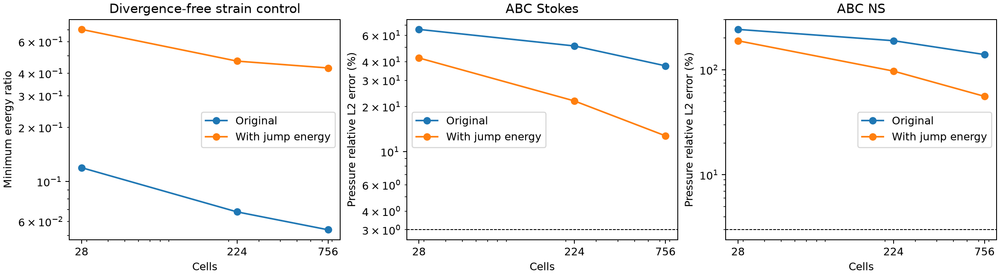
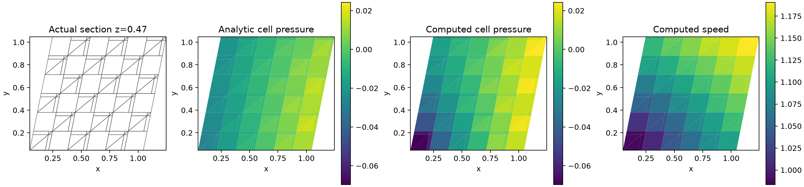

# 原生三维压力诊断与梯度跳变稳定化

2026-10-13；开发起点 `06e607a`。原生 TensorFVM 计算，未调用 OpenFOAM。

**当前结论：增强了混合黏性算子对速度变化的控制，压力误差明显下降，但三维 3% 门槛仍未通过。SST、壁面律及 SUBOFF 物理验收尚未完成。**

## 1. 为什么继续检查黏性算子

前一轮二维 Kovasznay 达标后，[三维 ABC 探针](../verification-native-kovasznay/abc-diagnostics/README.md)暴露了严重压力误差；连去掉对流后的 Stokes 对照也未通过。因此本轮分别检查静压、剪切和完整三维流，不把原因直接归到湍流模型或外迭代。

统一网格：单位盒棋盘分组，一部分保留六面体，另一部分分为六个四面体，共用实际三角面。施加仿射剪切 `(x,y,z)→(x+0.2y+0.1z,y+0.1z,z)`。n=2/4/6 对应 28/224/756 单元，拓扑与变形在原方案/修正方案之间相同。

三个独立连续方程控制，ρ=1、μ=0.1：

- 二次静压：`U=0, p=|x|²/2, f=x`。
- 三维剪切：`U=(y²,z²,x²), p=0, f=(-0.2,-0.2,-0.2)`，无对流 Stokes。连续黏性应力的散度明确非零，解析压力为零。
- ABC：使用既有独立 `abc_fields`，U 幅值 0.5、波数 0.7，全部三速度分量和三坐标均参与。NS 体力来自连续方程；Stokes 对照去除解析惯性加速度，保持该方程的准确解。

全边界用解析速度面积均值，压力固定一个单元参考值，内部初始速度为零。ABC 压力误差按既有三维规范去除常数规范后计算体积加权相对 L2；零压力剪切只报绝对误差，不构造零分母百分比。未修改参考场、删去测点或按结果拟合参数。

## 2. 检查能量非负还不够

原混合算子具有非负耗散，但这本身不能说明所有速度变化都受到充分控制。面自由度只约束面积平均值，重构速度在面上的切向变化仍可能有跳变。相关机制见 Hansbo 与 Larson，*Discontinuous Galerkin and the Crouzeix–Raviart element: application to elasticity*，式 (26)，[DOI](https://doi.org/10.1051/m2an:2003020)、[原始论文 PDF](https://www.numdam.org/item/M2AN_2003__37_1_63_0.pdf)。本文的多面体扩展须独立验证，不能直接沿用该文的全部理论结论。

本轮避免把偏应变能对体积膨胀的弱控制误认为不可压缩稳定性问题，同时列出：

1. 未加散度约束的偏应变能比。
2. 补回体积应变项后的完整对称应变能比。
3. **严格在实际离散 `B U=0` 空间内的最小能量比**，作为主要比较。

分母统一为完整梯度能加原有局部残差稳定化。第三项通过带约束的广义特征问题计算，独立检查特征方程残差及逐单元散度；没有只用投影后的试探随机向量代替最小特征值。

| 单元数 | η | 无约束偏应变比 | 完整应变比 | 散度为零时的比值 |
|---:|---:|---:|---:|---:|
| 28 | 0 | 0.094392 | 0.115212 | 0.119508 |
| 28 | 1 | 0.630916 | 0.677873 | 0.702679 |
| 224 | 0 | 0.017318 | 0.058618 | 0.067821 |
| 224 | 1 | 0.458522 | 0.464664 | 0.468070 |
| 756 | 0 | 0.006333 | 0.047939 | 0.053932 |
| 756 | 1 | 0.426501 | 0.427989 | 0.428792 |

这证明在所测网格上的控制增强；**不能据此宣称已经证明任意网格上的一致 Korn 下界**。机器汇总中 0.35 是本组固定网格的开发回归保护值，不是理论下界或物理精度门槛。新增项也不是全部压力误差的唯一根因。

## 3. 共性模块与牵引修正

新模块 `NativeGradientJump3D` 对每个内部面构造：

```text
J_f = G_owner − G_neighbor
C_f = (1/A_f) integral_face (x−x_f)(x−x_f)^T dA
Q_jump = Σ_f [η μ_harmonic A_f / d_f] tr(J_f C_f J_f^T)
```

`d_f` 为两单元中心之间的正法向距离，μ 使用两侧谐均值，η=1 在所有案例中固定。C 由实际面多边形的三角积分得到，半正定，且其法向投影为零。该项非负，对全域仿射速度（包括刚体旋转）为零，不惩罚仅法向导数跳变的分层剪切。

矩阵由同一二次能量组装为对称非负项。**数值牵引也同步修改**：先把各内部面能量对单元梯度的导数累加为 T_K，再通过本单元梯度矩阵 g_K 分配 `T_K g_K` 到单元/面反力。若只加矩阵、不修改牵引，界面动量和边界功就会不一致。

独立局部回放验证：矩阵功等于原黏性能量加跳变能；单元与面反力一致；内部总牵引相消；全域力与体力相抵；刚体旋转和仿射场不产生该稳定化力。随机状态、偏斜四面体、薄层混合单元和多边形面均覆盖。

默认向量黏性使用 `gradient_jump_stabilization=1`；设为 0 可复现本轮原方案。标量扩散不加此项。该改动未修复旧配点 `NativeViscous3D`，后者的已知增能反例仍保留。

## 4. 同网格原方案/修正方案结果

| 单元数 | 方程 | 方案 | 速度相对误差 | 去均值压力相对误差 | 两项均 <3% |
|---:|---|---|---:|---:|---|
| 28 | Stokes | 原方案 | 1.5236% | 65.7534% | 否 |
| 28 | NS | 原方案 | 5.0208% | 241.9517% | 否 |
| 28 | Stokes | 修正 | 1.1942% | 42.3361% | 否 |
| 28 | NS | 修正 | 4.1637% | 188.6145% | 否 |
| 224 | Stokes | 原方案 | 0.8705% | 50.9437% | 否 |
| 224 | NS | 原方案 | 2.9627% | 188.9132% | 否 |
| 224 | Stokes | 修正 | 0.4429% | 21.8331% | 否 |
| 224 | NS | 修正 | 1.7147% | 97.0523% | 否 |
| 756 | Stokes | 原方案 | 0.5679% | 37.5216% | 否 |
| 756 | NS | 原方案 | 1.9672% | 139.4630% | 否 |
| 756 | Stokes | 修正 | 0.2260% | 12.7602% | 否 |
| 756 | NS | 修正 | 0.9052% | 55.8190% | 否 |

零压力剪切的 756 单元压力绝对 L2 误差由 **0.056674** 降至 **0.019573**，仍未严格恢复零压力。ABC Stokes 压力误差从 **37.5216%** 降到 **12.7602%**，NS 从 **139.4630%** 降到 **55.8190%**；二者均未达标。

二次静压在 756 单元上的最大实际面速度由 2.3123e−4 降为 4.7108e−5，仍非严格零；没有只看较小的单元速度便宣称静压完全准确。相应原面速度保存在 NPZ 文件中，可直接核对。

所有 24 个控制求解均数值收敛；NS 要求当前动量、散度、速度变化和压力变化全部 <1e−8，Stokes 动量与散度 <1e−10。756 单元修正 NS 的全域动量收支误差 4.649e−10、能量收支误差 8.607e−10、内部牵引缺陷 1.199e−13。数值收敛和账本闭合均不能替代误差 <3%。





切面 z=0.47 来自真实单元面求交，不是中心散点插值或投影网格。云图使用保存的单元值；解析压力也是对应单元中心的参考值，双方独立去除体积均值并使用相同色标。图中仍可见压力差距。通用切面函数提取至 `native_sections3d`，原 SUBOFF 绘图入口保留兼容调用。

[谱/加密矢量 PDF](run/spectra-pressure.pdf)、[真实切面 PDF](run/section/mesh-pressure-speed.pdf)。所有求解使用联合原生 LU/GMRES 路径；本轮三维表格不能标记为 SIMPLEC 数据。SIMPLE/SIMPLEC 一致性继续由共同回归覆盖。

## 5. 回归、证据与复现

- [核心回归](tests.txt)：**110 passed, 1 xfailed**。已知失败为旧配点黏性的增能缺陷。
- 向量扩散的新 8→16 网格观察阶为 1.79961，未达到原 1.8 保护值；没有放宽阈值。继续到 32³ 后，16→32 保持原 >1.8 检验并通过。
- [切面与原绘图入口回归](section-tests.txt)：另有 **12 passed**。
- [机器汇总](run/summary.json)、[谱数据](run/spectra.json)、[全部案例](run/cases.json)。全部实际网格、速度、压力、通量、牵引、连续体力和迭代记录均保存。
- 运行前冻结加载源码，结束核对 SHA256。切面后处理另有[字段哈希与绘图源码清单](run/section/manifest.json)。趋势图为消除重叠坐标标签作了纯后处理重绘，依据相同 JSON，见[输入与绘图源码哈希](run/plot-sources.json)；没有重新拟合或修改计算数据。论文 PDF 只缓存于本地，不随仓库重分发；下载 SHA256 为 `19b792b88f6b9c45f6e3983ec3e84d6baed84fc2cfbed2e6c012345936421b32`。

```bash
OMP_NUM_THREADS=1 OPENBLAS_NUM_THREADS=1 PYTHONPATH=src \
/data/TensorFEM/.venv/bin/python scripts/verify_native_gradient_jump.py \
  --output results/native-gradient-jump-replay

OMP_NUM_THREADS=1 PYTHONPATH=src \
/data/TensorFEM/.venv/bin/python scripts/plot_native_pressure_diagnostic.py \
  --fields results/native-gradient-jump-replay/n6-jump1-abc-ns-fields.npz \
  --output results/native-gradient-jump-replay/section
```

输出目录需为空。稳定化/账本检查通过会返回 0，但 `abc_3d_pressure_accuracy_passed` 与 `physical_suboff_benchmark_passed` 仍为 false；不能把脚本退出码当作 SUBOFF 验收结果。

## 6. 剩余问题与下一步

本轮还用一个无体力三维势流作方向性预检：`U=(1+yz,1+xz,1+xy), p=−|U|²/2`。它严格无旋、无散，ΔU=0，对任意恒定黏度都满足无体力 NS。固定 224 单元，μ=1/0.1 的已收敛速度误差分别为 0.842%/7.362%，压力误差为 25.930%/35.496%；μ=0.01/0.001 在 100 步内未通过原收敛门槛。见[探针脚本](probes/unforced_potential.py)及[原输出](probes/unforced-potential.txt)。这只有标量记录，不作为完整 benchmark 验收证据。

因此剩余问题不只存在于有体力 ABC。下一步优先检查小黏度下惯性与压力的离散兼容性、共享面重构及受限高阶输运，再做三维误差与规模加密。禁止将本轮修正视为已经具备高 Re SUBOFF 能力。此前 Kovasznay 大网格结果属于各自冻结源码；新默认算子的完整物理验收还需重跑。

整体仍按[原生 SUBOFF 计划](../native-suboff-development-plan.md)持续开发，物理 Cp/Cd <3% 的目标保持不变。
