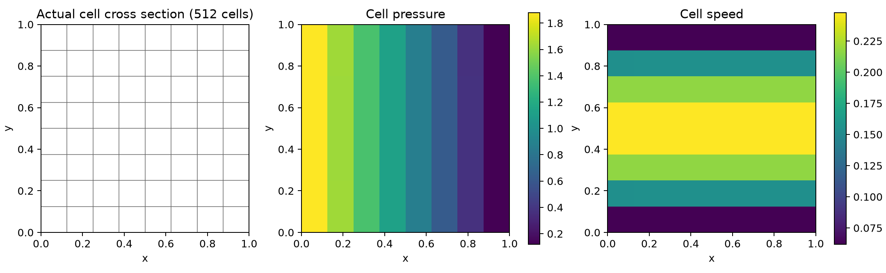
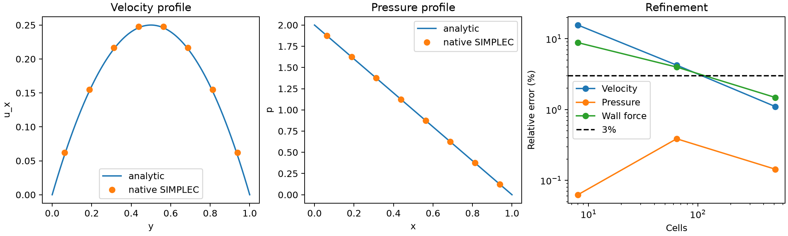

# 原生 TensorFVM 修复：混合黏性算子接入 Stokes / SIMPLE / SIMPLEC

日期：2026-10-12；开发起点：`0c1d8c9`。

**本报告全部由原生 TensorFVM 计算，没有调用 OpenFOAM。新混合后端的 Stokes 验证通过；旧配点 SIMPLE/SST 与 SUBOFF 尚未修复。**

## 1. 本次实际修复范围

此前能量型 `NativeHybridViscous3D` 只能单独求解全 Dirichlet 扩散问题。本次完成：

- 增加混合速度/牵引边界，保留实际共享面未知量与守恒。
- 新增显式选择的 `NativeHybridStokes3D`，将能量型黏性方程接入不可压缩压力速度耦合。
- 实现该后端的 SIMPLE、SIMPLEC 及原生联合 LU 对照求解，统一检查完整当前方程。
- 压力功使用实际面散度的负转置；压力修正直接更新面速度，面通量由同一面速度计算。
- 失败线性候选值不能覆盖已接受状态。线性门槛为原方程右端相对残差 1e−9，不使用放宽容差或裁剪场变量换取通过。

这是新混合后端的接入，不是向旧配点算法打补丁。默认旧求解路径没有静默切换；`run_native_suboff_rans.py` 仍不能获得本报告的验证资格。原耗散性 `xfail(strict=True)` 保留。

| 状态项 | 本轮结果 |
|---|---|
| 混合黏性算子接入压力速度方程 | 已完成 Stokes 范围 |
| 混合 Dirichlet / 总牵引边界 | 已验证 |
| SIMPLE/SIMPLEC 与联合求解的一致性 | 已验证 |
| 压力驱动通道速度、压力、壁面力 <3% | 512 单元通过 |
| 原 `NativeViscous3D` 的耗散性缺陷 | **仍存在** |
| 对流、SST、Spalding 接入新后端 | **未完成** |
| SUBOFF 数值收敛、Cp/Cd <3% | **未达标** |
| GPU、大网格性能 | 未测试 |

## 2. 方程与能量约束

黏性部分复用[混合算子基础报告](../verification-native-hybrid-foundations/README.md)的单元非负能量与仿射残差稳定项。保留单元速度和共享面速度，不形成稠密的全局消元矩阵。

令 `A` 为自由速度的黏性矩阵，`B` 为真实共享面速度的积分散度，`b` 为已知边界通量源：

```text
A U − Bᵀ p = f
B U = b
```

全速度 Dirichlet 边界使用一个压力参考点，且仍检查被参考点替代的单元连续性。开放边界规定的是总牵引 `(τ−pI)n`，包含黏性切向应力；移植其他求解器的压力出口设置时需重新核对边界方程。

SIMPLE 使用松弛后对角的逆 `R`，SIMPLEC 使用同分量邻居和修正，分母保护为 `0.1 aP_relaxed`，触发数写入历史：

```text
(B R Bᵀ) dp = b − B U*
U ← U* + R Bᵀ dp
p ← p + αp dp
```

因此压力修正矩阵由实际散度及其转置构成。新后端不使用旧配点 Rhie–Chow 的高阶重构矩阵。矩阵的能量性质不代表已经证明任意网格上的空间收敛率或 RANS 稳定性。

计算记录同时核对黏性能量、压力功、外力/边界功、共享面总牵引平衡。共享面应平衡的是总牵引，不能在存在压力跳跃时只检查黏性牵引。

## 3. 原两单元反例复测

复用原来的几何与速度 `u0=(1,0,0), u1=0`，静止边界，μ=1。原算子仍有 `dE/dt=+4.83280454`；混合算子为 `−68.20437956`。

本轮进一步扫描 21 档几何变形，并对每档两单元模型消去共享面，检查全部六个单元速度自由度的对称矩阵。最小特征值在全部扫描中保持正值，跨扫描最低为 **7.52902**。这避免只用一个恰好耗散的速度样本判断修复。

原几何、薄层六面体—金字塔—四面体过渡网格的混合边界，以及常压力/无散仿射速度解析解均进入测试。能量非负是该混合构造的性质；耗散率数值更大不代表物理精度更高。

[扫描原始数据](run/energy-sweep.json)。

## 4. 压力驱动通道：问题与边界

单位立方体，μ=ρ=1，Stokes 方程、零体力。解析解为：

```text
u = (y(1−y), 0, 0)
p = 2(1−x)
τxy = τyx = 1−2y
```

- x=0/1：给定解析总牵引，速度由方程求解。
- y=0/1：静止无滑移壁面。
- z=0/1：给定解析速度分布，模拟无限宽平行板通道的截取段，并非四壁无滑移的矩形管道。
- 边界量按面心采样，其积分误差包含在网格加密误差中。内部速度和压力均从零状态开始，不用参考解初始化。
- 网格为 2³、4³、8³ 个六面体，共享四边形面确定性拆分为三角形。这里的规则网格用于基础解析验证；混合畸变网格另由小案例覆盖，尚无曲面外流验证。

### SIMPLEC 实际结果

误差为体积加权相对 L2；壁面力为两块 y 壁面的总流向牵引，解析值 −2。

| 单元数 | 迭代数 | 速度误差 | 压力误差 | 壁面力误差 | 三项均 <3% |
|---:|---:|---:|---:|---:|---|
| 8 | 268 | 15.6215% | 0.0627% | 8.8156% | 否 |
| 64 | 687 | 4.2448% | 0.3869% | 3.9850% | 否 |
| 512 | 2089 | **1.1017%** | **0.1437%** | **1.4808%** | 是 |

压力误差不是全程单调下降，8 单元压力恰好很小不能当作网格已收敛的证据。速度在最后两档观察阶约 1.95；壁面力仍有较明显空间误差，不声明普遍二阶或严格网格无关。

SIMPLE、SIMPLEC、原生联合求解共 9 次均检查至当前动量残差 <1e−10、逐单元散度 <1e−10。512 单元的 SIMPLE 和 SIMPLEC 均需 2089 步，本案例没有证明 SIMPLEC 加速。

[全部结果](run/cases.json)、[算法间逐场差异](run/algorithm-comparison.json)、[机器可读验收](run/summary.json)。每次运行均保存单元/面速度、压力、通量、总牵引、实际几何以及完整迭代历史。



图中云图直接显示对应单元值，没有平滑拟合。截面为 z=0.4375 的单元层。



速度曲线取 x=0.5625、z=0.4375，压力曲线取 y=0.5625、z=0.4375。矢量图：[网格与流场 PDF](run/mesh-fields.pdf)、[曲线 PDF](run/profiles-refinement.pdf)。

## 5. 软件使用与复现

```bash
OMP_NUM_THREADS=1 OPENBLAS_NUM_THREADS=1 PYTHONPATH=src \
/data/TensorFEM/.venv/bin/python scripts/verify_native_hybrid_flow.py \
  --output results/native-hybrid-flow-replay
```

输出目录必须为空。该脚本只以本轮 Stokes 局部验收决定退出码；`legacy_suboff_fixed`、`sst_integrated`、`physical_suboff_benchmark_passed` 均明确为 false。运行前冻结生产代码并保存 SHA256，运行后检查源文件没有变化。

Python 接口：

```python
from tensorfvm.verification.native_hybrid_flow import channel_solver
mesh, solver = channel_solver(8)
result = solver.solve(algorithm="simplec", tolerance=1e-10, max_iterations=6000)
```

共性后端为 `tensorfvm.native_hybrid_stokes3d.NativeHybridStokes3D`。生产接口只接受已实现的 Stokes 物理项，没有接收并忽略对流或湍流参数。

回归测试 **71 passed, 1 xfailed**，见 [完整测试](tests.txt)。最终线性残差审计修改后另复测新流动模块，见 [最终模块测试](final-tests.txt)。已知失败仍指向旧黏性算子；新后端的测试通过不将其消除。

## 6. 下一步攻关顺序

1. 在联合单元/面速度方程上加入守恒对流，验证黏性—对流动量平衡与有限 Re 层流案例；同时解决直接求解的规模成本。
2. 接入切向 Robin/Spalding 壁面律，验证壁面功和力积分；保留正常向压力/速度约束。
3. 接入 SST 的变黏度、k/ω 扩散和当前非线性残差检查。旧 k/ω 扩散也使用缺陷算子，不能只替换动量黏性后就宣称 SST 修好。
4. 再把原生求解器用于合格贴体网格上的 SUBOFF，与外部 OpenFOAM 参考解分别对照 Cp、压力阻力、摩擦阻力和总阻力。

当前停止在第一阶段原生 Stokes 修复验收，SUBOFF 仍不具备误差小于 3% 的原生验证结果。
