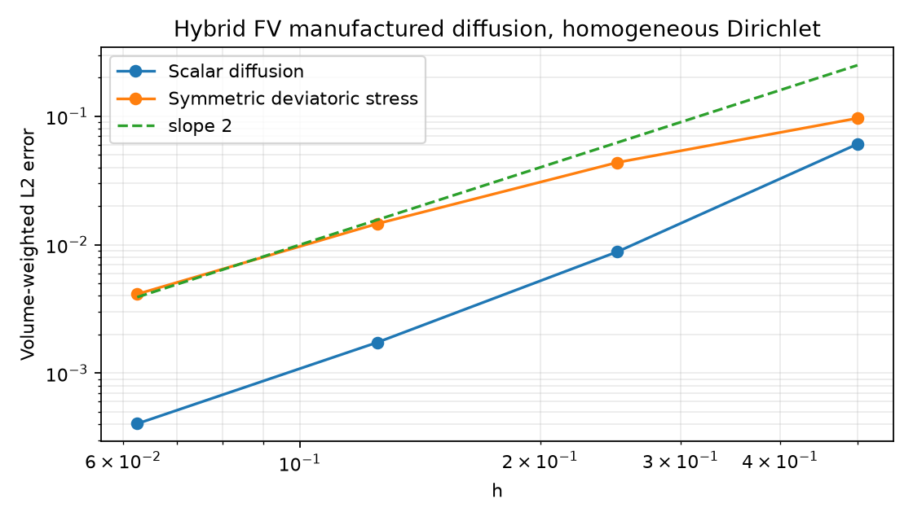

# 原生 FVM 基础攻关：能量型混合黏性离散与压力病态诊断

日期：2026-10-12。开发起点：`e4ba7910a90b4066ed835a06628e49711efa4eb1`。

## 状态与本轮变更

本轮实现独立的 `NativeHybridViscous3D` 验证算子，使用单元与共享面未知量，从非负离散黏性能量构造方程。
它在两单元反例、薄层混合网格和原 SUBOFF 网格速度样本上恢复了耗散性，并完成制造解加密检查。
**该实现尚未接入 SIMPLE/SST/壁面函数；原生产黏性算子的缺陷和 SUBOFF 压力失败均仍然存在。**

生产 SIMPLE 本轮只增加失败矩阵诊断：原方程相对残差、后向误差、行列尺度、负对角数和候选解幅值。
不修改压力接受门槛，不提交失败候选值；较小的后向误差不替代原方程残差门槛。

| 项目 | 结论 |
|---|---|
| 新混合算子的能量与共享面守恒检查 | 通过本轮测试 |
| 标量/向量扩散制造解加密 | 最细两档观察阶分别为 2.10 / 1.82 |
| 原 `NativeViscous3D` 缺陷 | **未修复，原回归继续 xfail** |
| 新算子接入 SIMPLE/SST | **尚未完成** |
| 压力线性求解失败 | 已进一步定位病态性，**未解决** |
| SUBOFF 收敛、Cp/Cd <3% | **未达标** |

[机器可读状态](run/summary.json)。

## 1. 离散方法与边界

标量部分依据 Droniou、Eymard、Gallouët、Herbin 的 [Hybrid/Mimetic/Mixed FV 统一框架，§2.2 的式 (2.16)–(2.24)](https://arxiv.org/abs/0812.2097)，使用单元 Gauss 梯度及仿射残差稳定项。
对称偏应力向量扩展是本项目实现；本文献的标量理论不直接当作本项目完整流动求解器的证明。

令单元 K 的体积为 V，面外法向面积向量为 S，单元中心到面心的向量为 r，法向距离为 d>0：

```text
G_K = Σ_f (u_f − u_K) ⊗ S_Kf / V_K
R_Kf = u_f − u_K − G_K r_Kf
Q_K = 2 μ_K V_K ||dev sym G_K||²
      + Σ_f μ_K |S_Kf| / d_Kf ||R_Kf||²
```

标量模式将第一项改为 `μ_K V_K |G_K|²`。稳定系数取固定值 1，没有按 SUBOFF 实验数据或特征值调参。
每个局部二次型均非负；对全静止 Dirichlet 边界，在内部面满足牵引平衡后，有 `dE/dt = −Σ_K Q_K ≤ 0`。
共享面的两个局部牵引通过面未知量的平衡方程相消。仿射场 R=0；刚体转动的对称应力也为零。

这是新的离散构造，未截断旧算子的负特征值。数值耗散率的大小不能当作物理精度改善率。

当前接口限制：

- 只支持所有外边界给定 Dirichlet 值；尚未支持压力出口配套的速度边界、Spalding 切向 Robin 条件或混合应力边界。
- 黏度为正的标量或单元数组；尚未对 RANS 总黏度、壁面分子黏度及其切换做耦合验证。
- 面法向距离必须为正；采用 CPU 稀疏直接求解或对角预条件 CG，原方程真残差仍须通过检查。
- 单元速度消去内部面变量后的能量性质不等于完整不可压缩压力—速度系统已经稳定。

## 2. 原反例复测

两单元几何与速度完全复用[上一轮小案例](../verification-native-small-cases/README.md)。
薄层过渡控制例由厚度 0.01 的六面体、金字塔和四面体组成，共享面确定性三角化。
SUBOFF 检查复用原 9,068 单元几何和原速度样本，没有改换速度来回避反例。
所有案例外边界静止，ρ=μ=1，无对流、压力和外力。

| 案例 | 单元数 | 原算子 dE/dt | 新混合算子 dE/dt | 共享面牵引不平衡最大值 |
|---|---:|---:|---:|---:|
| 强偏斜四面体对 | 2 | +4.83280454 | −68.20437956 | 3.55e−15 |
| 薄层混合过渡 | 3 | −204.05372937 | −203.69936655 | 3.11e−15 |
| SUBOFF 原速度样本 | 9,068 | +0.24579039 | −0.50298114 | 1.94e−13 |

[原始能量记录](run/energy.json)及各案例 `*-fields.npz` 保存单元速度、面速度和面牵引。
SUBOFF 能量账本误差为 1.44e−15；面平衡 CG 550 次迭代，原方程相对残差 9.95e−12。
保留单元与内部面速度后的矩阵为 **92,793 个未知量、2,720,337 个非零元**；这不是原 SIMPLE 动量系统的直接替换。

## 3. 精度检查：制造解扩散问题

单位立方体、零 Dirichlet 边界、μ=1，网格为三角化面的六面体，n=2/4/8/16。
标量解取 `φ=sin(πx)sin(πy)sin(πz)`，解析源为 `3π²φ`。
向量解取 `u=(φ,0,0)`，解析源由 `−Δu−(1/3)∇div u` 独立计算。
它是对称偏应力扩散的制造解，未加压力或无散约束。

| 单元数 | 标量体积加权 L2 误差 | 向量体积加权 L2 误差 |
|---:|---:|---:|
| 8 | 6.08167e−2 | 9.66567e−2 |
| 64 | 8.81714e−3 | 4.37460e−2 |
| 512 | 1.73523e−3 | 1.45764e−2 |
| 4,096 | 4.03868e−4 | 4.12525e−3 |

最细两档观察阶：标量 **2.103**，向量 **1.821**。向量在 64→512 单元时只有 **1.586** 阶，原三档测试未过 1.8 阶门槛；增加至 4,096 单元后才通过该门槛，没有降低要求。
当前数据支持趋向二阶，不宣称任意畸变混合网格都已获得二阶物理精度。



[完整加密记录](run/convergence.json)。这些制造解结果不能计入 SUBOFF 的 3% 达标数量。

## 4. 压力系统：病态性与误差门槛

从上一轮保留的初始 SUBOFF 状态重新组装第一次 SIMPLE 压力方程，保存矩阵、右端项和候选压力增量。
矩阵规模 9,068×9,068，非零元 725,091。

诊断显示该矩阵的 1-范数条件数估计在 **2×10¹²** 量级；该数值是估计值，不是精确条件数。
原 LU 解的右端相对真残差约 **5.46e−8**，但范数后向误差约 **2.96e−16**。
这说明“LU 的后向误差接近机器精度”与“当前右端相对残差达到 1e−9”不是同一要求。

同时观察到压力增量最大绝对值约 **3.73×10⁴**。行列缩放及扩展精度残差驱动的迭代改进将右端相对残差降低至约 **4.96e−9**，但未达到原 1e−9 门槛，异常大的压力增量仍在。
因此未以缩放、放宽容差或接受大幅候选场宣称修复。
14 个负对角元仅作为进一步定位线索；不单独据此判定完整矩阵不可解。

[全部压力诊断与缩放试验](run/pressure.json)，[冻结压力矩阵](run/pressure-matrix.npz)，[右端项与候选增量](run/pressure-candidate.npz)。
失败后仍保持 **0 个被接受动量步**，u、p、q 完全保持原状态。

## 5. 复现与证据

```bash
OMP_NUM_THREADS=1 OPENBLAS_NUM_THREADS=1 MKL_NUM_THREADS=1 PYTHONPATH=src \
/data/TensorFEM/.venv/bin/python scripts/verify_native_hybrid_foundations.py \
  --output results/native-hybrid-foundations-replay
```

输出目录必须为空。脚本默认使用仓库中的上一轮 SUBOFF 初态与速度样本；输入哈希见 `run/inputs.json`。
**当前脚本退出码为 2**，因为生产流动验证仍未完成；子算子检查通过与生产修复状态分别记录。
`run/source-snapshot/` 和 `run/sources.json` 保存运行所用源代码及 SHA-256。

本次 **66 passed, 1 xfailed（40.73 秒）**。[回归测试结果](tests.txt)包含新算子验证、原 SIMPLE/SST/壁面函数、线性失败状态保护和已知耗散性失败。
原算子的 `xfail(strict=True)` 保留，不用新算子的通过结果将其覆盖。

## 6. 下一步接入要求

1. **混合动量方程**：设计面未知量的稀疏消元或联合求解路径，保留实际面平衡；不能用旧单元矩阵接口假装已经接入。
2. **边界条件**：先验证混合 Dirichlet/牵引边界，再加入无穿透与切向 Robin 壁面律，检查壁面功和力积分。
3. **压力—速度兼容性**：从新动量响应推导压力修正，先做 Stokes 通道与偏斜网格；继续检查当前病态压力矩阵的局部重构来源。
4. **SST 耦合**：验证总黏度更新、k/ω 扩散和壁面约束的兼容性，再回到 SUBOFF 启动、网格收敛与实验对照。

本轮没有完成上述接入工作，也未运行新的合格 SUBOFF 流场。
