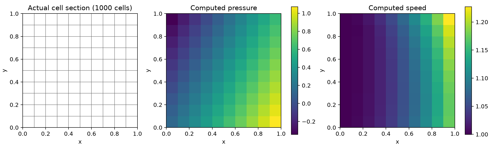
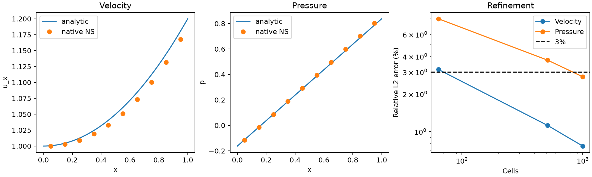

# 原生 TensorFVM：有限 Re 对流接入与压力—体力平衡修复

日期：2026-10-12。开发起点：`2b52448`。全部由原生 TensorFVM 计算，没有调用 OpenFOAM。

## 1. 本次推进范围

在[混合 Stokes 后端](../verification-native-hybrid-flow/README.md)上完成：

1. 共性共享面迎风动量输运，使用实际面速度产生的体积通量；支持明确给定的入口/回流速度。
2. 可选线性迎风重构，梯度来自当前混合面速度的 Gauss 积分，作为守恒延迟修正。
3. Picard 外迭代与原有 SIMPLE、SIMPLEC、联合 LU 内求解相接。最终验收重新计算**当前速度、当前通量、当前高阶修正**下的非线性残差。
4. 修复新混合后端的体力加载与压力梯度不平衡；同时修正输出牵引，保持逐单元和全域动量守恒。

本轮验证是有限 Re 的解析制造解，尚不是无体力外流实验 benchmark。旧配点黏性缺陷仍存在；新后端尚未接入 SST、Spalding 或 SUBOFF。

## 2. 对流离散与能量检查

内面共享质量通量 `q=ρ U_f·S_f`，基础迎风动量通量为 `q U_upwind`；边界流入使用显式给定的速度，流出使用内部重构。共享面只生成一份通量，在相邻单元中反号积分。

一阶格式具有以下离散能量恒等式（不要求输入通量已经无散）：

```text
Σ_K U_K · C_K
 = 1/2 Σ_K div(q)_K |U_K|²
 + 边界动能通量
 + 1/2 Σ_internal |q_f| |U_owner−U_neighbor|²
 + 1/2 Σ_inflow |q_f| |U_owner−U_inflow|²
```

内面/入口耗散项非负。二阶线性迎风附加项有符号，其功单独记录为 `deferred_correction_power`。**本轮二阶重构未加限制器，不宣称无条件耗散、有界或适用于高 Re 强分离流。**

随机面通量、偏斜四面体、薄层混合网格上的测试保留散度功项，核对矩阵组装、独立通量积分和能量恒等式。制造解测试另检查非线性全动量方程与总能量收支。

## 3. 找到并修复的压力—体力缺陷

### 3.1 独立静水平衡控制

单位立方体，8 单元，μ=1：

```text
u=0
p=0.4 + 0.7x − 0.3y + 0.2z
f=grad(p)=(0.7,−0.3,0.2)
```

该控制没有对流、湍流或壁面函数。旧加载方式仅把 `V_K f_K` 放入单元速度方程，但混合压力梯度作用于共享面速度方程，不能严格平衡同一常体力。

| 加载方式 | 最大非物理速度 | 最大压力绝对误差 |
|---|---:|---:|
| 原单元加载 | 0.0239753 | 0.230769 |
| 修复后的面加载 | 1.68e−17 | 6.66e−16 |

两者线性方程都可数值收敛；原结果说明“解出离散方程”不能替代解析一致性检验。

### 3.2 修复构造

对单元 K 的每个面，外向面积向量为 S、单元中心到面心为 r，构造体力面载荷：

```text
L_Kf = (f_K · r_Kf) S_Kf
Σ_f L_Kf = V_K f_K
```

后一个等式来自实际几何矩恒等式。面载荷与面速度做功；常体力对应的线性压力梯度在相同自由度上抵消。力通量必须同时进入报告的数值牵引：

```text
t_Kf = viscous_flux_Kf − p_K S_Kf − L_Kf
```

若只修改右端、不修改牵引，力积分会与求解方程不一致。测试覆盖全速度边界、混合牵引边界、强偏斜四面体和薄层混合网格，检查压力平衡与逐单元载荷守恒。

混合后端默认 `body_force_discretization='face'`；`'cell'` 仅保留用于可复现的前后对照。该修复没有修改旧配点 `NativeViscous3D`。

## 4. 有限 Re 解析制造解

单位立方体，ρ=1，μ=0.1，参考速度与长度均为 1，因此 Re=10。令 a=0.2：

```text
u = (1+a x², −2a xy, 0)
p = x − y/2 + z/4
(u·grad)u = (2ax(1+a x²), −2ay+2a²x²y, 0)
f = (u·grad)u + grad(p) − μ(2a,0,0)
```

速度严格无散、对流加速度非零。制造体力直接由连续方程解析推导，测试以有限差分独立核对；未由离散残差反推源项。速度为二维变化、沿 z 挤出的解析流动，压力沿 z 线性变化；这不是一般三维涡流验证。

所有外边界给定速度的真实面积平均值，以 Gauss 面积分保证总边界通量平衡；压力只固定一个单元参考值。内部速度和面速度从零状态开始，只有边界使用解析值。单元体力采用中心求值，其积分误差保留在加密研究中。

### 4.1 同一 512 单元网格上的方法对照

| 方法（同为原生联合求解） | 速度误差 | 压力误差 | 两项均 <3% |
|---|---:|---:|---|
| 原单元加载 + 一阶迎风 | 3.6418% | 14.9777% | 否 |
| 修复后面加载 + 一阶迎风 | 1.0293% | 5.4363% | 否 |
| 修复后面加载 + 线性迎风 | 1.1200% | 3.7349% | 否 |


### 4.2 修复后线性迎风的网格加密

| 单元数 | 外迭代数 | 速度误差 | 压力误差 | 两项均 <3% |
|---:|---:|---:|---:|---|
| 64 | 14 | 3.1446% | 8.0074% | 否 |
| 512 | 12 | 1.1200% | 3.7349% | 否 |
| 1,000 | 12 | 0.7654% | 2.7477% | 是 |


误差为体积加权相对 L2，压力参考值按同一解析压力固定。这里的 3% 是两项全场范数门槛，**不表示每个点误差 <3%，也不是 SUBOFF 的 Cp/Cd 误差**。所有粗网格与未达标方案均保留。

最细 **1,000 单元**案例经过 **12 次外迭代**收敛，速度误差 **0.7654%**、压力误差 **2.7477%**，本轮解析范数门槛通过。当前非线性动量残差 7.947e-10，逐单元散度最大值 4.406e-13；全域动量收支误差 8.565e-10，能量收支误差 1.788e-10。

最后两档观察阶为速度 **1.71**、压力 **1.38**。二阶是面重构的选项名称，当前数据不能宣称整体二阶。粗网格和一阶方案仍未通过精度门槛；CPU 总验证耗时约 401 秒，不作为性能基准。

大网格使用原生联合 LU 作为非线性离散验证路径。SIMPLE/SIMPLEC 与联合求解在同一 27 单元、相同二阶离散上交叉验证；**未将较大网格结果标为 SIMPLEC 结果**。算法差异、外层与内层历史分别保存。





云图直接显示计算单元值，没有平滑拟合。图中截面和曲线位置由最细网格的中央单元层确定，详见运行脚本。另存矢量 [网格/流场 PDF](run/mesh-fields.pdf)、[曲线 PDF](run/profiles-refinement.pdf)。

## 5. 验收与复现

[机器可读状态](run/summary.json)、[全部计算结果](run/cases.json)、[静水平衡对照](run/hydrostatic.json)、[算法对照](run/algorithm-comparison.json)。每次案例保存实际网格、速度、面速度、压力、通量、力、内外迭代历史；运行前冻结源文件并在结束时核对 SHA256。

```bash
OMP_NUM_THREADS=1 OPENBLAS_NUM_THREADS=1 PYTHONPATH=src \
/data/TensorFEM/.venv/bin/python scripts/verify_native_hybrid_ns.py \
  --output results/native-hybrid-ns-replay --fine-n 10
```

输出目录必须为空。默认数学案例选用二阶重构作加密验证，同时保留一阶和原体力加载方式作对照。生产类默认对流阶数仍为 1，使用二阶须显式指定。

```python
from tensorfvm.verification.native_hybrid_ns import polynomial_solver
mesh, solver, exact = polynomial_solver(4, reynolds=10, convection_order=2)
result = solver.solve(algorithm="simplec", tolerance=1e-8)
```

生产类为 `NativeHybridNavierStokes3D`，与 Stokes 后端共用压力速度求解。`viscosity` 为动态黏度，`body_force` 为单位体积力；本例密度为 1。牵引开放边界必须显式提供 `backflow_velocity`，不能把未知回流速度偷偷取作内部值。

完整回归 **90 passed, 1 xfailed**，见 [测试原始输出](tests.txt)。随后增加真实开放边界回流控制并复测 NS 模块，**20 passed**，见 [补充测试](backflow-tests.txt)；这些测试与完整回归有重叠。已知失败项仍为旧配点黏性算子的增能缺陷，未删除或放宽。

后续进展：[无体力 Kovasznay 流与对称面验证](../verification-native-kovasznay/README.md)。

## 6. 当前边界与下一步

- 有限 Re 层流的守恒对流与压力速度耦合已接通；本轮仅验证 Re=10 的光滑制造解。
- 高阶重构尚无有界性保证，需继续做无体力层流参考案例和受限高阶对流验证。
- 新后端尚缺切向 Robin/Spalding 壁面律、SST 变黏度和 k/ω 输运耦合。
- 原旧配点黏性耗散性缺陷保留已知失败测试；原生 SUBOFF 仍未达标。
- 当前为 CPU 稀疏直接求解，没有 GPU、并行扩展或工业规模性能声明。
