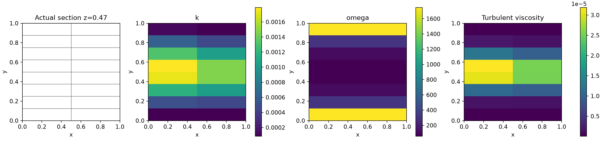
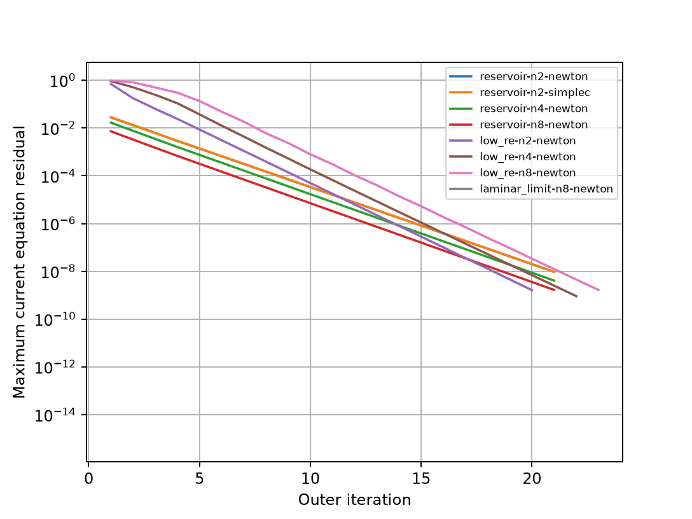

# 原生混合后端：动量—SST 耦合与低 Re 壁面控制

## 1. 本阶段解决的问题

[上一阶段](../verification-native-hybrid-scalar/README.md)实现守恒标量与 SST 一步更新，
但尚未连接动量，也不能判断原始非线性输运方程是否收敛。
新增 `NativeHybridRans3D` 将当前原生 NS、变黏度应力和 k/ω 输运连接起来。

本报告是**求解器耦合控制验证**。网格为 4、8、16 单元，足以检查接口、残差与反例，
不作为工程网格研究或高 Re 湍流精度证据。基于顶板速度的 Re 为 3。
本阶段没有实验湍流误差指标，`turbulent_accuracy_verified=false`；
SUBOFF 的 Cp/Cd、壁面函数、一般多面体正值性均未验收。

## 2. 求解和压力约定

动量使用动态有效黏度 `μ_eff=ρ(ν+ν_t)`。更新时重新构建黏性应力及梯度跳变项，
并清除旧 LU 与 AMG 缓存、旧收敛标志。边界载荷、已接受速度和压力作为下一次初值保留。
非法黏度在替换算子前被拒绝；变黏度结果与新建求解器独立对照。

不可压缩 SST 精确应力中的各向同性项通过修正压力处理：

\[
p^*=p+\frac23\rho k,\qquad p=p^*-\frac23\rho k.
\]

动量求解 `p*`；RANS 输出 `pressure`/`physical_pressure` 为恢复后的物理压力，
并单独输出 `modified_pressure`。总数值牵引保存四部分：
物理压力、有效偏应力、各向同性湍流应力、原有离散惯性/体力修正。
四部分相加必须等于实际守恒牵引，不能把修正压力直接用于后续实验 Cp。
本报告闭合边界参考为 `p*[0]=0`；有物理压力出口时，调用者仍需正确提供相应总牵引。

每轮先按当前湍流黏度求动量，再求冻结 k/ω 隐式更新，对单元和面状态一起松弛。
随后用新 k/ω、面梯度、速度梯度重新计算闭合、黏度与所有稳态残差。
不含伪时间项的当前标量残差包括**所有单元方程及自由面平衡方程**；
仅检查 owner 共享通量无法发现面未知量未平衡的问题。

归一化标量残差分母由 Dirichlet 载荷、Neumann 载荷、当前源项与对流项范数构成；
未使用上轮冻结线性残差替代。各方程及边界误差、全状态变化均小于 `1e-8` 才标记数值收敛。
残差尺度与完整自由方程残差保存在 NPZ，可重新计算。

## 3. 控制工况与结果

网格为 `[0,1]^3` 中 `2×n×1` 六面体。
所有速度边界给定 `U=(0.3 y,0,0)`，分子运动黏度 `ν=0.1`、密度 1。
上下边界对应静止/移动壁面，其余面是指定剖面边界。
这些侧边界并非周期边界，也不代表已经建立无限宽湍流通道。

### 非零湍流边界控制

所有标量边界固定 `k=0.01, ω=2`，初始内部同值；这是用于耦合检查的边界标量供给，
**不是物理无滑移壁面的 k 条件**。面采用三角剖分。
4、8、16 单元均收敛，场内黏度实际变化；原场与迭代记录见 `reservoir-*` 文件。

4 单元上的 SIMPLEC 与联合 Newton 对照使用相同方程、初值、容差与标量更新。
最大绝对差为速度 `3.18e-10`、修正压力 `2.46e-10`、k `4.05e-12`、ω `4.53e-10`。
这里证明小规模耦合结果一致，不证明 SIMPLEC 已在 SUBOFF 大网格上成熟。

### 低 Re 壁面条件控制

上下壁面设置 `k=0`、`ω=60ν/(β1 d1²)`，其余边界继续固定供给标量。
壁距为两个平面壁面的精确最近距离；初始 ω 使用边界驱动的原生扩散解。
这里测试的是低 Re SST 边界条件，**不是壁面函数**。

本组保留六面体的平面四边形面。下节保留三角剖分导致的失败。

| 单元数 | 外迭代 | 当前动量残差 | 当前 k 残差 | 当前 ω 残差 | 数值收敛 |
|---:|---:|---:|---:|---:|:---:|
| 4 | 20 | 6.35e-10 | 1.63e-9 | 9.92e-14 | 是 |
| 8 | 22 | 8.91e-10 | 9.16e-10 | 1.26e-13 | 是 |
| 16 | 23 | 7.71e-10 | 1.68e-9 | 2.64e-12 | 是 |

没有裁剪 k/ω。壁面 k 精确为零，全部 ω 为正。
最细控制网格能量闭合 `9.61e-11`，整体动量闭合 `6.05e-11`。
因为网格加密同时改变依赖 d1 的离散壁面 ω，本表不单独构成连续物理量的网格收敛证明。




图来自实际网格与 `z=0.47` 平面的相交多边形，未进行空间平滑。

### 独立层流极限

令 `k=0`，则 `ν_t=0`、`F1=0`；取常量 `ω=0.3√(0.44/0.0828)`，
连续 ω 生产和破坏相抵。精确速度为 `U=(0.3y,0,0)`，顶板剪切力为 `ν×0.3=0.03`。
16 单元速度最大误差 `2.22e-16`，顶板剪切力相对误差 `1.62e-15`，k 保持零。
这是独立方程和力约定检查，不把层流极限当作湍流精度验证。

## 4. 已确认且保留的缺陷

1. 均匀内部 ω=2 与较大的低 Re 壁面 ω 直接做面平衡，会产生负面 ω。
   [最初失败配置、冻结源码与日志](initialization-failure/failure.json)保留。
   边界扩散初始化解决了这一初值问题，但没有解决所有后续正值问题。
2. 继续使用三角剖分的六面体面时，第一次 k 输运仍出现**负面 k**：
   最小单元 k 为 `4.50336e-4`，最小面 k 为 `-1.08969e-3`。
   线性残差 `1.04e-16`、单元收支 `6.57e-19`，说明线性收敛与守恒并不能保证物理正值。
   [失败判定](rejected-triangle-wall.json)和[未裁剪候选原场](rejected-triangle-wall-candidate.npz)均保存。
3. `HybridSSTAdmissibilityError` 携带被拒绝的候选场及收支。
   RANS 层不会把该候选写入已接受的 k/ω。此时动量子步可能已更新，整个外迭代尚不具备事务回滚。
4. 保留四边形面可以使本组正交六面体控制通过；这没有修复任意偏斜多面体的离散最大值原理。
   当前标量混合扩散是能量稳定算子，尚非一般有界输运算法。

下一步需处理多面体标量正值与强壁面源项，随后补充有独立参考数据的湍流通道/平板、
壁面分辨率和剪切力验证，才进入原生 SUBOFF 工况。

## 5. 复现与证据

```bash
export OMP_NUM_THREADS=1 OPENBLAS_NUM_THREADS=1 PYTHONPATH=src
python scripts/verify_native_hybrid_rans.py --output results/reproduce-hybrid-rans
python scripts/audit_native_hybrid_rans.py results/reproduce-hybrid-rans
python -m pytest -q tests/test_native_hybrid_rans3d.py tests/test_native_hybrid_scalar3d.py tests/test_native_hybrid_sst3d.py tests/test_native_sst3d.py tests/test_native_hybrid_newton3d.py tests/test_native_block_solver3d.py tests/test_native_hybrid_stokes3d.py tests/test_native_hybrid_ns3d.py
```

[78 项回归通过](tests.txt)。包括缓存失效/非法黏度、当前残差与瞬态残差区分、
自由面平衡、非零耦合收敛、过期收敛标志拒绝、密度 1.7 的压力/黏度约定、低 Re 四边形控制和三角面反例。
既有 NS、Newton、SIMPLE/C 和分块线性检查同步通过。

[配置](settings.json)、[各案例指标](cases.json)、[源码快照](sources.json)、[原场审计](artifact-audit.json)和
[明确限制的汇总](summary.json)均可追溯。全部计算使用 CPU，未测试 GPU。
原生 SUBOFF 的 Cp/Cd 验收仍为 false。
