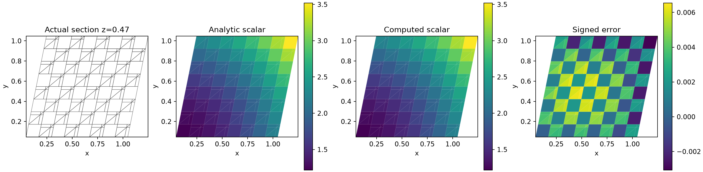
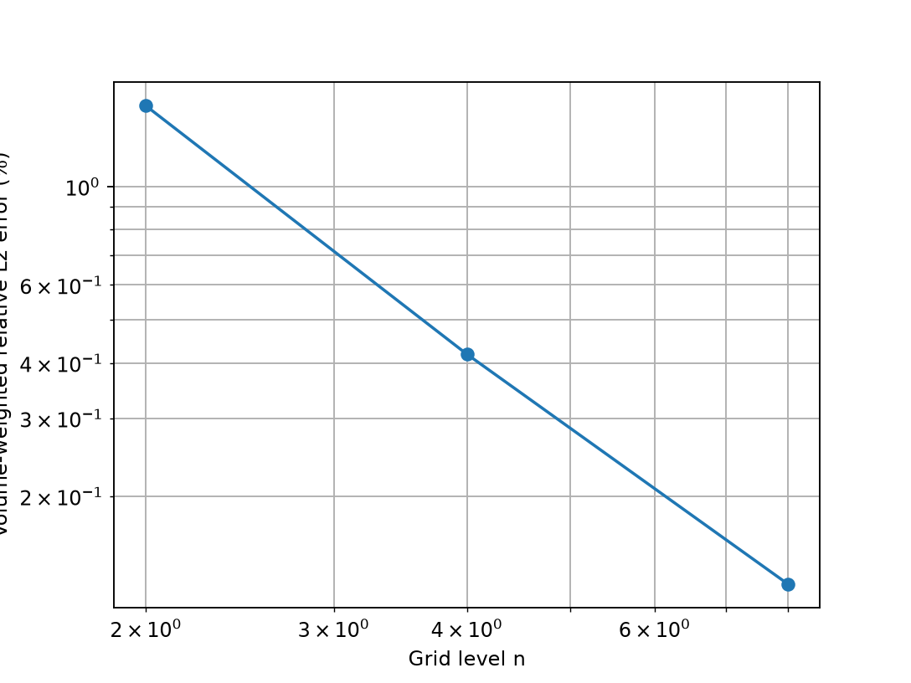

# 新混合后端：标量守恒输运与 SST 一步更新

## 问题与验证范围

当前原生 NS 已完成 [Kovasznay 无体力细网格及 ABC 三维验证](../verification-native-newton/README.md)。
本阶段把 k/ω 所需的扩散、对流、反应和时间项接入同一个混合单元/共享面后端，
避免继续依赖存在偏斜网格能量反例的旧配点扩散。

本报告验证标量算子与给定速度梯度下的 SST **一步更新**。
尚未验证动量—湍流非线性耦合、壁面函数、湍流外流或物理 SUBOFF 的 Cp/Cd。
结果均由原生 TensorFVM 在 CPU 上计算；GPU 尚未测试。

## 1. 方程、边界与离散

求解

\[
\partial_t\phi+\nabla\cdot(\mathbf U\phi)
-\nabla\cdot(\kappa\nabla\phi)+s\phi=f.
\]

`NativeHybridScalar3D` 复用 `NativeHybridViscous3D(components=1)` 的标量能量扩散，
未知量为单元值与共享面值。单元方程使用给定共享体积流量 `q=U·S` 的一阶迎风输运，
时间项采用后向 Euler，非负反应系数隐式处理。面方程满足两侧扩散通量平衡。

Dirichlet 数据为面平均值；Neumann 数据为向外的 `κ∇φ·n`，单位为每单位面积的扩散通量。
总向外输运为 `q φ_upwind − diffusive_flux`。凡 `q<0` 的边界都必须提供明确入口/背流标量，
即使扩散边界使用 Neumann。出口携带 owner 单元值。

保存并核查：真实线性残差、每单元收支、整体收支、独立两侧通量之和，以及标量功恒等式。
混合扩散能量非负不意味着任意偏斜网格上具有离散最大值原理；不宣称一般正值保证。
通用标量求解器允许有符号场，SST 包装器对不合法单元/面状态直接报错，未添加裁剪或正值下限。

## 2. 独立三维变系数制造解

预先固定解析标量、速度、扩散和反应系数：

\[
\phi=1+x^2+y^2+z^2,\quad \mathbf U=(0.6,-0.3,0.2),
\quad\kappa=1+x,\quad s=0.7.
\]

连续方程给出的独立源项为

\[
f=2\mathbf U\cdot(x,y,z)-(6+8x)+0.7\phi.
\]

源项由连续微分式在单元中心求值，不使用离散残差制造。
边界采用多边形三角剖分上的 4 阶 Gauss 积分得到面积平均值，未以中心值替代二次场平均。
网格采用既有共性 `pressure_mesh`：三维剪切映射的六面体/四面体混合网格，所有共享面三角化。
加密覆盖三个方向。解析参照为单元中心值，误差为体积加权相对 L2。

| 网格级别 | 单元数 | 面数 | 标量误差 | 精度及收支 |
|---:|---:|---:|---:|:---:|
| 2 | 28 | 96 | 1.52293% | 通过 |
| 4 | 224 | 672 | 0.41859% | 通过 |
| 8 | 1,792 | 4,992 | 0.12668% | 通过 |

预定门槛为误差 <3%、线性残差及收支绝对缺陷 <`1e-8`，并要求加密误差下降。
最细网格真实线性残差 `1.63e-15`、单元收支最大缺陷 `9.16e-15`、
界面缺陷 `5.96e-15`、整体缺陷 `2.86e-13`、功闭合 `8.46e-13`。
这里只证明这一扩散占主导问题的加密结果；一阶迎风不因此具有普遍二阶精度。




图来自实际单元与平面 `z=0.47` 的相交多边形，未做空间平滑。
解析与数值标量使用相同色标，误差另图展示。

## 3. SST-2003 输运接口

`NativeHybridSSTTransport3D.step` 接收旧 k/ω 的单元值和共享面值，
从共享面值计算 Gauss 梯度，调用既有独立审核的 SST-2003 精确生产项闭合。
常密度条件下每个方程使用比质量形式，扩散系数为 `ν+σ ν_t`。
新旧后端只复用闭合公式，新输运不调用旧 `NativeSSTTransport3D`。

模型采用应变率涡黏限制、k/ω 共用生产限制、`CD` 下限 `1e-10`、
`γ1=5/9`、`γ2=0.44`，与 [NASA TMR 的 SST-2003 定义](https://tmbwg.github.io/turbmodels/sst.html#sst-2003)对应。
本次重新抓取并保存[原始页面](nasa-tmr-sst.html)及[来源记录](source-provenance.json)。
生产项保留精确应力收缩中的散度项，不能将其标作 SST-2003m。
后续动量耦合必须保留各向同性湍流应力，或明确采用修正压力并恢复物理压力。

负生产/交叉扩散通过旧正值处的 Patankar 系数转为隐式负源，未直接删除；
正生产显式、破坏项隐式。一步线性求解的守恒不等于原始非线性 SST 收敛。
本模块不修改输入状态；无效更新报错，调用者应处理步长/非线性接受。

## 4. 检验与复现

[19 项测试通过](tests.txt)，其中 6 项新标量、5 项新混合 SST、8 项既有闭合/输运回归。
测试包含薄层偏斜混合网格的仿射解及解析牵引、混合边界、入口反向流、
常量保持、独立衰减 ODE、三档变系数输运加密、剪切生产、负生产、
非均匀共享面梯度及负交叉扩散、零 k 保持，以及拒绝负更新。
局部膨胀梯度测试仅审核源项代数，不将其作为不可压缩动量解。

```bash
export OMP_NUM_THREADS=1 OPENBLAS_NUM_THREADS=1 PYTHONPATH=src
python scripts/verify_native_hybrid_scalar.py --output results/reproduce-hybrid-scalar
python scripts/audit_native_hybrid_scalar.py results/reproduce-hybrid-scalar
python -m pytest -q tests/test_native_hybrid_scalar3d.py tests/test_native_hybrid_sst3d.py tests/test_native_sst3d.py
```

输出目录需为空。[配置](settings.json)、[指标](cases.json)、[判定](summary.json)、
原始 NPZ 网格/场/两侧通量、环境和冻结源码均保留。
[独立原场审计](artifact-audit.json)重新计算解析参照、源项、误差和局部/整体通量收支，并核对 SHA256。
`physical_suboff_benchmark_passed=false` 保持不变。

下一步需要把该输运与当前动量方程、有效黏度更新和非线性残差接受规则相连，
用简单湍流物理案例验证壁面分辨率/剪切，再推进 SUBOFF。
