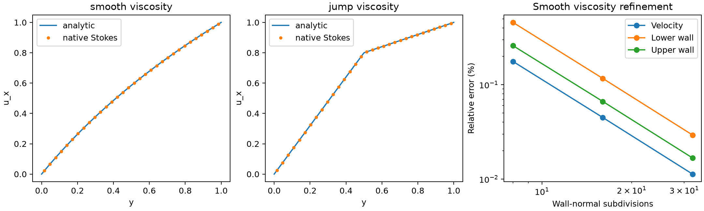

# 原生混合后端：变黏度与壁面剪切力验证

2026-10-13。原生 TensorFVM，层流算子验证；没有 SST、壁面函数或 SUBOFF 物理验收结论。

## 问题与解析量

单位立方体，ρ=1，下壁静止，上壁沿 x 以速度 1 移动，体力与解析压力均为零，`U=(u(y),0,0)`。稳态方程为 `d(μ du/dy)/dy=0`，对流项本身为零，使用 `NativeHybridStokes3D` 求解。

两种独立解析黏度分布：

- 平滑：`μ=1+y`，`u=ln(1+y)/ln2`，剪切应力 `τ=1/ln2`。
- 分层：y<0.5 时 μ=1，否则 μ=4；`u=y/0.625`（下层），`u=[0.5+(y−0.5)/4]/0.625`（上层），两侧应力均为 `τ=1.6`。速度连续，导数允许跳跃，界面恰落在实际单元面上。

每个 y 壁面的面积为 1，因此上下壁对流体的 x 向力分别为 +τ 和 −τ。壁面力从求解器的实际总牵引积分，未用解析梯度替换。

## 共性实现与边界

使用共性 `NativeMesh3D`、`NativeHybridViscous3D`、Stokes/SIMPLE/SIMPLEC 和分量对称边界；没有案例专用离散矩阵。黏度在各单元中心求值，误差保留在加密研究中。

网格为 `2×n×1` 六面体及三角分面，n=8/16/32。x 端给定解析速度的面积均值，y 壁面分别为 (0,0,0) 和 (1,0,0)，z 两侧只固定 w=0、切向牵引为零。压力保留常数零空间，因此固定一个零参考值；报告压力最大绝对误差，不以零参考场构造相对范数。

冻结报告使用联合求解，容差 1e−10。测试另外在 2×4×1 的黏度跳跃案例上交叉验证 SIMPLE 和 SIMPLEC。

## 结果

| 黏度 | 单元数 | 速度误差 | 下壁力误差 | 上壁力误差 | 最大压力绝对误差 |
|---|---:|---:|---:|---:|---:|
| smooth | 16 | 0.17636% | 0.45739% | 0.25934% | 0.008345 |
| smooth | 32 | 0.044894% | 0.11653% | 0.066445% | 0.002269 |
| smooth | 64 | 0.011276% | 0.029273% | 0.016716% | 0.0005882 |
| jump | 16 | 6.0709e-13% | 4.1633e-13% | 1.2768e-12% | 4.189e-13 |
| jump | 32 | 2.3659e-12% | 3.9135e-12% | 1.2018e-11% | 1.307e-12 |
| jump | 64 | 8.1114e-12% | 5.3013e-12% | 9.4452e-11% | 1.071e-11 |



[矢量 PDF](run/profiles-wall-forces.pdf)、[完整案例指标](run/cases.json)、[机器状态](run/summary.json)。各网格的速度、压力、黏度、面速度、牵引、实际连接和迭代记录均保留。

所有报告案例的速度、上下壁面力误差均小于 3%。平滑案例给出收敛趋势；分层案例恰为逐单元仿射解，接近机器精度是该特殊构造的性质，**不代表任意变黏度湍流都同样精确**。源项为零，该案例也不替代非零对流测试。

## 复现与下一步

```bash
OMP_NUM_THREADS=1 OPENBLAS_NUM_THREADS=1 PYTHONPATH=src \
/data/TensorFEM/.venv/bin/python scripts/verify_native_hybrid_shear.py \
  --output results/native-hybrid-shear-replay
```

输出目录需为空。共用 `NativeRunEvidence` 冻结源码并核对结束时哈希。5 项新增测试通过，覆盖连续方程独立差分核对、三算法分层应力与平滑黏度的加密收敛，见[原始测试输出](tests.txt)。这些测试与 Kovasznay 报告所列 100 项回归是不同测试项。

下一步仍需真正三维制造解、壁面律边界离散与 k/ω 输运，不把给定 μ(y) 视为已经求出了湍流黏度。
