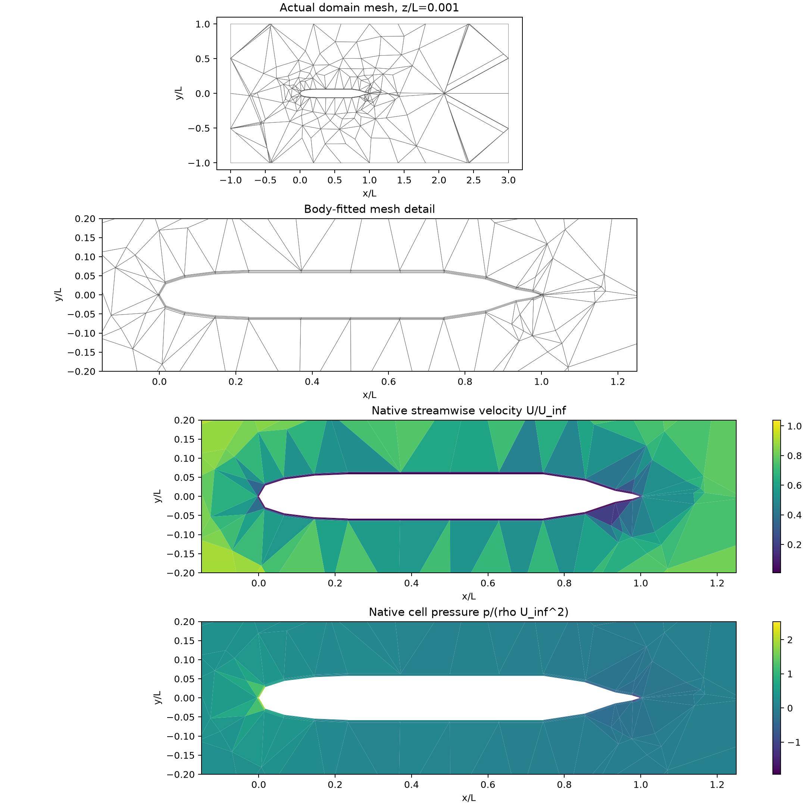
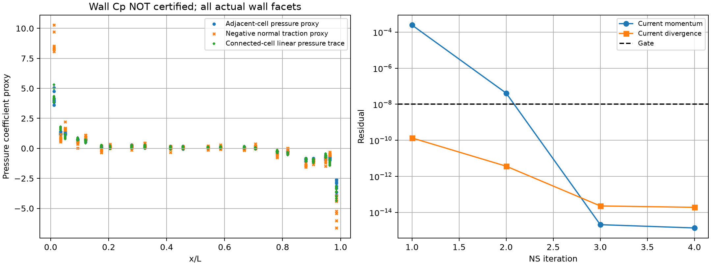
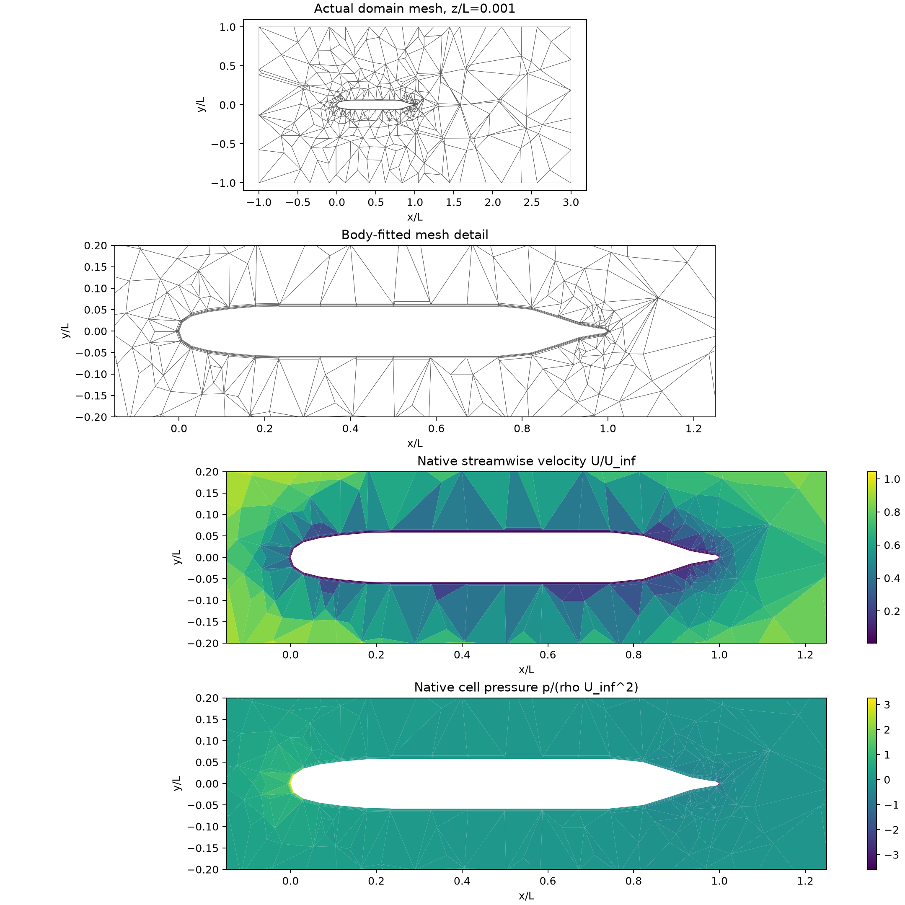
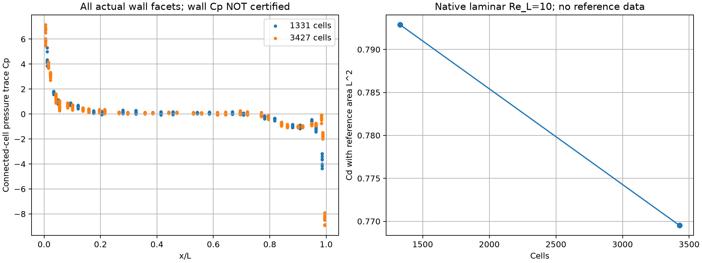
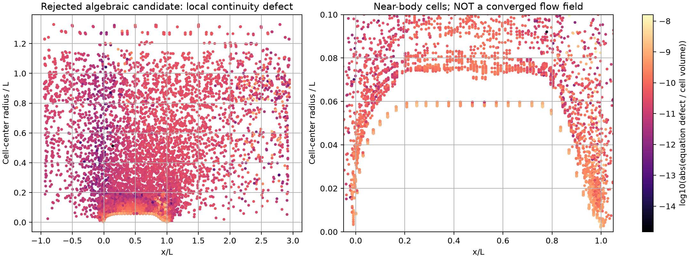
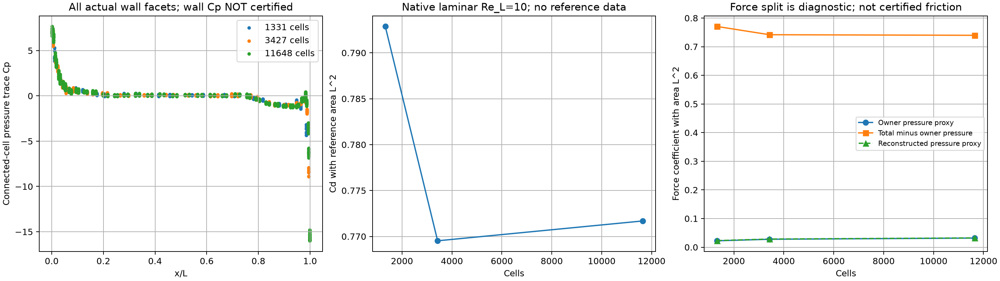

# 原生混合后端的完整 SUBOFF 外流域启动验证

## 1. 本阶段结论

首次在本阶段修复后的原生单元/共享面速度、压力后端上，完成真实 SUBOFF 外流域的无体力 Re_L=10 定常层流计算。
它包含无滑移艇体、贴体六面体层、端部棱柱、外部四面体和远场；不是薄层标量制造解，也未调用 OpenFOAM。
四步全耦合 Newton 后，当前原 Navier–Stokes 方程、连续性、完整状态更新和力/能量收支通过既定门槛。

**此结果只证明实际几何上的数值求解链路已运行并收敛，不是实验工况 benchmark 达标。**
当前已有两档低 Re 网格收敛解，但没有三档网格收敛证据、独立同工况 Cp/Cd 参考对照、湍流模型或壁面函数。
所报阻力以 L² 为参考面积，不可与其他归一化定义或高 Re 实验阻力直接比较。

## 2. 几何、网格与方程

裸艇母线使用仓库已有的 TensorLBM 来源 SUBOFF 几何。源代码及生成证据见 [mesh](mesh/)。
长度 L=1，外流域 `[-1,3] × [-1,1] × [-1,1]`，U∞=1，ρ=1，ν=0.1，Re_L=10。

| 项目 | 当前设置 |
|---|---|
| 总单元/面 | 1331 / 3556 |
| 近壁六面体 | 160 |
| 艏艉封口棱柱 | 32 |
| 外部四面体 | 1139 |
| 周向分段 | 8 |
| 近壁层 | 2 层，首层 0.002L，增长率 1.2，总厚度 0.0044L |
| 外部特征尺寸 | 0.8L |
| 拼接 | 共形共享三角面，无 overset 插值 |

这是启动网格：多面体艇体体积为 0.00745717L³，对同母线轴对称积分 0.00845891L³ 偏差约 11.84%。
节点在母线上不代表面内几何准确；此网格明显不能用于 <3% 物理精度认证。

艇体速度为零；入口及侧面远场给均匀速度 `(1,0,0)`；出口给零总牵引，回流速度显式给 `(1,0,0)`。
体力为零。初值来自同一原生离散的 Stokes 解，没有填入解析内部场或参考压力。
动量采用二阶共享面上风重构和完整黏性应力，压力通过实际面散度的负转置耦合；原始单元/面未知量均保留。

## 3. 数值收敛和守恒

| 指标 | Re=10 Newton 最终值 |
|---|---:|
| 当前动量相对残差 | 1.377e-15 |
| 质量散度最大值（保存面通量复算） | 1.473e-14 |
| 单元积分动量缺陷最大值 | 1.350e-15 |
| 界面牵引不平衡最大值 | 1.375e-15 |
| 艇体总力与远场动量通量闭合误差 | 1.998e-15 |
| 能量收支误差 | 1.887e-15 |
| 最终速度/压力相对更新 | 2.103e-15 / 1.367e-14 |
| 轴向艇体力，ρU∞²L² 单位 | 0.396433299 |
| Cd,L² = 2 Fx/(ρU∞²L²) | 0.792866598 |
| 最大单元速度 / U∞ | 1.047342 |
| 总耗时（该机器 CPU） | 130.03 秒 |

原方程与变化门槛为 1e-8；全部所列积分力与能量收支也要求 <1e-8。
[原场独立审计](re10-newton/artifact-audit.json)从保存的面速度重新计算通量、散度、单元积分动量和整体力闭合，
逐一核对源文件、网格和原场哈希。[迭代历史](re10-newton/history.json)包括每轮实际壁面力，
[汇总](re10-newton/summary.json)明确保留 `physical_suboff_benchmark_passed=false`。

第一次启动沿用了初始化的默认 1e-9 散度门槛，Stokes 散度为 2.719e-9，因此在进入 NS 前被拒绝。
该失败场及实际未平衡 NS 收支完整保存于 [re10-initialization-rejected](re10-initialization-rejected/summary.json)。
随后将初始化门槛显式设为既定的 1e-8；后续四步 NS 将最终散度降到约 1e-14，没有放宽最终验收门槛。

## 4. 实际网格与流场



图为 z/L=0.001 的真实单元剖切；流场按实际单元值着色，没有解析插值替代计算结果。
如此粗的外部网格仍有强烈单元分辨率痕迹，必须继续加密和核查几何/远场敏感性。



最初保存两种诊断量：相邻单元压力 `2p_owner/(ρU∞²)` 与负法向总牵引 `−2(t·n)/(ρU∞² A)`。
前者不是经验证的壁面压力重构，后者含黏性法向应力及数值稳定项；均不能直接当作已经验证的表面 Cp。
此网格两种代理量的面积加权绝对 RMS 差约为 0.4904，不能选择其中更好看的曲线报告达标。
新增第三条曲线采用内部连通单元的线性最小二乘重构，不输入已知壁面压力。
[独立算子验证](../verification-native-boundary-pressure/README.md)已通过仿射一致性、规范压力平移、不可解邻域拒绝和三档曲面采样函数加密。
实际 CFD 中，该重构与原壁邻值的 Cp 绝对 RMS 差为 0.09917；仍需曲面真实流动及网格加密确定物理压力精度。

## 5. 复现

```bash
export OMP_NUM_THREADS=1 OPENBLAS_NUM_THREADS=1 PYTHONPATH=src
python scripts/prepare_suboff_hybrid_mesh.py --axial 12 --azimuthal 8 --layers 2 --first-height .002 --growth 1.2 --far-size .8 --output results/suboff-startup-mesh-new
python scripts/run_native_hybrid_suboff.py --mesh results/suboff-startup-mesh-new/suboff-hybrid.msh --reynolds 10 --output results/suboff-startup-re10-new
python scripts/report_native_hybrid_suboff.py results/suboff-startup-re10-new
```

所有输出目录必须为空。计算会冻结源码与输入网格；失败不得覆盖原证据或作为通过。
环境为 CPU/SciPy，GPU 未测试。
SIMPLEC 的同网格 Re=10 独立求解采用对角基准、动量/压力松弛 1。
其求解器相对残差门槛已通过，Cd 与 Newton 相对差为 1.296e-9，但单元积分动量缺陷 1.0524e-8、界面牵引缺陷 1.2907e-8，略高于既定 1e-8 门槛。
因此[整体验收明确失败](re10-simplec-ledger-rejected/summary.json)，没有将小误差四舍五入为通过；[独立对照](algorithm-comparison.json)与全部原场保存。
从上述数值状态继续做 7 次 SIMPLEC 外迭代，将相对迭代门槛收紧到 1e-10，原积分收支门槛保持 1e-8。
现在单元/界面缺陷分别降至 1.111e-10 / 1.348e-10，整体通过。
[补充原场](re10-simplec-polished/summary.json)和[最终算法对照](algorithm-comparison-polished.json)保留了原失败状态的完整重启绑定；
Cd 与 Newton 相对差约 1.029e-11。这项通过确认离散方程的算法一致性，仍不是实验物理精度。
Re=100 从 Stokes 直接启动在 432.39 秒后因回溯失败而停止，当前动量残差仍约 1.805e-2。
[失败原场与审计](re100-newton-rejected/summary.json)完整保留，不报告为真实阻力。
新增 `--initial-run` 从同网格的历史原生层流数值状态重启，校验网格、原场 SHA、数据形状、规定边界与面通量一致性；可显式记录不同 Re 的黏度延续。
初始原场、配置、汇总及哈希随新运行一同归档，全部当前方程重新建立。
`--tolerance` 只允许收紧 1e-8 门槛，不能放宽；`--linear-method` 可选择 direct、reused_lu 或 block_amg。
Re=10→30 延续已在 4 次 Newton 迭代后通过全部数值门槛，耗时 101.21 秒。
Re=30 的 Cd,L²=0.306173642，单元积分动量缺陷 4.718e-16，总力闭合 9.714e-16；见[原场与汇总](re30-continuation/summary.json)。
Re=30→60 延续已通过：Cd,L²=0.178592933，局部动量缺陷 3.053e-16，总力闭合 5.551e-16，见 [Re=60 归档](re60-continuation/summary.json)。
继续到 Re=100 仍因 Newton 回溯失败而拒绝，最终动量残差约 8.034e-3，见[延续失败场](re100-continuation-rejected/summary.json)。
改善初值尚未解决该粗网格上更强惯性时的非线性问题。单网格、低 Re 数值通过不能替代高 Re Cp/Cd 的实验对照与网格收敛。


SIMPLEC 的失败保留与继续迭代可复现为（第一条预期返回未通过）：

```bash
python scripts/run_native_hybrid_suboff.py --mesh results/suboff-startup-mesh-new/suboff-hybrid.msh --reynolds 10 --algorithm simplec --momentum-relaxation 1 --momentum-relaxation-basis diagonal --output results/suboff-simplec-initial-new
python scripts/run_native_hybrid_suboff.py --mesh results/suboff-startup-mesh-new/suboff-hybrid.msh --reynolds 10 --algorithm simplec --momentum-relaxation 1 --momentum-relaxation-basis diagonal --tolerance 1e-10 --initial-run results/suboff-simplec-initial-new --output results/suboff-simplec-polished-new
python scripts/report_native_hybrid_suboff.py results/suboff-simplec-polished-new
python scripts/run_native_hybrid_suboff.py --mesh results/suboff-startup-mesh-new/suboff-hybrid.msh --reynolds 30 --initial-run results/suboff-startup-re10-new --output results/suboff-re30-new
```


## 6. 分块求解与网格加密的实测状态

同一 1,331 单元、Re=10 案例使用分块 AMG 后，原方程和全部收支通过；
与直接 LU 的最大相对原场差为 1.225e-14（总牵引），见[逐场对照](block-direct-comparison.json)。
AMG 耗时 127.56 秒，原 LU 130.03 秒，本规模下没有明显速度优势的证据。
[分块原场及线性方法配置](re10-block/summary.json)均保留。

新增 3,427 单元网格：18 轴向分段、12 周向、3 层、首层 0.00129254L、增长率 1.129243、外部尺寸 0.533333L。
576 六面体、72 棱柱和 2779 四面体，艇体体积 0.008003826L³，几何体积误差降至约 5.38%。
[网格及完整参数](medium-mesh/summary.json)已保存，但[直接求解启动失败](medium-re10-initialization-rejected/summary.json)：
Stokes 质量散度 5.524e-8 超出 1e-8 门槛，整体小线性残差不能代表小单元中的连续性已满足。
未进入合格 NS 解，所存力不可用于网格阻力收敛比较。
对原联立方程增加扩展精度残差迭代修正后，隔离验证中的同网格 Stokes 散度降至 4.383e-14，已进入 NS 迭代。
同网格完整 NS 已在 4 次 Newton 迭代后通过：最终质量散度 4.484e-14、局部动量缺陷 7.676e-16、
界面牵引缺陷 8.934e-16、总力闭合 1.055e-15、能量误差 2.387e-15。
速度/压力最终变化为 1.835e-15 / 7.283e-15。总耗时 1471.09 秒；源文件全程一致。
[完整中网格证据](medium-re10-refined/summary.json)与[独立原场审计](medium-re10-refined/artifact-audit.json)保留。
n=128 SST 原场结束并验源后，修复已通过合并提交 `c3ae8de` 接入主线；
运行版之后的兼容性修补仅处理非原生尺寸的私有接口测试矩阵，原生流动路径未改变，最终源码与 62 项通过的测试覆盖版本逐字节一致。



| 单元数 | Cd,L² | 对上一网格的相对变化（以较细网格为分母） |
|---:|---:|---:|
| 1331 | 0.792866598 | — |
| 3427 | 0.769526000 | 3.0331% |

[网格比较脚本及哈希绑定](grid-comparison/comparison.json)核对相同物理设置与外域边界，并由保存的牵引复算阻力。
这里的 3.0331% 是两档网格的差异，不是对实验的误差；变化同时含艇体几何与流动离散影响。
中网格几何体积误差仍约 5.38%，艏艉压力随网格仍明显变化，不能认证 Cp/Cd <3%。


[候选补丁与 62 项相关回归](linear-refinement-candidate/)已保存；运行版本与最终兼容性修正版本的源码差别和哈希见该目录的 status.json。

归档的 11,648 单元修复网格使用分块 AMG，Stokes 初始化达到 30×80 次 GMRES 上限后被拒绝，实际整体线性相对残差为 3.657e-11。
虽然整体残差小于通用 1e-9 上限，GMRES 自身未达到所要求的 1e-13 相对容差，且此运行未保存拒绝的 GMRES 候选向量用于逐单元散度复核，不能认定它可接受。
[失败归档](fine-re10-block-rejected/summary.json)中的零艇体力来自未更新的初始状态，**不是细网格阻力结果**。
此前名字含 near-coincident-diagnostic 的约 1.2 万单元历史网格仍有 4.326e-13L³ 极小单元，不作为本次加密输入。
当前仍没有三档收敛流场，不能声称 Cp/Cd 网格无关。

### 保存候选解后的细网格诊断

新增失败候选归档后，11,648 单元复查仍被拒绝：2400 次 GMRES，实际整体残差 9.157e-11，
但原连续性行缺陷除以单元体积后最大为 **1.622e-8**，超过 1e-8。
这次实测证实不能仅凭整体残差接受该候选；AMG 层级构建的数值差异使它与上一次残差略有不同。
[失败候选向量、原代数方程缺陷及指标](fine-re10-block-diagnostic/rejected-linear-candidate.json)均保存，
[报告审计](fine-re10-block-diagnostic/artifact-audit.json)核查文件哈希并从已保存的代数缺陷复算分块指标；
该后处理没有重新组装矩阵，不能称作独立矩阵验证。
局部最大缺陷位于 x/L=0.977 附近、体积 5.90e-6L³ 的四面体；艏部棱柱也有约 1.25e-8 的缺陷。
它不是仅限最小体积单元的现象，前 20 个单元的位置、体积与顶点数一并保存在审计中。



失败异常保留原求解器状态；候选代数解与未更新的物理场分别存档，均不可报告为收敛流动。
[诊断补丁与 9 项测试](amg-diagnostics-candidate/)包括：未收敛 GMRES 的原状态保护、
全局小残差/局部质量超标反例，以及非有限候选的可归档性。
速度对角与压力质量的对称尺度平衡候选随后同样被拒绝：整体残差 1.050e-10，局部连续性缺陷增大到 1.355e-7，耗时 392.25 秒。
[原候选、源码与审计](fine-re10-block-balanced-rejected/summary.json)完整保存；不将该试验合入生产求解器。
AMG 聚合弱连接阈值 theta=0.25 试验也失败：整体残差 2.361e-10，局部连续性缺陷 6.192e-8，耗时 916.04 秒。
[完整失败证据](fine-re10-block-strength-rejected/summary.json)保留。算子复杂度从约 1.32 增至 2.45；
运行中短时栈采样确认在 GMRES/AMG 松弛过程内，没有证据表明程序挂起。该阈值试验不合入主线。
原设置的预条件残差从第 480 步 2.178e-4 持续降至第 2080 步 1.194e-8，尚未形成停滞证据。
恢复原预条件器、将最多重启周期增加到 60 后，Stokes 初始化通过：质量散度 1.404e-11。
但首个 Newton 方向在 4800 步后仍未达到 GMRES 内部 1e-13 目标而被拒绝，整体残差 6.048e-10、
逐单元代数连续性缺陷 2.203e-10。总耗时 1257.42 秒。
[完整失败证据](fine-re10-block-budget60-rejected/summary.json)与候选向量均保留。
此处保存的 Cd,L²=0.741373399 来自初始化 Stokes 场；实际 NS 动量缺陷仍为 1.378e-3，不能加入收敛 NS 阻力表。

下一项隔离试验显式启用不精确 Newton 方向：仅在原矩阵全部检查已经通过时，允许 GMRES 正的迭代上限状态进入原回溯线搜索。
全局残差≤1e-9、逐单元连续性缺陷≤1e-8、压力约束≤1e-9 和有限值检查保持不变；负状态仍拒绝。
Stokes 初始化默认严格要求 GMRES 收敛。完整 NS 方程、状态变化、局部/界面动量、力与能量收支的原门槛也保持不变。
[24 项测试及候选状态](inexact-newton-candidate/)覆盖严格初始化、准确方向的显式授权、错误方向拒绝、局部质量超标拒绝和原状态保护。
运行记录分别保存 GMRES 目标是否达到、原矩阵检查是否通过与方向是否允许；不会将迭代超限写成 GMRES 已收敛。
候选分支 `fix/native-amg-diagnostics` 提交 `f00d816` 尚未合入生产主线；实际细网格从本次经过验源的 Stokes 数值状态继续；运行已结束，第四次线性修正未通过，仍不宣称收敛。

### Re=100 非线性导数检查

对原 Re=100 延续失败状态，独立计算 3 个确定性随机方向的中央有限差分，
并与当前动量方程完整 Jacobian（包括压力和对流通量导数）比较。
在步长 1e-4、无迎风符号切换时，三组相对导数误差约 2.79e-11、2.75e-11、2.95e-11。
[输入原场、完整源码、全部差分步长及结果](re100-jacobian-check/summary.json)保留。
这项检查未发现该状态下的 Jacobian 不一致，但只覆盖三个方向；
它不证明非线性求解的全局收敛，也不改变原 Re=100 失败结论。

直接精度修复、刚体约束检查和未平衡 AMG 诊断合并到隔离分支 `fix/native-linear-refinement`（`27777e0`）后，通过 [74 项相关回归](amg-diagnostics-candidate/combined-core-tests.txt)。它不包含未通过的尺度平衡或聚合阈值试验。
上述组合现已在 n=128 源码验真结束后合入 `main`，合并后核心源码与通过 74 项测试的版本逐字节一致，运行器编译检查通过。


### 受控不精确 Newton：第四次极小修正仍拒绝

11,648 单元实际 NS 的前三次全步均接受，当前动量降至 2.571e-15、质量散度约 7.81e-14。
但前三步最后的速度/压力变化为 6.196e-8 / 2.967e-7，仍需完成下一次完整更新检查。
第四次 GMRES 60 个重启周期后，原代数相对残差 **1.83378e-9 > 1e-9**，因此方向被拒绝。
[完整失败原场及方向](fine-re10-inexact-final-correction-rejected/summary.json)、原矩阵缺陷和独立报告审计均保留；耗时 3022.03 秒。

该方向的代数缺陷 L2 仅 1.571e-23，速度/压力完整增量相对量约 3.24e-15 / 1.56e-14，
说明困难发生在极小 RHS 的线性末步精度。[增量诊断](fine-re10-inexact-final-correction-rejected/increment-size-diagnostic.json)明确它未被接受。
保存场本身的局部动量约 1.04e-15、总力 1.54e-15、能量 3.00e-15，但不能用这些值覆盖原线性拒绝结论。
Cd,L²=0.7716879511 保留为未完成求解的状态值，尚不进入三档收敛结果表。

下一项修复应针对同一原矩阵的残差修正与末步验证，不放宽全局/局部线性门槛。
从此状态继续时还应显式要求至少一次完整 Newton 修正，避免用“初始残差已小”的零步捷径替代末次更新检查。

## 细网格完整末步修复与三档比较（2026-10-13）

原矩阵残差修正使此前失败的第四个小 Newton 方向通过既定门槛；并且重启强制执行一步完整修正，未跳过更新检查。11,648 单元最终所有原方程和收支通过，Cd,L²=0.7716879511，完整证据见 [细网格结果](fine-re10-refined-terminal) 和 [修复说明](amg-residual-refinement/README.md)。前三次演进与本次末步的总计算成本大于单次重启的 898.735 s；不得把重启耗时当作从 Stokes 初始化的完整耗时。

| 单元数 | Cd,L² | 相对上一档的变化（以细档为分母） |
|---:|---:|---:|
| 1,331 | 0.7928665979 | — |
| 3,427 | 0.7695259997 | 3.0331% |
| 11,648 | 0.7716879511 | 0.2802% |

三档均通过数值验收，但 Cd 加密趋势非单调；几何和离散同时变化，未据此认证渐近网格收敛，未给出不适用的 GCI。0.2802% 是两档计算差异，不是实验误差。尾端压力迹线仍强烈依赖网格，最细网格极端值为 -15.99898；总阻力变化小不能代替整个 Cp 分布的收敛。后续还需区分尾部几何/局部压力重构与离散解的影响。



压力分量仅为 owner 压力或连接单元线性重构的诊断值；总力减 owner 压力力的余项包含黏性与数值贡献，不能称为已认证的摩阻分量。
