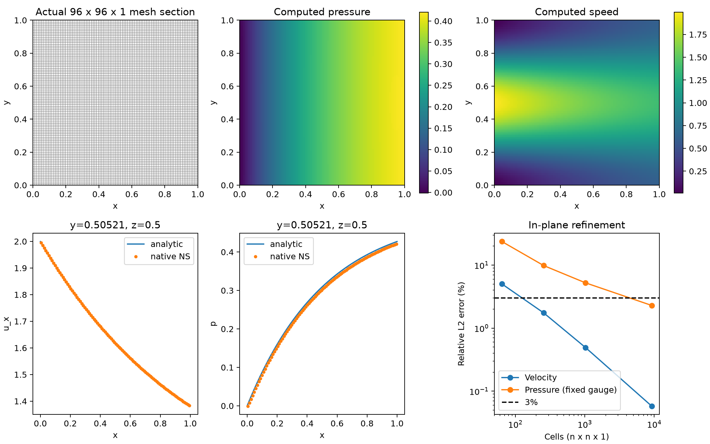

# 原生 TensorFVM：无体力 Kovasznay 流与对称面验证

日期：2026-10-13；开发起点 `fdd5615`。全部计算使用原生 TensorFVM，没有调用 OpenFOAM。

## 1. 问题与本轮目标

上一轮[Re=10 制造解](../verification-native-hybrid-ns/README.md)含解析体力，不能据此断言无体力流动也已达到相同精度。本轮选择具有非零对流、非恒定压力的 Kovasznay 稳态解，要求惯性、压力和黏性自行平衡，输入体力严格为零。

单位域、ρ=1、Uref=Lref=1、μ=1/40，Re=40。令 κ=2π：

```text
λ = Re/2 − sqrt(Re²/4 + κ²)
u = 1 − exp(λx) cos(κy)
v = (λ/κ) exp(λx) sin(κy)
w = 0
p = (1 − exp(2λx))/2
```

`λ²−Re λ=κ²` 给出 `div(U)=0` 和 `(U·∇)U + ∇p − μ ΔU=0`。代码使用等价的稳定表达式 `λ=−2κ²/(Re+sqrt(Re²+4κ²))`。

参考公式与软件实例见 [DeepXDE 官方 Kovasznay 示例](https://deepxde.readthedocs.io/en/latest/demos/pinn_forward/Kovasznay.flow.html)。该页面说明文字存在横向速度正弦自变量和边界条件的笔误；本项目采用其实现中的 `sin(2πy)`，并以独立有限差分在 Re=10/40/100 下核对连续方程，不照抄错误文字。本例外边界不是全部零速度。

这是层流解析验证，**不包含 SST、壁面函数、外流实验阻力或 SUBOFF 达标结论**。解本身为二维；即使使用三维单元也不构成一般三维流动验证。

## 2. 网格、边界与求解

共用 `NativeMesh3D`、混合黏性/压力速度/对流模块与 `verification.native_hybrid_ns.kovasznay_solver`。六面体的面按真实三角面分解；面通量、梯度和力均来自实际网格。

保留两类计算，不能将其当成同一条三维网格序列：

- **完整立方体**：`n×n×n`，六个外边界给定解析速度面积均值。4³、8³ 保留原有粗网格误差。
- **对称挤出**：`n×n×1`，z∈[0,1]。x/y 外边界给定解析速度面积均值；z=0/1 只约束 `w=0`，切向总牵引为零，切向速度由方程求得。8²→16²→32²→64²→96² 做平面内加密。没有在挤出面额外施加解析切向速度。

边界均值用独立 Gauss 面积分，保证总体通量平衡。压力只在第一个单元固定为解析值；主要压力误差始终使用该固定规范，未通过事后平移压力来过门槛。机器数据另列去均值压力误差供诊断。

所有内部速度和面速度从零开始；没有使用内部解析场初始化。线性迎风沿用已有共性模块，仍是未加限制器的延迟修正。Picard 外层松弛 0.7，最大 120 步；当前非线性动量残差、逐单元散度最大值、速度变化、压力变化全部小于 1e−8 才判定数值收敛。

大网格使用原生联合求解；SIMPLE/SIMPLEC 在 3×3×1 同方程交叉核对。**不能把较大网格的联合结果标记为 SIMPLEC 结果。**

## 3. 本轮实现与保护条件

### 3.1 分量边界与压力参考

黏性共性模块新增 `(face, component)` Dirichlet 掩码，保留原 `(face,)` API。自由度、规定值与牵引都按分量处理。此接口可实现与坐标轴对齐的对称面；任意法向的旋转约束和曲面切向 Robin 尚未实现。

压力参考取决于是否存在自由的边界**法向**通量。仅释放切向速度的对称面不会消除压力常数零空间，因此仍须压力参考。SIMPLEC 的同分量邻接判断使用真实全局自由度编号，不能再用删去受约束分量后的压缩行号 `%3`。

仿射 Stokes 流在对称面上验证三种算法、压力参考、切向零牵引、法向速度及能量收支。Kovasznay 对称面上另验证 SIMPLEC 与联合结果一致。

### 3.2 线性求解复用

新增显式选项 `coupled_linear_method='reused_lu'`。首次矩阵做 LU；后续旧 LU 仅作 GMRES 预条件，乘法和右端始终使用当前矩阵。GMRES rtol=1e−11，独立真实相对残差要求 ≤1e−9；失败时重新分解当前矩阵。失败候选不会写入接受场。

测试包括新旧分解路径的结果比较，以及“GMRES 返回成功但候选错误”的注入测试，确保真实残差会触发重新分解。该改进降低重复分解成本，尚不是工业规模、多进程或 GPU 性能证明。

### 3.3 非线性外层松弛

新增 `outer_relaxation`，默认 1 保持原调用行为。松弛后重新组装当前通量和当前高阶修正，再核对完整非线性残差。初始内部零场经过部分松弛后可能仍有散度；该散度如实记录，不能凭内层线性收敛隐藏。

## 4. 计算结果

| 网格 | 单元数 | 速度误差 | 固定规范压力误差 | 两项均 <3% |
|---|---:|---:|---:|---|
| 4×4×4 | 64 | 8.7723% | 43.7074% | 否 |
| 8×8×8 | 512 | 4.7847% | 28.1847% | 否 |
| 8×8×1 | 64 | 5.0348% | 23.6912% | 否 |
| 16×16×1 | 256 | 1.7469% | 9.8465% | 否 |
| 32×32×1 | 1,024 | 0.4928% | 5.2380% | 否 |
| 64×64×1 | 4,096 | 0.1287% | 3.1610% | 否 |
| 96×96×1 | 9,216 | 0.0579% | 2.2918% | 是 |

最细 96×96×1 共 **9,216 单元、74,112 面、210,816 个自由速度分量和 9,216 个压力未知量**，21 次外迭代后收敛。速度误差 **0.0579%**、固定参考压力误差 **2.2918%**，本轮二维解析范数门槛通过。

64×64 的固定规范压力误差为 3.1610%，仍判未通过；其[完整失败运行](run64/summary.json)与字段保留。没有通过改用去均值误差（该网格为 0.6310%）使其过关。96×96 的去均值压力误差另为 0.2948%；两种指标不能混用。

最细当前动量残差 5.583e-10，逐单元散度最大值 1.999e-09，全域动量收支误差 5.184e-10，能量收支误差 5.308e-10。最大非解析 z 速度 5.450e-05，如实保留。

64→96 最后两档观察阶为速度 1.97、固定规范压力 0.79。不能宣称整体二阶，也未计算一般三维 GCI。

3×3×1 上 SIMPLE/SIMPLEC 与联合求解的速度、压力、面速度和通量最大绝对差为 1.684e-08。96×96 单例 CPU 用时约 516.1 秒（含构网格、组装与计算），只记录此次运行，不作性能推广。



图中加密曲线对应最终运行组的 8/16/32/96；64 网格来自独立归档运行，上表合并列出且保留[原图](run64/mesh-fields-refinement.png)。

另存[矢量 PDF](run/mesh-fields-refinement.pdf)。云图直接展示单元计算值，无平滑修饰；曲线位置为最细网格 y 中央单元行、z=0.5。

3% 门槛为速度与固定规范压力的体积加权相对 L2，**不是逐点 3%，也不是 SUBOFF 的 Cp/Cd 门槛**。挤出方向未做系统加密，完整立方体序列也尚未通过精度门槛；这些限制不能因平面内细网格通过而消失。

## 5. 可复现证据与使用

[全部案例](run/cases.json)、[机器状态](run/summary.json)、[算法差异](run/algorithm-comparison.json)。每例保存实际网格/面连接、边界分量掩码、单元与面速度、压力、面体积通量、动量通量和总牵引，以及内层/外层/线性求解记录。

共性 `NativeRunEvidence` 在运行前冻结加载的生产源码和脚本，并在结束时检查 SHA256；保存运行环境和线程配置。源码快照可用于复现当时的离散行为。

```bash
OMP_NUM_THREADS=1 OPENBLAS_NUM_THREADS=1 PYTHONPATH=src \
/data/TensorFEM/.venv/bin/python scripts/verify_native_kovasznay.py \
  --output results/native-kovasznay-replay --fine-n 96
```

输出目录必须为空。机器验收不通过时脚本退出码为 2；不因未达标删除结果。

```python
from tensorfvm.verification.native_hybrid_ns import kovasznay_solver
mesh, solver, exact = kovasznay_solver(
    16, reynolds=40, symmetry_extrusion=True,
    coupled_linear_method="reused_lu",
)
result = solver.solve(
    algorithm="coupled", outer_relaxation=0.7,
    max_outer_iterations=120, tolerance=1e-8,
)
```

回归 **100 passed, 1 xfailed**，见[测试原始输出](tests.txt)。已知失败为旧配点黏性算子的偏斜网格增能反例，未删除或放宽。

## 6. 后续验收

补充：[变黏度与壁面剪切力验证](../verification-native-hybrid-shear/README.md)已完成，覆盖平滑黏度及 4:1 跳跃应力守恒；这不等同 SST 耦合。

**新发现的阻断项**：[真实三维偏斜混合网格 ABC 探针](abc-diagnostics/README.md)虽数值收敛，756 单元上的去均值压力误差仍达 NS 139.46%、Stokes 37.52%。因此二维无体力验证通过也不能视为三维压力已算准；根因尚未确认。

整体任务仍进行中。下一步优先定位并修复上述三维压力问题，再按[原生 SUBOFF 开发验收计划](../native-suboff-development-plan.md)推进边界牵引、变黏度与壁面剪切验证，再接入 SST 与壁面律。新混合后端尚未计算 SUBOFF；现有 OpenFOAM 结果只作外部基线。

后续：[三维压力诊断与梯度跳变稳定化](../verification-native-gradient-jump/README.md)。本页场数据对应本页冻结源码；新默认算子的完整精度需按后续报告继续验收。
