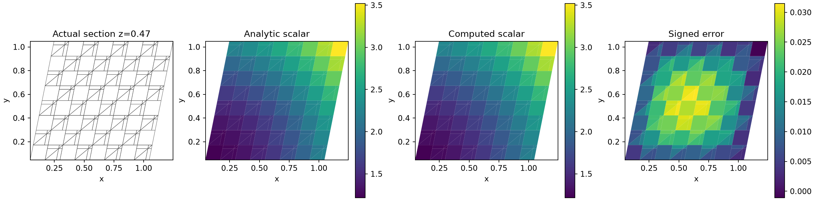
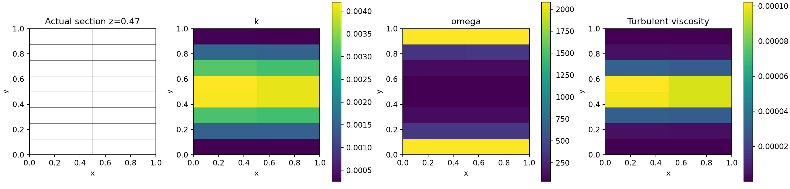
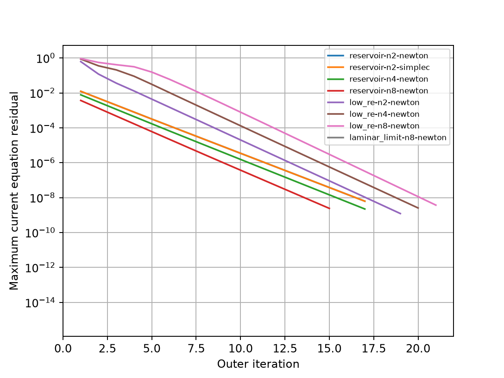
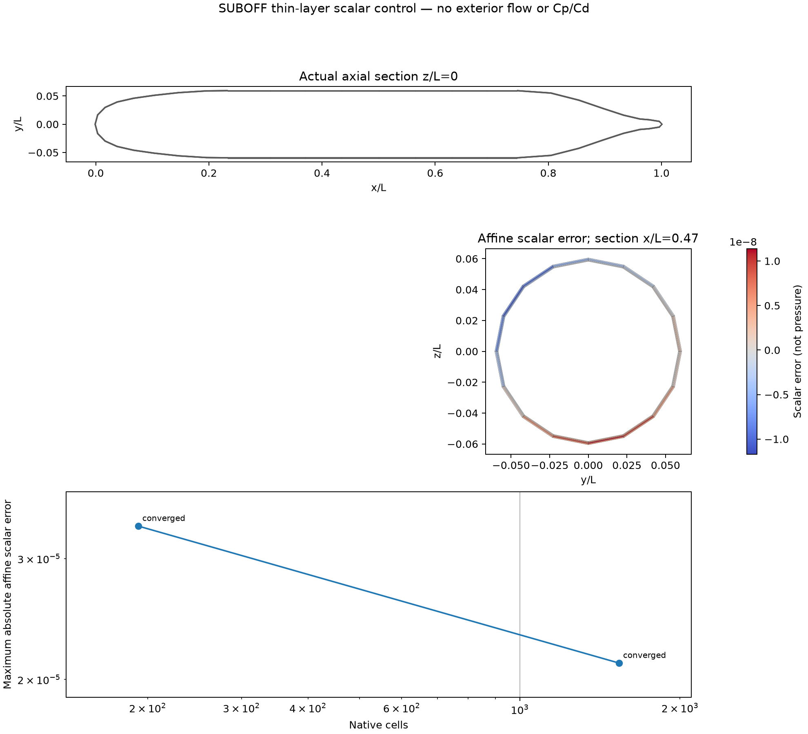

# 非线性标量延续 Newton：收敛修复与精度核查

## 范围与验收

本次修复原生单元/共享面标量输运的非线性求解，并验证其与原生动量、连续性、SST 方程的耦合。
沿用此前的图扩散方程，不改变边界值、不裁剪 k/ω、不放宽残差和收支门槛。
默认标量修正仍为 `none`；选择 `nonlinear_mmp` 时默认使用 `continuation_newton`，旧迭代可通过 `mmp_solver='picard'` 重现。

**尚未完成物理 SUBOFF 的 Cp、Cd 误差 <3% 验收。本文中的薄层几何测试只解仿射标量扩散，没有外部流场和远场边界，不能当作潜艇绕流。**
真实湍流精度、曲面壁面函数、匹配工况实验数据资格、GPU 加速仍未通过验证。

## 求解方法

原图修正见[上一阶段](../verification-native-scalar-mmp/README.md)。本次增加系数及其状态依赖的解析 Jacobian：

- 将绝对值写为 `sqrt(a²+δ²)`，将两端最大值写为 `(a+b+sqrt((a-b)²+δ²))/2`；
- 标量差的平滑量使用标量状态尺度，反力与边权平滑量使用矩阵对角尺度，维度保持一致；
- 从 1e-3 逐个数量级降至 1e-10，并最终在 **ε=0 的原图方程**求解和验收；
- Newton 使用真实线性残差及 Armijo 回溯；失败保留候选场和迭代历史，不能作为已接受解；
- 初值来自原未修正线性系统，没有用解析内部场初始化；
- 验收仍要求当前原非线性残差、相对状态变化 <1e-12，单元、共享面、全局和功收支绝对缺陷 <1e-8。

解析 Jacobian 通过独立方向差分检查；在原先 Picard 能收敛的正调和案例，两种方法的场和通量一致到 3e-10 以内。
平滑过程的中间场不会被报告为最终解。

## 浮点精度与功收支

细壁面控制的 ω 边界量达到 20480，总扩散功量级约 1e9。
直接用双精度相减两个大功量会出现约 1e-7 的消减误差，超过原 1e-8 门槛。
现在同时保存：

1. 原总能量直接差 `work_balance_direct_float64`；
2. 等价的单元方程功及内部面反力功之和 `work_balance`，各项分别保存供复算；
3. 当前单元、共享面和全局原方程残差，不因功诊断改变而省略。

局部扩散用 `Σj Aij(φj−φi)` 保持常量零空间；残差和状态增量使用 `numpy.longdouble` 累加，Jacobian 和稀疏 LU 仍为双精度。
此机器扩展精度有效位为 64，普通双精度为 53；不同平台需重新验证，未宣称 GPU 支持。
必要时用同一零平滑 Jacobian 做残差迭代修正，所有原验收条件继续成立才返回。
这不会将非零功缺陷硬设为零：新增扰动测试验证它能检出失衡状态。

## 独立标量精度

三维连续制造解使用独立体源及边界面积均值。其用途是验证离散，不是物理 SUBOFF 标模。

| 单元数 | 相对 L2 误差 | 最大单元收支缺陷 |
|---:|---:|---:|
| 28 | 2.629378% | 1.409e-14 |
| 224 | 1.163029% | 6.149e-15 |
| 1792 | 0.593879% | 3.951e-15 |

修正扩散的精度代价仍在：同样最细网格，未修正误差约 0.127%，修正后约 0.594%。
求解器收敛改进不会自动消除新增扩散误差。



## 完整耦合控制

| 案例 | 单元数 | 外迭代 | 最大当前方程残差 |
|---|---:|---:|---:|
| reservoir-n2-newton | 4 | 17 | 6.229e-09 |
| reservoir-n2-simplec | 4 | 17 | 6.229e-09 |
| reservoir-n4-newton | 8 | 17 | 2.222e-09 |
| reservoir-n8-newton | 16 | 15 | 2.412e-09 |
| low_re-n2-newton | 4 | 19 | 1.220e-09 |
| low_re-n4-newton | 8 | 20 | 2.546e-09 |
| low_re-n8-newton | 16 | 21 | 3.716e-09 |
| laminar_limit-n8-newton | 16 | 1 | 6.340e-16 |

8 个控制全部通过，覆盖 SIMPLEC/Newton 对照、三角面低 Re 壁面和层流极限。
SIMPLEC 与 Newton 的最大场值差为 3.84e-10。这里 Reynolds 数低、规模小，不构成湍流阻力精度认证。
未修正三角面 k 负值反例仍保存，不能把拒绝反例计为物理成功。





## 实际 SST 功收支精度记录

[逐次记录](power-precision/solves.json)保存了全部 42 次 k/ω 求解；每次均通过原收支门槛。最大直接差案例：

- 扩散能量：1.8924846741e+09；
- 双精度总量直接差：7.1525573730e-07；
- 等价局部方程功求和：-2.1028430233e-09。

[候选原始场与各项功](power-precision/largest-direct-power-defect.npz)及源代码快照均保存。直接差保留为诊断，没有隐藏。

## 零平滑最终修正

中间光滑问题用 Newton 求解，最后仍须解 ε=0 原方程。细薄层上出现原残差很小而 Newton 建议步长不稳定的情况。
只在零平滑、残差已经 <1e-14 时，允许改用原冻结算子的无松弛 Picard 更新。
每个冻结系统做三次扩展精度残差的双精度 LU 修正；必须连续两次完整无松弛更新 <1e-12，
随后再次通过当前原方程 <1e-12 和全部绝对收支 <1e-8 的门槛。
历史分别记录 Newton 步、线性残差修正和无松弛固定点步，不把回溯后的小增量冒充收敛。

这里调整了最终非线性求解方式，保留了原门槛。薄层探针中，普通双精度冻结求解的更新量约 2.6e-12，
精确残差修正后约 2–4e-13；两种探针源码与日志均在 [probes](probes/) 中。

## 真实 SUBOFF 薄层几何的标量加密

解域只是船体外的一层薄体积，固定总厚度 0.0022L，解 φ=1+0.1x−0.2y+0.3z 的纯扩散问题，所有边界给定精确仿射值。
轴向/周向/法向同时加密为 12r、8r、2r；层增长率 1.2^(1/r)，第一层厚度按固定总厚度重算。
六面体及端部楔体的面采用一致三角剖分。初值使用原线性求解，未填入解析内部场。

| r | 单元数 | 面数 | 修正后最大绝对误差 | 当前原残差 | 记录数 | 求解秒数 | 状态 |
|---:|---:|---:|---:|---:|---:|---:|---|
| 1 | 192 | 1264 | 3.34631043e-05 | 5.967e-16 | 58 | 3.00 | 通过原方程/更新/收支门槛 |
| 2 | 1536 | 9696 | 2.11366918e-05 | 1.082e-15 | 74 | 202.81 | 通过原方程/更新/收支门槛 |

两档误差下降；**尚不能宣称三档网格收敛已完成**。r=3 的 5,184 单元、32,208 面独立运行已结束但失败，详见[完整失败证据](thin-suboff-r3-failed/cases.json)及[原场审计](thin-suboff-r3-failed/artifact-audit.json)。
运行 3087.33 秒、记录 74 步，在 ε=1e-8 阶段因 Newton 线性真实残差 7.397e-9 超过 1e-9 门槛而拒绝。
当时平滑方程相对残差已约 3.213e-13，原零平滑方程仍为 1.049e-8；单元/界面/全局缺陷分别约 5.883e-8、2.574e-8、4.428e-8，功缺陷 −5.774e-7。
候选场最大仿射误差虽降为 4.469e-6，仍不能以场误差小替代原方程收敛。
本失败暴露出中间延续阶段在小残差下反复求解病态切线的问题；正在验证更合理的阶段转换，最终零平滑原方程、完整更新与收支门槛不变。
未修正线性基线在 r=1/2 的误差约为 1.29e-13 / 3.89e-14，说明新增误差来自可选非线性修正，而非把原仿射几何误差隐藏掉。
图中的 x/L=0.47 截面误差是局部切面值；表中的误差是所有单元最大值。



## 未通过路径及数据保留

- [双精度 Newton](controls-double-rejected/summary.json)：r=2 零平滑线搜索失败。日志和已完成场保留，该早期运行没有保存失败候选场，明确记录此缺口。
- [扩展精度短延续但无最终固定点修正](controls-r2-rejected/summary.json)：r=2 残差约 9.85e-16，但 Newton 建议变化仍约 1e-10，141 条记录后拒绝；完整失败候选和历史保留。
- [直接加长延续路径](controls-long-path-rejected/summary.json)：从标准初值在 ε=1e-11 停滞，当前原残差 4.41e-12；拒绝并保存候选。随后 r=3 初始线性求解被主动中断，没有当作 r=3 收敛/失败证据。
- 从失败场重启的小参数探针曾成功，但标准初值不能复现；因此没有把该探针当作最终修复证明。最终采用精确残差的原固定点修正，已从标准初值完成上述两档正式计算。

历史结果不改写成成功。当前原始场、完整迭代记录、运行环境、源文件 SHA256 和冻结源码分别见 [controls](controls/)、[scalar](scalar/)、[coupling](coupling/)、[power-precision](power-precision/)；每个正式运行均验证运行前后源码未变。

## 软件使用与复核

仓库根目录执行；输出目录必须为空。Python 环境需 numpy、scipy、matplotlib 和现有 TensorFVM 依赖。
本机 Python 3.11.15、NumPy 2.4.6、SciPy 1.17.1；实际环境由各运行 environment.json 记录。

```bash
export PYTHONPATH=src
export OMP_NUM_THREADS=1
export OPENBLAS_NUM_THREADS=1
python scripts/verify_native_scalar_mmp_controls.py --suboff-refinements 1 2 --output results/new-controls
python scripts/report_native_mmp_continuation.py results/new-controls
python scripts/verify_native_hybrid_scalar.py --scalar-correction nonlinear_mmp --output results/new-scalar
python scripts/audit_native_hybrid_scalar.py results/new-scalar
python scripts/verify_native_hybrid_rans.py --scalar-correction nonlinear_mmp --output results/new-rans
python scripts/audit_native_hybrid_rans.py results/new-rans
python scripts/verify_native_scalar_power_precision.py --output results/new-power
```

更细薄层通过 `--suboff-refinements 3` 单独运行。历史 Picard 失败通过 `verify_native_mmp_failures.py` 的显式旧求解器重现。

## 回归与后续

[123 项相关回归](tests.txt)通过，包括混合黏性、Stokes、NS、Newton、SIMPLE、SST、分块求解等；随后最终固定点修正版本[复跑 31 项直接相关测试](tests-final-polish.txt)，全部通过。
新增检查覆盖解析 Jacobian、旧求解器场/通量对照、真实薄层、三角面壁面耦合、标量输入广播和功收支扰动。

下一步先完成第三档薄层检查，再推进新混合后端的独立湍流/壁面物理案例、曲面切向边界与 y+ 审计，随后才做匹配工况的原生 SUBOFF Cp/Cd。
原生无体力 Kovasznay 及三维 ABC 的既有验证见[开发计划](../native-suboff-development-plan.md)。本报告不能替代它们或物理 SUBOFF 的最终验收。
