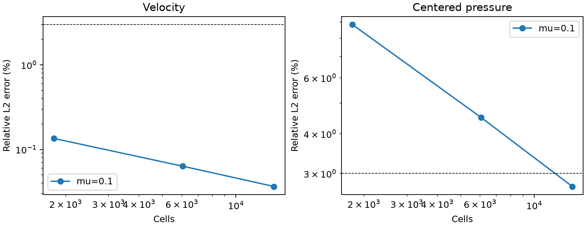
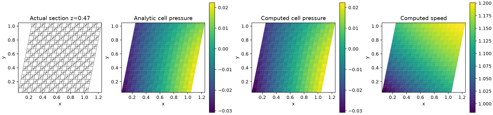
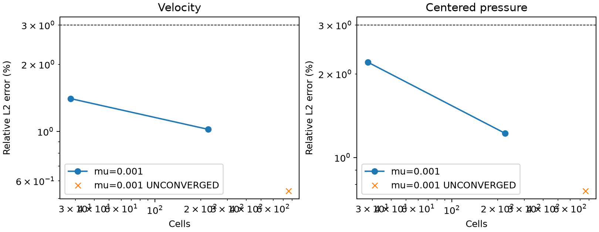
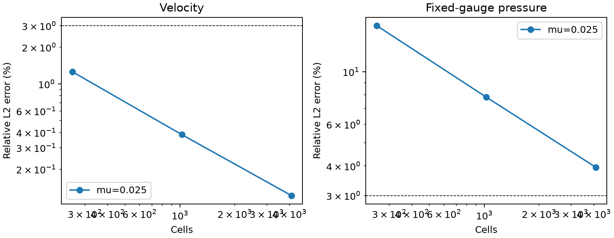
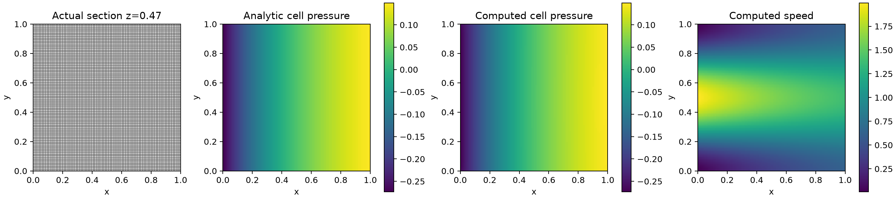

# 原生 NS 完整雅可比、线搜索与加密验证

## 1. 目的与边界

[上一阶段](../verification-native-compatible-inertia/README.md)修复共享面惯性/压力配合后，
低黏度势流仍存在“每次线性求解通过、非线性残差不下降”的问题，ABC 三维压力也尚未达到 3%。
本阶段加入原生完整 Newton 雅可比及残差线搜索，并重新计算有非零黏性作用的 Kovasznay 流和 ABC 加密网格。

Newton 是新增的**联合参考求解方法**，不是 SIMPLE/SIMPLEC，也没有取代原有分离式接口。
这里求解相同的原生 NS 离散方程，没有修改惯性、应力、体力、边界或误差口径。
SST、壁面函数以及原生 SUBOFF 的 Cp/Cd 验收仍未完成。

## 2. 完整离散导数和接受规则

每个共享面的动量通量为 `q(U) u_adv(U)`，因此

\[
\delta(q u_{adv})=q\,\delta u_{adv}+u_{adv}\,\delta q.
\]

`native_hybrid_convection3d.hybrid_jacobian` 同时包含质量流量的导数、
单元速度/面平均重构的导数和 Gauss 梯度线性迎风修正的导数。
面通量导数通过同一守恒散度和 `Rᵀ` 回到速度方程。流向改变后重新选迎风单元；
零通量处采用所选迎风分支的单侧导数，不声称处处光滑。
独立中心差分在偏斜混合网格、一/二阶格式、开放/封闭边界及密度 1.7 下核查导数。

每步联合求解速度和压力增量，保留原连续性约束及压力参考。
线搜索从步长 1 开始折半，要求当前完整方程残差的固定尺度范数满足 Armijo 下降条件。
速度/压力变化及当前方程均已低于容差时允许舍入误差范围内的最终确认步。
每个试步重建原非线性方程；被拒绝的试步不改变已接受状态。
线性真残差门槛保持 `1e-9`，非线性动量、散度、压力参考与速度/压力变化门槛为 `1e-8`。
线搜索失败、迭代上限和线性真残差失败不能视为收敛。

## 3. 分块预条件与三维求解规模

新增可选 `coupled_linear_method='block_amg'`，使用 PyAMG 5.3.0 的标量 AMG 周期和
SciPy GMRES。`tensorfvm[amg]` 为可选依赖；默认直接分解/复用 LU 路径保留。
速度预条件器使用完整梯度加原局部重构残差的标量能量，按速度分量分别建立 AMG；
它不替换方程中的对称黏性应力或梯度跳变项。

压力预条件近似 `diag(d)`，其中 `d_K=V_K/mu_K`。
封闭边界下消去固定参考压力变量及对应行，并在动量右端保留其非零贡献；
对剩余压力采用

\[
\left[\operatorname{diag}(d_r)-d_r d_r^T/\sum_Kd_K\right]^{-1}
=\operatorname{diag}(1/d_r)+\mathbf1\mathbf1^T/d_0.
\]

这保留预条件近似中的常压力零空间。开放压力边界使用不含零空间修正的压力质量近似。
分块三角作用中进行两次速度 AMG 周期。仅预条件器为近似，GMRES 使用原耦合矩阵；
每个答案再对当前原矩阵检查真实残差，并检查迭代退出状态。
内部 GMRES 容差为 `1e-13`，用于避免细网格连续性误差被整体线性残差掩盖；
物理动量、散度、力与能量门槛保持不变。

直接求解的 6,048 单元试算在分解阶段耗时超过 13 分钟；确认分块探针在 224、1,792、
6,048 单元通过真实残差检查，且前两档与直接法一致后，停止了该直接试算。
[停止记录](direct-abc/termination.json)明确标记 6,048 单元尚无该次直接解。
正式加密使用分块求解器重新保存完整场，不能把探针日志当成正式原场证据。

## 4. 初值和可复现性

`initialize_stokes()` 先用相同网格、物性和边界求原生 Stokes 解作为初值。
此步骤不读取解析内部速度或压力；解析边界与压力参考沿用验证工况定义。
随后 Newton 恢复完整惯性残差并求 NS 解。保存初始速度、面速度和压力，便于独立审核。
这能改善部分工况的初值，但不能保证所有网格/雷诺数均收敛。

`verify_native_newton.py` 使用已有共性物理解和网格模块，保存全部原网格/场、
两侧数值牵引、动量通量、每个线搜索试步、真线性残差、环境、源码快照与 SHA256。
每个计算结束核对源码未变化。误差仍为体积加权相对 L2；
ABC/势流使用去均值压力，Kovasznay 同时报固定参考压力和去均值压力，
并继续以历史的**固定参考压力**指标验收，不用较小的去均值误差替换。

## 5. 结果

### 真正三维 ABC 网格加密

| 单元数 | 速度误差 | 压力误差 | 当前方程收敛 | 解析精度与守恒门槛 |
|---:|---:|---:|:---:|:---:|
| 1,792 | 0.13470% | 8.83001% | 是 | 未通过 |
| 6,048 | 0.06332% | 4.50317% | 是 | 未通过 |
| 14,336 | 0.03646% | 2.73033% | 是 | 通过 |

[完整指标](abc-amg/cases.json) · [配置](abc-amg/settings.json)

14,336 单元包含 38,400 个面、148,992 个自由速度未知量及 14,336 个压力未知量。
6,048→14,336 单元观察阶为速度 1.919、压力 1.739。
最细网格达到既定三维制造解门槛，三档误差单调下降；粗网格失败记录保留。
最细网格当前动量残差 `2.32e-15`、最大散度 `1.38e-12`，整体动量与能量闭合约 `5.20e-14`、`1.01e-13`。
计算约 213 秒；这不是物理 SUBOFF 的 Cp/Cd 通过。




### 无体力三维势流，黏度 0.001

| 单元数 | 速度误差 | 压力误差 | 当前方程收敛 | 解析精度与守恒门槛 |
|---:|---:|---:|:---:|:---:|
| 28 | 1.40295% | 2.20500% | 是 | 通过 |
| 224 | 1.02212% | 1.22218% | 是 | 通过 |
| 756 | 0.54311% | 0.75984% | **否** | 未通过 |

[完整指标](potential/cases.json) · [配置](potential/settings.json)

224 单元的低黏度失败已通过原生 Stokes 初值加 Newton 解决；756 单元仍失败，不宣称低黏度网格验证整体通过。



### Re=40 Kovasznay，平面对称挤出加密

| 单元数 | 速度误差 | 压力误差 | 当前方程收敛 | 解析精度与守恒门槛 |
|---:|---:|---:|:---:|:---:|
| 256 | 1.25748% | 15.64750% | 是 | 未通过 |
| 1,024 | 0.38397% | 7.81218% | 是 | 未通过 |
| 4,096 | 0.12172% | 3.94954% | 是 | 未通过 |
| 9,216 | 0.06727% | 2.66609% | 是 | 通过 |

[完整指标](kovasznay/cases.json) · [配置](kovasznay/settings.json)

该网格为 `n×n×1`，不能替代真正三维 ABC。4,096 单元的去均值压力误差为 0.799%，但预定固定参考压力误差为 3.950%，仍不通过。9,216 单元独立计算现已完成，固定参考压力误差 2.66609%、去均值压力误差 0.37069%，通过预定门槛。四档误差单调下降。

[细网格完整指标](kovasznay-fine/cases.json) · [细网格配置](kovasznay-fine/settings.json)。
细网格有 74,112 个面、210,816 个自由速度未知量和 9,216 个压力未知量。
原生 Stokes 初值后 4 步 Newton 收敛；当前动量残差 `5.15e-15`、最大散度 `1.21e-13`，
整体动量闭合 `1.27e-13`、能量闭合 `1.78e-15`，计算约 1,134 秒。
该次仍使用联合参考求解，不声称大网格 SIMPLEC 或物理 SUBOFF 已通过。




切面图中压力分别去体积均值，仅供场形态对照；验收采用上表固定参考压力误差。

### 线性算法与效率限制

1,792 单元 ABC 和 4,096 单元 Kovasznay 均保存直接法与分块法的独立原场对照。
分块法没有降低线性/非线性门槛；相同方程的场差异另见原场审计结果。
对各向异性的 `64×64×1` 网格，分块法耗时约 585 秒，直接/复用 LU 约 240 秒，**分块法更慢**。
停止其尚未完成的 96 档重复计算，改用独立的直接/复用 LU 细网格运行；
[停止记录](kovasznay-amg/termination.json)和已收敛 64 档完整原场均保留。
不能把三维混合网格上的加速推广为所有网格上的性能结论。


## 6. 已保留的反例

- 直接零内部初值：224 单元势流的黏度 0.01、0.001 在 50 次 Newton 步后未收敛，
  [探针源码](probes/zero_start.py)与[日志](probes/zero_start.txt)保留。它不具备完整场快照，正式场证据使用下方运行目录。
- Stokes 初值也不能保证收敛：756 单元、黏度 0.001 的势流仍在线搜索中失败，
  动量残差约 `1.01e-3`；即使末态压力误差小于 3%，验收仍为 false。
- 黏度延续 `.01 → .005 → .002 → .001` 的独立探针也未解决该细网格问题：
  最后阶段线性真残差 `1.41482e-9` 超过门槛，被拒绝。
  [源码](probes/viscosity_continuation.py)和[日志](probes/viscosity_continuation.txt)完整保留，没有放宽阈值。

上述证据尚不能单独判定是离散分支、低黏度稳定性还是全局求解策略的问题。
下一步需要继续区分这些原因，不能把一个粗网格的 Newton 成功解释成高 Re 外流算法已经成熟。

## 7. 复现

```bash
python -m pip install pyamg==5.3.0  # 在已有 benchmark Python 环境中补充可选依赖
export OMP_NUM_THREADS=1 OPENBLAS_NUM_THREADS=1 PYTHONPATH=src
python scripts/verify_native_newton.py --case potential --levels 2 4 6 --viscosities .001 --output results/reproduce-newton-potential
python scripts/verify_native_newton.py --case abc --levels 8 12 16 --viscosities .1 --linear-method block_amg --output results/reproduce-newton-abc
python scripts/verify_native_newton.py --case kovasznay --levels 16 32 64 96 --viscosities .025 --output results/reproduce-newton-kovasznay
python scripts/verify_native_newton.py --case kovasznay --levels 64 96 --viscosities .025 --linear-method block_amg --output results/reproduce-newton-kovasznay-amg
```

目录必须为空；退出码 0 要求该运行所有案例都通过原解析精度和守恒门槛。
任何网格未通过时会保留数据并退出 2。代码路径均为原生 TensorFVM；只在 CPU 测试，GPU 未测。

## 8. 回归与原场审计

[76 项相关回归通过](tests.txt)，覆盖完整雅可比、迎风方向与背流导数、线搜索拒绝、线性失败不污染已接受解、
Newton/Picard 同方程对照，以及既有 SIMPLE/SIMPLEC、应变、守恒检查。
另补充了平滑/跳跃黏度与分量对称边界的分块求解对照；[该模块 6 项通过](variable-viscosity-tests.txt)，其中 4 项与主回归重合。
旧配点黏性增能反例仍未修复；本阶段不把旧路径计为已通过。

`python scripts/audit_native_newton_evidence.py docs/verification-native-newton`
从保存网格/场重新计算误差和整体动量，核对源码快照和判定字段，且独立比较线性算法结果。
[审计 JSON](artifact-audit.json)保持 `physical_suboff_benchmark_passed=false`。

## 9. 尚未完成

原生 SUBOFF Cp/Cd、参考数据资格、SST 和壁面处理尚未完成。
继续完成当前版本的无体力有限 Re 加密验证，再推进新后端的湍流输运、壁面剪切和物理外流。
低黏度细网格反例和各向异性网格上的分块求解效率仍须继续处理。
