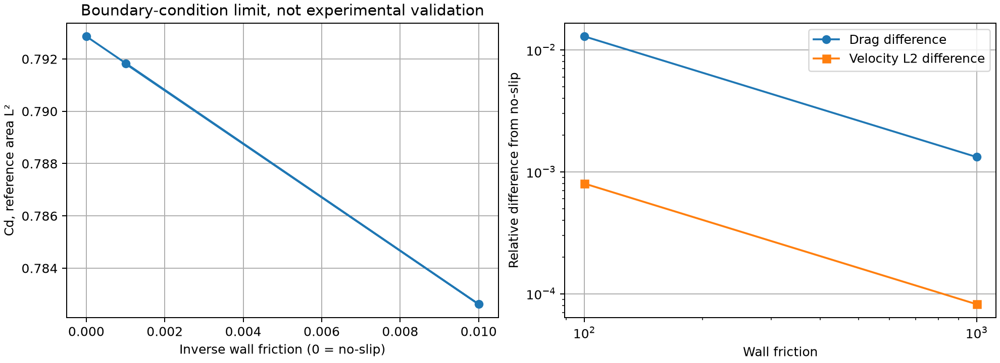
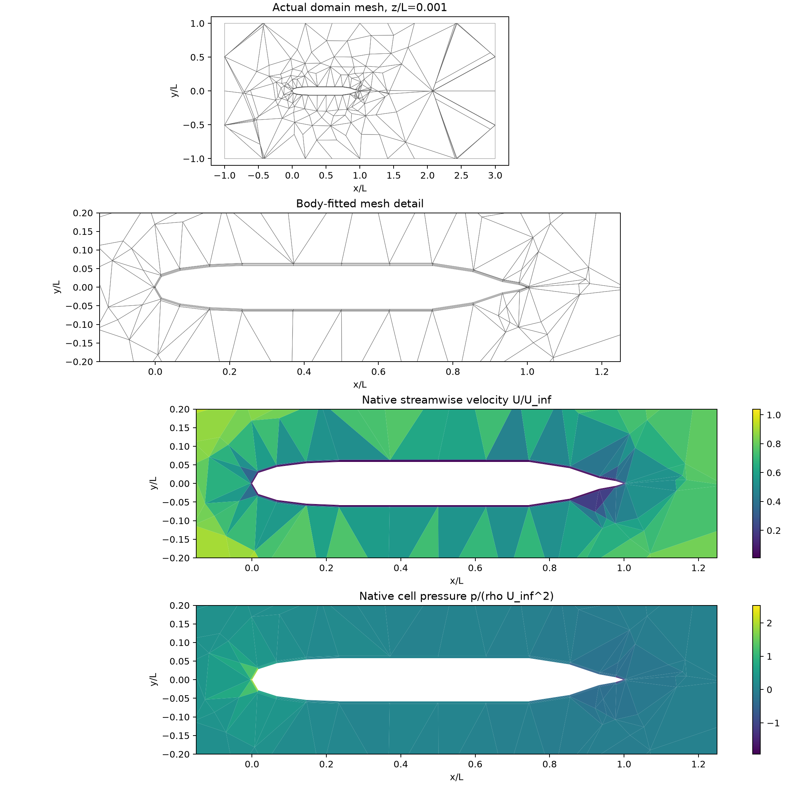

# 任意面法向约束与 SUBOFF 曲面滑移验证

## 1. 已完成与适用范围

原生混合后端新增 `normal_velocity_faces`，通过切向基消元约束任意平面网格面的法向平均速度。
状态、梯度、牵引和输出继续采用物理笛卡尔分量；没有添加很大的法向罚系数。
代码 `628f801` 已合入主线；[73 项组合测试](tests.txt)及[12 项黏性回归](viscous-regression.txt)通过。
两组真实 SUBOFF 几何上的有限滑移 NS 计算均收敛并通过独立原场审计。
**这些是边界实现及无滑移极限一致性检查，不是 SUBOFF 实验精度或湍流壁面函数验收。**

## 2. 数学与软件实现

将物理速度写为 `u=u_D+P q`。约束面上 P 的两列是与实际面法向正交的单位切向量；
其余自由分量保留笛卡尔基。P 的列正交，速度、动量矩阵和连续性统一变换为：

```
A_reduced = Pᵀ A P
B_reduced = D P
momentum residual = Pᵀ(Au − Dᵀp − f)
```

压力梯度仍是实际连续性算子的负转置，保持压力功一致性。
原生 Stokes、SIMPLE/SIMPLEC、Newton、变黏度重建和 RANS 当前残差均采用该映射；
AMG 在同一可容许速度空间投影其预条件器。
旧的笛卡尔分量边界使用原索引路径；法向约束与同一面的笛卡尔分量约束不能重叠。
`velocity_boundary` 给出约束面的法向速度，切向部分仍由牵引/Robin 方程求解。

法向条件使边界不再被误判为开口压力边界；封闭边界的非平衡通量会被拒绝。
刚体约束检查同时计入法向和正摩擦约束。
当前速度边界缺陷进入收敛判据；已经收敛的状态若被改成穿透壁面，也不能继续标记通过。
在法向约束模式中，内部 `free` 是约化坐标标签，不能把它直接当作物理分量索引。
拒绝线性候选另存稀疏 P，明确其速度坐标类型。

## 3. 独立控制与几何限制

- 旋转后的滑移 Couette：联立、SIMPLEC、完整 NS/Newton 的速度、压力与功保持不变，面穿透通量接近舍入误差。
- 多边形圆柱、四边形侧面：面平均刚体旋转兼容零法向平均通量，直接与 AMG 求解都再现零应变和零剪切。
- 三角化侧面：刚体旋转在每个小三角形面心一般有非零法向分量，不能将它当成静止面零通量的精确参考。
  针对此情况单独验证实际零通量、方程与功率收支，并比较直接与 AMG 解；不宣称其等于刚体旋转解析场。
- 非零兼容法向边界、面平衡与黏度重建、错误边界拒绝也有测试。

这里约束的是 FV 面平均通量，不声称在多边形面的任意点满足精确光滑曲面条件；曲面几何仍需网格加密。

## 4. 实际 SUBOFF 有限滑移计算

沿用已冻结的 1,331 单元、3,556 面贴体混合网格，ReL=10、ρ=U=L=1、ν=0.1，无体力。
入口/远场速度固定，出口零总牵引。固体静止，壁面法向速度零，切向条件 `t_t+βu_t=0`。
分别取 β=100、1000 检查向无滑移的极限，不拟合实验数据；ν/β 对应连续 Navier 滑移长度。
两组均从数值 Stokes 初始化开始，4 次完整 Newton 后通过；耗时约 126.42 / 129.55 秒。

| β | Cd,L² | 与同网格无滑移解的相对差 | 最大壁面法向速度 | 最大积分切向 Robin 缺陷 |
|---:|---:|---:|---:|---:|
| 100 | 0.7826226583 | 1.292013% | 5.20e-18 | 4.16e-17 |
| 1000 | 0.7918177677 | 0.132283% | 4.34e-19 | 3.38e-17 |
| 无滑移 | 0.7928665979 | — | 0 | 不适用 |

β 增大时速度场对无滑移解的体积加权相对 L2 差由 0.08018% 降至 0.008202%。
两组最大质量散度约 3.83e-14 / 1.71e-14，局部动量约 1.56e-15 / 1.47e-15，
总力和能量收支均低于 8e-15。完整更新量也通过，不以单独小残差代替收敛。
[β=100 原场与审计](suboff-beta100/summary.json)、[β=1000 原场与审计](suboff-beta1000/summary.json)均保留。



上述百分比是不同壁面条件之间的差异，不是实验误差；也不是网格收敛结果。
[对照程序](../../scripts/compare_native_suboff_slip_limit.py)核查同网格、Re、物性与源文件绑定，并从牵引复算阻力。
通用网格比较程序现在会拒绝混合不同摩擦系数的案例，避免将边界条件变化伪装成网格加密。



## 5. 复现和剩余工作

```bash
export OMP_NUM_THREADS=1 OPENBLAS_NUM_THREADS=1 PYTHONPATH=src
python scripts/run_native_hybrid_suboff.py --mesh docs/verification-native-hybrid-suboff-startup/mesh/suboff-hybrid.msh --reynolds 10 --wall-friction 1000 --output results/suboff-robin-new
python scripts/report_native_hybrid_suboff.py results/suboff-robin-new
python -m pytest -q tests/test_native_normal_constraints3d.py
```

不指定 `--wall-friction` 仍使用原无滑移条件；重启会拒绝不同壁面条件的输入。
下一步接入实际非线性壁面律及其当前剪切/功率闭合，再与 SST 壁面输运耦合并检查目标 y+。
线性 β 的上述控制不能自动当成高 Re 壁面函数；原生 SUBOFF 的实验 Cp/Cd、三档网格和误差 <3% 目标仍未完成。
