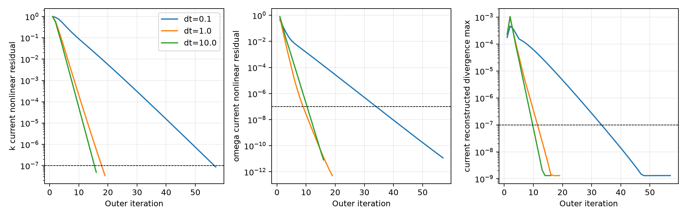
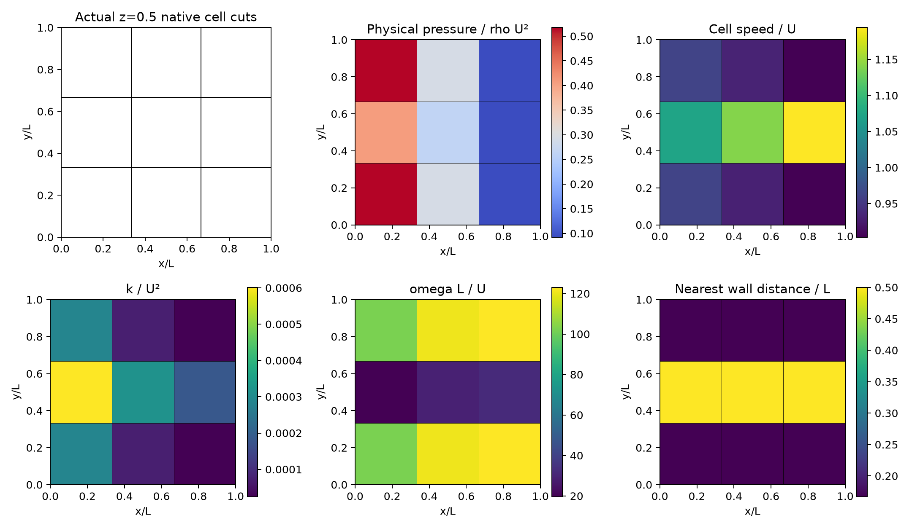

# Nonzero native 3D NS/SST numerical convergence

**Numerical coupling convergence is verified; physical benchmark accuracy remains unqualified.** The real 27-cell unit channel has uniform inlet U=1, two prescribed no-slip walls, physical-pressure outlet p=0 and prescribed uniform velocity on z boundaries. Re=20, rho=1 and molecular viscosity=.05. SST-2003 exact production, original constants, and low-Re wall omega are unchanged. This is a coupling diagnostic, not a turbulent reference experiment.

## Original limitation and correction

The [original two-outer-step run](nonzero-channel/report.md) remains preserved. Its pseudo dt=1e-4 did not advance turbulence close to steady balance; omega's current nonlinear residual stayed near 1. The new runs increase pseudo dt and outer iterations. Initial k=.001 and omega=1 remain identical; no reference solution supplies initial fields or sources. No equation, wall condition, positivity clipping or acceptance threshold was changed.

Outer gates remain **1e-7**, inner momentum gate **1e-8**. Each outer acceptance checks current momentum after updating viscosity, stored and reconstructed continuity, current Rhie–Chow flux consistency, velocity/modified-pressure/flux/k/omega changes and recomputed original nonlinear k/omega equations. Gauge is checked when applicable. The frozen implicit transport ledger is reported separately and does not qualify nonlinear convergence.

| Pseudo dt | Actual outer iterations | Current k residual | Current omega residual | Reconstructed divergence U/L | Numerically converged |
| ---: | ---: | ---: | ---: | ---: | --- |
| 0.1 | 57 | 8.72833e-08 | 1.15974e-11 | 1.31318e-09 | True |
| 1.0 | 19 | 3.41213e-08 | 5.04816e-13 | 1.31273e-09 | True |
| 10.0 | 16 | 4.86558e-08 | 8.10953e-12 | 1.31348e-09 | True |



## Actual converged mesh and fields



Fields are actual computed cell values; the native cell intersections remain visible. Physical pressure is converted consistently from pi=p+2rho k/3. Isotropic and anisotropic stress terms reconstruct the same total native face force. Raw arrays and all imported producer source snapshots are archived separately in each case directory.

## Independent pseudo-step comparison

Relative field differences below compare converged dt=.1 and dt=10 solutions against dt=1. Cell fields use volume weighting; native face flux uses its Euclidean norm. Numerical consistency limit is 1e-6, separate from the physical benchmark's requested 3% criterion.

| Pseudo dt | Velocity | Physical pressure | k | omega | Native flux |
| ---: | ---: | ---: | ---: | ---: | ---: |
| 0.1 | 8.45184e-12 | 4.34554e-11 | 9.62178e-08 | 3.14085e-11 | 1.01068e-11 |
| 1.0 | 0 | 0 | 0 | 0 | 0 |
| 10.0 | 1.52124e-11 | 2.24309e-11 | 5.84228e-08 | 9.76796e-12 | 1.80869e-11 |

## Qualification scope and reproduction

All unchanged nonlinear gates passed: **True**. Pseudo-step field consistency passed: **True**. Physical benchmark passed: **False**. No experimental drag/Cp reference, below-3% accuracy, spatial refinement, high-Re wall y+, SUBOFF result or GPU validation is claimed.

```bash
OMP_NUM_THREADS=1 OPENBLAS_NUM_THREADS=1 MKL_NUM_THREADS=1 PYTHONPATH=src python scripts/verify_native_rans_integration3d.py --outer 100 --pseudo-dt 1 --turbulence-relaxation .7 --tolerance 1e-7 --output NEW_EMPTY_DIRECTORY
PYTHONPATH=src python scripts/report_native_rans_convergence3d.py
```

[convergence.json](convergence.json) lists every gate, threshold and actual value. Detailed histories, original current-source ledgers and measured elapsed times appear in the three case result.json files. Source bindings are captured at launch. Physical validation still requires independent benchmark data and wall/mesh convergence.
