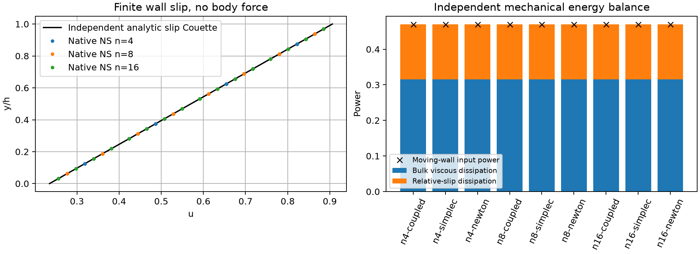
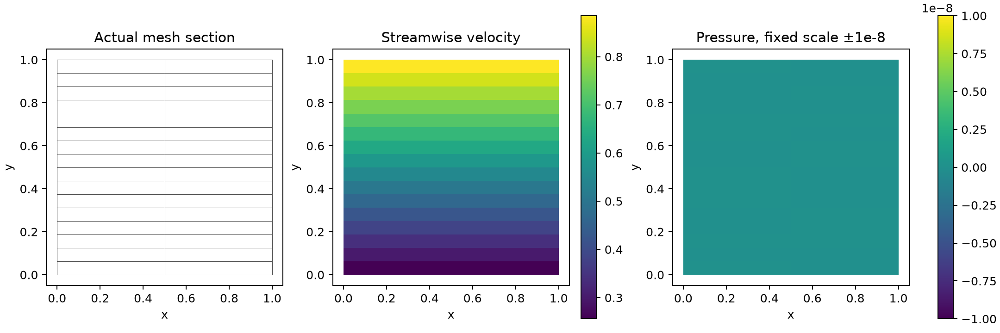

# 原生混合后端的 Robin 壁面阻力边界与独立功率审计

## 1. 范围与结论

新增共性接口 `robin_coefficient`，已在提交 `7923854` 接入主线的混合黏性、Stokes 与 NS 路径。
支持每个边界面上的对称半正定张量 C，保持原有共享面牵引与体积连续性。
[50 项相关测试](tests.txt)和[12 项既有黏性回归](viscous-regression.txt)通过。
三档三角面网格 × 联立、SIMPLEC、完整 NS/Newton 的 [9 个控制](undamped-controls/summary.json)均通过；
初始默认松弛的一项失败也完整保留。

**这里只验证线性滑移边界及守恒，不是湍流壁面函数或 SUBOFF 精度通过。**
三档控制的解析速度为仿射函数，结果接近舍入误差，验证的是精确再现性质，不能用来声称一般曲面流动收敛阶。
当前法向不渗透仍由笛卡尔分量约束在平面上实施，尚缺任意曲面法向的精确约束消元。
一般斜面上的全张量 Robin 扩散已有独立仿射测试；它没有证明曲面固壁同时满足不渗透。

## 2. 边界方程和共性实现

约定外向总牵引 `t=(τ−pI)n`，边界条件为：

```
t + C u_face = g
```

切向摩擦使用 `C=β(I−nnᵀ)`；移动壁面时 `g` 含 `C u_wall`。
它在共享面方程中增加面积加权阻力矩阵，而不是在后处理时额外拼接阻力。
边界数据参数 `boundary_traction` 在 Robin 面上表示 g。
内部面非零 C、与 Dirichlet 分量重叠、非有限、不对称或非半正定数据会被拒绝。
黏度重建保留 Robin 系数并清空旧线性求解缓存；AMG 速度预条件器也包含相应分量的阻力项。

刚体约束检查同时计入正摩擦约束，避免把由摩擦唯一确定的速度误判为欠约束。
该六模态检查仍只是必要条件，不是完整矩阵稳定性或条件数证明。

物理黏性面牵引与 Robin 反力分别保存。
代数能量中增加 `uᵀ C u`，相应非齐次边界功保持在 g 中。
对移动壁面，`uᵀ C u` 本身不等于相对滑移耗散；报告另算
`(u−u_wall)ᵀ C (u−u_wall)`，并直接检查机械能收支。

## 3. 无体力滑移 Couette 控制

单位高度，μ=0.7，底部/顶部壁速 0/1，摩擦系数 β₀=2、β₁=5。
壁面法向速度零，侧面为对称边界；入口/出口使用解析应力作为实际边界条件。
没有体力或解析内部初值。独立连续解析解为：

```
τ = 1 / (1/μ + 1/β₀ + 1/β₁) = 0.46979865771812
u(y) = τ(y/μ + 1/β₀), v=w=0, p=0
```

首轮 SIMPLEC 使用原接口默认动量松弛 0.5、压力松弛 1、最多 6000 步。
n=4/8 分别需 1277/3542 步；n=16 未收敛，动量残差 3.418e-6、总力闭合 7.681e-5、
机械功缺陷 4.677e-5。虽然速度误差很小，也不能通过数值验收。
[失败原场、全部迭代及源文件](default-relaxation-rejected/)保留；该早期 settings 未显式记录松弛值，
可由其冻结运行器及求解器签名核查上述默认值。新版运行器显式保存松弛与迭代设置。

对于这个线性、正定阻力问题，设置动量松弛 1 后，SIMPLEC 一步便得到原方程解。
没有放宽门槛、修改方程或改变通道参考值，也未将该设置无条件应用于非线性 SUBOFF。

| 法向单元 | 总单元/面 | 三种路径最大速度相对 L2 | 最大壁面力相对误差 | 最大原运行收支缺陷 |
|---:|---:|---:|---:|---:|
| 4 | 16 / 136 | 5.28e-15 | 1.43e-14 | 7.99e-15 |
| 8 | 32 / 264 | 6.78e-15 | 1.08e-14 | 3.57e-14 |
| 16 | 64 / 520 | 4.54e-14 | 1.02e-13 | 1.29e-13 |

NS 路径先数值求解 Stokes，再检查完整当前对流方程；此平行流的对流散度解析为零，
因此该控制不是有限对流强度、一般三维流动或湍流验证。



实际输入功约 0.469799，体积黏性耗散约 0.315301，滑移耗散约 0.154498。
[独立原场审计](undamped-controls/artifact-audit.json)不调用生产 Robin/黏性算子：
从保存的 C、面速度、面积重算阻力；由真实面速度 Gauss 梯度重算本仿射控制的体积耗散，
检查边界符号、逐单元力平衡、质量、滑移耗散和移动壁面功。



压力图固定色标 ±1e-8，避免将约 1e-13 的舍入波动画成可见物理压力结构。
原始压力数据仍完整保留，没有平滑或修改原场。

## 4. 软件使用与下一步

```bash
export OMP_NUM_THREADS=1 OPENBLAS_NUM_THREADS=1 PYTHONPATH=src
python scripts/verify_native_robin.py --relaxation 1 --output results/robin-new
python scripts/report_native_robin.py results/robin-new
python -m pytest -q tests/test_native_robin3d.py
```

使用 `--relaxation .5` 可复现尚未在步数预算内收敛的初始控制，预期返回失败。
后续需要任意曲面法向约束、真实非线性壁面律及 SST 壁面输运耦合，再验证目标 y+ 范围。
这份报告不替代原生 SUBOFF 的 Cp、总阻力与网格独立性验收。
