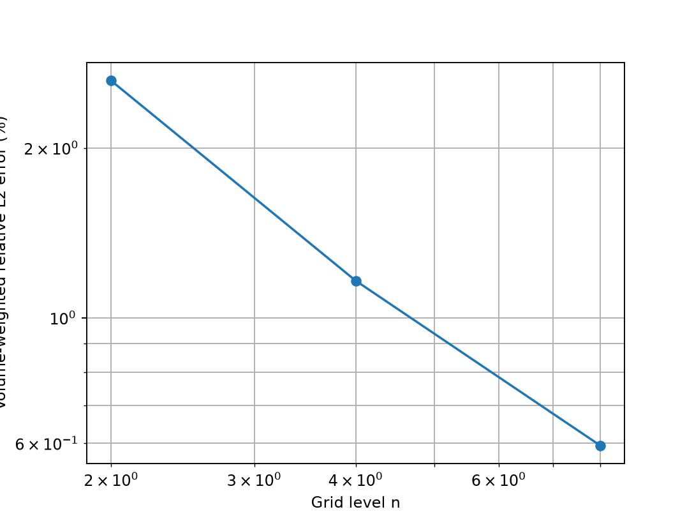

# 混合标量正值修正：通过范围、精度代价与未收敛反例

后续求解器修复见[延续 Newton 验证](../verification-native-mmp-continuation/README.md)。本页保留原 Picard 运行及当时的失败证据。


## 1. 问题定位

[上一阶段](../verification-native-hybrid-rans/README.md)发现三角面低 Re 壁面案例出现负面 k。
本次先固定闭合系数，分别改变伪时间步和网格，确认缩小步长只能暂时避免负值：
同一稳态反应—扩散问题仍给出负面值，且在 4、8、16 单元均存在。
原单元/面混合扩散矩阵含正的非对角项；能量稳定和通量守恒不足以保证正值。
[诊断源码与日志](probes/fvm-scalar-positivity-probe.log)保留。

SUBOFF 的现有层网格实际使用三角面，不能通过仅保留正交四边形面的控制计算回避这个问题。
本阶段加入可选的非线性标量图扩散修正，并直接在真实 SUBOFF 薄层几何上检验。
**该几何上的修正求解仍未收敛，物理 SUBOFF 的 Cp/Cd 仍未验收。**

## 2. 修正方程和守恒

参考 [Droniou 综述第 6.3 节](https://arxiv.org/abs/1407.1567)中的非线性对称修正原则：
在原扩散上增加非负、对称的图扩散，保留能量控制；正值和精度仍需对实际非线性解审核。
[来源记录](source-provenance.json)保存检索信息。以下严格正项、单元/面图和局部通量分配是本项目的实现选择。

令 `A` 为原混合标量扩散，图节点包括单元及共享面，同一单元内的节点两两相连。
自由节点定义

\[
b_i=1.01\frac{|(A\phi)_i|}{\sum_{j\in N(i)}|\phi_i-\phi_j|},\qquad
s_i=0.01(h_i/L)^2 A_{ii}/|N(i)|,
\]

分母为零时令 `b_i=0`；Dirichlet 节点令 `b_i=s_i=0`。
`h_i` 为单元体积的立方根，面节点取相邻单元的较大值，`L` 为网格包围盒最大长度。
边系数为 `βij=max(bi+si,bj+sj)`，修正作用为 `Σ βij(φi−φj)`。
扩散反应使用差分形式求值，以保留常量零空间。

严格正项 `si` 很重要：只使用 `bi` 时，原方程已收敛的负调和解满足 `Aφ≈0`，
修正也会消失。本次新增了该反例，避免把“非线性残差小”误判成“正值已修复”。

每条边的系数按其所属单元数量分配回局部矩阵，随后从局部反力重建两侧面通量。
因此修正同时进入单元方程、面平衡、边界扩散通量和能量，不是计算后裁剪。
新增能量为 `Σ βij(φi−φj)²≥0`。常量保持精确；严格正项使仿射解不再机器精度精确。
仿射探针最大绝对误差随 `n=2/4/8` 降为 `4.64e-4 / 6.13e-5 / 7.79e-6`，
[原始日志](probes/fvm-mmp-affine-probe.log)保留。

接口为 `NativeHybridScalar3D(..., correction='nonlinear_mmp')`，
SST/RANS 使用 `scalar_correction='nonlinear_mmp'`。默认仍为 `none`。
当前只支持 Dirichlet 和齐次 Neumann 扩散边界；非零 Neumann 明确拒绝。
没有对所有网格、源项或非线性迭代作无条件正值/收敛承诺。

## 3. 当前方程与迭代门槛

每次冻结图系数后线性求解，状态以 0.5 松弛，最多 600 次。
返回前按**当前状态**重新构建图系数，要求原非线性残差与状态变化均 <`1e-12`，
并要求单元、界面、整体收支及功闭合绝对缺陷均 <`1e-8`。
SST 仍检查所有单元/面 k≥0、ω>0；没有正值裁剪。

`ScalarMMPConvergenceError` 保存未接受候选场、真实残差、收支与完整历史，
SST 同时标识失败的是 k 还是 ω。未收敛候选不能传递为已接受湍流状态。

## 4. 三维加密精度与代价

沿用[上一阶段独立连续制造解](../verification-native-hybrid-scalar/README.md)：
`φ=1+x²+y²+z²`、`U=(0.6,−0.3,0.2)`、`κ=1+x`，源项由连续方程微分得到。
几何是三维偏斜六面体/四面体混合网格，边界为独立面积积分值。

| 单元数 | 原混合扩散误差 | 严格非线性修正误差 | 精度及收支门槛 |
|---:|---:|---:|:---:|
| 28 | 1.52293% | 2.62938% | 通过 |
| 224 | 0.41859% | 1.16303% | 通过 |
| 1,792 | 0.12668% | 0.59388% | 通过 |

三档均通过原 3% 与收支门槛，误差下降；修正增加了扩散，精度显著低于原算子。
不能因修复负值就默认在所有案例启用，也不能把这个制造解作为物理 SUBOFF 达标结果。




[配置](scalar/settings.json) · [指标](scalar/cases.json) · [原场审计](scalar/artifact-audit.json)

## 5. 零源项与壁面耦合结果

正边界、零源项的 28 单元调和控制：原算子最小单元值 `−0.007025`、最小面值 `−0.034128`。
严格修正后最小单元值 `0.003572`，全部单元/面值位于 `[0,1]`，但需要 578 次内迭代。
[原场与指标](controls-partial/cases.json)显示这不是裁剪得到的结果。

三角面低 Re 壁面耦合在 4、8 单元分别于 19、20 次外迭代通过，保持 k≥0、ω>0。
非零边界供给的 4/8/16 单元控制也通过，含 4 单元 SIMPLEC/Newton 对照。
这些仍是 Re=3 的接口控制，不是有实验数据的湍流 benchmark。
本次 16 单元低 Re 壁面计算因内迭代停滞被拒绝，整套耦合验收为 false。
[已完成的 6 个原场](coupling-partial/cases.json)与[失败记录](coupling-partial/failure.json)同时保留。

## 6. 实际 SUBOFF 层网格仍未通过

使用项目原有几何生成器：轴向 12、周向 8、两层，第一层厚度 `0.001L`、增长率 1.2，
实际三角面六面体/楔形层网格。仅求正仿射标量场，未添加外部流场域，未求 NS、Cp 或 Cd。
原算子仿射检查通过；增加正值修正后 600 次内迭代仍未收敛：
非线性残差约 `3.36e-10`，状态变化约 `1.68e-7`，不能接受。

另试了 Anderson 加速与含图系数导数的 Newton 探针，都未解决停滞：
Newton 的独立有限差分导数误差约 `1.14e-9`，随后线搜索仍失败。
[Anderson 日志](probes/fvm-mmp-anderson-probe.log)和[Newton 日志](probes/fvm-mmp-newton-probe.log)只属于探索证据，
没有作为生产求解器采用，也不以末态很小的标量误差宣称收敛。

[失败候选原场、完整历史及收支](failures/cases.json)用于下一阶段区分薄层条件数、
非光滑图系数和正则项各向异性影响。下一步重点是这一收敛瓶颈，再进入湍流物理验证。

## 7. 复现与回归

```bash
export OMP_NUM_THREADS=1 OPENBLAS_NUM_THREADS=1 PYTHONPATH=src
python scripts/verify_native_hybrid_scalar.py --scalar-correction nonlinear_mmp --output results/reproduce-mmp-scalar
python scripts/audit_native_hybrid_scalar.py results/reproduce-mmp-scalar
python scripts/verify_native_hybrid_rans.py --scalar-correction nonlinear_mmp --output results/reproduce-mmp-rans
python scripts/verify_native_scalar_mmp_controls.py --output results/reproduce-mmp-controls
python scripts/verify_native_mmp_failures.py --output results/reproduce-mmp-failures
```

输出目录需为空。RANS 与层网格控制当前会因上述未收敛案例退出失败；这不是全部通过的 benchmark 套件。
失败导出脚本专门保存被拒绝候选，其正常退出只表示失败已复现和保存。
[84 项数值回归通过](tests.txt)，新增异常候选导出另由实际失败计算验证。
全部计算为 CPU；最终物理 SUBOFF 的 Cp/Cd 验收始终为 false。
