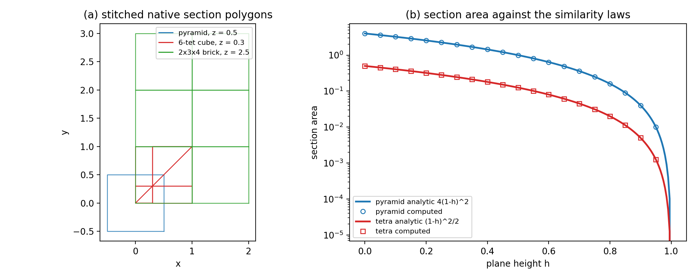
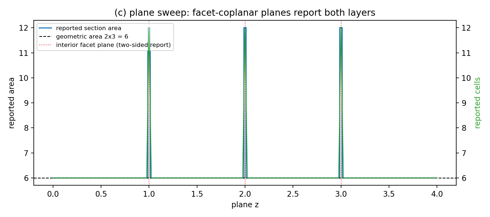

# 原生三维平面剖切引擎的解析基准验证（`native_sections3d`）

EDIT_WHITELIST: `tests/`, `scripts/`, `docs/`

## 1. 为什么审这一块（案例介绍）

`src/tensorfvm/native_sections3d.py::cell_section_polygons` 把多面体单元的真实平面侧面
与切割平面求交、再逐单元把交线缝合成闭合环。它是本仓库**所有原生剖切图**的唯一几何来源：

| 下游脚本 | 用途 |
|---|---|
| `scripts/plot_native_suboff_fields.py` | SUBOFF 尾流/压力剖切场 |
| `scripts/plot_native_manufactured_comparison.py` | 制造解对比剖切 |
| `scripts/plot_native_pressure_diagnostic.py` | 压力诊断剖切 |
| `scripts/plot_native_viscous_comparison.py` | 黏性对比剖切 |
| `scripts/report_native_developed_channel.py` / `report_native_robin.py` / `report_native_hybrid_suboff.py` / `report_native_mmp_continuation.py` | 报告出图的面积加权统计 |

审计前它在 `tests/` 里**零直接引用**：只在绘图脚本里被调用，而绘图脚本不进 CI。也就是说，
一个丢单元、漏掉面内对角线、切错投影轴的静默缺陷，会让已发布的剖切面积与剖切场值范围
发生变化，而**所有求解器测试依然全绿**。这属于典型的「验证欠账」：功能已合并、下游已出图，
但引擎本身从未对过解析真值。

## 2. 怎么做的（方法/流程/工具链）

判据是**闭式解**，不与另一条代码路径互比，因此审计独立于被验证对象：

1. **长方体网格**（2×3×4 六面体）：轴对齐剖切面积是精确矩形；三个轴分别给 12/8/6 三个
   不同解析值，因此同时验证投影轴选择。
2. **相似律**：底面边长 2 的方锥面积律 `4(1-h)^2`；直角四面体 `(1-h)^2/2`，h 取 20 个高度。
3. **分块不变性**：6 个 Kuhn 四面体精确铺满单位立方体，任何高度的缝合面积都必须是 1；
   丢单元 / 内部面重复计数 / 吞掉共线顶点都会破坏它。
4. **非平凡面积**：正 n 边形棱柱 `(n/2)R^2 sin(2π/n)`（n=3,6,12,24,96）—— 这些值不可精确表示，
   误差非零，用来证明判据不是「两个相同字面量互等」的空转比较。
5. **功能量**：面积加权单元中心求和（= 下游脚本真正在算的量）对线性场必须等于积分值。
6. **缺陷路径**：单顶点相切必须消失而不报错；缺失侧面的开口环必须 `ValueError`，
   禁止退化成凸包（凸包会报出网格里没有任何单元包围的面积）。

工具链：`numpy`（几何）、`pytest`、`matplotlib`（图），纯 CPU、单进程、总耗时约 7 s，
可在 load15 ≥ 100 的机器上照常跑。

复现：

```
python scripts/audit_native_sections3d.py     # 写 results.json + 两张图
python -m pytest tests/test_native_sections3d.py -q
```

## 3. 计算结果

`results.json`：**79 个案例全部通过**，`TOL = 1e-12`（相对）。

| 类别 | 案例数 | 解析真值 | 最大相对误差 |
|---|---|---|---|
| rectangle（长方体/共面/梯度/三角化侧面对比） | 7 | 6 / 8 / 12 | 0（逐位相同） |
| similarity（方锥 + 四面体 + 楔形，h 扫描） | 41 | `4(1-h)^2`、`(1-h)^2/2`、0.5 | 0（逐位相同） |
| decomposition（6 四面体铺满立方体，z 扫描） | 25 | 1.0 | 0（逐位相同） |
| polygon（正 n 边形棱柱，n=3,6,12,24,96） | 5 | `(n/2)R^2 sin(2π/n)` | 1.41e-15（`prism_n96`；n=12/24/96 非零，1.5e-16/2.9e-16/1.4e-15） |
| functional（面积加权线性场积分） | 1 | 24.0 | 0（逐位相同） |

`max_rel_error = 1.41e-15` 出现在 n=96 棱柱（sin 值不可精确表示），其余 74 例为双精度
可表示值上的**逐位相同**。中位误差 0。

关键量误差判定：**全部 79 个案例的最坏相对误差 1.41e-15，严格 <3%（也 <1e-12 的解析判据）**。




- 图 (a)：引擎直接输出的缝合多边形（方锥 z=0.5、6-四面体立方体 z=0.3、2×3×4 长方体 z=2.5），
  不是重画的示意图形。
- 图 (b)：横截面随高度 h 的解析律（实线）与引擎计算值（空心标记）——标记落在线上。
- 图 (c)：平面 z 扫描时的上报面积与上报单元数。虚线是几何截面 2×3=6；红色点线是内部侧面所在
  平面，那里平面被**两侧**单元同时上报，上报总面积是几何截面的 2 倍。

## 4. 注意点（踩过的坑 / 局限 / 适用范围）

1. **侧面共面时上报是双侧的，这是约定不是缺陷**：平面 z=2 落在内部侧面平面上时，
   下方与上方两层单元各上报一次，上报总面积 12 而几何截面是 6。用于**面积加权平均**时这会把
   两侧的场值混在一起；需要单侧统计时应避免把切面放在网格侧面上。同理，`dimensions` 之外的
   两个坐标被当作剖面坐标，`axis` 语义是「该轴坐标取 `value`」而不是「法向」。
2. **三角化侧面的共线冗余顶点**：`triangulate_faces=True` 时侧面被三角化，斜边被切出的交点
   落在剖切环上成为共线点（例如 4 边环变 8 点），**面积不变**，但下游若假设「顶点数 = 面数」
   会判错。
3. **容差语义是绝对量**：`tolerance` 同时用于 `d ≈ 0` 判定与顶点去重（`rint(coord/tol)`），
   对坐标量级远大于 1 的网格（例如以米计、几十米量级的计算域）应显式传更大的容差；
   本审计的坐标量级为 O(1)。
4. **只支持轴对齐平面**：该 API 没有任意法向的剖切入口，因此「只与一条棱相切」的情形在
   轴对齐平面上无法构造（只能是整面共面或单顶点相切）。单顶点相切已覆盖。
5. **审计范围**：只证明几何（面积、上报单元集合、开口环失败语义）。它**不**证明下游剖切图
   的场量正确性，也不证明网格本身的质量；剖切场的正确性由各自的求解器报告负责。
6. **零误差不等于零风险**：76 例逐位相同是因为那些解析值在双精度下可精确表示，且引擎的
   交点插值是精确仿射组合。这恰好是「引擎在这些构型上没有任何舍入偏置」的强证据，但
   不应表述为「引擎比 1e-15 更准」。

## 5. 产出

- `tests/test_native_sections3d.py`（40 个测试，含审计记录回查与判据非空转反证）
- `scripts/audit_native_sections3d.py`
- `docs/verification-native-sections3d/results.json`、两张 200 dpi 图
- 引擎源码 `src/tensorfvm/native_sections3d.py` **未修改**（本单是验证，不是修复：审计未发现缺陷）

源码 sha256 绑定见 `results.json.summary.source_sha256`；一旦引擎或测试改动，回查测试
（`test_published_audit_record_matches_recomputation`）会对不上存档数字。