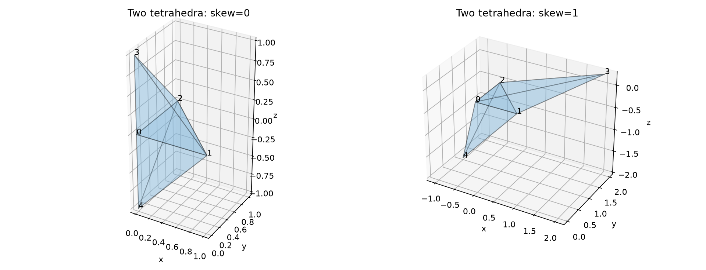
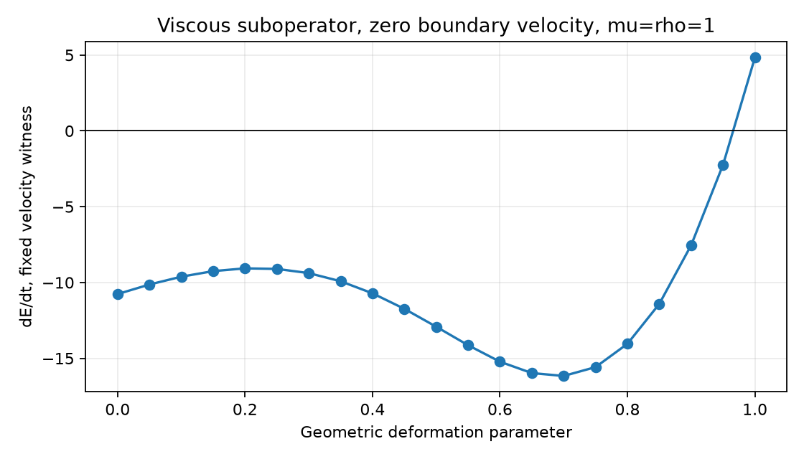

# 原生 FVM：先用小案例确认缺陷

日期：2026-10-12。生产代码起点：`fc91349e2de9f1a87202af65b634149e44300930`。
本次新增诊断和回归测试，未修改求解器离散。

**结论：四项问题都可以用 2–27 单元案例检查。三项既有修复通过复测；黏性耗散性缺陷在仅两个四面体上复现，仍未修复。**
本验证集整体不通过，也不授予 SUBOFF 的 Cp/Cd 误差小于 3% 资格。

## 1. 案例和判定

| 问题 | 小案例 | 判定标准 | 本次结果 |
|---|---|---|---|
| 黏性子算子耗散性 | 2 个四面体；静止边界，无压力、对流、湍流、外力 | dE/dt ≤ 0，允许 1e−12 舍入误差 | **失败：+4.83280454**；参考几何为 −10.76444444 |
| 松弛参数改变稳态目标 | 27 个偏斜六面体；带体力的 Stokes 流；松弛系数 0.3/0.8 | 两例均收敛至 1e−9；速度、压力相对差异 <1e−8 | **通过**：2.1524e−10 / 4.0342e−10 |
| 中断后壁面力滞后 | 27 单元通道；SIMPLE + SST + Spalding；动量步后中断 | 当前壁面力满足同一壁面律，且不修改状态/矩阵 | **通过**：相对差异 0；冻结牵引仍相差 4.2441e−4 |
| 被拒绝线性解覆盖有效状态 | 8 单元；分别注入不准确压力解、NaN 压力解 | 两者均被拒绝；u、p、q 及历史保持原状态 | **通过**：两种注入均保留状态，接受步数 0 |

前两项为离散方程性质检查；壁面力项为本构和输出一致性检查；失败状态项为故障注入测试。
故障注入本身不解释 SUBOFF 压力系统为何难解。

[机器可读总表](run/summary.json)。既有三项修复前的数据与失败日志见[上轮审计](../verification-native-solver-audit/README.md)。
本次新跑的是当前版本，没有将历史修复前结果标为本次计算。

## 2. 两个四面体的反例

### 几何与条件

| 顶点 | x | y | z |
|---|---:|---:|---:|
| 0 | 0 | 0 | 0 |
| 1 | 1 | 0 | 0 |
| 2 | 0 | 1 | 0 |
| 3 | 2 | 2 | 0.25 |
| 4 | −1 | 1 | −2 |

两个单元为 `(0,1,2,3)`、`(0,2,1,4)`，共享 z=0 的三角面。体积分别为 1/24 和 1/3；共有 7 个面。
所有面投影为正，网格通过现有几何检查。最大非正交角 **86.6509°**，属于强偏斜压力测试，不能代表合格工程网格的一般精度。

所有外边界速度为零，ρ=μ=1。只检查黏性子算子，设单元速度为：

```text
u0 = (1, 0, 0)
u1 = (0, 0, 0)
```

不需要特征向量、SUBOFF 几何文件或大规模求解。



### 动能检查

令 A 为负的积分黏性算子，M 为单元体积矩阵：

```text
M du/dt = −A u
E = uᵀ M u / 2
dE/dt = −uᵀ A u
```

当前反例：

- uᵀAu = **−4.8328045449105765**；
- 不调用动量通量矩阵，从面梯度重新组装 τ=∇u+∇uᵀ−(2/3)tr(∇u)I，再积分牵引，得到 dE/dt = **+4.832804544910575**；
- 两条计算路径的能量平衡差为 **1.78e−15**；它们共享面梯度重构，并非完全独立的离散实现；
- 对称部分最小特征值为 **−7.14778901**；
- 同网格标量扩散 A 的最小对角元也为 **−4.82848343**，说明检查范围需要覆盖共享梯度/非正交扩散，而不限于对称应力耦合。

完整 6×6 动量矩阵、2×2 标量矩阵、几何、速度和面牵引见[反例原始数据](run/energy_skew.json)。
这确认离散黏性项对该速度场产生瞬时动能增长。速度场未要求无散，不能据此断言完整不可压缩系统有增长特征模态，或已解释 SUBOFF 失败的全部原因。

### 参考几何和变形扫描

保持公共面不变，用参数 s∈[0,1] 设置：

```text
顶点 3 = (2s, 2s, 1−0.75s)
顶点 4 = (−s, s, −1−s)
```

相同固定速度场、相同边界条件，扫描 21 个 s 值。s=0 时最大非正交角 25.2394°，dE/dt=−10.76444444，对称部分正定；s=1 时出现上述反例。
扫描展示几何敏感性，不提供通用安全角度或网格质量门槛。



## 3. 复现与回归

```bash
OMP_NUM_THREADS=1 OPENBLAS_NUM_THREADS=1 MKL_NUM_THREADS=1 PYTHONPATH=src \
/data/TensorFEM/.venv/bin/python scripts/verify_native_small_cases.py \
  --output results/native-small-cases-replay
```

输出目录须为空。**当前脚本应返回退出码 2**，同时写完报告和图片；这是耗散性要求未满足的明确标志。
输出的 `all_requirements_passed` 和 `physical_benchmark_passed` 均为 false。
`run/sources.json` 和 `run/source-snapshot/` 保存本次生产源文件及 SHA-256。

```bash
OMP_NUM_THREADS=1 OPENBLAS_NUM_THREADS=1 MKL_NUM_THREADS=1 PYTHONPATH=src \
/data/TensorFEM/.venv/bin/python -m pytest -q -rx \
  tests/test_native_energy_small.py tests/test_native_simple3d.py tests/test_native_viscous3d.py
```

本次结果为 **19 passed, 1 xfailed（15.68 秒）**，见 [tests.txt](tests.txt)。耗散性要求使用 `xfail(strict=True)` 保留为显式已知失败；这不表示要求通过。
未来若修复使其通过，严格 XPASS 会要求删除该标记，避免长期隐藏已解决或变化的缺陷。
原有 SIMPLE 压力修正一致性测试也在本次回归范围内。

## 4. 下一步顺序

1. 先针对两单元反例检查共享面梯度与非正交扩散，保留线性场精确性、共享面守恒和参考几何耗散性。
2. 扩展至薄层棱柱/六面体与四面体过渡网格，检查耗散性和压力响应；两个四面体通过并不足以覆盖混合网格。
3. 再用层流平板/通道等解析或可信参考案例检验精度及网格收敛，随后验证 SST 与壁面函数。
4. 这些层级通过后再回到 SUBOFF 的 Cp、Cd 和网格独立性验证。
