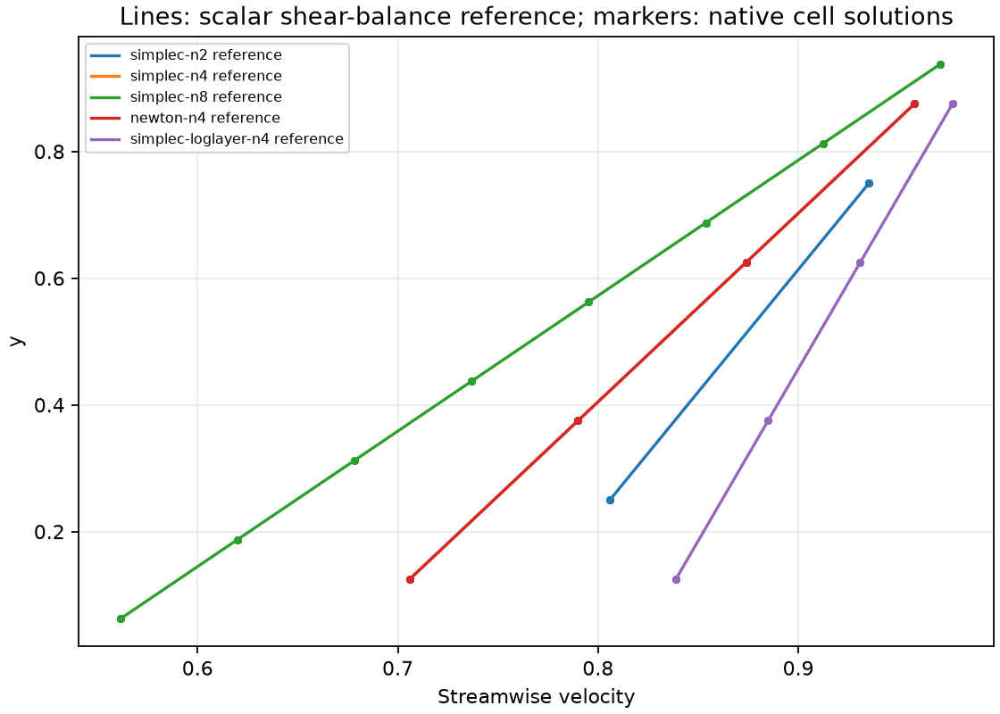
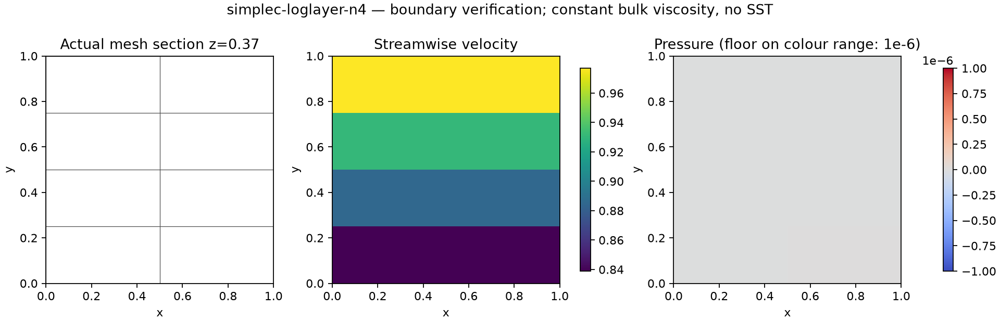

# 原生混合动量中的 Spalding 壁面牵引

2026-10-13。新增 `NativeSpaldingWall3D`，将壁邻单元采样的非线性 Spalding 应力接入原生 Navier–Stokes 的边界方程、Newton 雅可比以及 SIMPLE/SIMPLEC 当前残差。五组无体力 Couette 计算通过边界验收，相关新测试与原有 Robin/Newton/RANS 回归合计 **49 项通过**。

**本报告验证非线性动量边界，使用明确给定的常数体黏度；尚未耦合 SST 壁面 G 和 ω 更新，也不构成 SUBOFF 的 Cp/Cd <3% 结论。** 不把常数体黏度当作 SST 求解结果。

## 1. 物理问题和边界

单位立方通道，上壁沿 x 方向以速度 1 运动，下壁物理速度为零；无体力。上壁无滑移，下壁法向速度严格为零，切向应力由 Spalding 壁面律决定。横向侧面不穿透，流向两端的横向速度为零、法向总牵引为零。流入/回流速度取此一维问题的解析剖面，仅作为边界数据；内部初值由原生 Stokes 求解生成，没有填入解析内部场。

密度 ρ=1，体黏度 μ_bulk=0.02。常规组分子黏度 μ=0.001；另一组 μ=0.0002，用于增加 y+。网格为 2×n×2 个六面体，面三角化；n=2、4、8 时分别有 8、16、32 个单元，壁邻采样距离 d=1/(2n)。小网格用于检查边界装配，不用于湍流网格精度结论。

独立的一维常应力参考由以下标量关系求根获得：

```
1 = u_tau * u_plus(d*u_tau/nu) + rho*u_tau²*(1-d)/mu_bulk
tau = rho*u_tau²
U(y) = u_tau*u_plus(d*u_tau/nu) + tau*(y-d)/mu_bulk
```

这里 `u_plus` 是给定 y+ 的 Spalding 反函数。实际求解则使用给定单元速度反求 u_tau 的边界组件。该参考验证选定边界模型的离散实现，不是湍流实验数据。

## 2. 单元采样与边界工作

P=I−nnᵀ。壁面律使用 `P(U_owner−U_wall)`，将计算所得牵引加入壁面共享自由度对应的动量方程；面法向速度保持精确约束。Newton 使用本构精确导数与采样/投影映射的组合，SIMPLE/SIMPLEC 每轮重建当前割线系数。当前算子是单元采样、面方程施力的非局部边界关系，不假定其矩阵对称。

共享面速度是外部离散流场的辅助迹，并没有被强制设为物理壁面的无滑移速度。**它不能作为物理壁面速度输出，也不能直接用来替代 Foundation 12 无滑移边界的 snGrad。** 这一构造与 OpenFOAM 的边界 nut 离散实现不同；相同采样位置和壁面本构不等于已经实现相同离散算子。

壁面采样耗散与实际离散边界工作分别记录：

```
D_sample = -(U_owner-U_wall) dot T
P_wall = U_wall dot T
P_transfer = (U_face-U_owner) dot T
P_boundary = U_face dot T = P_wall - D_sample + P_transfer
```

T 是模型的积分切向牵引。n=4 常规 SIMPLEC 组的 D_sample=0.004744831、P_boundary=−0.004462487、P_transfer=0.000282344，不能忽略采样与面迹的差别。P_transfer 是该离散构造的工作转移项，不是迭代残差；其物理影响仍需在耦合 SST 和真实参考案例中验证。

动量的局部/全局账本使用实际离散牵引；模型目标牵引与实际切向牵引另外比较。报告脚本从保存数组重新检查边界力、功率分解与速度误差，并核对字段和生产源码 SHA256。

## 3. 实际结果

| 算法 / n / 分子黏度 | 速度最大误差 | 壁面剪应力最大误差 | 工作收支误差 | y+ |
|---|---:|---:|---:|---:|
| SIMPLEC / 2 / 0.001 | 5.295e-10 | 3.231e-11 | 5.255e-12 | 17.986 |
| SIMPLEC / 4 / 0.001 | 8.556e-10 | 8.778e-12 | 2.759e-11 | 10.248 |
| SIMPLEC / 8 / 0.001 | 7.511e-10 | 1.599e-11 | 4.442e-11 | 6.045 |
| Newton / 4 / 0.001 | 1.221e-15 | 4.857e-17 | 3.123e-17 | 10.248 |
| SIMPLEC / 4 / 0.0002 | 6.274e-10 | 2.998e-11 | 1.432e-11 | 37.929 |

五组均满足速度最大误差 <1e-7；剪应力、质量/局部/全局动量、接口牵引和能量收支 <1e-8；模型牵引缺陷 <1e-8；功率分解误差 <1e-10。模型壁面法向流量均为零。详细数值见各组 `summary.json` 和 [comparison/comparison.json](comparison/comparison.json)。

三种 n 改变了采样距离，常数 μ_bulk 模型的参考剪应力也随之改变；这不是固定物理问题的网格无关性研究，不能据此给出 GCI 或宣称 SUBOFF 网格收敛。





压力图使用至少 ±1e-6 的色标范围，避免将接近零的迭代误差渲染为显著压力变化；原始压力数组完整保留。其他四组的网格与场图也在 `comparison` 中。

## 4. 稳定性和回归

首次 SIMPLEC 对角松弛 0.7 在此新增边界耦合下发散，最终触发线性真实残差保护。失败日志保留为 `diagonal-relaxation-failed-tests.log`，不能声称该设置通过。改用已有的行和松弛 0.5 后通过；本报告全部 SIMPLEC 组明确采用此设置。

49 项回归覆盖：本构/装配方向差分、单元采样与面迹区分、坐标旋转、SIMPLE/SIMPLEC/Newton、移动壁面工作、低速黏性极限、非法壁面约束，以及原 Robin、Newton 和 RANS 路径。早期 4 项测试包含在此集合中，不重复相加。

当前尚未证明全湍流耦合稳定性、复杂曲面精度或 GPU 能力。必须继续接入同一状态下的 SST 壁面生产项、ω 单元约束及 k 零通量处理，再做有参考数据的湍流通道和匹配工况 SUBOFF。

## 5. 软件使用与复现

生产代码提交 `1381f23`，每组保存实际输入、原始场、迭代记录、源码快照、环境与哈希。输出目录必须为空。

```bash
export OMP_NUM_THREADS=1 OPENBLAS_NUM_THREADS=1 PYTHONPATH=src
python scripts/verify_native_spalding_couette.py --algorithm simplec \
  --layers 4 --output results/new-spalding-couette
python scripts/verify_native_spalding_couette.py --algorithm simplec \
  --layers 4 --molecular-viscosity .0002 --output results/new-spalding-loglayer
python scripts/report_native_spalding_couette.py \
  results/new-spalding-couette results/new-spalding-loglayer \
  --output results/new-spalding-report
python -m pytest tests/test_native_spalding3d.py tests/test_native_robin3d.py \
  tests/test_native_hybrid_newton3d.py tests/test_native_hybrid_rans3d.py -q
```

此前完成的 [Foundation 12 ω/G 壁面组件](../verification-wall-law-reference/linearization/omega-blend/README.md)和[低 Re SUBOFF 当前稳态收支](../verification-native-suboff-sst-startup/step47-steady-ledgers/README.md)仍分别保持其验证范围。
