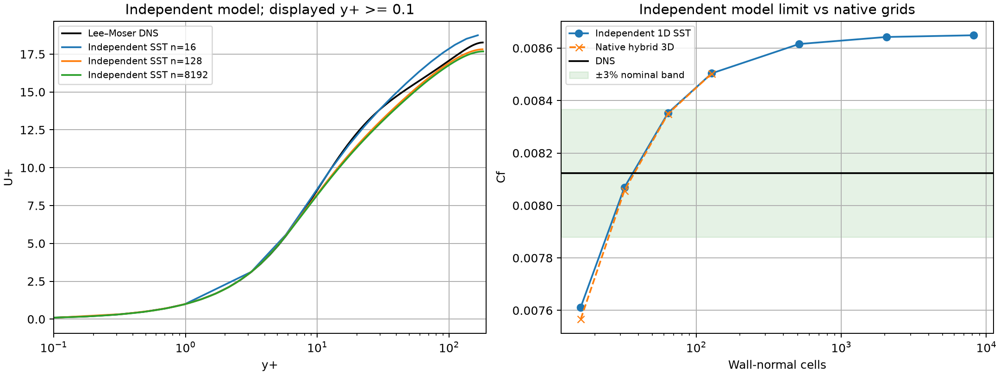

# 独立一维 SST-2003 槽道参考与模型偏差诊断

## 1. 目的与结论

三维原生槽道 n=128 已数值收敛，但 Cf 对 Lee–Moser DNS 的偏差为 4.6770%。
为区分 SST 模型/壁面条件与三维离散影响，本次独立求解同条件的一维 SST 方程。
参考求解器不调用三维生产闭合、网格、动量、标量或 RANS 算子；DNS 只用于计算结束后的比较。

- 同为 n=128，两种独立离散的 Cf 相差 **0.009662%**。
- 一维 n=8192 得到 Cf=0.0086491333，对 DNS 偏差 **6.4737%**；n=2048→8192 的变化为 **0.07615%**。
- 三维 n=128 相对最细一维参考，Cf 低约 **1.6875%**，速度相对 L2 差约 **0.8522%**。

这些结果支持：本槽道当前模型及壁面条件的预测偏差与离散误差方向相反，较粗网格曾部分抵消模型偏差。
不能因为 n=32 恰好接近 DNS 就报告总体达标，也不宜继续假定仅增加网格必然将偏差压到 3% 以下。
上述结论限于此平行流和明确的壁面条件，不证明所有三维 SST 实现或 SUBOFF 工况都正确。
**这是一维模型诊断，不替代原生 SUBOFF 的 Cp/Cd、完整三维守恒与实验验收。**

## 2. 方程与边界

依据 [NASA TMR SST-2003](https://tmbwg.github.io/turbmodels/sst.html#sst-2003) 独立编写。
[下载页面及 SHA 绑定](run/settings.json)保留；包括两个生产项共同使用 10 倍限幅、应变率黏性限制、
γ₁=5/9、γ₂=0.44 及 CD 下限 1e-10。未修改模型常数拟合 DNS。

半槽道 y∈[0,1]、ρ=1、uτ=1、ν=1/182.088，无体力；修正压力梯度 dp*/dx=−1。
由动量方程积分得到 `(ν+νt) dU/dy = 1−y`，并代数求解它与黏性限制器的两个分支。
然后数值求解两个保守标量方程：

```
d/dy[(ν+σk νt) dk/dy] + P_limited − β* k ω = 0
d/dy[(ν+σω νt) dω/dy] + γ P_limited/νt − β ω² + cross_diffusion = 0
```

壁面 U=0、k=0、ω=60ν/(β₁ y₁²)，与现有三维控制完全一致；中心面标量零导数、总剪切为零。
这是 SST 原文推荐的有限网格低 Re 边界，不是壁面函数。
参考初始化 k=0.1、正值 ω 近壁估计，不输入 DNS 内部速度、k 或 ω。

## 3. 数值方法与证据范围

使用指数拉伸 3 的独立一维单元中心网格、谐和面导通系数与三对角标量求解。
固定点迭代采用 dt=0.01、松弛 0.5；负交叉源作为隐式消耗项保留，没有截断负值冒充有效更新。
每次以当前 k/ω 重建闭合及原稳态方程。
相对残差分母逐单元包含两侧通量幅值及生产/消耗幅值，避免只用巨大壁面项作为全局分母。
要求该逐单元最大相对残差 <1e-10，且连续两次完整**未松弛**更新 <1e-10。

[3 项测试](tests.txt)覆盖：独立剪切闭合与生产实现交叉核对/总应力恒等式；
独立扩散算子的二阶加密和源项守恒；不同伪时间步收敛到同一结果、迭代不足和非法输入拒绝。
初步 dt=1 的探索发生约 2% 残差振荡；[失败日志](exploratory-dt1-rejected.log)明确未收敛，不作为模型极限数据。
该探索没有冻结原场；正式七档计算则保存了全部原场与源码。

**绝对残差限制：**n=8192 时壁面 ω≈4.77e10，ω 方程有巨大通量与消耗项的浮点相消。
此一维离散的最大绝对 ω 行缺陷为 0.00390625，显然没有通过三维 benchmark 的 1e-8 绝对收支门槛。
这里仅按上述明确的相对方程门槛报告一维参考迭代状态，并用网格变化诊断 Cf；
绝不将这些参考场计入三维原生 benchmark 合格集合，也未放宽三维生产求解器门槛。

## 4. 七档原始结果与交叉审计

| 法向单元 | 首单元 y+ | Cf | 对 DNS 的相对误差 | 最大当前局部相对残差 |
|---:|---:|---:|---:|---:|
| 16 | 0.983783 | 0.0076121967 | 6.2913% | 9.915e-11 |
| 32 | 0.468851 | 0.0080691154 | 0.6665% | 9.917e-11 |
| 64 | 0.228932 | 0.0083533495 | 2.8325% | 9.917e-11 |
| 128 | 0.113125 | 0.0085040027 | 4.6871% | 9.942e-11 |
| 512 | 0.0280331 | 0.0086156860 | 6.0620% | 9.937e-11 |
| 2048 | 0.00699288 | 0.0086425471 | 6.3927% | 9.829e-11 |
| 8192 | 0.00174726 | 0.0086491333 | 6.4737% | 9.596e-11 |

DNS Cf=0.00812325523，来自[原始作者数据及出处](run/dns-reference/provenance.json)。
DNS 剖面未包含完整中心点，图中保持原样；没有外推 DNS 来构造内部计算状态。
Cf 使用整个半槽道的计算体积流量。



[原始数据](run/cases.json)给出每档的实际相对/绝对局部缺陷与整体收支，不隐藏精度限制。
[三维原场对照](run/native-comparison.json)绑定原运行设置、原场和审计 SHA。
[交叉审计](run/artifact-audit.json)在参考计算结束后，另用生产 SST 闭合重建 k/ω 源项与面通量，
逐单元缩放后的重建差异约为浮点舍入量级；同时复算应力、速度积分、Cf、原场哈希和最后两次完整更新。
审计使用生产闭合不代表参考求解时使用它；二者的源文件分别冻结。

## 5. 复现与后续

```bash
export OMP_NUM_THREADS=1 OPENBLAS_NUM_THREADS=1 PYTHONPATH=src
python scripts/verify_sst_channel_reference.py --model-source docs/verification-native-sst-model-limit/run/model-source.html --output results/sst-reference-new
python scripts/audit_sst_channel_reference.py results/sst-reference-new
python scripts/plot_sst_channel_reference.py results/sst-reference-new
python -m pytest -q tests/test_sst_channel_reference.py
```

下一步继续曲面流动、实际 SIMPLEC、SST/壁面处理的独立验证；保留此低 Re 槽道的 DNS 精度失败。
本次诊断不能推断高 Re SUBOFF 一定失败或通过，仍须对匹配工况的独立 Cp/Cd 数据实际计算。
