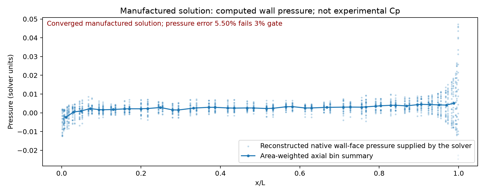

# SUBOFF native mixed-grid three-dimensional manufactured solution

11,648 actual control volumes: 2,880 hexahedra, 192 wedges, 8,576 tetrahedra.
The complete nonlinear incompressible momentum/continuity system converged in
55 iterations under the original 1e-7 gate. Independent replay checks current
momentum, stored and reconstructed mass flux, and their face consistency.

**The all-metrics 3% gate FAILED.** This is an ABC manufactured verification,
with nonzero hull velocity and analytic forcing; it is not physical SUBOFF flow.
Manufactured verification cannot replace experimental drag or Cp validation.

| Relative volume-weighted L2 metric | Error | Strictly below 3% |
|---|---:|---|
| velocity | 0.197898% | True |
| pressure | 5.49992% | False |
| velocity_x | 0.240105% | True |
| velocity_y | 0.168216% | True |
| velocity_z | 0.216977% | True |

The pressure above is solved from actual momentum, not a velocity potential.
No smoothing or off-plane mesh projection is used. The actual facet intersections
retain their piecewise constant cell values; wall pressure uses the solver's face
reconstruction. Raw fields, input mesh, full iteration history, executed launch
probe and source hashes are included. Snapshot timing and exact normalization
are disclosed in `config.json`.

The CPU run took 822.20 seconds. GPU has not been tested. This one grid does
not establish spatial convergence. The medium grid is evaluated separately.
