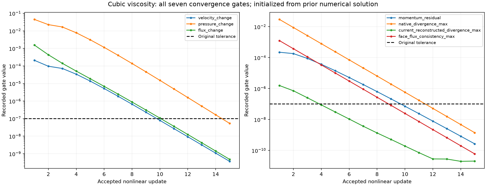
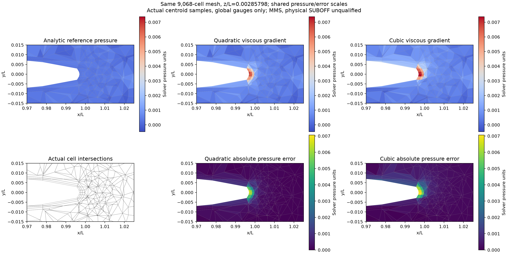
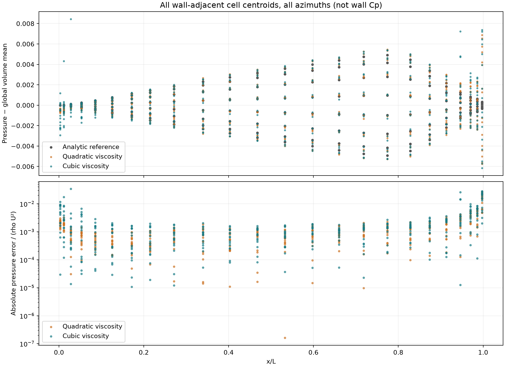
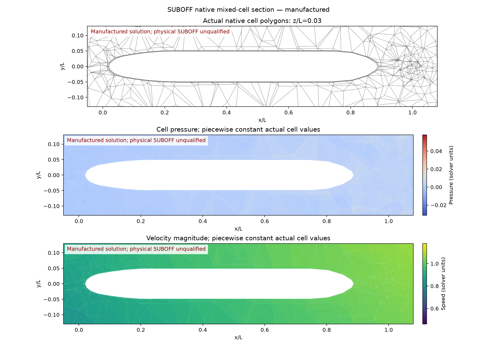
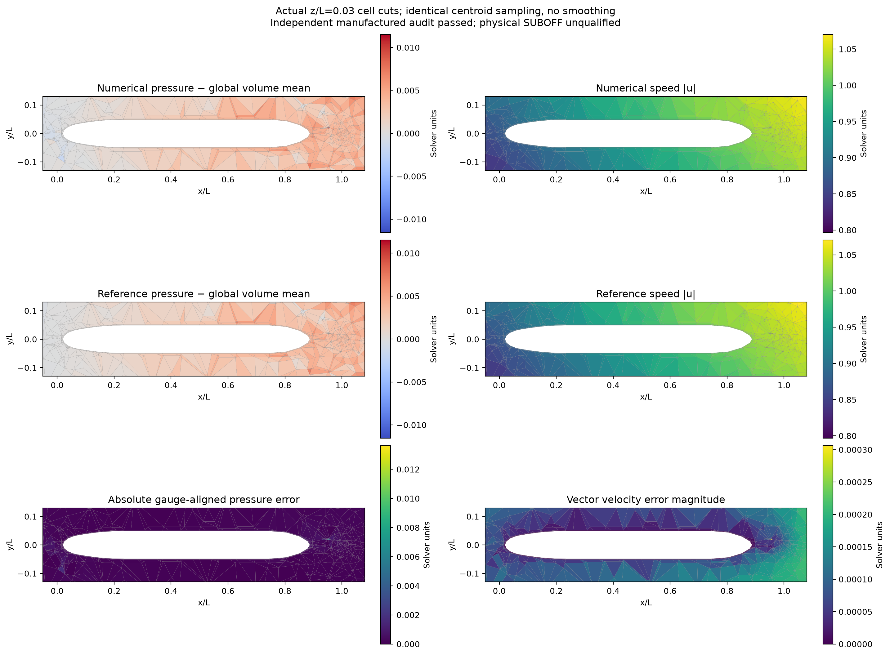
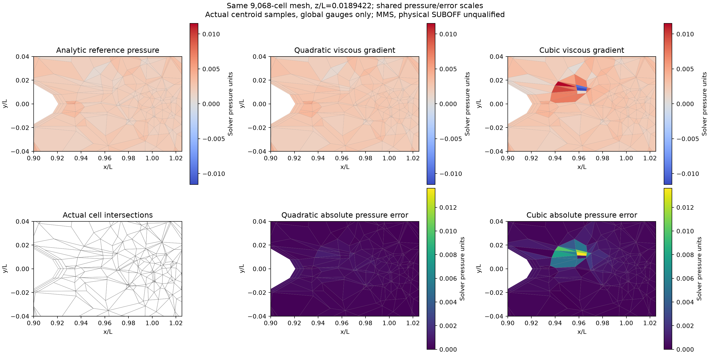

# SUBOFF 同网格黏性重构对照

## 结论：本轮高阶试验未通过局部精度验收

三次黏性重构使尾区壁邻棱柱的黏性截断残差降低约 200 倍，但完整收敛解的
壁邻压力相对 L2 从 **11.51% 恶化到 20.66%**，固定尾区从 **27.87% 恶化到 102.04%**。
全域压力误差也从 **0.7465% 增至 0.8617%**。因此这不是成功的压力精度修复，
三次选项只保留为明确的实验对照，**不作为当前推荐配置**。

15 次非线性更新收敛、19/19 原方程及全域检查通过，与局部精度失败同时成立。
本轮补充[自动局部验收](cubic-viscosity-local-acceptance/result.json)：全域、壁邻、
固定近艇和固定尾区四项压力相对 L2 必须分别严格低于 3%，缺失/非有限值判失败。
原二次和新三次计算均未获得这一局部资格；固定尺度误差不能替代相对 L2 门槛。

## 问题与范围

在[尾部过渡对照](tail-transition-report.md)之后，继续检查 **9,068 个单元**的
单域共形混合贴体网格：近壁六面体、艏艉棱柱封口、外部四面体。
前一算例全域压力相对 L2 为 0.7465%，但壁邻为 11.5085%、固定尾区为
27.8708%。最大压力误差位于尾尖壁邻棱柱 8991，不能仅凭全域指标宣布达标。

本次先分解该网格上完整离散方程的截断残差，再只替换黏性面的梯度重构，
最后重新求解完整耦合方程。制造解沿用 `U=0.5, k=0.7, nu=0.1, rho=1`；
速度、压力和连续 Navier–Stokes 体力定义见[主报告](single-domain-report.md)。
未知量是单元体积中心的点值，不是体积平均值。

**这里验证离散算子，不验证真实无滑移 SUBOFF、SST 或壁面函数。**
艇体和外边界都采用制造解速度，压力采用一个规范值；没有施加解析内部压力、
用解析内部场初始化求解，或按离散方程反算体力。新场初值来自同网格已收敛的
旧数值场；解析内部值仅用于独立误差统计和只读截断诊断。


## 1. 用完整方程定位误差

[冻结旧源码的逐项诊断](tail-term-diagnostic/result.json)在解析点值上评估生产算子，
同时用独立的三角面 Duffy–Gauss 积分求解析压力、对流和黏性通量。
四项残差之和与原生产方程动量残差的最大积分差为 `6.00e-16`。
6 阶与 8 阶参考积分的最大加速度差为 `1.60e-12`，小于下表量级。

固定尾区：`0.9 <= x/L <= 1.025, r/L <= 0.025`，按真实单元中心选取。
其中 16 个壁邻棱柱的体积加权加速度残差 RMS 为：

| 来源 | RMS |
|---|---:|
| 压力面均值重构 | 2.32764e-6 |
| 黏性梯度重构 | 7.60485e-4 |
| 对流重构 | 4.72780e-6 |
| 单元中心体力与连续积分之差 | 1.66014e-7 |

这些是动量截断项，不是耦合压力解误差的可加性预算。
旧算子的黏性项在这些单元明显占主导，因此本轮针对它做受控修改。
原 Rhie–Chow 项在这组单元上的散度 RMS 约 `5.42e-10`，而速度面均值引起的
散度 RMS 约 `2.11e-6`；这没有提供删除压力稳定项的依据。

## 2. 共性三次黏性面梯度

新增 `tensorfvm.native_cubic_gradient3d.NativeCubicFaceGradient3D`。
它从真实单元邻接扩展模板，使用相邻单元中心和已知 Dirichlet 面中心的**点值**。
拟合三维非恒定三次多项式的 19 项；目标样本数预设为 38，采用距离倒数加权、
SVD 旋转/方向尺度归一化和列归一化。模板只由几何决定，不按制造解误差调整。
本网格样本数为 38–100，最大归一化条件数为 124.822。

设局部多项式为 `P_i`，面权重为 `lambda`，中心连线为 `d=x_n-x_o`。
先计算面积平均梯度及预测的端点差：

```text
g* = (1-lambda) mean_face(grad P_o) + lambda mean_face(grad P_n)
l* = (1-lambda) [P_o(x_n)-P_o(x_o)] + lambda [P_n(x_n)-P_n(x_o)]
g_face = g* + [(u_n-u_o)-l*] S / (S dot d)
```

三次多项式的梯度是二次式，面中心与面二阶中心矩给出它的准确面积平均；
没有用面中心梯度冒充三次多项式的平均梯度。边界端点采用已知的面中心速度，
边界拟合只取内侧多项式。自由边界没有伪造的值或导数样本。

该构造对任意三次多项式保持精确，且每个内部面只有一份共享梯度/应力通量。
它生成单元值的稀疏线性映射和独立的边界源项；非线性牵引力与组装矩阵使用
同一映射。压力均值、压力稳定化、二次对流重构、边界通量、连续体力和网格保持
同一控制设置。`--viscous-reconstruction cubic` 显式启用该选项。
这不是整个 Navier–Stokes 格式达到三阶的证明。

[同网格只读黏性探针](cubic-viscosity-probe/result.json)给出：

| 区域 | 二次黏性残差 RMS | 三次黏性残差 RMS | 降低倍数 |
|---|---:|---:|---:|
| 全域 | 2.03817e-3 | 1.26208e-4 | 16.15 |
| 全部壁邻 | 3.34491e-2 | 3.23073e-3 | 10.35 |
| 固定尾区 | 4.31618e-3 | 2.66778e-5 | 161.79 |
| 尾区壁邻棱柱 | 7.60485e-4 | 3.79461e-6 | 200.41 |

该探针保存网格、源码哈希和逐单元残差，只读诊断本身不授予流动收敛或精度资格。

## 3. 回归与完整算例设置

[61 项针对性检查](cubic-viscosity-tests/summary.json)通过：包括所有三次单项式的
面平均梯度、旋转薄层、混合/自由边界、组装矩阵与原方程随机作用一致性、
三角/多边形混合网格的非线性收敛、冻结源码审核和比较口径保护。
改变黏性重构的两次计算不能被网格收敛绘图器拼成细化序列。

两次 9,068 单元计算使用完全相同的网格文件，`nu=0.1`，非线性松弛 `0.7`，
最大更新数 `100`，直接 LU / 当前算子预条件 GMRES、COLAMD 排序。
全部原始场变化和当前方程门限仍为 `<1e-7`，没有放宽。
计算设备为 CPU / SciPy；本轮不授予 GPU 或物理湍流资格。

## 4. 完整流场结果与独立审核

新场 **15 次更新收敛**，独立冻结源码审核 **19/19 项通过**。
局部压力相对 L2 尚未全部低于 3%，不能宣布局部精度全部达标。
这是一组同网格算子对照，不是网格无关性或物理 SUBOFF 验证。

| 指标 | 二次黏性梯度 | 三次黏性梯度 |
|---|---:|---:|
| 全域压力相对 L2 | 0.746506% | 0.861708% |
| 全部壁邻压力相对 L2 | 11.5085% | 20.6616% |
| 固定近艇压力相对 L2 | 4.94034% | 12.8156% |
| 固定尾区压力相对 L2 | 27.8708% | 102.044% |
| 全域最大压力误差 / rho U² | 2.62574% | 5.44792% |
| 全域压力 RMS / rho U² | 0.18453% | 0.213007% |
| 速度向量相对 L2 | 0.0154511% | 0.0135567% |

压力均采用真实单元体积加权，各自在**整个域**减去一次均值；没有局部拟合。
固定近艇窗口是 `-.025 <= x/L <= 1.025, r/L <= .08`，尾区沿用第 1 节窗口。
固定尺度 `rho U²=0.25` 的误差与参考相对 L2 并列公开，二者不互换验收含义。
新场超过 `3% rho U²` 的单元数为 **5**。

新场最大绝对压力误差单元为 **6697 (tetra)**，中心
`[0.9615775505937696, 0.012431800182208526, 0.01894220174036791]`；误差 `-0.0136198118`。
完整[局部统计](cubic-viscosity-local-pressure/result.json)、[原场](tail-transition-cubic-viscosity/fields.npz)、
[独立审核](tail-transition-cubic-viscosity/audit/audit.json)和
[新算子截断分解](cubic-viscosity-term-diagnostic/result.json)均保留。

| 当前方程审核项 | 残差 |
|---|---:|
| momentum_residual | 2.6740279e-10 |
| native_divergence_max | 1.40364534e-09 |
| current_reconstructed_divergence_max | 2.04484051e-11 |
| face_flux_consistency_max | 5.98759731e-11 |



## 5. 网格、计算场及压力曲线



该截面穿过旧场最差单元的中心，`z/L=0.002857978102883826`；保留相同视窗，
参考/新旧压力共享色标，新旧误差共享色标。它是事后诊断截面，不改变预定区域指标。
每个多边形均为真实单元与平面的交截，着色取该单元实际中心的场值。
中心不必位于切面上；图中不平滑、不插值到切面，也不把几何采样纹理当成误差。



这是全部方位角的壁邻**单元中心**压力散点，不是壁面 Cp 或实验数据。
[逐点 CSV](cubic-viscosity-comparison/wall-adjacent-pressure.csv)提供真实位置、参考/新旧压力及误差。





各图提供独立 PDF、原始数组和输入哈希；局部图不能替代全部三维单元统计。

## 6. 计算成本和复现

新流场总墙钟 **739.10 s**，首次完整线性求解（含装配）
**584.21 s**，采样峰值 RSS **5.546 GiB**。
矩阵为 **36,272** 个未知量、**13,724,411** 个非零元；旧算子为 10,619,857 个非零元。
资源记录每 2 秒采样，见[运行资源](tail-transition-cubic-viscosity/resource-observations.json)。
进程退出码 `0`；终止原因 `None`。
同机有其他任务，且初值不同，这些开发记录不构成严格性能加速比。

在仓库根目录运行（输出目录须为新的目录）：

```bash
OMP_NUM_THREADS=1 OPENBLAS_NUM_THREADS=1 MKL_NUM_THREADS=1 PYTHONPATH=src \
python scripts/run_native_suboff_benchmark.py \
  --mesh docs/verification-native-suboff-mms/tail-transition-quadratic/input.msh \
  --initial-run docs/verification-native-suboff-mms/tail-transition-quadratic \
  --output /tmp/suboff-cubic-new \
  --reconstruction quadratic --quadratic-linear-solver assembled \
  --viscous-reconstruction cubic

python scripts/audit_native_suboff_run.py \
  --run /tmp/suboff-cubic-new --output /tmp/suboff-cubic-new/audit

python scripts/audit_native_suboff_local_pressure.py \
  --runs docs/verification-native-suboff-mms/tail-transition-quadratic /tmp/suboff-cubic-new \
  --output /tmp/suboff-cubic-local-new
```

`config.json` 绑定本次实际执行源码；精确历史复现须使用其 `source-snapshot/src`
和冻结的 runner，并将原数值初值路径指定为保存的旧运行。环境记录包含 Python、
NumPy/SciPy 版本；上述命令使用当前检出的源码。单元级诊断可分别使用
`audit_native_quadratic_terms.py` 和 `probe_native_viscous_reconstruction.py`，
统一色标对照由 `plot_native_viscous_comparison.py` 生成。


## 7. 稳定性诊断与下一步

[齐次黏性矩阵的能量诊断](cubic-viscosity-energy-probe/result.json)使用完整向量黏性
算子的对称部分，并按绝对对角线平方根归一化。二次/三次算子的最小三个特征值为：

| 算子 | 最小三个归一化特征值 |
|---|---|
| 二次 | -0.440209, -0.387239, -0.343059 |
| 三次 | -0.559007, -0.403078, -0.267011 |

两者对角元均为正，但对称部分都没有正定性保证。特征对残差至多约 `2.14e-11`。
这只是速度扩散能量诊断，**不能据此宣称已经证明压力耦合不稳定或锁定唯一原因**。
新场最差四面体与相邻单元出现交替符号压力误差，说明需要检查离散误差放大、
压力–速度耦合和混合网格接口，而不能用单项截断残差代替完整解验收。



该补充截面使用 `z/L=0.01894220174036791`，覆盖新最差单元 6697；同样属于事后
诊断视窗，未更改四个固定验收区域。前面的旧热点截面也保留，避免只展示改善位置。

下一步按以下顺序推进：

1. 在能重现尾区四面体/结构化层压力振荡的小型混合网格上，检查完整压力–速度
   耦合算子的条件性和压力稳定项响应；需要同时核验多项式一致性、当前方程和局部误差。
2. 保留二次基线，分别控制尖尾表面/层间几何与压力耦合变更，完成受控完整求解；
   三次试验未证明增加阶数即可解决当前问题。
3. 四区域门槛通过并补充网格敏感性后，再推进真实无滑移、压力出口、湍流/壁面处理。
   当前不扩大真实 SUBOFF 合格声明，也不开展 FVM–LBM 联合流场。
