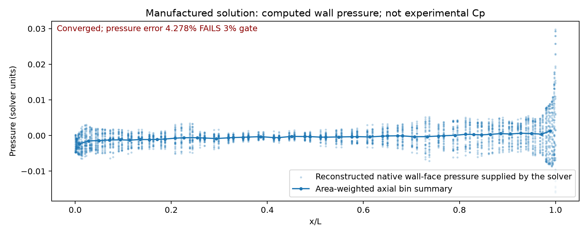

# Native 3D SUBOFF manufactured calculation

Actual mixed-cell body-fitted mesh: 24,284 control volumes.
Converged: **True**. Independent manufactured field gate: **False**.
Experimental drag/Cp qualification: **false**. Spatial refinement qualification: **false**.

| Relative volume-weighted L2 metric | Error | Strictly below 3% |
|---|---:|---|
| velocity | 0.146147% | True |
| velocity_x | 0.178105% | True |
| velocity_y | 0.125126% | True |
| velocity_z | 0.15652% | True |
| pressure | 4.27768% | False |

The manufactured solution prescribes nonzero velocity at the hull and analytic
continuum forcing; it is a discretization verification, not physical SUBOFF flow.
Pressure is solved from coupled momentum and continuity, not a velocity potential.
See `config.json` for normalization, `result.json` for current reconstructed mass
and momentum residuals, and `history.jsonl` for every completed nonlinear update.
The input mesh and imported numerical sources are frozen with SHA256 bindings.
`fields.npz` contains raw cell fields and native face fluxes/tractions.

Failure, if any: `None`.
CPU wall time: 1837.108 seconds. GPU has not been tested.

## Actual mesh and calculated fields

These are manufactured fields, not experimental SUBOFF Cp comparisons.
