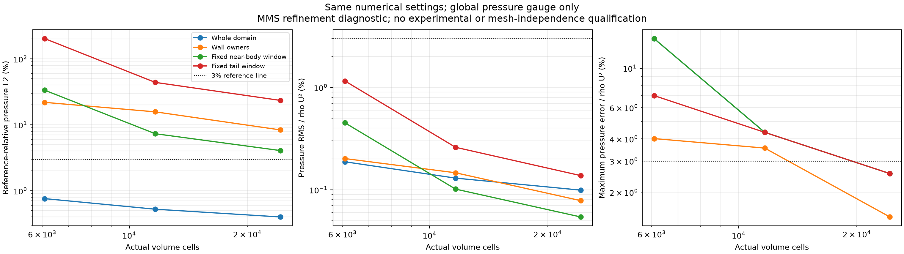
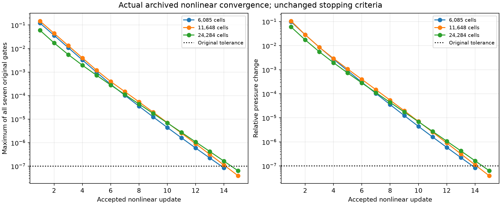
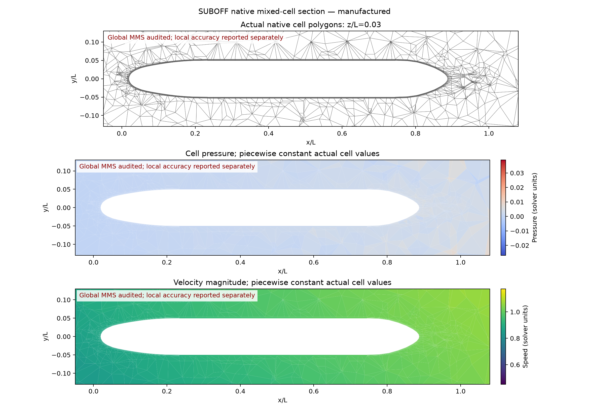
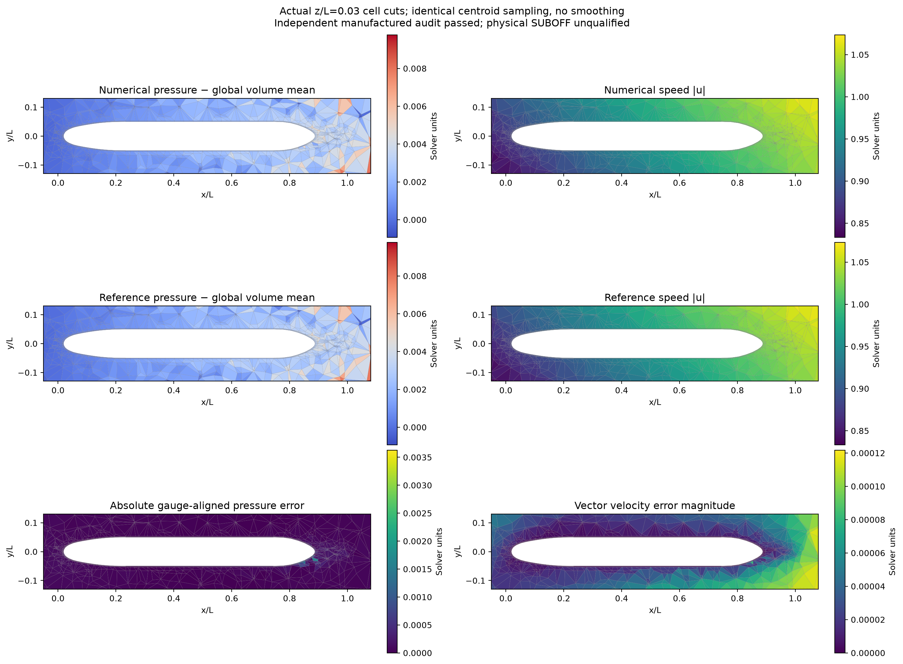
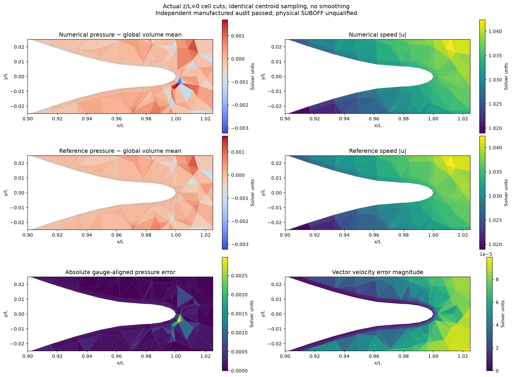
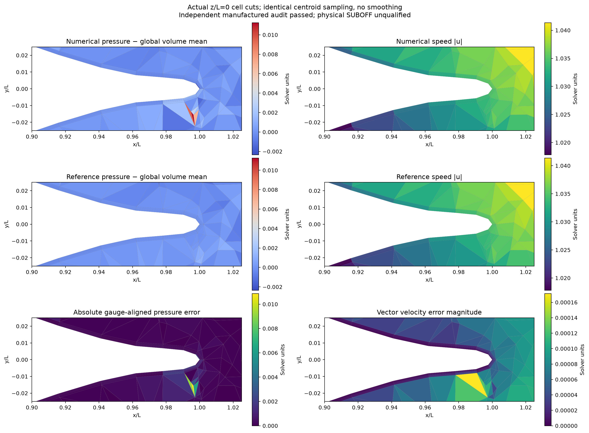
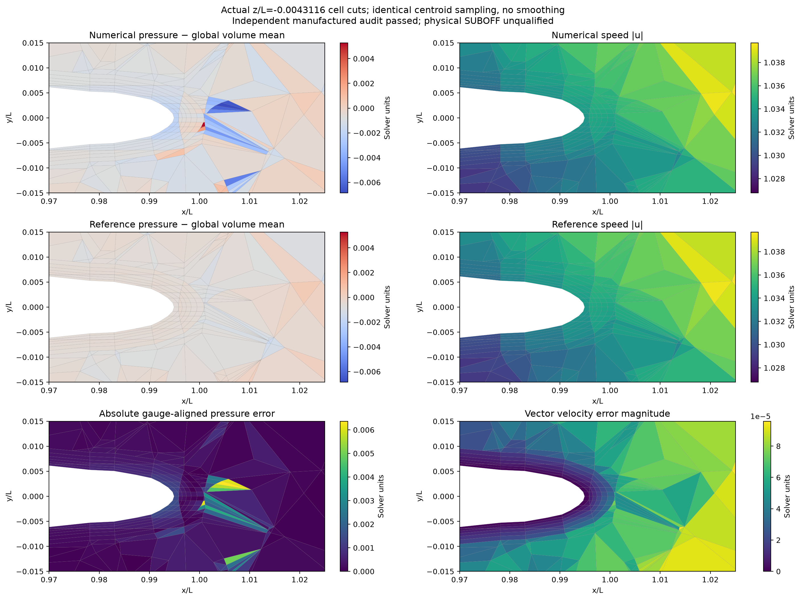
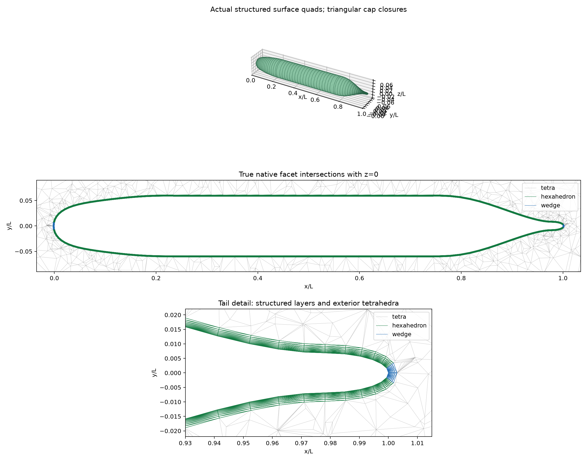
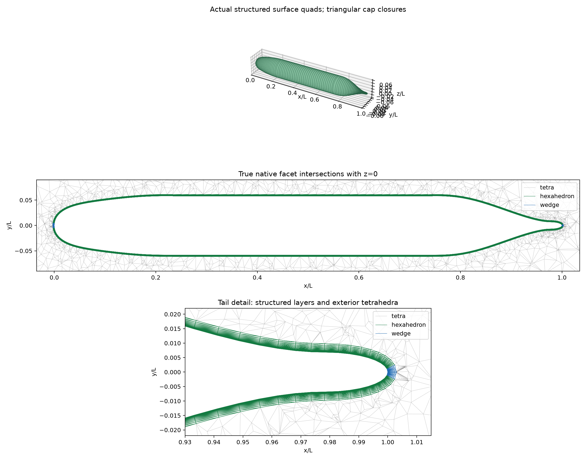

# SUBOFF 加密验证：单域贴体 FVM

## 本轮范围与结论

沿用完整共形单域：近壁结构化六面体、艏艉棱柱、外部 Gmsh 四面体。新建 61,282 和
172,768 单元网格；实际完整二次 FVM 流场本轮推进到 24,284 单元。网格已生成、几何
已通过和流场已算准是三个分别核验的状态。两个更大网格尚无流场精度结论。

本轮不修改流动离散算子，也不改变制造解或收敛门限。以下三档均采用三角 FV 面、
完整二次重构、装配耦合矩阵及数值初值。初值只影响求解路径；每档最终状态分别
重放当前完整方程。6,085 单元初值来自尚未收敛的线性运行，这一事实保留在冻结配置和
初值 producer ledger 中；11,648 / 24,284 单元初值来自各自已收敛的线性数值解。

**全域制造解门限通过不等于局部压力、物理阻力或 Cp 达标。** 本轮检查固定区域和
最大压力误差，不通过增加远场体积掩盖艇体附近误差。制造解的艇体边界给定非零解析
速度，实际无滑移 SUBOFF、湍流模型和实验数据验证仍未完成。

本轮结论：**加密有效，但尚未全部算准。** 24,284 单元独立复核 **19/19 项通过**，
全域压力 L2 为 **0.400184%**，全域最大压力误差 / `rho U²` 为 **2.54578%**，
超过该固定尺度 3% 的单元为 **0 个**。壁邻压力相对 L2 仍为 **8.36176%**，固定
近艇区域为 **4.06459%**，固定尾部区域为 **23.4110%**，均未低于 3%。这些相对范数
与固定尺度最大误差的分母不同；本轮不互换判据，也不授予整体物理 SUBOFF 合格状态。

## 软件与复现

完整问题、解析公式和控制方程见[单域主报告](single-domain-report.md)。本轮仍取
`U=0.5, k=0.7, nu=0.1, rho=1`，外域 `[-1,3] × [-1,1] × [-1,1] L`。
所有场变化、动量、保存通量散度、当前重构散度和通量一致性均要求 `<1e-7`，
每个速度分量、向量速度与压力全域相对 L2 均要求 `<3%`。

```sh
OMP_NUM_THREADS=1 OPENBLAS_NUM_THREADS=1 MKL_NUM_THREADS=1 PYTHONPATH=src \
  /data/TensorFEM/.venv/bin/python scripts/run_native_suboff_benchmark.py \
  --mesh docs/verification-native-suboff-mms/medium/input.msh \
  --output NEW_RUN --reconstruction quadratic --quadratic-linear-solver assembled \
  --initial-run docs/verification-native-suboff-mms/medium
PYTHONPATH=src python scripts/audit_native_suboff_run.py --run NEW_RUN --output NEW_RUN/audit
```

计算使用单线程 CPU/SciPy；这些完整二次耦合运行没有 GPU 加速验证。原始网格、场、
初值、数值源码、每步日志和独立审核均随运行保存。

## 相同面策略的三档实际流场

| 单元数 | 速度向量 L2 | 全域压力 L2 | 壁邻压力 L2 | 固定近艇区域压力 L2 | 全域最大误差 / rho U² | 超过 3% rho U² 的单元数 |
|---|---:|---:|---:|---:|---:|---:|
| 6,085 | 0.0158732% | 0.759395% | 21.8823% | 33.4909% | 14.6924% | 22 |
| 11,648 | 0.0112074% | 0.524758% | 15.7115% | 7.32089% | 4.34898% | 7 |
| 24,284 | 0.0076091% | 0.400184% | 8.36176% | 4.06459% | 2.54578% | 0 |

- [6,085 单元运行](quadratic-assembled-small/report.md)：14 次更新，287.73 s；收敛 `True`，独立审核 `True`。最后当前重构散度 `1.92872e-08`。
- [11,648 单元运行](quadratic-assembled-coarse/report.md)：15 次更新，841.10 s；收敛 `True`，独立审核 `True`。最后当前重构散度 `7.08612e-09`。
- [24,284 单元运行](quadratic-assembled-medium/report.md)：15 次更新，3995.77 s；收敛 `True`，独立审核 `True`。最后当前重构散度 `2.76279e-09`。





[逐步原始指标 CSV](refinement-comparison/nonlinear-history.csv)展示七项原始验收指标的最大值与压力变化；没有筛掉未达到门限的初期迭代。

[指标 CSV](refinement-comparison/metrics.csv)、[局部误差与热点原始数据](refinement-local-pressure-audit/result.json)。
绘图工具核对独立审核与局部审核的网格、场、配置散列，并拒绝混用不同面处理或求解设置。
图中三种误差的分母不同，不能把固定尺度 RMS 当成参考相对 L2 的替代验收条件。

### 局部误差定义

- 所有区域均沿用唯一的全域体积均值 gauge 对齐；不在局部重新去均值。
- 固定近艇区域：`-0.025 <= x/L <= 1.025`、`sqrt(y²+z²)/L <= 0.08`。
- 固定尾部区域：`0.9 <= x/L <= 1.025`、`sqrt(y²+z²)/L <= 0.025`。
- 以上按真实单元体积中心选取，不裁切单元体积。壁邻单元集合另行报告，其覆盖厚度随加密变化。
- 固定压力尺度为制造解的 `rho U²=0.25`，不是物理 Cp。相对 L2 分母在尾部可能很小，
  故同时提供固定尺度 RMS、最大误差及超限单元数。

各方向细化比、外部四面体及法向层厚并不构成严格均匀 h 序列。因此不直接以
`N^(-1/3)` 拟合阶数，不给出 GCI，也不宣称已进入网格无关区。

### 冻结源码兼容性复核

历史 11,648 单元快照与本轮源码并非逐字节相同：新增了多边形积分分支与无效压力边界拒绝。
在同一实际网格和归档原始场上，[两个冻结 producer 的直接对照](refinement-source-review/result.json)
显示面压力、面速度、黏性力、当前方程残差、当前一致通量及一个固定随机向量的完整矩阵
作用结果均逐元素完全相同。当前三角面、全速度边界路径的这次探针差值为零；它不是一般
代码等价性证明。所有导入源码与输入字节均有散列绑定。

## 真实流场、网格与尾部误差









所有图使用真实单元切面和同一单元体积中心的数值/参考样本，不做平滑。数值与参考
共用色标；色标由显示窗口内相交的单元确定，压力 gauge 仍用全域。尾部切面采用
`z/L=0`：解析平面压力虽为零，离面体积中心的参考样本可以非零，误差图始终比较
同一位置的样本。图示结果不能替代全体三维单元误差检查。

24,284 单元中的全域最差点为尾后外部四面体 13491，中心约
`(1.00657, 0.002156, -0.004312) L`，绝对压力误差 **0.00636445**，
相邻单元最大体积比 **11.52**。最大误差已减小，尾部热点仍存在；当前证据未确定其单一原因。



补充截面经过该单元中心的 `z/L=-0.004311599259316188`，用于直接展示三维最差点。
这是根据全体单元审核结果选取的诊断图；验收指标仍来自全部单元与预先固定的区域。

## 更大网格与尺寸过渡

| 实际单元数 | 轴向区间 × 周向 × 法向层 | 六面体 / 棱柱 / 四面体 | 首层高 / L | 总层厚 / L | 远场尺寸 / L | 接口最大邻体积比 | 固定尾部最大邻体积比 |
|---|---:|---:|---:|---:|---:|---:|---:|---:|
| [6,085](../verification-suboff-single-domain-mesh/coarse/report.md) | 24 × 16 × 3 | 1,056 / 96 / 4,933 | 0.0006 | 0.0022875 | 0.4 | 24.885 | 23.965 |
| [11,648](../verification-suboff-hybrid-mesh/coarse/report.md) | 32 × 24 × 4 | 2,880 / 192 / 8,576 | 0.0004 | 0.00230625 | 0.35 | 29.354 | 22.655 |
| [24,284](../verification-suboff-hybrid-mesh/medium/report.md) | 48 × 32 × 6 | 8,832 / 384 / 15,068 | 0.0003 | 0.002978976 | 0.3 | 18.633 | 22.390 |
| [61,282](../verification-suboff-single-domain-mesh/fine/report.md) | 64 × 48 × 8 | 23,808 / 768 / 36,706 | 0.00018 | 0.0029698353 | 0.2 | 15.077 | 25.925 |
| [172,768](../verification-suboff-single-domain-mesh/extra-fine/report.md) | 96 × 64 × 12 | 72,192 / 1,536 / 99,040 | 7.525e-05 | 0.0029784328 | 0.14 | 10.624 | 30.043 |





更大网格同时增加轴向、周向、法向及远场分辨率；三档较细网格的近壁层总厚度保持在
约 `0.00298 L`。几何检查包括真实体积、闭合、正投影、界面共形、仿射场和任意共享
通量全域抵消。[尺度与质量独立统计](../verification-suboff-single-domain-mesh/five-level-scaling-audit/result.json)
绑定原始几何文件和生成报告。几何通过不能消除局部尺寸突变，仍应检查外部四面体
过渡；当前层高不是按给定物理 Reynolds 数/y+ 设计的壁函数网格。

### 大网格二次重构预检查

| 单元数 | 自由压力梯度最大误差 | 自由压力 Hessian 最大误差 | 给定速度 Hessian 最大误差 | 预定 1e-7 门限 |
|---|---:|---:|---:|---:|
| [61,282](../verification-suboff-single-domain-mesh/fine-quadratic-preflight/result.json) | 2.04153e-12 | 8.00937e-09 | 1.16066e-08 | True |
| [172,768](../verification-suboff-single-domain-mesh/extra-fine-quadratic-preflight/result.json) | 5.19718e-12 | 5.51343e-08 | 6.25849e-08 | True |

检查在实际完整网格上构建自由压力与给定速度边界的二次重构矩阵，恢复一个预先固定的
二次多项式导数。没有使用流动参考解选取模板。它只检查模板构建、秩和多项式再现；
**没有装配/求解这两个大网格的 Navier–Stokes 耦合系统，不构成流场精度认证。**

## 求解成本与扩展边界

| 实际流场单元数 | 首次完整线性求解（含装配）/ s | 全运行 / s | 非线性更新次数 |
|---|---:|---:|---:|
| 6,085 | 214.54 | 287.73 | 14 |
| 11,648 | 671.82 | 841.10 | 15 |
| 24,284 | 3594.30 | 3995.77 | 15 |

24,284 单元运行的采样峰值进程 RSS 为 **17.465 GiB**；[逐次观测 CSV](quadratic-assembled-medium/resource-observations.csv)与[采样说明及 CPU 型号](quadratic-assembled-medium/resource-observations.json)保留原始证据。
这些是开发过程的单线程墙钟记录，期间存在其他任务，不能据此发布严格加速比。
矩阵包含 97,136 个耦合未知量，首次装配 27,557,550 个非零元。更大网格的完整流场
尚未启动；当前直接分解的时间和内存成本需要先解决。

[独立线性 Schur 探针](linear-schur-probe/result.json)在 6,085 单元的一个冻结完整二次矩阵上，
经 583 次 GMRES、160.62 s 达到真实相对残差 2.3413e-11。它不是完整非线性运行，
与正式运行首次线性化的状态不同，不能直接计算二者的加速比；生产二次求解器的
选项未因这个探针而放开。后续仍需验证预条件复用、局部连续性与完整非线性收敛。

## 下一步

1. 对比稀疏排序与可复用分块预条件，在真实矩阵上核对残差、解与内存，再推进
   61,282 单元完整流场。[PyMetis 官方接口](https://documen.tician.de/pymetis/functionality.html#pymetis.nested_dissection)
   提供嵌套剖分排序；本轮仅调研了接口，尚无该排序的性能结果。
2. 改善尾后外部四面体尺寸过渡，保留原网格作为对照；继续检查固定区域与壁邻误差。
   大网格最差尺寸跳变位于尾后四面体之间，增加法向层数不能直接消除这类缺陷。
3. 172,768 单元的几何和重构证据不作为流场结果。单域 FVM 完成精度验证后，再开展
   物理壁面、阻力/Cp、湍流和 overset。

新增固定窗口、审核绑定及绘图检查：19 项测试通过。数值离散源码本轮未修改；
上一轮完整回归结果仍单独保存，不重复计作本轮测试。
