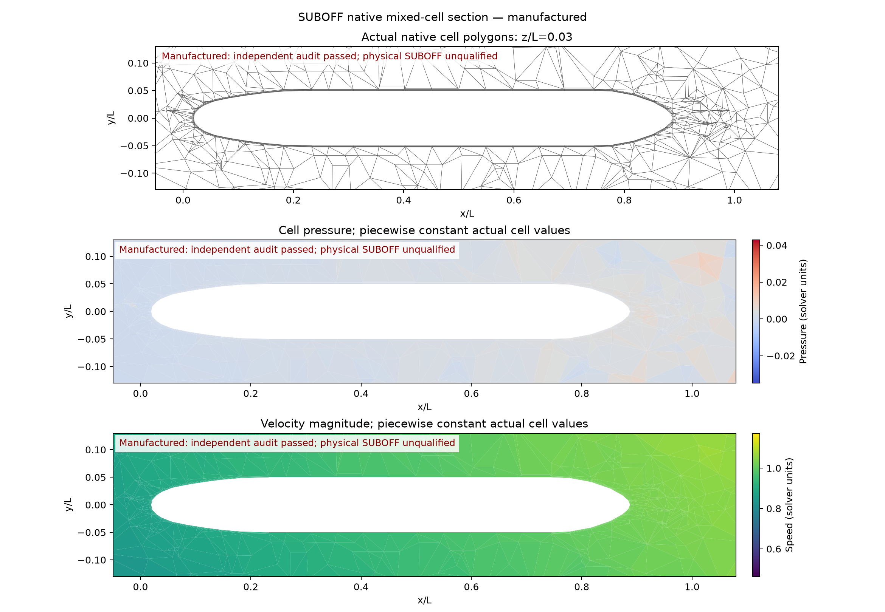
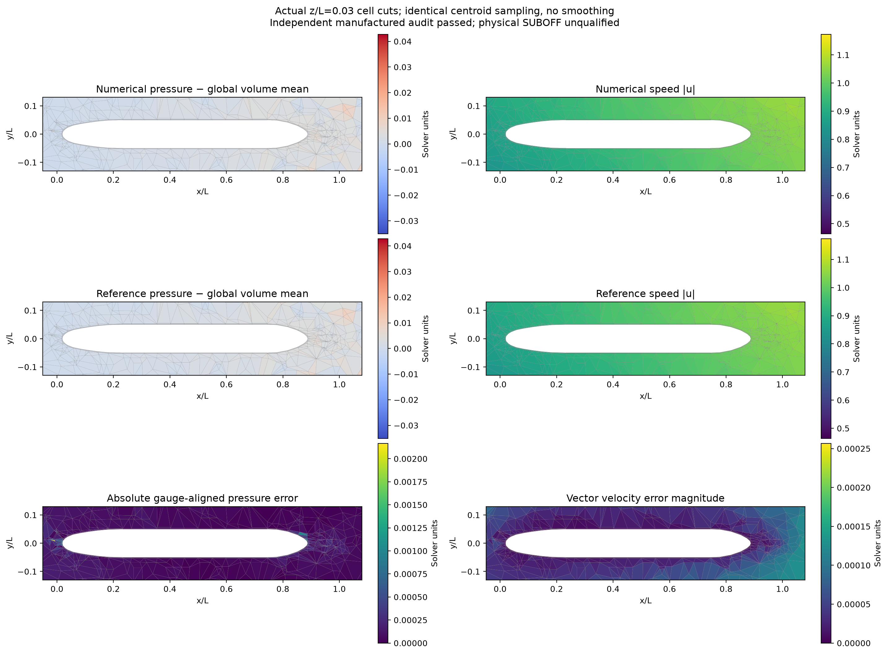

# SUBOFF 单域贴体有限体积验证

本阶段采用完整共形流体域：近壁结构化六面体、艏艉棱柱和外部 Gmsh 四面体。
没有 overset 插值或 FVM–LBM 耦合。11,648 单元上的完整非线性制造解已经收敛，
独立冻结源码复核的 19 项门限全部通过。该结果验证离散方程；实际 SUBOFF 无滑移绕流、
阻力、Cp、湍流及网格收敛仍需分别验证。

**逐单元对照仍发现尾部局部压力误差热点。全域体积加权 L2 通过，不能视为局部压力、
壁面 Cp 或整项 SUBOFF 算例已经达标。** 下述成功仅指明确列出的全域制造解与方程残差门限。

## 问题与判据

归一化艇长为 1，流体外域为 `[-1,3] × [-1,1] × [-1,1]`。固定解析参数
`U=0.5, k=0.7, nu=0.1, rho=1`，所有网格使用相同定义：

\[
\mathbf u=U(\sin kz+\cos ky,\ \sin kx+\cos kz,\ \sin ky+\cos kx),
\qquad p=\rho U^2\sin kx\cos ky\sin kz.
\]

独立连续体力为 `(u·grad)u + grad(p)/rho + nu*k²*u`。
艇体和外边界均给定制造速度与实际面上的求积通量；艇体边界不是物理无滑移壁面。
压力只固定一个 gauge。内部速度和压力通过耦合方程求解。

验收同时要求速度、压力和通量变化量，以及动量、保存面通量散度、当前重构通量散度、
面通量一致性均严格小于 `1e-7`。速度向量、三个分量和去除体积加权均值的压力，
均采用真实单元体积权重的相对 L2 误差，分别要求严格小于 3%。参考值在真实体积中心取值，
不是精确单元体积平均值。

## 完整二次算子修复

新增共享稀疏面均值、梯度和 Hessian 映射，直接装配完整二次压力、对称黏性应力、
对流及 Rhie–Chow 通量方程。每次非线性更新仅冻结当前面通量与速度协方差。
首次直接分解完整矩阵，后续复用分解作为当前完整矩阵的 GMRES 预条件器。
最终验收仍重放原始完整方程，未降低线性或非线性标准。

原 matrix-free 路径还滞后了部分基础高阶对流源，并存在大数相减的数值风险。
原失败记录与其冻结源码保留；已收敛旧结果的最终完整方程验收并未因此失效。
新路径通过 `--quadratic-linear-solver assembled` 显式选择。

## 11,648 单元结果

本算例沿用原网格和全部 36,386 个三角面，没有启用共面面片合并。
初值来自同一网格上已收敛的原数值解，没有用内部解析场初始化。
46,592 个耦合未知量、13,164,021 个矩阵非零元，15 次非线性更新收敛，
单线程 CPU 总用时 841.10 s；未测试此路径的 GPU 加速。

| 误差指标 | 原线性重构 | 完整二次重构 |
|---|---:|---:|
| 速度向量 | 0.1979% | **0.0112074%** |
| 速度 x | — | **0.0149918%** |
| 速度 y | — | **0.00681589%** |
| 速度 z | — | **0.0154045%** |
| 去均值压力 | 5.49992% | **0.524758%** |

| 独立当前方程复核 | 实际值 | 门限 |
|---|---:|---:|
| 动量残差 | 1.24576e-10 | 1e-7 |
| 保存通量最大散度 | 6.82649e-10 | 1e-7 |
| 当前重构通量最大散度 | 7.08612e-9 | 1e-7 |
| 面通量一致性 | 1.11308e-10 | 1e-7 |

[完整运行记录](quadratic-assembled-coarse/report.md)、
[独立审核及源码/字段绑定](quadratic-assembled-coarse/audit/audit.json)、
[原始场](quadratic-assembled-coarse/fields.npz)。审核使用独立子进程导入冻结 producer，
重新计算真实方程与解析误差，不执行新的线性求解，不读取保存误差作为验收依据。

## 真实网格、计算场与解析对照





[对照 PDF](quadratic-assembled-coarse/comparison-plots/comparison.pdf) 使用相同真实单元截面、
相同单元中心样本及共同色标；第三行直接显示压力误差和向量速度误差。没有平滑或投影。
压力按全域体积均值对齐。四面体中心可能偏离切面，故参考场也有相同的单元色块采样特征；
这些色块不能直接作为求解压力误差的证据。

选用 `z/L=0.03`，因为本制造解在 `z=0` 上的连续解析压力恒为零。
实际切面包含 1,788 个单元，270 个六面体及 1,518 个四面体。
[表面压力散点、轴向面积加权分箱及逐面数据](quadratic-assembled-coarse/plots/wall-pressure.png)
属于制造压力；三维表面正负值的轴向平均可能相消，不是实验 Cp 曲线。

## 共面面片合并的独立试验

新增 `--merge-coplanar-faces`，只合并 owner、neighbor、物理 patch 相同且严格共面的
两个三角形。外部四面体邻居不同的接口面保持独立；单元、体积和面积向量守恒不变。
二次矩和边界通量按真实凸平面 polygon 求积。几何单元测试覆盖弯曲面、垂直面、不同
patch/neighbor 拒绝，以及面积、体积闭合和精确二次矩。

新增 [6,085 单元网格](../verification-suboff-single-domain-mesh/coarse/report.md)，
包含 1,056 个六面体、96 个棱柱、4,933 个四面体；三层壁面高度为
`0.0006 / 0.00075 / 0.0009375 L`。面片合并使面数由 17,275 降至 13,963，
壁面最大中心连线非正交角由 88.714° 降至 18.142°，95 分位由 88.534° 降至 6.693°。
这些是壁面指标；外部四面体的最大非正交角没有同时消失。

- [线性重构零初值对照](merged-linear-small/report.md)：100 步未收敛，速度 0.249419%，
  压力 6.22243%；不通过。
- [二次重构零初值失败](merged-quadratic-small-zero/report.md)：16 次更新后，第 17 次方向的
  16 个步长均不能降低 merit，按设计回退；压力 9.22286%，当前重构散度 0.00378392。
  [独立审核](merged-quadratic-small-zero/audit/audit.json)确认失败。
- [已有数值初值重试](merged-quadratic-small-warm/report.md)：**16 步收敛**，速度向量
  **0.0158491%**，x/y/z 分量 **0.0202514% / 0.00923546% / 0.0236722%**，
  压力 **0.772845%**，CPU 用时 299.81 s。该初值的线性重构运行尚未收敛，配置和冻结初值
  ledger 明确记录这一事实，不把初值作为准确解。最终完整方程和 3% 门限保持不变。
  [冻结源码独立审核](merged-quadratic-small-warm/audit/audit.json) **19/19 通过**，
  动量残差 5.50162e-11、当前重构散度 1.74837e-9、面通量一致性 8.00385e-11。
  [合并面真实网格和计算场](merged-quadratic-small-warm/plots/fields.png)、
  [数值/参考/误差对照](merged-quadratic-small-warm/comparison-plots/comparison.png)。

几何改善不能代替流动验收。两次成功分别由各自最终场和方程验证，不能转移给不同初值的失败。
这两档采用不同面策略，因此不将其拼成正式网格收敛序列。

## 局部压力检查：尚未算准的部分

[逐区域原始数据和热点](local-pressure-audit/result.json)以相同全域 gauge 对齐，
没有为各区域重新去均值。固定压力尺度采用制造解的 `rho*U²=0.25`；它不是物理 Cp。

| 局部指标 | 6,085 单元合并面 | 11,648 单元三角面 |
|---|---:|---:|
| 壁面相邻单元压力 L2 | **62.7309%** | **15.7115%** |
| 最大绝对压力误差 | 0.129675 | 0.0108724 |
| 最大误差 / 固定压力尺度 | **51.8701%** | **4.34898%** |
| 壁邻单元占全域体积 | 1.156e-5 | 7.820e-6 |

6,085 单元中的最差点是尾部外侧四面体单元 4904，参考压力约 0.00217136、
计算压力约 0.13184667（均为全域 gauge 对齐值）。邻居体积最大相差 21.61 倍。
其邻点误差主要同号，不能未经验证就称为棋盘格。11,648 单元的最差点同样位于尾部外四面体。
局部网格与压力重构的敏感性仍需隔离验证；本次数据尚不能确定单一原因。

壁邻区域体积很小，故其误差被全域体积加权指标明显弱化。区域参考压力接近零时，
相对误差会放大；表中的固定压力尺度最大误差避免了这个分母问题，也仍暴露实际缺陷。
因此，现有两例只通过全域制造解门限，**局部压力精度尚未通过，不能称整个案例达标**。

复核命令：

```sh
PYTHONPATH=src python scripts/audit_native_suboff_local_pressure.py \
  --runs docs/verification-native-suboff-mms/merged-quadratic-small-warm \
         docs/verification-native-suboff-mms/quadratic-assembled-coarse \
  --output /tmp/suboff-local-pressure-audit
```

该工具核验独立审核绑定的字段/网格/配置字节，输出分区误差、热点坐标、相邻单元与几何量；
不执行新的流动求解。全域 `x>0.9` 统计包含尾后背景，不能当作近艇尾局部区域。

## 软件使用与下一阶段

在仓库根目录设置 `PYTHONPATH=src`，并为 CPU 可比运行设置
`OMP_NUM_THREADS=1 OPENBLAS_NUM_THREADS=1 MKL_NUM_THREADS=1`：

```sh
python scripts/run_native_suboff_benchmark.py \
  --mesh docs/verification-native-suboff-mms/coarse/input.msh \
  --output /tmp/suboff-quadratic-run \
  --reconstruction quadratic --quadratic-linear-solver assembled \
  --initial-run docs/verification-native-suboff-mms/coarse
python scripts/audit_native_suboff_run.py \
  --run /tmp/suboff-quadratic-run --output /tmp/suboff-quadratic-audit
```

输出目录必须为空，审核目录必须不存在，避免覆盖证据。
源快照、网格、数值初值与审核输入均有 SHA256 绑定。

后续依次完成同配置多网格收敛、合并面实际求解鲁棒性、混合出口边界、物理无滑移
SUBOFF 的阻力/Cp 和湍流验证，再进入纯 FVM overset 与 FVM–LBM。
当前共形结果没有验证移动艇体、自由液面或破冰。

在扩大网格或进入物理绕流前，须先消除近壁/尾部局部压力热点，并加入分区及固定压力尺度的
局部误差检查，避免极小体积单元的误差被全域体积权重掩盖。
