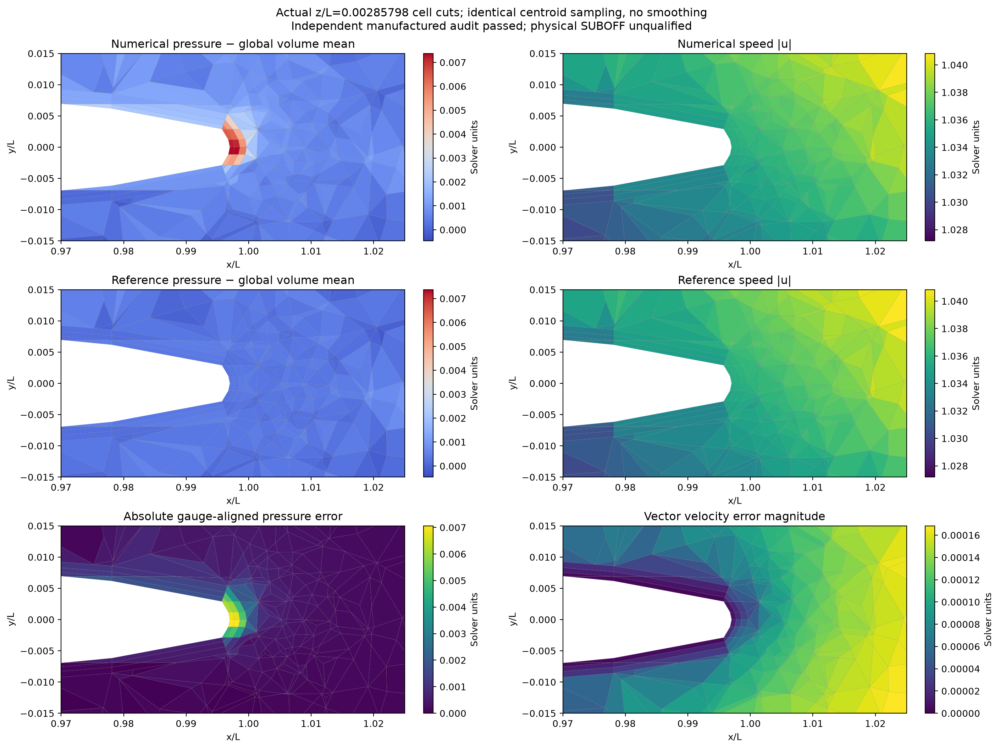

# Manufactured SUBOFF: numerical/reference comparison

The section is **z/L=0.00285798**, displayed over x/L=[0.97, 1.025], y/L=[-0.015, 0.015]. Rows 1 and 2 show numerical and independently prescribed reference pressure/speed on the **same actual native cell polygons**, using values at the **same actual cell centroids**. Each column shares one colour range across numerical/reference rows, computed from cells whose section polygons intersect this window. Pressure means are removed separately using **all cell volumes in the complete domain**; no fitted amplitude or local offset is applied. Row 3 shows absolute gauge-aligned pressure error and vector velocity error magnitude.

Intersected tetrahedron centroids may lie away from the plane. Similar polygon patterns in the reference and numerical plots reveal this centroid sampling effect; the error row separates their discrepancy. No smoothing, reconstructed plane values, off-plane geometric projection or fake experimental contours are used. Native polygons are exact planar facet intersections.

The source NPZ and mesh/config hashes match the independent audit bindings. Audit passed: **True**. Full-field errors and actual current-equation residuals are copied from that bound audit and remain in summary.json. This plot cannot create a numerical or physical qualification. **Physical SUBOFF drag/Cp validation remains false.** Polygon coordinates, native cell IDs and displayed arrays are saved in section-comparison.npz.

Run `PYTHONPATH=src python scripts/plot_native_manufactured_comparison.py --run RUN_DIRECTORY --output NEW_DIRECTORY --plane-z 0.002857978102883826 --x-limits 0.97 1.025 --y-limits -0.015 0.015` from the repository root. The helper import uses the executable script directory in Python's normal script search path.
