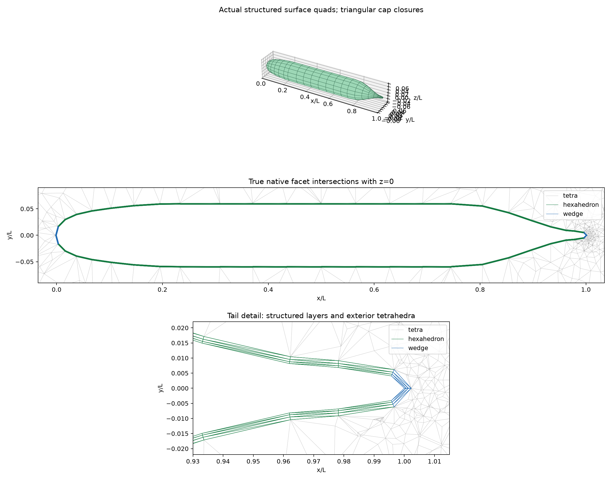
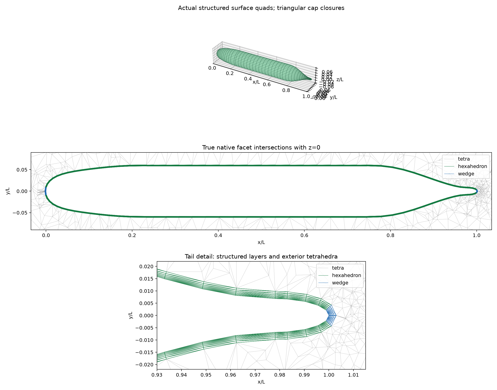
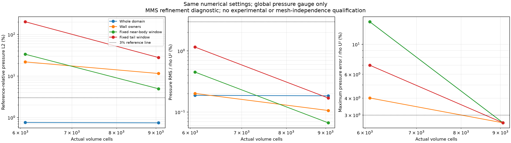
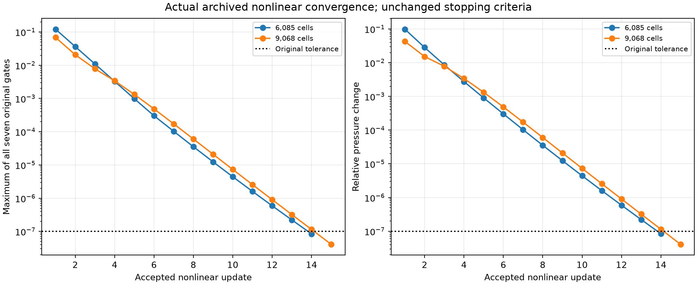
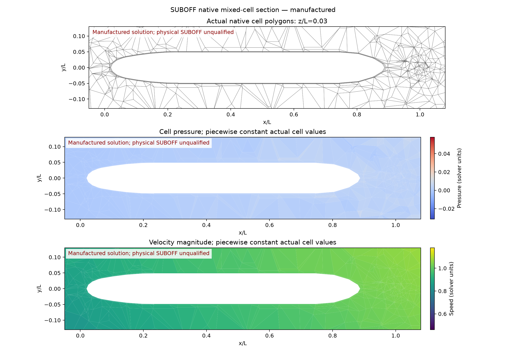
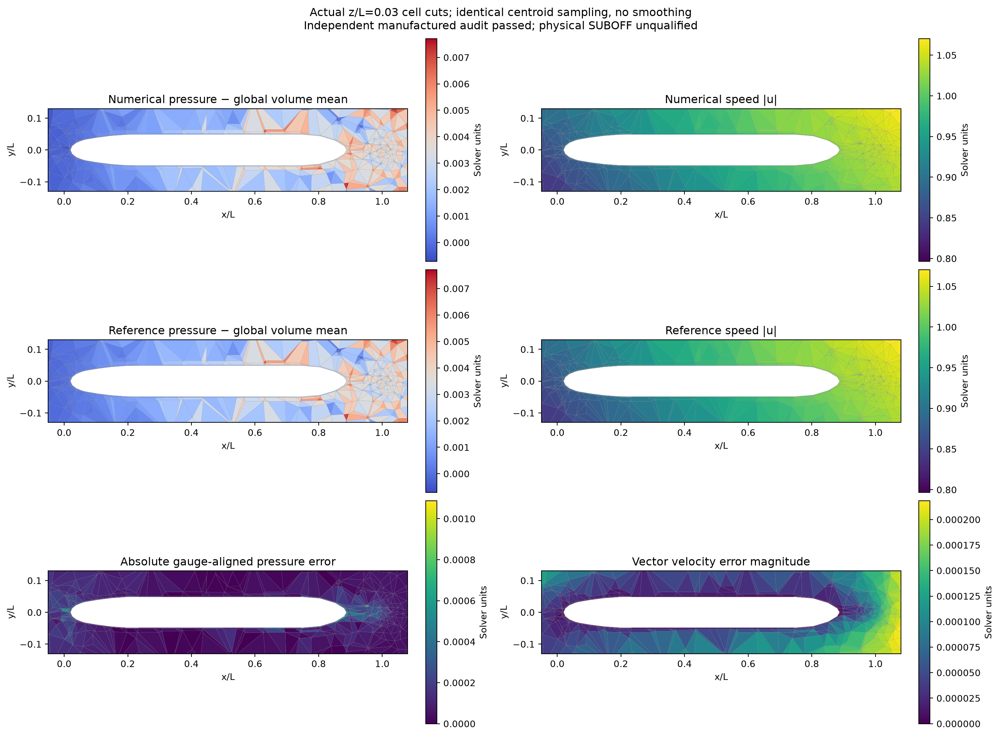
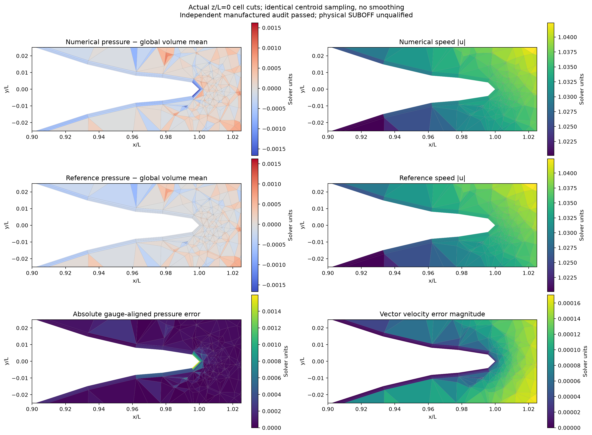
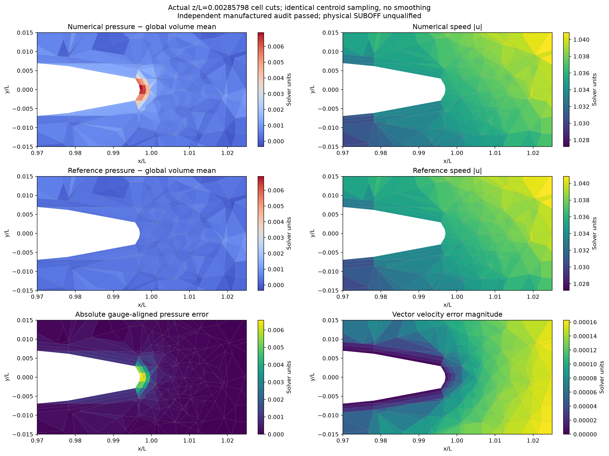

# SUBOFF 尾部过渡对照与求解成本

后续[同网格黏性重构试验](cubic-viscosity-report.md)已经完成：降低黏性截断残差
没有改善完整压力解，三次试验局部误差反而上升。下述二次基线及网格对照数据保留，
新结论与四区域自动验收见后续报告。

## 当前结论

**外部网格调整有效，但局部相对压力误差尚未全部低于 3%。**
保持艇体表面和结构化层不变，6,085 → 9,068 单元使固定近艇压力 L2 从
33.49% 降至 4.94%，壁邻压力 L2 从 21.88% 降至 11.51%，固定尾区从
202.92% 降至 27.87%。全域最大误差 / `rho U²` 从 14.69% 降至 2.63%，
超过该固定尺度 3% 的单元从 22 个降为 0 个。全域压力 L2 为 0.7465%。

新流场 15 次更新收敛，独立审核 **19/19 项通过**。当前最大误差位于尾尖
壁邻棱柱，原来的最大误差位于外部四面体。它提示继续检查尖尾闭合与壁邻
压力重构；尚未证明某一单独网格指标或离散项是唯一原因。湍流模型及壁函数
均未参与本次制造解计算。

## 问题与范围

继续验证单域、共形混合贴体 FVM。当前是连续 Navier–Stokes 制造解：
`U=0.5, k=0.7, nu=0.1, rho=1`，艇体及外边界均给定解析速度，
解析体力独立于离散方程。完整定义见[主报告](single-domain-report.md)。
**本报告不包含真实无滑移 SUBOFF、湍流闭合或壁面函数验证。**

本次保持艇体表面和结构化层不变，测试外部四面体尺寸过渡的影响。
两个对照组分别为 6,085 → 9,068 和 24,284 → 26,570 单元。
实际完整新流场仅完成 **9,068 单元**；26,570 单元是几何对照，
61,282 / 172,768 单元仍仅有之前的几何和重构预检查。

## 网格方法与对照约束

共性生成器 `tensorfvm.suboff_hybrid_mesh.generate_suboff_hybrid_mesh` 新增可选
`tail_size`、`tail_radius`、`tail_size_gradient`。本次固定为 `0.003 L`、
`0.01 L`、`0.5`。Gmsh Ball 尺寸场以最外层尾尖为球心，在球外连续过渡到
既有远场尺寸；三维生成时同步放开最小尺寸下限。
[官方字段定义](https://gmsh.info/doc/texinfo/#index-Ball)规定了半径、过渡厚度及内外尺寸。
这些参数依据几何尺度预设，没有根据制造解压力调节。

外部四面体重新生成，因此不能保证所有变化都局限于球内，也不能把任何流场改善
唯一归因于最大邻体积比。实际几何必须独立检查：
[成对核验](../verification-suboff-single-domain-mesh/tail-transition-pair-check/result.json)
确认两组结构化单元中心/体积、壁面三角形中心/面积向量均逐元素完全一致。
原网格、旧流场及失败记录全部保留。

| 单元数 | 尾区最大邻体积比 | 尾区 P95 邻体积比 | 尾区最大非正交角 | 层/四面体接口最大邻体积比 |
|---:|---:|---:|---:|---:|
| 6,085 | 23.965 | 8.828 | 76.865° | 24.885 |
| 9,068 | 15.772 | 3.304 | 85.625° | 28.699 |
| 24,284 | 22.390 | 3.924 | 77.899° | 18.633 |
| 26,570 | 18.013 | 3.658 | 80.284° | 19.024 |

尾区沿用 `0.9 <= x/L <= 1.025, r/L <= 0.025`；纳入接触这些单元的内部面。
最大体积比有所下降，最大非正交角与接口最差体积比并未同步改善。
因此不授予网格质量全面改善或网格无关资格。
[独立网格统计及绑定](../verification-suboff-single-domain-mesh/tail-transition-audit/result.json)。





## 求解方法、初始化与完整方程审核

仍使用三角 FV 面、完整二次重构、完整冻结通量装配矩阵、残差回溯及 COLAMD LU。
原先隐式默认的 COLAMD 现可通过 `--lu-ordering COLAMD` 显式记录，默认行为不变。
[同一 6,085 单元原场上的源码探针](tail-transition-source-review/result.json)检查压力/速度面均值、
牵引力、当前方程残差、当前一致通量及完整矩阵随机作用；六项逐元素相同。
这是此次探针上的兼容性证据，不是一般代码等价证明。

新网格的低阶初值路径在第 10 步出现严重连续性偏差，已主动停止且未用于最终流场。
[终止记录](tail-transition-linear-seed/termination.json)和原始日志保留，不能记为收敛。
随后从独立审核通过的 6,085 单元数值场，以距离加权局部仿射拟合迁移 `u,p`；
同中心单元直接复制。共 1,397 个直接复制，7,671 个局部拟合。
[迁移证据](tail-transition-transferred-seed/config.json)绑定源场、源审核、目标网格和执行源码。
**这只是初值，未使用解析内部场，不保证迁移守恒，也不是 overset 交换算子。**
最终通量和解由目标网格的完整方程重新求出；迁移本身的 `converged` 保持 false。

新流场非线性更新 **15 次**，求解收敛 **True**，
独立复核 **True**。
[逐步历史](tail-transition-quadratic/history.jsonl)、[原场](tail-transition-quadratic/fields.npz)、
[完整方程审核](tail-transition-quadratic/audit/audit.json)保存原始证据。
所有原始场变化、动量、保存通量散度、当前重构散度和通量一致性门限仍为 `<1e-7`。

## 压力和速度精度

| 单元数 | 速度向量 L2 | 全域压力 L2 | 壁邻压力 L2 | 固定近艇压力 L2 | 固定尾区压力 L2 | 最大压力误差 / rho U² | 超过 3% rho U² 的单元 |
|---:|---:|---:|---:|---:|---:|---:|---:|
| 6,085 | 0.0158732% | 0.759395% | 21.8823% | 33.4909% | 202.919% | 14.6924% | 22 |
| 9,068 | 0.0154511% | 0.746506% | 11.5085% | 4.94034% | 27.8708% | 2.62574% | 0 |

全部采用真实体积加权，压力仅在全域去一次均值；固定窗口未变。
尾区参考压力范数较小，相对 L2 与固定 `rho U²=0.25` 归一化的误差同时公开，
不互换判据。这里的固定压力尺度不是物理 Cp。两个网格不构成统一比例细化，
不拟合收敛阶、不发布 GCI，不宣称真实 SUBOFF 已满足 3%。

[局部误差与最差单元原始数据](tail-transition-local-pressure-audit/result.json)。
新网格最差单元为 8991（wedge），中心 `[0.9972653648000261, 0.0005684871903638458, 0.002857978102883826]`，
带符号压力误差 `0.0065643379`。













补充截面取 `z/L=0.002857978102883826`，穿过最差单元 8991 的中心；
它是基于结果选择的诊断图，不改变预先固定的区域和验收指标。

图使用真实单元切面，不平滑，不用插值重画压力误差；数值与解析对照采用相同采样位置。
局部彩图不能替代全体三维单元的误差统计。

## 求解成本及未成功的排序尝试

新运行耗时 **607.70 s**，采样峰值 RSS **4.733 GiB**。
完整矩阵包含 36,272 个未知量、10,619,857 个非零元。
[资源记录](tail-transition-quadratic/resource-observations.json)每 2 秒采样；
同时存在其他开发计算，墙钟仅为开发记录，不能发布严格加速比。

另在同一冻结的 6,085 单元数值场上比较两种稀疏排序：

| 排序 | 结果 | 因子非零元 | 因子分解时间 | 进程峰值 RSS |
|---|---|---:|---:|---:|
| COLAMD | 线性真实残差 5.5482e-15，通过 | 140,074,113 | 209.97 s | 4.201 GiB |
| MMD_AT_PLUS_A | 600 s 总运行时限内未完成，终止 | 未获得 | 未获得 | 未记录完整峰值 |

[COLAMD 原始结果](ordering-probe/colamd/result.json)、[MMD 超时记录](ordering-probe/mmd-at-plus-a/result.json)。
冻结数值源码及输入绑定见各目录；这是单个线性系统探针，不是非线性流场认证。
峰值包含探针读取 L/U 稀疏因子的额外内存，与生产流场峰值不能直接作同条件比较。
当前没有证明替代排序能降低成本，默认保留 COLAMD。大网格扩展瓶颈仍待解决。

## 使用与复现

```sh
export OMP_NUM_THREADS=1 OPENBLAS_NUM_THREADS=1 MKL_NUM_THREADS=1 PYTHONPATH=src
/data/TensorFEM/.venv/bin/python scripts/prepare_suboff_hybrid_mesh.py \
  --output NEW_MESH --axial 24 --azimuthal 16 --layers 3 \
  --first-height .0006 --growth 1.25 --far-size .4 \
  --tail-size .003 --tail-radius .01 --tail-size-gradient .5
/data/TensorFEM/.venv/bin/python scripts/transfer_native_initial_state.py \
  --source-run docs/verification-native-suboff-mms/quadratic-assembled-small \
  --mesh NEW_MESH/suboff-hybrid.msh --output NEW_SEED
/data/TensorFEM/.venv/bin/python scripts/run_native_suboff_benchmark.py \
  --mesh NEW_MESH/suboff-hybrid.msh --output NEW_FLOW --initial-run NEW_SEED \
  --reconstruction quadratic --quadratic-linear-solver assembled --lu-ordering COLAMD
/data/TensorFEM/.venv/bin/python scripts/audit_native_suboff_run.py \
  --run NEW_FLOW --output NEW_FLOW/audit
```

源场必须已经收敛并通过独立审核，迁移工具会拒绝与审核散列不一致的源场。
全套新增/受影响针对性检查 **41 项通过**：[执行汇总](tail-transition-tests/summary.json)。
没有新增 GPU 加速合格结论。

## 后续验收顺序

1. 保留尾部尺寸场作为候选改进，原网格继续作为对照。优先核查误差最大的尾尖
   壁邻棱柱及压力重构，并兼顾非正交性和层外接口过渡；尚不将它认定为最终网格策略。
2. 验证可复用分块预条件或其他低内存方法，再推进 61,282 单元完整流场。
3. 数值精度确认后，验证无滑移/压力出口，再推进实际 Reynolds 数下的 SST、近壁分辨率、
   阻力/Cp 和尾流实验对照。制造解不存在可用于调节这些局部误差的湍流或壁函数参数。
