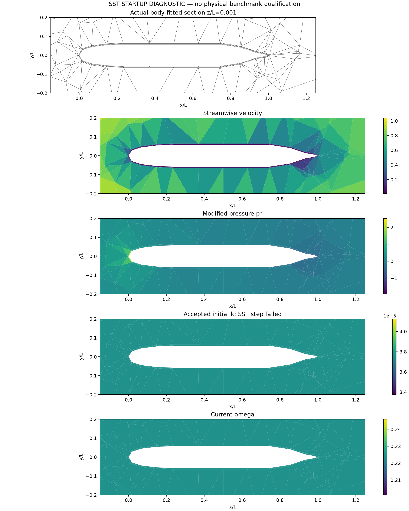

# 实际 SUBOFF 网格的混合 SST 启动

2026-10-13，开发诊断；高 Re 的物理基准尚未开始验收。

最新进展：[标量精度修复、显式工作判据与 SIMPLEC 耦合](precision-and-work-policy/README.md)。原 omega 通量精度不一致已修复；两步耦合后的第三步 k 失败已独立复现，并由较平滑的初始延续路径解出相同原始子问题。完整 SIMPLEC+SST 已连续完成五步，当前稳态残差及收支仍未通过，正在由保存场继续迭代。下文保留最初失败的历史证据。

## 已定位的问题

在 1,331 单元真实贴体 SUBOFF 网格上，采用 nu=0.001、I=0.005、尺度 0.05L 的标准常量内部初值，原 `diffusion_equilibrium` 面初始化生成负 k，触发 `invalid face k` 拒绝。选择非线性 MMP 输运并不自动改变此前的初始化。原探测日志保留；这不是 SST 收敛或精度测试。

新增显式 `face_initialization='cell_average'`：内部共享面取相邻单元的凸平均，非固定边界面取内部单元初值，Dirichlet 面取给定值。单元初值不变，没有截断求解结果或使用实验内部场。该猜测不满足面扩散平衡，后续必须由实际 k/omega 原方程解出；不能据此宣布收敛。默认初始化方式保持原行为。

9 项 RANS 回归通过，包括不同正值初始猜测最终收敛到相同解、当前原方程残差并非初值合格标记、非法输入不覆盖已有状态。测试日志见本目录。

## 当前实际计算

使用相同网格已收敛的原生 Re=10 层流原场，进入混合 SST 的第一步。此低 Re 试验检查生产代码路径能否启动，不能作为实际 SUBOFF 高 Re 湍流验证。模型是 SST-2003、低 Re 壁面 k=0/omega=60nu/(beta1*d1^2)，没有壁面函数、几何 trip 或转捩模型。

动量采用原生联合 Newton，标量采用非线性 MMP，dt=0.01、松弛 0.7。新的凸平均初始化已在实际网格通过，但第一次完整耦合步在 omega 输运被拒绝，耗时 146.568 s；数值/物理通过均为 false。这里只允许报告已完成的启动步骤，不将一步计算等同稳态收敛、SIMPLEC 验证或 Cp/Cd 达标。

```bash
OMP_NUM_THREADS=1 OPENBLAS_NUM_THREADS=1 PYTHONPATH=src python scripts/verify_native_suboff_sst_startup.py \
  --laminar-run docs/verification-native-hybrid-suboff-startup/re10-newton \
  --output results/native-suboff-sst-startup-convex --steps 1
```

## 实际失败与下一步

同一 Re=10 问题已用正式证据脚本复现旧初始化的负 k 拒绝；新的凸平均越过初始化与首次动量子求解，omega 的候选虽然保持正值且相对原方程残差约 6.74e-16，实际局部通量收支约 4.732e-8、接口缺陷 2.584e-8、全局收支 1.030e-8，保存的工作平衡项合计约 0.2484，未通过原有绝对门槛。不得只引用小的相对残差。第一步 k/omega 均未提交，原始场审计确认接受的湍流变量仍与初值逐项相等。

原始与修复后失败分别见 [原初始化](original-initialization-rejected) 和 [omega 输运](omega-transport-rejected)，均含源码冻结、原场、真实网格/云图和独立收支复算。旧失败原始 scalar 元数据未完整保存，报告明确使用 NPZ 中的通量和工作项复算；新版运行器已补充候选全部非数组诊断记录。

代码检查发现，MMP 零平滑非线性反应保留扩展精度，但构造冻结扩散算子及局部通量时存在 float64 强制转换。需要验证这一精度不一致是否导致当前绝对收支失败，并在相同方程与门槛下重放候选；尚未将其判定为唯一原因。


