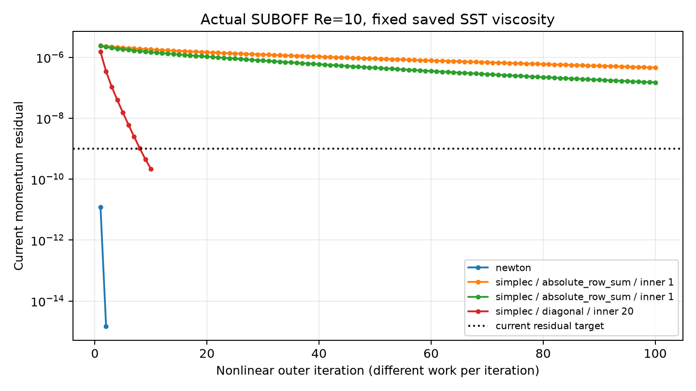

# SUBOFF 固定 SST 涡黏性的动量子问题对照

本页验证原生动量求解器。固定同一保存状态的黏性系数，不推进 k、ω，不能作为完整 RANS 或实验精度达标证据。

输入 NPZ SHA256：`48301b3b82441082ac39a8a84d13ce434fe7869aceb5cd9f8a1a62a1e790999f`。各运行完全一致；源码、原始场和输入绑定均已核对。

Re=10，1,331 单元，3,556 面，无滑移壁面。使用实际 SUBOFF 数值状态，无制造体力。压力数组为修正压力 p*；Cd 参考面积为 L²。

| 求解设置 | 数值收敛标志 | 外迭代 / 修正数 | 当前动量残差 | 全局动量收支 | 能量收支 | 耗时/s |
|---|---|---:|---:|---:|---:|---:|
| newton | 是 | 2 / 2 | 1.4979e-15 | 9.8191e-15 | 4.4964e-15 | 48.54 |
| SIMPLEC，absolute_row_sum，α=0.5，内层上限 1 | 否 | 100 / 100 | 4.6027e-07 | 1.3512e-05 | 1.2217e-05 | 1314.36 |
| SIMPLEC，absolute_row_sum，α=0.9，内层上限 1 | 否 | 100 / 100 | 1.4929e-07 | 6.7346e-06 | 5.6828e-06 | 1314.87 |
| SIMPLEC，diagonal，α=0.9，内层上限 20 | 是 | 10 / 172 | 2.1647e-10 | 4.5588e-10 | 2.3016e-10 | 144.44 |

计数说明：SIMPLEC 每次修正包含动量预测与压力校正；Newton 为联合线性修正。两者不能按外迭代数直接比较计算成本。耗时为各进程记录值，同机并发负载可能影响结果。

原始面速度重新计算通量，独立散射质量和动量通量，重新积分壁面力。详细字段差异见 comparison.json；此审计不等于另一套离散方法的验证。

**仍未完成：完整 SST 稳态收敛、实验雷诺数与壁面函数、同工况 Cp/Cd <3%、网格收敛。**
