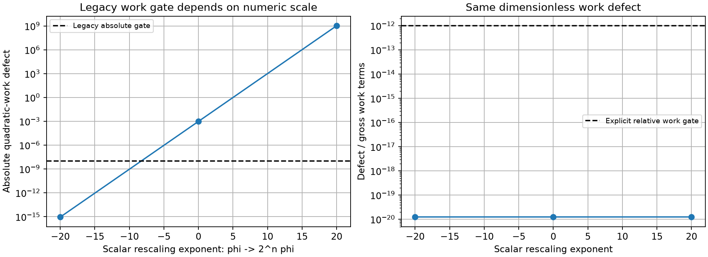
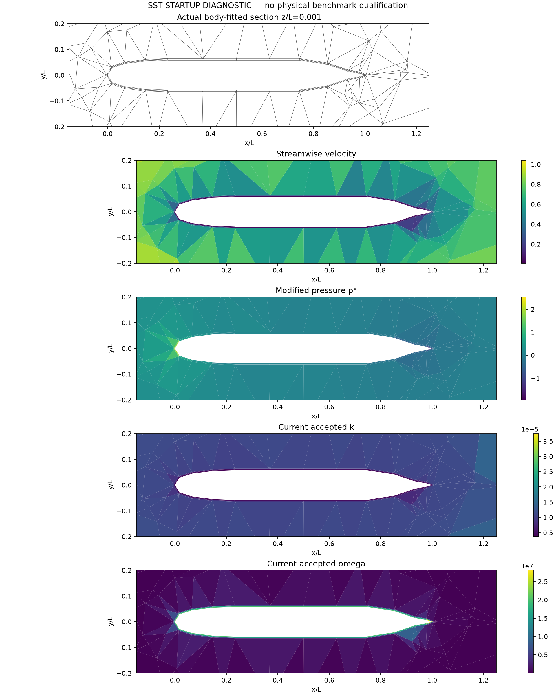

# 标量精度修复、工作平衡判据与原生 SST 耦合

2026-10-13。实际 AFF-1 SUBOFF，1,331 单元、3,556 面，Re=10。所有结果均为开发诊断，**未达到高 Re SUBOFF 的 Cp/Cd 精度目标**。几何、输入、原场、完整失败记录与源码快照随各子目录保存。

## 1. 已证实的精度不一致

旧实现的非线性 MMP 反应使用扩展精度，但冻结算子、局部通量与部分矩阵系数提前转成 float64。同一保存状态的全局/局部自由方程残差差异约 2.83e-8。修复后局部系数和常数保持差分使用一致的扩展精度，残差差异降至约 4.32e-12。SciPy 稀疏分解仍用 float64 近似矩阵，精确残差用于修正与验收。本机 longdouble 为 64 位有效尾数，不能称为 IEEE 四倍精度。

重放脚本逐项核对原 omega 方程的扩散系数、产生项、耗散和储存项，未改变输入方程。修复后的绝对判据重放仍被拒绝，结果见 [omega-absolute-rejected](omega-absolute-rejected/summary.json)：

| 指标 | 修复后绝对判据重放 |
|---|---:|
| 局部通量缺陷 | 4.256e-12 |
| 接口通量缺陷 | 2.842e-12 |
| 全局通量收支 | -1.664e-11 |
| 绝对工作缺陷 | -9.996e-4 |
| 旧绝对工作门槛 1e-8 | **未通过** |

精度修复解决了原通量精度问题，不能被描述为通过了全部旧门槛。

## 2. 显式相对工作判据

标量工作是辅助标量方程乘以标量值的二次量。本例 omega 近壁值很大，工作总尺度约 8.046e16。将同一个冻结标量问题的未知量、初值、边界和源项同时乘以 2 的整数次幂，工作缺陷和工作尺度均按平方缩放：原场绝对缺陷 -9.996e-4，缩小 2^20 后为 -9.091e-16，放大 2^20 后为 -1.099e9；相对值保持 1.242e-20。详见 [缩放审计](work-scale-audit)。这不是重新计算完整 SST，也不证明全部绝对通量门槛具有单位不变性。



新增显式 `scalar_work_balance_policy=relative`，工作缺陷除以扩散、边界、储存、输运、耗散和产生的工作项绝对尺度，要求 <1e-12。默认仍为 `absolute`，不在旧门槛失败时自动改用新门槛。局部、接口、全局通量的绝对门槛仍为 1e-8，非线性残差及完整更新门槛保持不变。每次记录旧绝对门槛是否通过。

[显式相对 omega 重放](omega-relative/summary.json)通过其声明的判据：局部/接口约 2.2e-10，相对工作约 1.496e-20；**旧绝对工作门槛仍未通过**。测试包含一个被缩小数值掩盖的错误场：旧绝对工作门槛可通过，新相对门槛拒绝；并验证相对门槛不会豁免任何通量失败。

## 3. 完整三步耦合：第三步失败

[原生联合 Newton + SST 三步试算](coupled-third-step-rejected/summary.json)耗时 359.715 s。前两步完成；第三步 k 方程在首个平滑阶段达到 80 次迭代上限，完整更新约 0.679，原方程相对残差约 3.851e-5。保存的是第二次接受的湍流场及第三次已更新的动量场，第三步 k 候选单独保存且未提交。它不是一个完全平衡的耦合状态。

| 第二步当前耦合指标 | 值 |
|---|---:|
| 动量相对残差 | 2.142e-6 |
| 连续性最大缺陷 | 2.694e-14 |
| k 当前稳态相对残差 | 0.9899 |
| omega 当前稳态相对残差 | 0.8928 |
| 数值稳态收敛 | **否** |

第三步拒绝的 k 局部/接口/全局通量缺陷分别为 3.876e-8、4.681e-8、2.850e-7，相对工作缺陷 5.940e-5。即使绝对工作缺陷只有 6.624e-12，也必须拒绝。独立原场审计核对了散度、通量及保存的工作项、源码/输入/场文件哈希。



## 4. SIMPLE/SIMPLEC 分步外耦合

新增显式 `momentum_coupling=sweeps`，仅允许 SIMPLE/SIMPLEC。每轮 RANS 做指定次数的压力修正，每次重建当前对流，再更新 SST。动量和压力线性求解仍必须通过真实矩阵残差门槛；允许未收敛的动量场作为外迭代状态，最终仍要求当前动量、连续性、k、omega、边界约束以及完整外迭代场变化共同收敛。原 `converged` 模式保留作为参考。

12 项 RANS 回归通过；另有 43 项标量精度、MMP、标量输运与流动回归通过（[日志](scalar-flow-regressions.log)），两组测试文件不重复。RANS 结果见 [测试日志](rans-sweeps-tests.log)。无体力剪切流中，SIMPLE 和 SIMPLEC 从未平衡初值收敛至与联合 Newton 一致的速度、压力、k、omega、涡黏性和力；一次压力修正不能被误报为已收敛，线性求解失败也不能提交湍流状态。这是算法控制试验，不能替代实际 SUBOFF 验证。

实际 SUBOFF 对照命令：

```bash
OMP_NUM_THREADS=1 OPENBLAS_NUM_THREADS=1 PYTHONPATH=src python scripts/verify_native_suboff_sst_startup.py \
  --laminar-run docs/verification-native-hybrid-suboff-startup/re10-newton \
  --output results/native-suboff-sst-simplec-sweeps-three --steps 3 \
  --scalar-work-balance-policy relative --momentum-method simplec --momentum-coupling sweeps
```

## 5. 剩余工作

解决真实网格 k 非线性停滞，完成连续外迭代及全部稳态收支核验；再验证高 Re、SIMPLEC+SST 壁面处理和实际 y+。目前没有与 OpenFOAM 对齐的壁面函数、同工况/同网格对照或 Cp/Cd 双指标 <3% 证据。低 Re 层流三网格阻力非单调、尾部 Cp 极值随细化增强的问题也仍需处理。
