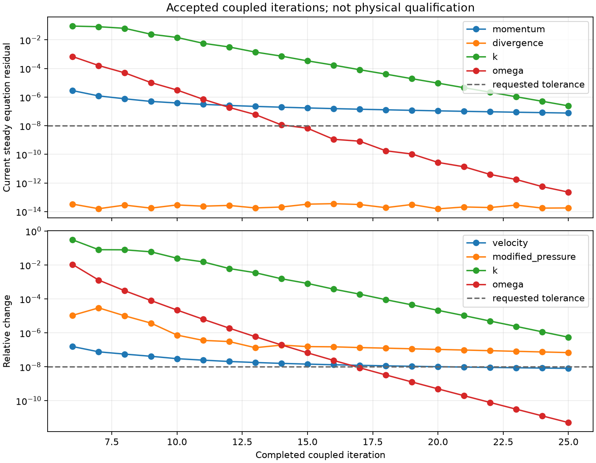

# SUBOFF 原生 SIMPLEC/SST：累计 25 步稳态审计

2026-10-13。**20 步续算正常完成，累计 25 步；仍未达到完整数值收敛。** 不与高 Re 实验 Cp、Cd 混合评分。

## 问题与运行设置

AFF-1 裸艇，Re=10，1,331 单元、3,556 面，真实贴体网格，无制造体力；原生混合有限体积，SIMPLEC＋SST-2003。壁面无滑移、k=0、ω=60ν/(β₁d₁²)，没有壁面函数。由已归档第 5 步精确恢复单元及共享面状态，dt=1，湍流松弛 0.7；每次 RANS 外迭代 5 次对流更新，每次仅一次 SIMPLEC 修正，行和松弛 0.5。

20 步续算耗时 2916.443 s；过程无数值异常，最终字段 SHA256 为 `f1df07962b8883f29b478fd4633db9b731ac9b7bba777e9db1556861dc6ee04a`。源码、原始场、重启绑定和当前方程审计全部核对。原运行 settings 中 face_initialization 保留当时请求默认值；initialization.json 的实际操作为 restored_accepted_fields，重启字段逐项验证，未重算共享面初值。

## 当前方程与收支

审计从最终保存场重建当前 SST 系数和原生算子，**去掉全部伪时间项**，另行散射面通量和积分边界力。它不是另一种离散方法的独立求解。

| 指标 | 累计第 25 步 |
|---|---:|
| 当前归一化动量残差 | 7.689373e-8 |
| 质量散度最大值（独立散射） | 1.709576e-14 |
| 当前归一化 k 残差 | 2.433809e-7 |
| 当前归一化 ω 残差 | 2.272960e-13 |
| 全局动量收支绝对误差 | 2.073080e-6 |
| 能量收支绝对误差 | 1.691779e-6 |
| k 全局收支绝对误差 | 3.181660e-10 |
| k 相对二次工作收支误差 | 1.811577e-7 |
| ω 局部收支最大绝对误差 | 4.576769e-5 |
| ω 内部面通量不平衡最大值 | 1.319641e-6 |
| ω 全局收支绝对误差 | 3.723642e-4 |
| ω 相对二次工作收支误差 | 1.673072e-14 |

本次明确采用 relative 标量工作策略：局部、内部面、全局通量仍需绝对误差 <1e-8，二次工作采用相对误差 <1e-12；旧绝对工作是否通过另外保存。最终 k 的相对工作门槛未通过，ω 的通量门槛未通过。ω 归一化残差很小不能代替这些检查。

Cd(L²)=0.7928666495 仅为当前迭代积分值；不能据其接近低 Re 层流值判定 RANS 收敛或高 Re 实验精度。




## 精度转换影响的实测

同一当前 float64 SST 闭合系数与源项下，额外使用保存场的原始扩展精度重建 MMP 系数和标量账本。该对照不改变原正式审计；已逐项确认所有原始账本数组完全相同。平台 NumPy 将该类型标为 float128，但实测有效尾数为 **64 位，不是 IEEE 四倍精度**。

ω 保存场转换为 float64 的最大差为 9.304131e-10；保留原精度后，局部收支最大值仍为 4.576622e-5，全局收支为 3.723823e-4。局部账本最大变化仅 2.553861e-8，约为原最大局部缺陷的 0.056%。因此，当前大部分 ω 缺陷尚不能解释为该转换导致的精度损失。闭合模型本身仍为 float64，未在此验证完整扩展精度 SST；更接近稳态时应重新检查。

## 已执行的下一步

已从该第 25 步完整状态启动原生 SIMPLEC 续算：对角松弛 0.9，每次 RANS 外迭代更新一次对流矩阵，并在冻结矩阵上做最多 20 次修正；dt=1、全部物理方程和标量验收策略保持一致。另有从同一第 5 步起算的批次配置对照在运行。此页不预判后续结果。

启动脚本现增加显式 `--tolerance`（默认仍 1e-8），便于必要时继续收紧当前方程和场变化门槛。该参数不能代替稳态力、工作和通量审计；不修改已归档运行的设置。NaN 等非法门槛在读取输入前拒绝。

```bash
PYTHONPATH=src python scripts/audit_native_suboff_rans_state.py \
  docs/verification-native-suboff-sst-startup/resumed-25-step-audit/run \
  --output results/suboff-25-step-new-audit --precision-sensitivity
```

必须继续完成：当前原生 SST 稳态收敛、壁面函数的完整耦合与验证、高 Re 同工况 Cp/Cd 误差 <3%、网格收敛。当前结果不构成这些要求的通过证据。
