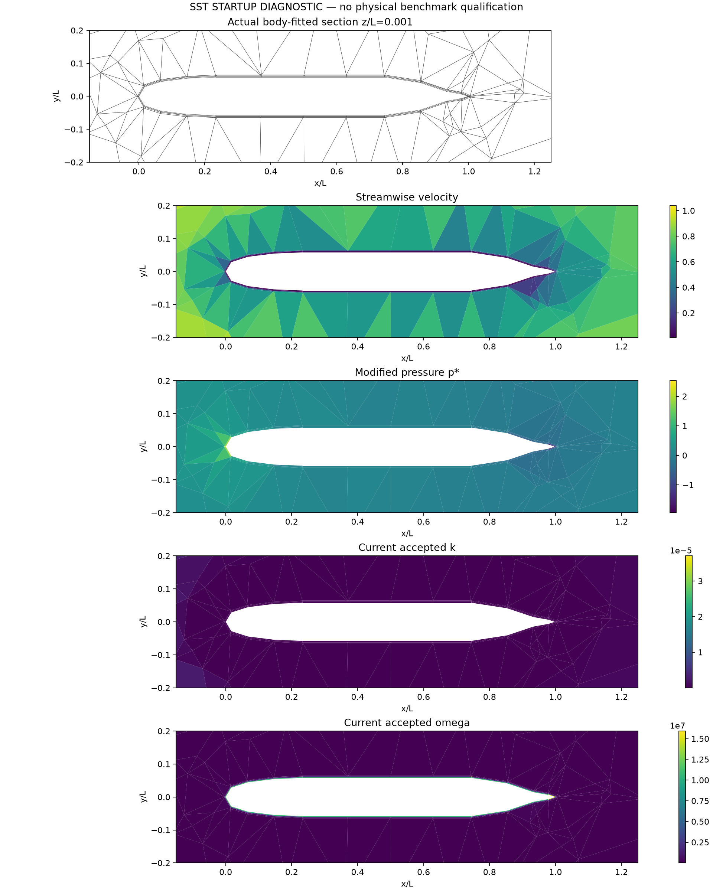
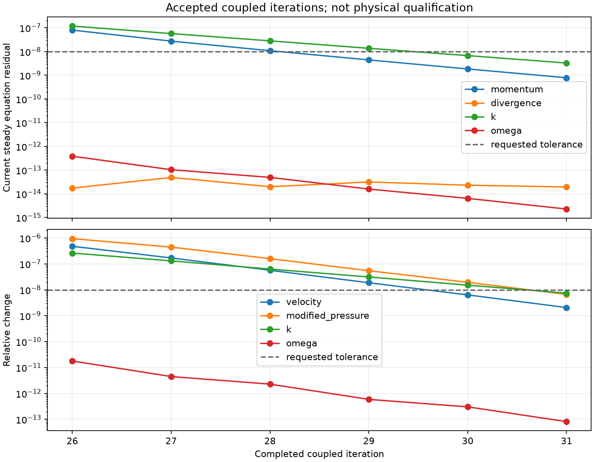

# 累计第 31 步：耦合残差通过，完整标量收支尚未通过

2026-10-13。由第 25 步使用批次 SIMPLEC 续算，6 步后达到原设定的 1e-8 当前耦合残差及场变化门槛，585.809 s。**这只证明原设定的 solver_converged 条件；完整数值验收仍失败，物理 benchmark 未通过。**

设置：Re=10，1,331 单元/3,556 面，SST-2003，无滑移低 Re 壁面，无制造体力；SIMPLEC 对角松弛 0.9，每轮一次对流更新、最多 20 次修正；dt=1，标量明确采用 relative 工作收支策略。原始场 SHA256：`54b09eb80929b521c2bcafeb3fe14a45656ffa4801afe6d439fa6af412689e8f`。

## 去除伪时间项后的当前稳态审计

| 指标 | 实测值 |
|---|---:|
| 动量归一化残差 | 7.827308e-10 |
| 质量散度最大值（独立散射） | 2.658862e-14 |
| 局部动量收支最大值 | 8.899722e-10 |
| 全局动量收支绝对值 | 3.092168e-9 |
| 内部面牵引不平衡最大值 | 7.646794e-10 |
| 能量收支绝对值 | 1.425460e-9 |
| k 归一化残差 | 3.273801e-9 |
| k 全局收支绝对值 | 3.887797e-12 |
| k 相对二次工作收支 | 2.065312e-9 |
| ω 归一化残差 | 2.267664e-15 |
| ω 局部通量收支最大值 | 5.024704e-7 |
| ω 全局通量收支绝对值 | 9.824988e-6 |
| ω 相对二次工作收支 | 1.656030e-16 |

当前质量、动量、内部面牵引和能量检查均小于 1e-8。但 k 的相对工作误差未满足 1e-12，ω 的局部/全局通量绝对误差未满足 1e-8。必须继续迭代或定位数值误差；不能仅凭 solver_converged=true 宣布完成。

保留扩展精度 scalar 状态、但固定同一 float64 SST 闭合的敏感性对照：ω 全局缺陷仍为 9.778421e-6、局部最大 4.949834e-7。精度转换对局部账本的最大影响为 2.743764e-8。它已经值得继续监测，但不能解释全部当前缺陷，也不是完整扩展精度闭合验证。

Cd(L²)=0.7928679534 是该迭代积分值；不是高 Re 实验阻力系数对照。原始 run、全部来源绑定、源码和重构账本已保留。

## 后续计算

已从同一第 31 步状态将耦合容差收紧到 1e-12，dt、物理方程和标量收支策略保持一致，并启动原标量求解与初值复用对照。其结果必须再次执行当前稳态审计；本页不预判达标。
