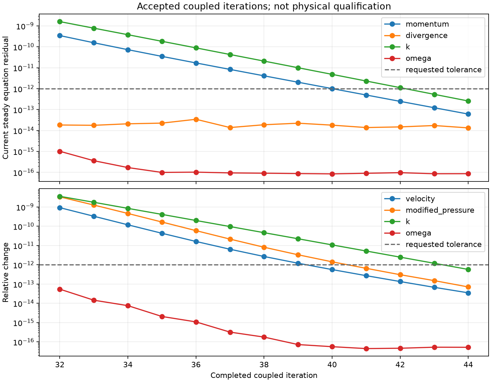

# 累计第 44 步：动量与 k 收支通过，ω 精度问题仍待修复

2026-10-13。由第 31 步状态继续原生 SIMPLEC/SST，耦合容差明确收紧到 1e-12，开启上一轮单元/共享面标量初值复用。13 步后满足该残差和完整场变化门槛，耗时 275.036 s；**完整稳态验收仍因 ω 通量收支失败，不能宣布 SUBOFF 已算准。**

## 设置与复现证据

Re=10，1,331 单元、3,556 面，实际贴体 SUBOFF，无制造体力；SST-2003，无滑移低 Re 壁面；SIMPLEC 对角松弛 0.9，一轮对流更新后最多 20 次修正；dt=1，湍流松弛 0.7。标量工作收支明确采用 relative 策略，局部/内部面/全局通量仍保持绝对 1e-8 门槛。旧绝对工作结果单列，不宣称已经通过。

每步 k/ω 初值复用均被原始方程验收，未触发回退；各用 2–3 次非线性迭代。调用方场不剪裁。原始场 SHA256：`b726d8e239383bb80b2f34c80d6ae0efc7d0163afb44f1c3bf3d2f9a72a9bfa8`。启动时源码 aedaa34 已独立快照，后续回退健壮性修复不修改该运行。

## 当前稳态收支（无伪时间项）

| 指标 | 第 44 步 |
|---|---:|
| 动量归一化残差 | 6.106345e-14 |
| 质量散度最大值（独立散射） | 1.707109e-14 |
| 局部动量收支最大值 | 9.203749e-14 |
| 全局动量收支绝对值 | 6.203583e-14 |
| 内部面牵引不平衡最大值 | 8.814130e-14 |
| 能量收支绝对值 | 4.918288e-14 |
| k 归一化残差 | 2.576154e-13 |
| k 全局通量收支绝对值 | 3.031918e-16 |
| k 相对二次工作收支 | 1.673375e-13 |
| ω 归一化残差 | 8.639970e-17 |
| ω 局部通量收支最大值 | 3.266177e-8 |
| ω 内部面通量不平衡最大值 | 1.477530e-9 |
| ω 全局通量收支绝对值 | 2.491288e-7 |
| ω 相对二次工作收支 | 2.325333e-18 |

质量/动量/能量和 k 检查通过；ω 局部、全局通量仍失败。当前 Cd(L²)=0.7928679562，仍只是低 Re 数值诊断值，不与高 Re 实验数据混合评分。原冷启动同伦流程的同起点、同容差对照仍在运行；最终场差异与完整耗时比较待其结束。

## 剩余 ω 缺陷的精度敏感性

1. 当前生产流程把已接受的扩展精度 k/ω 单元和面值转换为 float64 后计算当前方程。保持闭合系数不变，使用保存的原精度重建标量账本后，ω 内部面缺陷降至 1.364242e-12，但局部最大仍为 2.940214e-8、全局为 -1.615845e-7。状态转换对局部账本的最大影响为 2.278830e-8，已与残余缺陷同量级。
2. 另一个独立诊断函数执行完全相同的 SST 函数代码，只在独立 globals 中使用 longdouble 输入转换，并以保存的扩展精度面值计算标量梯度；**未修改生产模块，也未重新求解**。ω 的装配黏性系数逐项不变，体积积分源项最大变化 2.616133e-8；局部最大缺陷为 2.506567e-8，全局为 -1.448207e-7。该诊断仍失败，不是完整高精度输运的达标结果。
3. 本平台 longdouble 实测有效尾数 64 位，不是 IEEE 四倍精度。原始差分源项、账本、黏性数组、函数/脚本快照与 SHA256 均在 closure-precision-sensitivity 中保存。

这些结果支持下一步检查 SST 状态、梯度、闭合源项以及输运 source/sink/old 的精度传递和一致性。仅改报告显示精度、只保留最后的数组，或继续按已到舍入量级的归一化残差停止，都不能解决当前缺陷。仍需实现、验证并重新求解后才可验收。

仍未完成：完整原生 SST 稳态资格、壁面函数耦合、高 Re 同工况 Cp/Cd <3%、网格收敛。当前计算不构成这些要求的通过证据。
