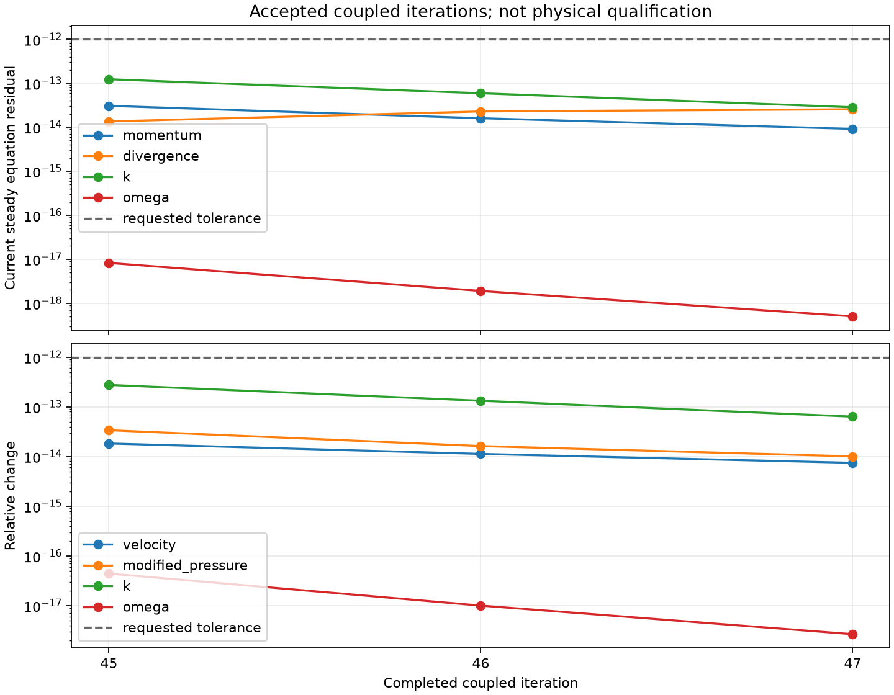
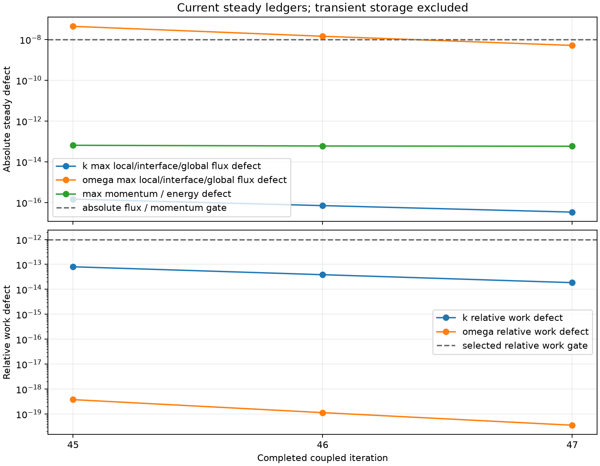

# Re=10 SUBOFF：第 47 步通过当前稳态收支

2026-10-13。原生 TensorFVM 在 1,331 单元、3,556 面的真实贴体 SUBOFF 网格上，从第 44 步保存场继续 3 步，耗时 71.951 s。当前原方程残差、完整场变化和动量/k/ω 稳态收支同时通过。保存场的独立重建审计得到相同结论。

**通过范围仅为这张网格、此低 Re 工况的离散稳态验收。** 尚未获得高 Re 壁面函数验证、网格收敛或同工况实验 Cp/Cd <3%；报告保留 `physical_suboff_benchmark_passed=false`。启动器和审计器的总资格字段仍为 false，分别用 `solver_converged` 和 `current_steady_ledgers_passed` 表达本轮实际通过的门槛。

## 问题与修复

L=U=ρ=1、ν=0.1，Re=10，无制造体力，AFF-1 裸艇、零攻角。SST-2003，入口 I=0.5%、尺度 0.05L；壁面 k=0、ω=60ν/(β1 d1²)，尚无壁面函数。SIMPLEC 使用对角松弛 0.9，每轮最多 20 次内部修正；标量伪时间 dt=1、外层松弛 0.7。

第 44 步的 ω 归一化残差已很小，但全局通量缺陷 2.491288e-7 超过 1e-8。此次显式启用 `scalar_precision=longdouble`，保留状态、标量梯度、SST 源项、输运源汇及旧时间层数据的扩展精度。相同 SST 公式、常数和通量门槛不变。稀疏 LU、几何、动量及扩散系数装配仍为 float64；本平台 longdouble 有效尾数 64 位，不是四倍精度求解器。

`require_steady_ledgers` 新增当前收支门槛：残差和场变化满足 1e-12 后，重新计算无伪时间项的当前稳态收支；未通过则继续。获取最终结果时再次检查，防止沿用失效的收敛标签。此选项在本轮明确开启。

## 当前场审计

| 指标 | 第 44 步 float64 闭合 | 第 47 步扩展精度闭合 |
|---|---:|---:|
| 动量归一化残差 | 6.106345e-14 | 9.184467e-15 |
| 独立质量散度最大值 | 1.707109e-14 | 1.944474e-14 |
| 全局动量收支绝对值 | 6.203583e-14 | 5.745269e-14 |
| 动量能量收支绝对值 | 4.918288e-14 | 5.045964e-14 |
| k 归一化残差 | 2.576154e-13 | 2.847288e-14 |
| k 相对工作收支 | 1.673375e-13 | 1.853260e-14 |
| ω 归一化残差 | 8.639970e-17 | 5.032031e-19 |
| ω 局部通量收支最大值 | 3.266177e-8 | 3.055902e-10 |
| ω 内部面通量不平衡最大值 | 1.477530e-9 | 1.364242e-12 |
| ω 全局通量收支绝对值 | 2.491288e-7 | 5.122274e-9 |
| ω 相对工作收支 | 2.325333e-18 | 3.529442e-20 |

局部/内部面/全局通量仍采用绝对 1e-8，标量工作采用此前明确选择的 relative 策略（1e-12）。ω 旧的绝对工作缺陷为 0.0394941，**旧绝对工作判据仍不通过**，不得将相对工作通过写成旧判据通过。

第 45、46 步的 ω 全局通量仍未通过，新门槛确实阻止提前停止；第 47 步才接受。审计使用当前生产算子重建并独立求和，未重新求解、未计入伪时间项；这不构成独立离散方法或实验验证。

Cd(L²)=0.7928679561765144，仅是此低 Re 网格的诊断值。它与高 Re 实验使用的迎流面积 Cd 不可直接比较。

## 网格、场与迭代记录


图中保留单元分片常值及粗网格痕迹，不进行平滑以掩盖网格分辨率。当前网格不足以用于目标高 Re 精度验收。





## 验证与复现

高 ω 源项与独立 Decimal 计算对照；源/汇/旧场的微小扰动保留、float64 LU、SST 实际步进与精确恢复、稳态门槛及旧流程回归均通过。日志分别为 21 项与 28 项测试，集合有重叠，不相加。

本轮源代码提交 `3a5139c`。`run/source-snapshot` 与 `run/sources.json` 记录实际生产源码；原始场 SHA256 为 `322ca2a6ce120c16210d96135c63ee895c3e62e028139b9810478db6261be16b`。独立审计数组 SHA256 为 `a0b1beb9433d55fb853bd79d9f0dd84b26f420256c3257c0175ce2a3a99a7b1d`。初始场、重启来源、环境及边界数据均已绑定保存。

在仓库根目录，采用已安装项目依赖的 Python，输出目录必须为空：

```bash
export OMP_NUM_THREADS=1 OPENBLAS_NUM_THREADS=1 PYTHONPATH=src
python scripts/verify_native_suboff_sst_startup.py \
  --laminar-run docs/verification-native-hybrid-suboff-startup/re10-newton \
  --restart-run docs/verification-native-suboff-sst-startup/step44-current-audit/run \
  --output results/new-sst-extended --steps 24 --dt 1 --tolerance 1e-12 \
  --scalar-work-balance-policy relative --scalar-warm-start \
  --scalar-precision longdouble --require-steady-ledgers \
  --momentum-method simplec --momentum-coupling sweeps \
  --momentum-sweeps 1 --momentum-inner-iterations 20 \
  --momentum-relaxation .9 --momentum-relaxation-basis diagonal
python scripts/audit_native_suboff_rans_state.py results/new-sst-extended \
  --output results/new-sst-extended-audit
python scripts/report_native_suboff_sst_startup.py results/new-sst-extended
```

后续应完成动量 Spalding 牵引、壁邻 ω 约束及生产项耦合，再对齐 OpenFOAM 的高 Re 工况、边界、网格和阻力归一化。不能把本次低 Re 数值收支通过替代这些工作。
