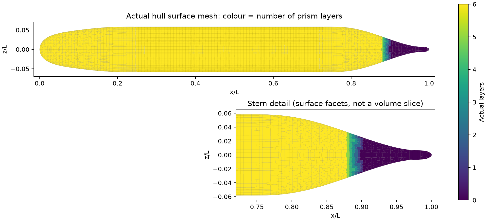
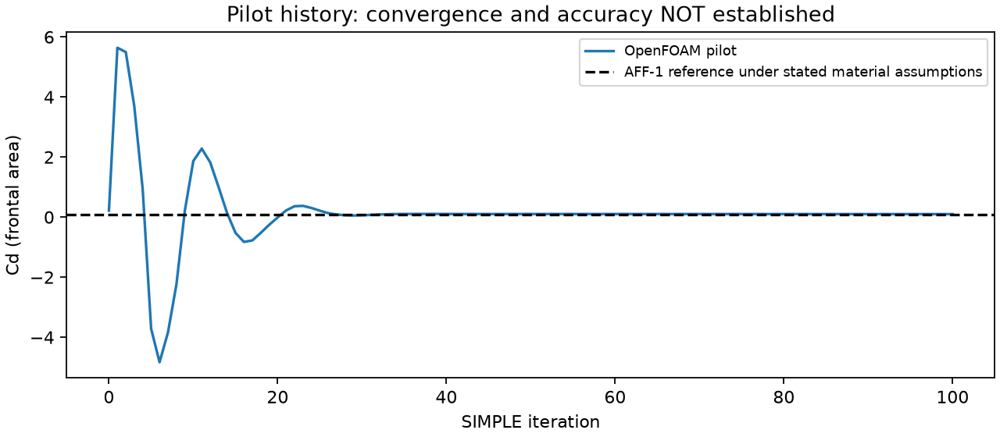
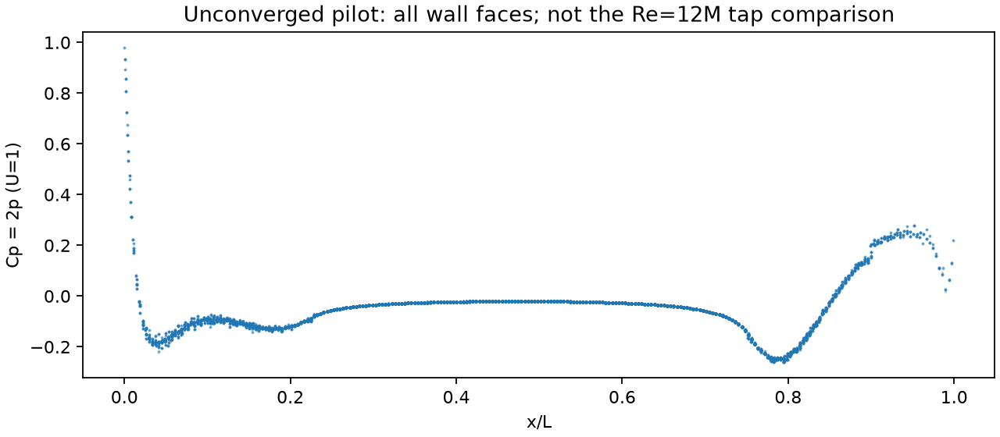

# OpenFOAM SUBOFF 调研与复现基线

日期：2026-10-12。**状态：配置与网格流程验证；尚无 Cp 或阻力误差小于 3% 的计算结论。**

后续：[首层变薄与尾部加密对照](refinement-01/README.md)；[原生 TensorFVM SIMPLEC 实现与验证](../verification-native-simplec/README.md)。

## 1. 选定的公开案例

Permadi、Chen、Sugianto（2023），[Influence of Full and Symmetrical Domains on the Numerical Flow around a SUBOFF Submarine Model using OpenFOAM](https://doi.org/10.47176/jafm.16.05.1513)，[出版社全文](https://www.jafmonline.net/article_2198_f0ba50cd6021da497f86f3e36ea63eec.pdf)。

论文采用 AFF-8 带附体、5.93 kn、OpenCFD v2112、稳态不可压 RANS、SIMPLEC、SST k–ω 和 Spalding 壁面处理。对流为二阶迎风，扩散为二阶中心；近壁 6 层、增长率 1.15、目标首层中心 y⁺=45（40–50）。全域三套网格为 1,846,432／2,574,485／3,657,842 单元；停止条件包括归一化残差小于 1e−5 和力稳定。

**文献不能证明 Cp 与阻力同时达标。** Table 4 的力值与所列误差百分比不一致：以其实验值 102.39 N 重算，全域粗／中／细网格误差分别为 0.801%／0.791%／0.508%。在 x/L=0.92，文中全域 Cp=0.236、实验 Cp=0.302，差值 0.066，点相对误差约 21.9%。

论文没有给出完整 OpenFOAM 字典和明确的入口湍流参数；其外边界包含 noSlip 壁面，计算域坐标原点也需结合原始模型进一步确认。因此它是配置依据，不是可直接声称逐项复现的完整算例包。

## 2. 本机复现的边界与假设

本次安装 **OpenFOAM Foundation 12**（build `12-86e126a7bc4d`，包 `20250206`），串行运行。使用官方二进制，仅修改本地安装前缀，未修改求解器。**Foundation 12 与论文的 OpenCFD v2112 不同。**

| 项目 | 当前独立基线 |
|---|---|
| 几何 | AFF-1 裸艇、零攻角；来自 TensorLBM 的母型公式，仍需原始型值表认证 |
| 求解器 | `foamRun` / `incompressibleFluid`，`SIMPLE { consistent yes; }` |
| 湍流与壁面 | `kOmegaSST`；`nutUSpaldingWallFunction`；`omegaWallFunction` blended；`kqRWallFunction` |
| 无量纲化 | L=1，U=1，ρ=1；ν=1/Re；p 为运动学压力 |
| 阻力工况 | Re=13,218,056.8096，对应现有资料的 U=3.046 m/s、L=4.356 m、ρ=998.2 kg/m³、μ=0.001002 Pa·s |
| 入口湍流 | 自行假设 I=0.5%，长度尺度 0.05L；后续必须做敏感性检验 |
| 远场 | 自行选定入口/侧面速度固定，出口压力固定；不等同论文试验域壁面条件 |
| 数值格式 | U 有界 linearUpwindV，梯度限幅；k、ω 暂用一阶迎风启动；非正交修正 limited 0.5，2 次修正 |
| 网格 | 背景体加密后再进行表面加密；6 层、增长率 1.15、首层厚度 0.0002L；实际层数必须检查 |
| 计算域 | 鼻尖原点，[-3,4]×[-2.625,2.375]×[-2.125,0.875]L；这是项目选择，不宣称与论文一致 |

首层**厚度**不是首层中心距离；该设置只是 y⁺≈45 的初估，必须用计算得到的 y⁺ 分布复核。当前 100 步运行属于流程试算。最终应升级 k/ω 对流格式、验证敏感性及三套网格，再判定精度。

阻力目标使用 AFF-1 的 87.4 N；在上述计算物性和迎流面积 πD²/4 下，Cd=0.09312081297。AFF-8 的 102.39 N 不适用于裸艇。Cp 使用独立 Re=1.2e7 工况，现有 19 点表仍待原表审核，详见[实验数据审计](../verification-suboff-reference/README.md)。不把两个工况合并评分，也不混用湿表面积系数和迎流面积系数。

## 3. 已执行的检查

- 原 9,068 单元网格成功导出，修正了 OpenFOAM 内部面的 owner/neighbour 排序要求。
- 原网格最大非正交角 85.625°，81 个单元 determinant<0.001，597 个面插值权重<0.05。这张网格保留为方法诊断，不能作为精度基准。
- 扩展检查还报告 1,152 个“凹单元”。Foundation 12 的 `checkConcaveCells` 将共面分割面也归入该项；27 个规则立方体的三角面导出也触发全部 27 个单元。该数字不能直接等同真实几何凹陷。对应源码为 [primitiveMeshCheck.C](https://github.com/OpenFOAM/OpenFOAM-12/blob/master/src/meshCheck/primitiveMeshCheck/primitiveMeshCheck.C)。
- 27 单元通道 smoke 完成 100 步，验证了字段、SST、壁面函数和求解器能够执行；它没有实验精度验收意义。
- 初次单阶段 snappy 操作没有达到指定表面层级，且最终棱柱层数为零。脚本已改为先体加密、后表面处理，禁止仅凭 `Finished meshing` 宣称网格合格。
- 原网格日志与最终两阶段网格实测结果见本目录 `evidence/` 和 `status.json`。求解状态必须区分程序完成、数值收敛和物理精度通过。

### 两阶段网格的实测质量

254,775 单元，19,196 个艇体表面面元；平均实际层数 5.806；有层表面积比例 97.476%，完整六层表面积比例 96.139%。**缺层集中在尾段，不能用总体覆盖率掩盖尾部边界层欠分辨。** 最大非正交角 44.957°、最大 skewness 0.572；常规 `checkMesh` 通过，扩展检查仍报告 8,364 个凹性单元及 36 个凹面提示，须结合几何审查。该网格获准用于诊断试算，未获精度验收。



### 100 步试算结果（未收敛）

Cd=0.09928360716，参考 Cd=0.09312081297，当前偏差 **6.618%**。第 100 步初始残差仍有 Uy≈5.43e−4、Uz≈5.38e−4、p≈3.06e−4；不能用内层线性求解的低残差替代外层收敛。y⁺ 最小/平均/最大为 14.63/65.69/1224.29，局部壁面分辨率尚不满足目标。





Cp 图展示当前阻力工况的全部表面面元，不能与 Re=1.2e7 的测压点直接当作同工况比较。导出的壁面压力按实际面面积向量重新积分，并与 OpenFOAM 输出的压力力独立交叉核对，误差见 `status.json`。当前 Cp 数组、压力/摩擦力历史、全部输入字典和压缩日志均已归档。网格由脚本重建，SHA256 可核对。10 项相关测试通过。

新网格上的 OpenFOAM 运行与旧网格上的 TensorFVM 失败不是严格同网格实验，不能据此定量归因求解器差异。

## 4. 可复现命令

官方二进制下载地址及 SHA256 见 [sources.json](sources.json)。本机将 deb 用 `dpkg-deb -x` 解压至用户目录，并修改 `etc/bashrc` 中安装前缀。

在仓库根目录，使用已安装 numpy/项目依赖的 Python。`tensorfvm-foam12` 是一个 source Foundation 12 `etc/bashrc WM_MPLIB=none` 后执行参数的本地包装器；也可用等价包装器替代。

```bash
export PYTHONPATH=src
python scripts/prepare_openfoam_suboff_snappy.py \
  --output results/openfoam-suboff/new-run --iterations 100
python scripts/run_openfoam_suboff.py \
  --case results/openfoam-suboff/new-run \
  --foam-wrapper /home/jsyc/.local/bin/tensorfvm-foam12 --solve
```

运行器拒绝覆盖现有网格，检查每个进程的退出码，并读取 `checkMesh` 的文字结论（它可以在失败时返回 0）。网格常规检查通过且平均实际层数至少 5 后才启动试算；扩展检查结果另外保留。平均层数是启动门槛，不能代替完整层覆盖率、y⁺、网格无关性验证。`physical_benchmark_passed` 始终保持 false，不能由程序正常退出自动设为 true。

归档指标、配置、日志和图片：

```bash
python scripts/report_openfoam_suboff_pilot.py \
  --case results/openfoam-suboff/new-run \
  --output results/openfoam-suboff/new-report
```

导出原网格作同网格诊断：

```bash
python scripts/prepare_openfoam_suboff.py \
  --mesh docs/verification-suboff-single-domain-mesh/coarse-tail-transition/suboff-hybrid.msh \
  --output results/openfoam-suboff/native-diagnostic
```

## 5. 后续验收顺序

1. 检查贴体外形、头尾局部细化、六层覆盖率和 y⁺ 空间分布；不能靠增加远场单元数替代近壁分辨率。
2. 在独立 OpenFOAM 基线上收敛连续性、动量、k、ω，并记录 Cd 压力/摩擦分量。建议最后 200 步 Cd 波动范围/均值<0.2%，并检查稳定趋势；这是项目门槛，不是文献保证。
3. 运行至少三套逐级加密网格，核对总阻力与 Cp 曲线的网格变化；同时检验入口湍流、远场距离和二阶格式影响。
4. 阻力误差<3%；Cp 预先锁定曲线范数及 Cp=0 附近的处理，不用逐点相对误差掩盖或放大问题，同时报告绝对差和实验不确定度。
5. OpenFOAM 自己通过这些检查后，再以相同网格、边界、Re、参考面积对照 TensorFVM，定位离散/耦合差异。最后扩展至 AFF-8、overset 和 FVM–LBM 耦合。

本阶段不以替换湍流常数或针对实验曲线调参来宣布达标。
