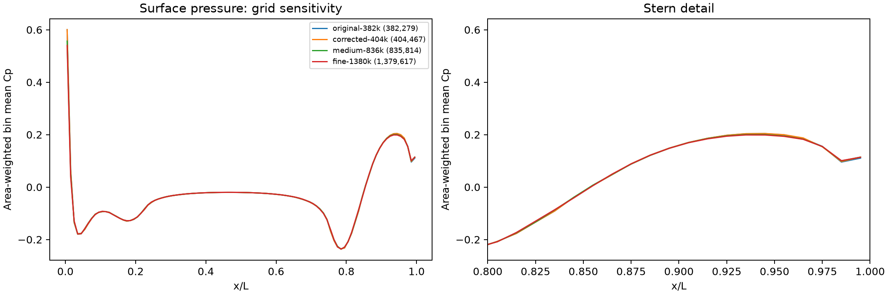
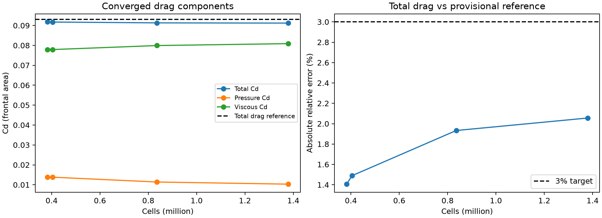
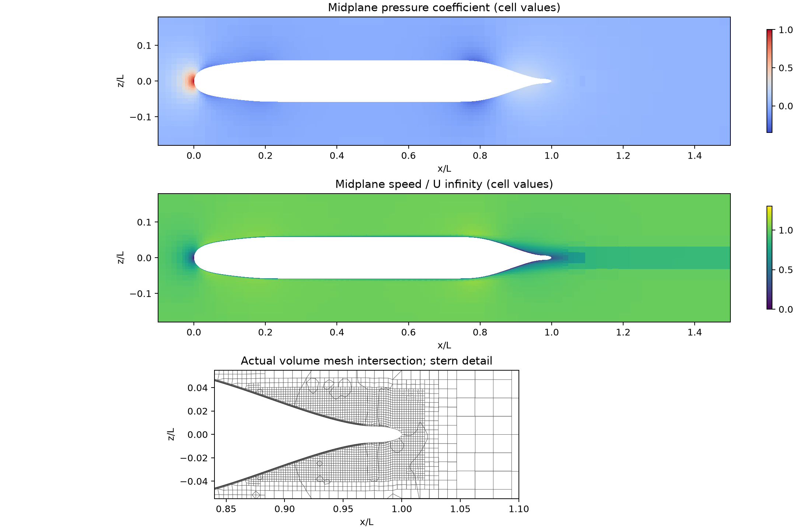
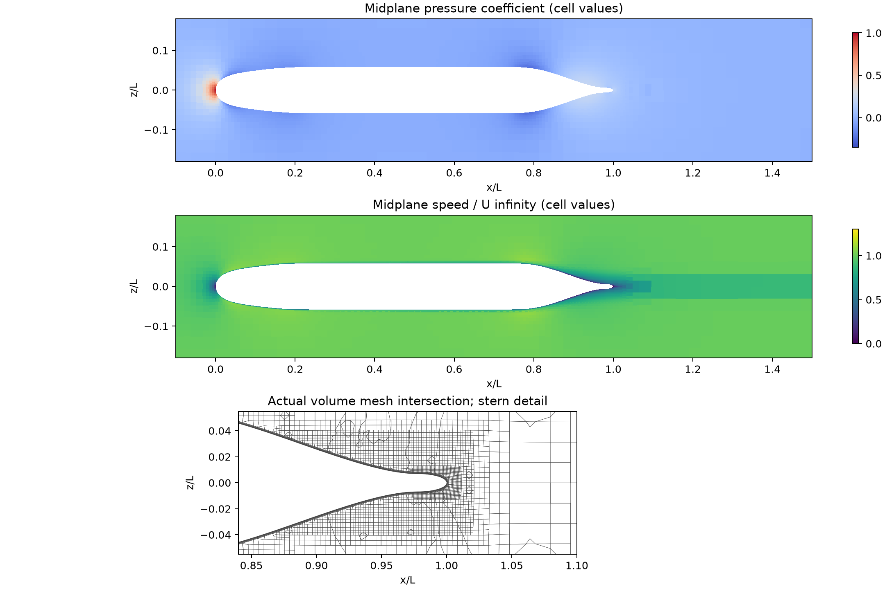
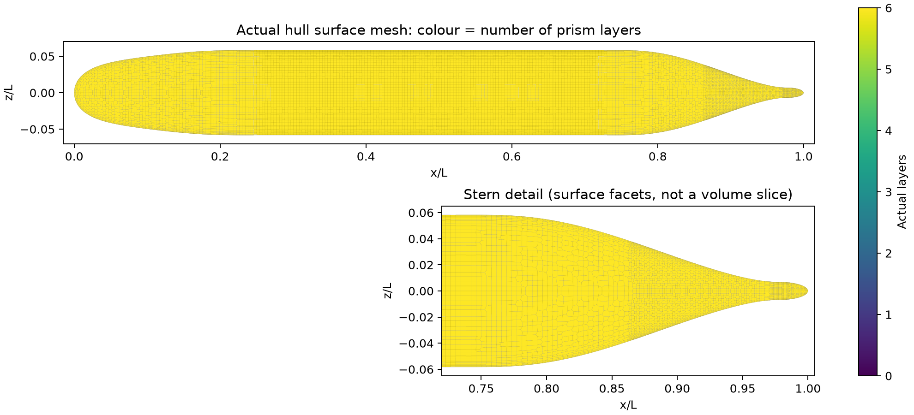
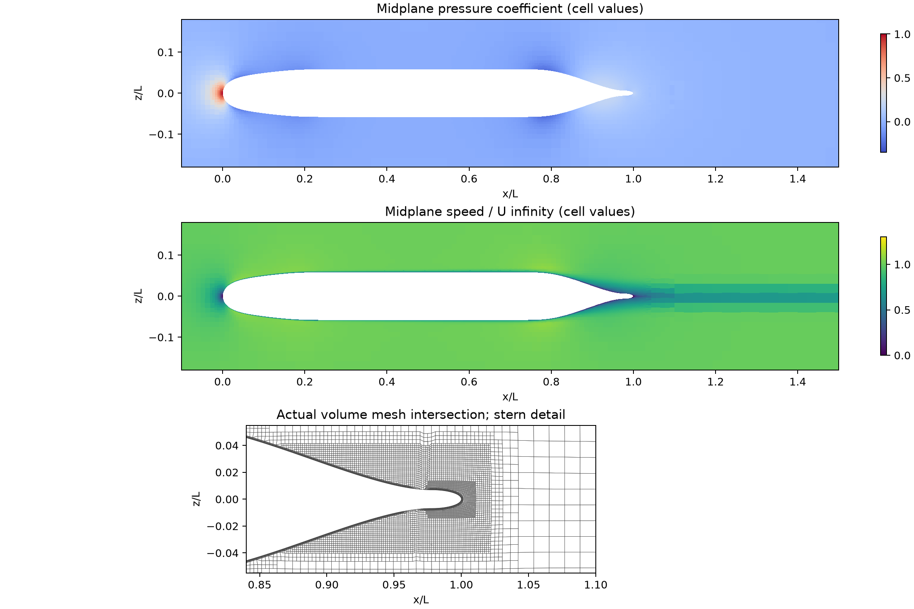
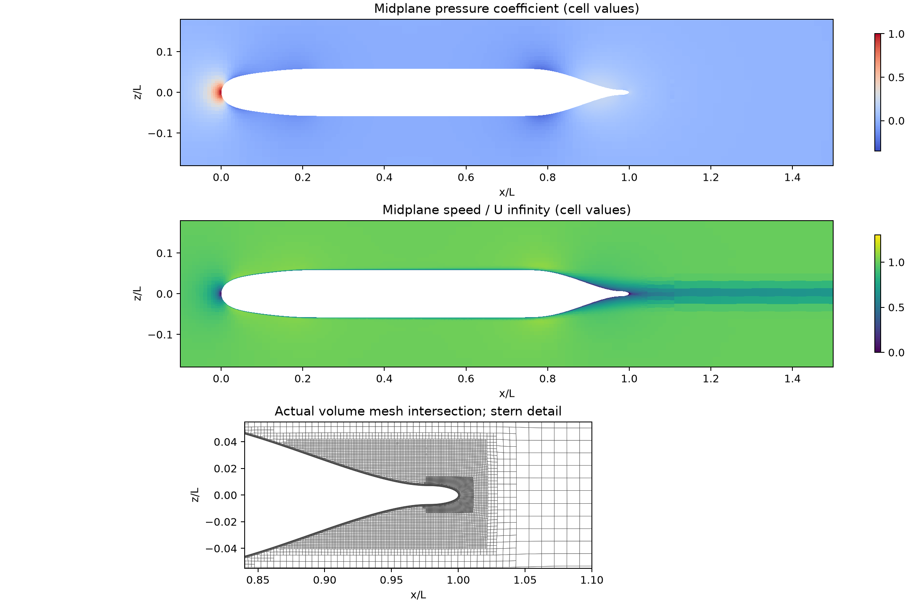
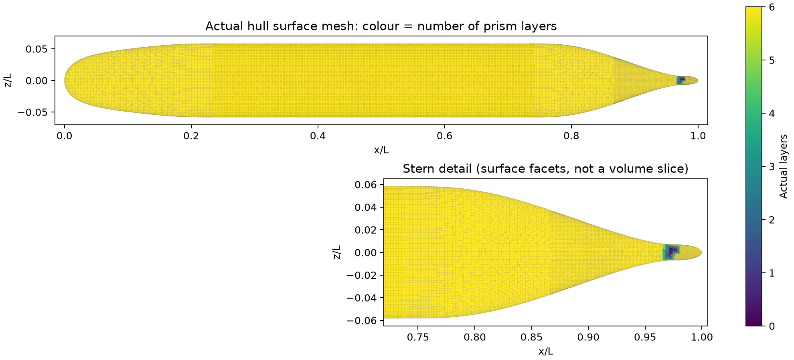
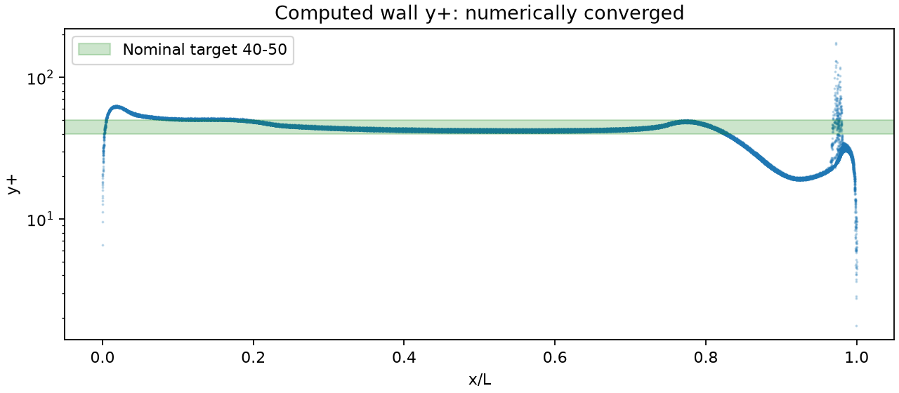

# SUBOFF AFF-1：迭代收敛、尾端缺层修复与网格敏感性

日期：2026-10-12。求解器为 **OpenFOAM Foundation 12**，不是原生 TensorFVM。
本轮以固定物理设置的对照计算，回答原先约 7% 的阻力偏差是否主要由网格不足造成。
四套网格已完成独立数值收敛检查和完整场重建；以下给出最终结果及仍未通过的物理验证项目。

## 1. 问题与工况

采用 AFF-1 裸艇、零攻角、无显式转捩触发的全湍流稳态 RANS。
L=1、U∞=1、ρ=1，ReL=13,218,056.8096。对应 L=4.356 m、U∞=3.046 m/s、
ρ=998.2 kg/m³、μ=0.001002 Pa·s。阻力系数用迎流面积 πD²/4，D=0.508 m。
沿用项目中待进一步认证的 AFF-1 阻力参考 87.4 N，即 Cd=0.09312081297。

表面压力系数 Cp=2p，p 是无量纲运动学压力，出口参考压力为零。
本轮比较同工况不同网格的 Cp；现有 19 点实验表属于 **ReL=12e6**，且仍待原表审核，
因此不将其与本轮 ReL=13.218M 结果混合评分。
资料适用范围见[实验数据审计](../../verification-suboff-reference/README.md)与
[公开案例调研](../README.md)。

## 2. 求解方法与控制变量

- `foamRun / incompressibleFluid`，`SIMPLE { consistent yes; }`，即 Foundation 12 的一致压力修正设置。
- SST k–ω；`nutUSpaldingWallFunction`、blended `omegaWallFunction`、`kqRWallFunction`。
- U 使用 bounded linearUpwindV，速度梯度限幅；k/ω 本轮保持一阶迎风；非正交修正 2 次、扩散限幅 0.5。
- 松弛 p=0.3，U/k/ω=0.5；入口 I=0.5%、湍流长度 0.05L 为项目假设。
- 同一母型 STL、同一计算域、边界条件、雷诺数与物性，比较脚本检查配置一致性。
- 计算域为 [-3,4]×[-2.625,2.375]×[-2.125,0.875]L。
- 请求的近壁首层厚度固定 0.00018L，目标六层，增长率 1.15。局部层厚可能因网格生成约束缩减；厚度不等于首层中心距，y⁺ 以求解后实际值为准。

原网格采用尾部 level 7；修正组在 x/L=0.975–1.01、横向 ±0.012L 内增加 level 8 加密。
在此基础上，背景块网格三个方向的基准划分按 1、1.35、1.65 倍取整，保持同一加密区域与层设置。
这是**固定首层厚度的工程网格敏感性研究**，并非均匀缩比网格，不能直接给出形式上的 Richardson 外推或 GCI。

中、细网格初始场由原网格的第 800 步收敛解通过 `mapFields -consistent -mapMethod interpolate` 获得；
修正粗网格使用原网格第 300 步作为初值。映射仅加快启动，每张网格必须独立满足收敛门槛。
未使用实验数据构造初值或修正求解结果。

## 3. 数值收敛标准

必须同时满足：

1. 最近 **200 个连续迭代**中，总 Cd、压力阻力、黏性阻力各自的极差/均值 ≤0.2%，前后半窗均值差/均值 ≤0.1%。
2. 最近 20 步的 Ux、Uy、Uz、p、k、ω **初始**残差均 ≤1e−5。p 使用每个外迭代第一次压力求解的初始残差。
3. 最近 20 步局部连续性误差 ≤1e−7，全局连续性误差绝对值 ≤1e−9。
4. 保存完整最终场文件，壁面 Cp 按实际面积向量重新积分的压力力必须与求解器输出一致。

线性求解器最后一次修正的小残差、总阻力中分量的相互抵消、程序正常结束，都不能单独视为收敛。
`physical_benchmark_passed` 仍为 false；数值收敛与实验精度验收分别判断。

## 4. 结果与图表

<!-- RESULTS_START -->
### 4.1 收敛后的阻力

四套计算均满足本报告的数值收敛门槛。误差为相对于当前 AFF-1 阻力参考的绝对相对偏差；不是 Cp 实验验收结论。

| 网格 | 单元数 | 最终迭代 | Cd | 阻力参考偏差 | 压力 Cd | 黏性 Cd |
|---|---:|---:|---:|---:|---:|---:|
| 原网格 | 382,279 | 800 | 0.091811496 | 1.406% | 0.013889513 | 0.077921983 |
| 尾端修正粗网格 | 404,467 | 600 | 0.091734124 | 1.489% | 0.013815218 | 0.077918906 |
| 中网格 | 835,814 | 1000 | 0.091320777 | 1.933% | 0.011392361 | 0.079928417 |
| 细网格 | 1,379,617 | 1000 | 0.091206551 | 2.056% | 0.010317542 | 0.080889009 |

最近 200 步各分量的相对极差如下，门槛均为 0.2%；半窗口漂移及全部残差见各目录的 `convergence-audit.json`。

| 网格 | 总 Cd 极差 | 压力阻力极差 | 黏性阻力极差 | 最近 20 步最大主方程初始残差 |
|---|---:|---:|---:|---:|
| 原网格 | 0.0097% | 0.0541% | 0.0018% | 1.034e-07 |
| 尾端修正粗网格 | 0.0026% | 0.0145% | 0.0005% | 2.027e-07 |
| 中网格 | 0.0024% | 0.0164% | 0.0004% | 1.364e-07 |
| 细网格 | 0.0158% | 0.1249% | 0.0019% | 1.538e-07 |

### 4.2 实际网格与壁面分辨率

| 网格 | 壁面面元 | 有棱柱层面积 | 完整六层面积 | 最大非正交角 | 最大 skewness |
|---|---:|---:|---:|---:|---:|
| 原网格 | 21,908 | 99.89839% | 99.56805% | 50.869° | 0.714 |
| 尾端修正粗网格 | 22,684 | 100.00000% | 100.00000% | 50.045° | 0.847 |
| 中网格 | 40,308 | 99.99191% | 99.68165% | 64.179° | 1.399 |
| 细网格 | 60,004 | 99.99283% | 99.91730% | 63.525° | 1.495 |

| 网格 | y⁺ 最小/面均值/最大 | y⁺>100 的面积 | 完整六层面上的最大 y⁺ |
|---|---:|---:|---:|
| 原网格 | 13.44 / 41.43 / 369.38 | 0.13921% | 63.24 |
| 尾端修正粗网格 | 6.01 / 39.81 / 63.24 | 0.00000% | 63.24 |
| 中网格 | 1.73 / 40.82 / 224.82 | 0.01184% | 63.01 |
| 细网格 | 1.76 / 40.95 / 174.98 | 0.00309% | 62.88 |

尾端修正粗网格实现完整六层覆盖，将最大 y⁺ 从 369.38 降至 63.24。中、细网格仍各有 19、39 个零层面，缺层面积约 0.00809%、0.00717%。高于 100 的 y⁺ 全部位于不足六层区域；细网格最大 y⁺ 位置约 (0.97246, 0.00711, 0.00011)L。这些局部问题仍需修复，均值约 41 不能代替局部检查。

### 4.3 网格变化与 Cp 曲线

| 相邻比较 | 总 Cd 变化 | 压力 Cd 变化 | 黏性 Cd 变化 | Cp 绝对 RMSE | Cp 最大绝对差 |
|---|---:|---:|---:|---:|---:|
| 原网格 → 尾端修正粗网格 | -0.0843% | -0.5349% | -0.0039% | 0.000484 | 0.003550 |
| 尾端修正粗网格 → 中网格 | -0.4506% | -17.5376% | +2.5790% | 0.004810 | 0.043818 |
| 中网格 → 细网格 | -0.1251% | -9.4346% | +1.2018% | 0.002304 | 0.016642 |

百分比以比较中的前一张网格为分母。Cp 使用 100 个共同的 0.01L 轴向区间，对区间内全部壁面按表面积加权；曲线是区间均值，不是几何停滞点的 Cp。中→细网格的最大差出现在首个区间 x/L∈[0,0.01]，其中心为 0.005。它们是网格间差异，不是对实验的误差。





矢量版：[Cp 比较 PDF](cp-grid-comparison.pdf)、[阻力比较 PDF](drag-grid-comparison.pdf)。原始共同区间数据：[cp-bin-profiles.csv](cp-bin-profiles.csv)；全部比较指标：[comparison.json](comparison.json)。

### 4.4 对“是否网格太小”的判断

1. **先前约 7% 的偏差不能归因于总单元数不足。** 同一张 382,279 单元网格，从第 100 步的 6.965% 偏差续算到第 800 步后降至 1.406%。这部分改进来自继续迭代。
2. **尾端缺层确实影响局部壁面质量。** 修复后最大 y⁺ 显著下降，总 Cd 只变化 −0.0843%；局部质量与总阻力必须分别检查。
3. **目前四组 Cd 的参考偏差均小于 3%，仍不能据此宣布完全网格无关。** 中→细网格总 Cd 变化 −0.1251%，压力 Cd 变化 −9.4346%，黏性 Cd 变化 +1.2018%；两个分量的网格变化部分抵消。
4. **下一轮局部加密应重点覆盖头部。** 中→细网格的压力 Cd 减少约 0.0010748，其中 x/L<0.25 的前体贡献约 0.0008167，占 75.99%；Cp 最大区间差也出现在最前端。应先检查鼻部局部加密、曲面几何逼近与压力积分，再联合检查壁面法向分辨率。尾部极少量缺层仍需单独处理。
5. **Cp 实验精度尚未验收。** 当前 Cp 仅做同 Re 的网格比较；下一步需要经审核、工况匹配的测压数据，并开展 k/ω 二阶格式、入口湍流及壁面法向网格敏感性研究。
6. **这是外部 OpenFOAM 参考计算。** 原生 TensorFVM 仍需在相同网格和物理条件下复现，不能将本轮 Cd 偏差转记为原生求解器已达标。

所有壁面压力重新积分与 OpenFOAM 压力力的一致性误差均小于 1.3×10⁻¹⁶（本次无量纲力），验证了报告的压力数据与力输出对应关系；这项自洽检查不等同于对实验的验证。
<!-- RESULTS_END -->

### 实际网格、压力与速度

云图直接显示 y/L=0 截面各单元的原始 p、U 值，不进行跨单元平滑插值；各网格使用相同色标。
下方同时显示尾端体网格截面，因此可以判断局部场变化与网格位置的关系。
壁面网格图的颜色为实际棱柱层数，不能把表面网格图误作体网格截面。

原 382,279 单元：



修正 404,467 单元：





中网格 835,814 单元：



细网格 1,379,617 单元：








## 5. 证据与适用范围

每个子目录包含 `status.json`、`convergence-audit.json`、Cp/力/y⁺ 数据、压缩运行日志、
配置文件、初始化来源、网格 SHA256、实际截面 VTK 及图像。较大的映射初值不重复上传，记录文件大小与 SHA256，
可通过记录的源计算与映射步骤重新构造。

`pressure_drag_regions` 另给出三个轴向区间的压力力积分，以及缺层面当前承担的压力力。
三个轴向区间可相加；缺层面是重叠诊断，不能再次加到总和中。
缺层面的压力力贡献**不等于缺层造成的误差**，影响仍须由修复前后的完整解对照判断。

- OpenFOAM/MPI 的版本、官方软件包校验和、本机包装器以及串行/MPI 对照见 [environment.json](environment.json)。
- 同一检查点推进一步的串行/MPI Cd 相对差为 2.1493e−6（0.0002149%）。这只验证该检查点的分区影响，没有将其当作全程误差上界。
- 各网格标准 `checkMesh` 通过；扩展凹性检查仍有警告，原始日志保留。共面分割面会触发其中部分检查，尚不能将所有凹性警告认定为无害。
- 各组共享 TensorLBM 母型公式生成的 STL；与原始 SUBOFF 型值表的几何认证仍未完成。
- k/ω 对流仍为一阶；入口湍流、远场距离、转捩/试验激流条件尚未完成敏感性研究。
- 本轮固定壁面首层厚度；更大的总单元数不等于壁面法向分辨率同步提高。
- OpenFOAM 上得到的结果不能替代原生 TensorFVM 的精度验证。其已有的黏性离散、压力耦合诊断问题仍需按同网格对照处理。

本轮发现并修复了续算脚本的检查点保存间隔问题：每段 200 步时仍沿用 600 步写场会无法续算。
中网格的未保存尝试已单独归档并从原始映射初值重新计算，不参与收敛统计。
新的运行器按段保存场文件，并在任一 MPI 分区缺少末步检查点时明确失败。

收敛历史、检查点及案例 I/O 的 **9 项回归测试通过**，见 [测试记录](tests.txt) 和 [测试范围](test-status.json)。这些测试验证计算流程，不替代流动物理验证。

## 6. 可复现流程

仓库根目录设置 `PYTHONPATH=src`。需要项目 Python 依赖、Foundation 12 和匹配的 OpenMPI。
包装器示例与软件包来源见 `environment.json`；本机包装器路径可以替换为等价安装。

先生成原网格的 100 步解，并按本次的 100→600→800 路径续算：

```bash
export PYTHONPATH=src OMP_NUM_THREADS=1 OPENBLAS_NUM_THREADS=1
python scripts/prepare_openfoam_suboff_snappy.py \
  --output results/openfoam-suboff/reproduce-original-100 --iterations 100 \
  --first-layer-thickness 0.00018 --tail-level 7
python scripts/run_openfoam_suboff.py --case results/openfoam-suboff/reproduce-original-100 \
  --foam-wrapper tensorfvm-foam12 --solve
python scripts/prepare_openfoam_restart.py --source results/openfoam-suboff/reproduce-original-100 \
  --output results/openfoam-suboff/reproduce-original-converged \
  --end 600 --write-interval 100 --processes 8
tensorfvm-foam12-mpi decomposePar \
  -case results/openfoam-suboff/reproduce-original-converged -time 100
tensorfvm-foam12-mpi mpirun --mca btl self,vader,tcp --cpu-set 0-7 --bind-to core -np 8 \
  foamRun -parallel -case results/openfoam-suboff/reproduce-original-converged \
  > results/openfoam-suboff/reproduce-original-converged/log.foamRun 2>&1
python scripts/run_openfoam_parallel.py --case results/openfoam-suboff/reproduce-original-converged \
  --foam-wrapper tensorfvm-foam12-mpi --ranks 8 --cpu-set 0-7 --block 200 --max-iteration 1200
```

检查最终 `convergence-audit.json` 后，将收敛检查点用于初值映射。中网格生成示例：

```bash
export PYTHONPATH=src OMP_NUM_THREADS=1 OPENBLAS_NUM_THREADS=1
python scripts/prepare_openfoam_suboff_snappy.py \
  --output results/openfoam-suboff/reproduce-medium --iterations 600 \
  --first-layer-thickness 0.00018 --tail-level 7 --tip-level 8 --base-scale 1.35
python scripts/run_openfoam_suboff.py \
  --case results/openfoam-suboff/reproduce-medium --foam-wrapper tensorfvm-foam12
```

本次映射初始化的命令为：

```bash
tensorfvm-foam12-mpi mapFields /absolute/path/to/reproduce-original-converged \
  -case /absolute/path/to/reproduce-medium -sourceTime 800 -consistent -mapMethod interpolate
```

复制归档的 `system/decomposeParDict`，按实际可用核数设置 `numberOfSubdomains`，执行 `decomposePar -time 0`。
然后分段计算并在每段末尾审计：

```bash
python scripts/run_openfoam_parallel.py --case results/openfoam-suboff/reproduce-medium \
  --foam-wrapper tensorfvm-foam12-mpi --ranks 4 --cpu-set 0-3 --block 200 --max-iteration 1200
python scripts/report_openfoam_suboff_pilot.py --case results/openfoam-suboff/reproduce-medium \
  --output results/openfoam-suboff/reproduce-medium-report
python scripts/plot_openfoam_slice.py --case results/openfoam-suboff/reproduce-medium \
  --time FINAL_ITERATION --foam-wrapper tensorfvm-foam12-mpi \
  --output results/openfoam-suboff/reproduce-medium-report
```

达到迭代上限仍不满足检查时，运行器会记录未收敛状态并以非零状态退出；增加上限后可继续，不能将上限视为通过条件。
最终比较工具 `scripts/compare_openfoam_suboff_grids.py` 拒绝未收敛结果、不同几何或不同物理/离散配置。
Cp 在共同的 0.01L 区间内按表面积加权，报告 Cp 绝对 RMSE 与最大差，不在 Cp≈0 处使用不稳定的逐点相对误差。
