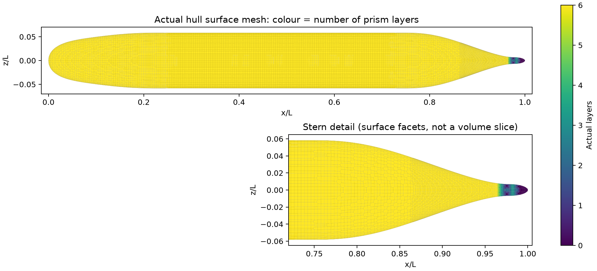
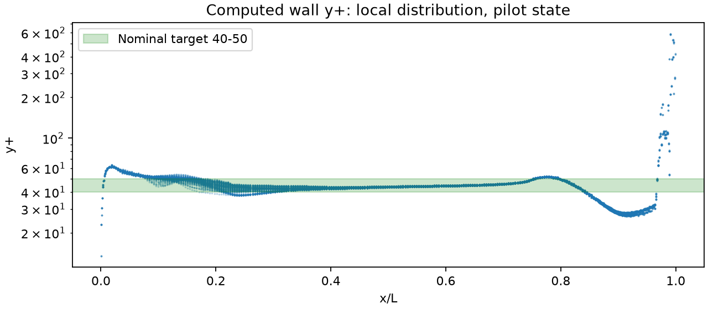
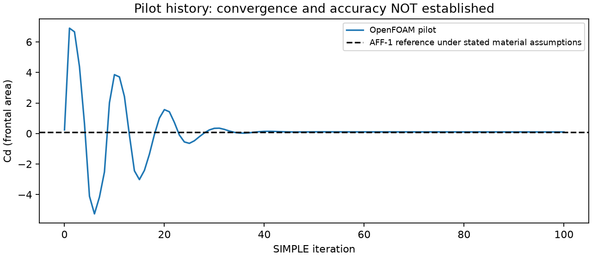
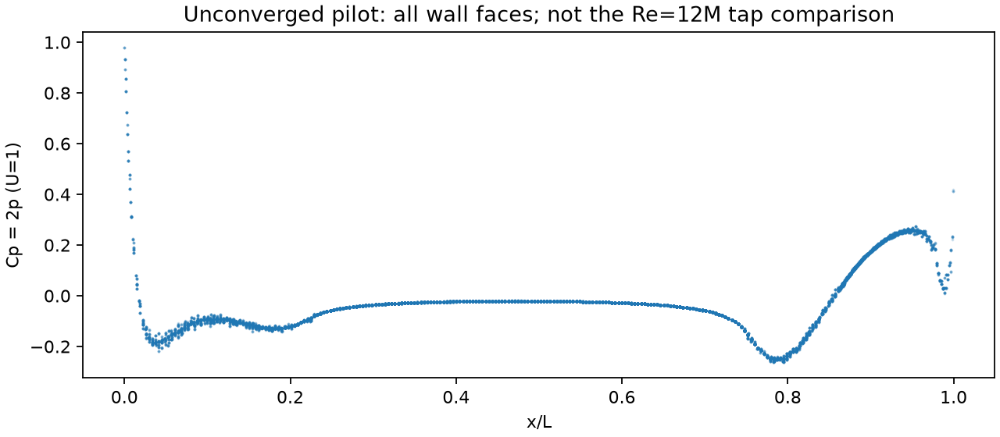

# 第一层变薄与尾部加密：SIMPLEC/SST 对照

日期：2026-10-12。本轮与[上一轮](../README.md)均使用 OpenFOAM Foundation 12、SIMPLEC、SST、Spalding；这里比较的是网格调整，不是 SIMPLE 与 SIMPLEC 的加速比较。仍未获得 Cp/Cd 小于 3% 的物理验收。

## 修改依据

原网格 x/L<0.85 主体 y⁺ 中位数 49.40，过大值主要集中在尾段，不能由全艇平均 65.69 推导所有首层单元都需大幅变薄。

- 首层名义厚度 0.0002L → **0.00018L**，减少 10%。L=4.356 m 时对应 0.8712 mm → 0.78408 mm；首层中心距离约为厚度一半，实际以网格几何为准。
- 在 x/L∈[0.87,1.02]、y/L,z/L∈[−0.04,0.04] 增加第 7 级体加密。其余主体仍为第 6 级表面加密。
- 六层、增长率 1.15 和求解配置不变；两例均从相同名义来流初值运行 100 次迭代，未通过收敛验收。

## 网格实测

| 指标 | 原网格 | 本轮 |
|---|---:|---:|
| 单元数 | 254,775 | 382,279 |
| 平均实际层数 | 5.806 | 5.934 |
| 有层表面积占比 | 97.476% | 99.898% |
| 完整六层表面积占比 | 96.139% | 99.568% |
| 最大非正交角 | 44.96° | 50.87° |
| 最大 skewness | 0.572 | 0.714 |
| 常规 checkMesh | 通过 | 通过 |
| 扩展几何检查 | 有凹性标记 | 有凹性标记 |

薄层和尾部细化显著增加了覆盖率，但最大非正交角并未改善，不能把加密概括为所有质量指标都变好。缺层仍集中于尾尖附近。



## 计算结果

| 第 100 步指标 | 原网格 | 本轮 |
|---|---:|---:|
| OpenFOAM 报告平均 y⁺ | 65.69 | **45.03** |
| 最大 y⁺ | 1224.29 | **589.92** |
| 主体 y⁺ 中位数（x/L<0.85） | 49.40 | **44.43** |
| 全艇 y⁺ 40–50 的表面积比例 | 54.67% | **74.45%** |
| 全艇 y⁺ 30–100 的表面积比例 | 97.31% | **96.94%** |
| Cd | 0.0992836 | 0.0996066 |
| Cd 相对参考值的当前偏差 | 6.618% | 6.965% |

本轮全艇面积加权平均 y⁺=45.43；尾段 x/L≥0.85 的中位数约 29.96、面积加权平均 39.47，仍有尾尖局部高值，不能称整个表面都达到 40–50。首层和主体名义 y⁺ 目标已接近，空间验证尚未完成。高 y⁺ 极值、尾尖缺层及尾段部分低于 30 的区域均需结合最终收敛场继续检查。第 100 步 Cd 的偏差略大于原网格，不能宣称阻力精度已改善。

见 `status.json`、分区 y⁺ 比较 `comparison.json` 及下面图件。y⁺=40–50 是主体名义设计目标，驻点/尾尖处局部剪切不同，必须同时报告分布、面积占比和极值。







100 步的 Cd 只能作为相同启动步数下的过程数据，不能用于证明网格收敛，也不能据此给两个网格的最终精度排序。继续以残差、力稳定性、近壁空间分辨率和实验误差共同验收。

## 复现

```bash
export PYTHONPATH=src
python scripts/prepare_openfoam_suboff_snappy.py \
  --output results/openfoam-suboff/new-thinner-tail \
  --first-layer-thickness 0.00018 --tail-level 7 --iterations 100
python scripts/run_openfoam_suboff.py \
  --case results/openfoam-suboff/new-thinner-tail \
  --foam-wrapper /home/jsyc/.local/bin/tensorfvm-foam12 --solve
python scripts/report_openfoam_suboff_pilot.py \
  --case results/openfoam-suboff/new-thinner-tail \
  --output results/openfoam-suboff/new-thinner-report
```

## 原生 TensorFVM

已添加实验性 `--algorithm simplec`；小案例通过，旧 SUBOFF 网格仍触发异常速度保护，详见[原生 SIMPLEC 验证](../../verification-native-simplec/README.md)。本页新 snappy 网格的计算结果来自 OpenFOAM，尚未用于原生 TensorFVM 求解，不能混淆两者的能力状态。
