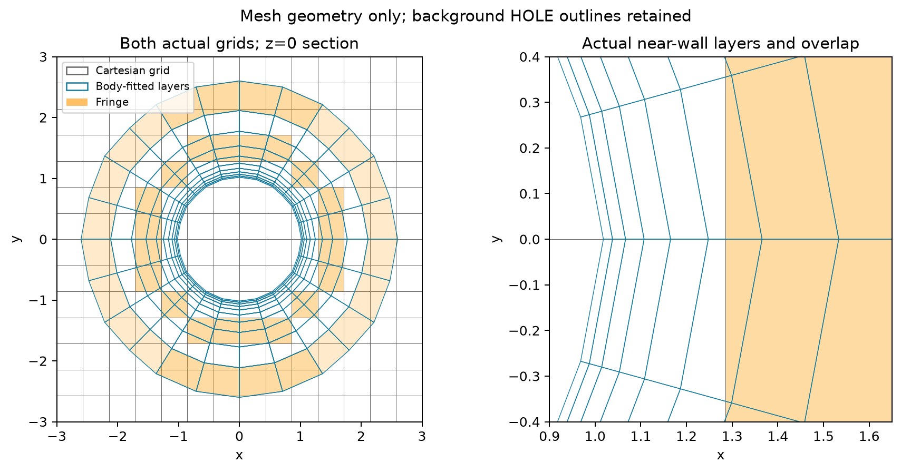
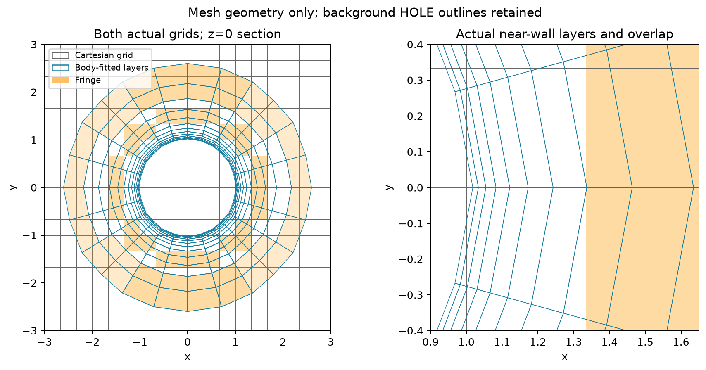
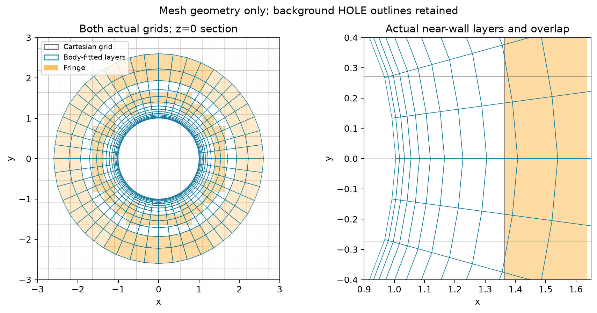

# Actual body-fitted layers and Cartesian background

The plots overlay archived native section polygons. Background HOLE outlines are retained; orange marks fringe cells. These are mesh plots, not computed flow fields.

