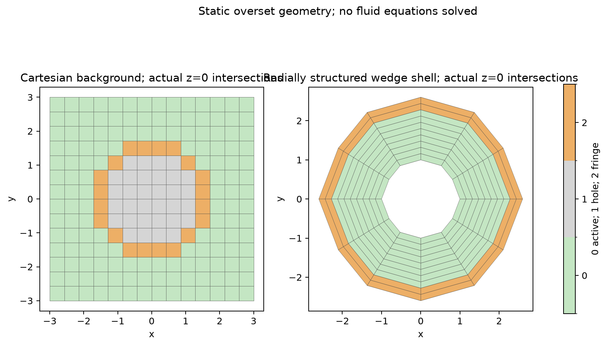
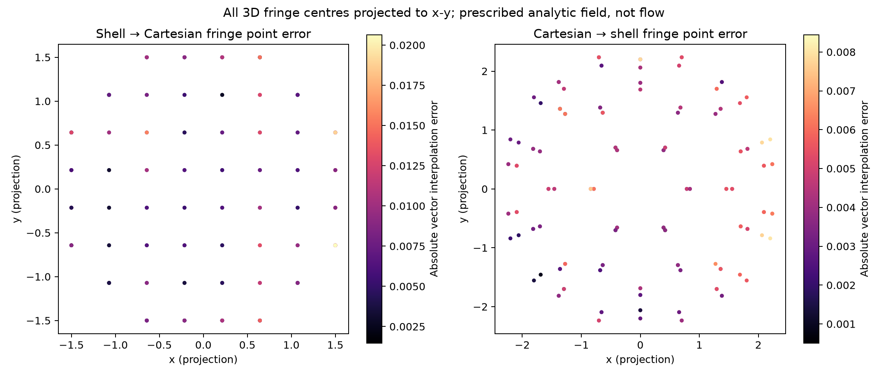
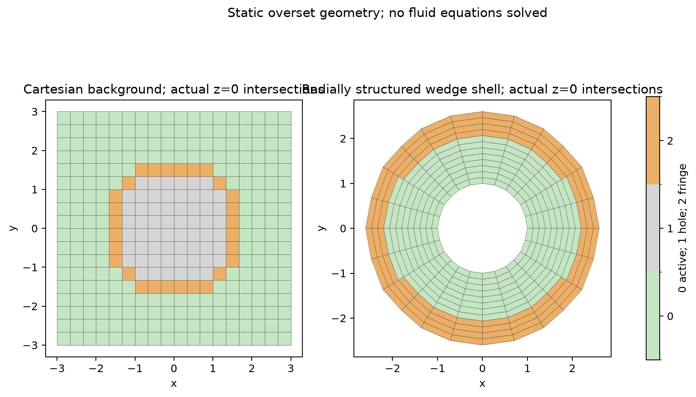
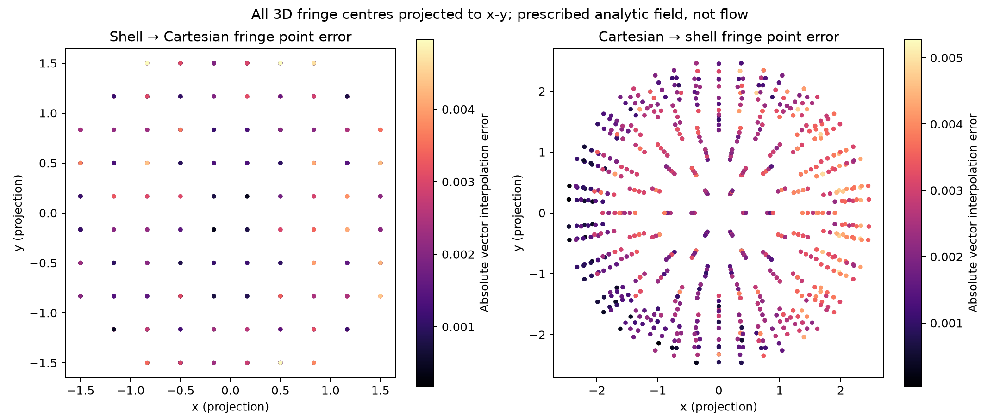
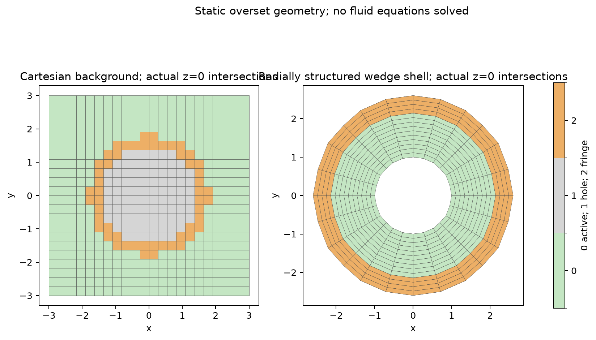
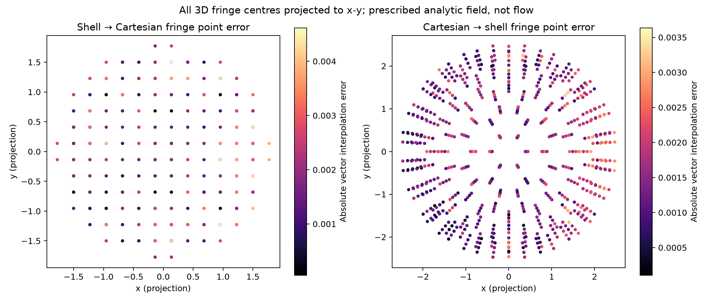

# Three-dimensional Cartesian / body-fitted overset verification

## Scope and method

The background is a native Cartesian hexahedral grid on [-3,3]^3. The component grid has radially structured wedge layers between radii 1 and 2.6, using an icosphere angular triangulation. Planar facets approximate the spherical wall. A radius-1 solid is excluded. Background centroid classification is hole below radius 1.5, fringe below 1.8, otherwise active; shell centres beyond radius 2.1 are fringe. This is centroid classification, not a cut-cell method or a moving-grid calculation.

Both transfer directions require a containing active native polyhedron and a convex tetrahedron of active donor centres. A tangent separating half-space protects the entire interpolation tetrahedron from the sphere. No nearest-neighbour fallback or orphan suppression is used. Weights reproduce constants and affine fields. The independently prescribed nonlinear vector field is fixed across all levels; formulas and coordinates are in config.json. Errors use receiver-cell-volume-weighted relative L2 on fringe point values. These weights define a diagnostic norm, not conservative remapping of volume averages.

## Results

|Level|Background cells|Shell cells|Shell → background L2|Background → shell L2|Time s|
|---|---:|---:|---:|---:|---:|
|1|2744|800|0.416069%|0.230837%|7.86|
|2|5832|3840|0.108864%|0.133129%|21.37|
|3|10648|4480|0.101185%|0.080714%|30.67|

Three-level error decrease: **True**. Constants/affine reproduction and active-donor invariants: **True**. Fine-level two-way interpolation errors below 3%: **True**. Full raw metrics, both donor maps, native geometry, classifications and fields are archived for independent replay.

### Level 1 real geometry and interpolation diagnostic

### Level 2 real geometry and interpolation diagnostic

### Level 3 real geometry and interpolation diagnostic

## Limits and reproduction

No Navier–Stokes equations, pressure correction, turbulence, LBM populations, time stepping, moving-solid hole cutting or conservative shared interface flux are solved in this verification. The error plots show point interpolation of a prescribed analytic vector field; they are not velocity or pressure flow contours. The generic native mesh adapter uses a sphere-specific solid-clearance contract; a SUBOFF solid-clearance adapter remains necessary. FVM/LBM coupling requires common units and physical coordinates, shared time advancement, consistent pressure/density conversion, population reconstruction and conservative interface flux. Those are separate acceptance gates.

Run `OMP_NUM_THREADS=1 OPENBLAS_NUM_THREADS=1 PYTHONPATH=src python scripts/verify_overset3d.py --output EMPTY_DIRECTORY`. Producer sources were copied before execution. Every archived output except the manifest itself has a SHA-256 binding in manifest.json.
