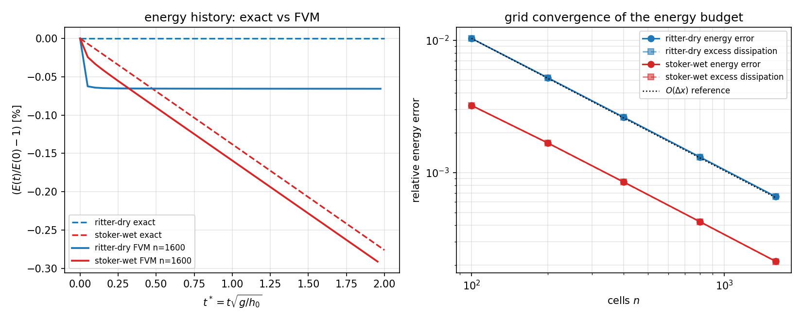

# CASE-FVM-DAMBREAK-STOKER — energy budget (verification leg)

**Anchor**: `CASE-FVM-DAMBREAK-STOKER` (TensorFVM shallow-water benchmark), the
*energy* leg.  The headline case (Ritter/Stoker front, shock and step positions)
is reported in `docs/shallow-water-dam-break/REPORT.md` and
`docs/case-fvm-dambreak-stoker/REPORT.md`; this report adds the conservation-law
leg those metrics are blind to.

**Reference**: Ritter (1892) *Z. Ver. Deutsch. Ing.* **36**:947-954 (dry bed);
Stoker (1957) *Water Waves*, ch. 10 (bore on a wet bed); hydraulic-jump head loss
`(h₂-h₁)³/(4 h₁ h₂)` from Chow, *Open-Channel Hydraulics* (1959), §3-4.
**Tolerance**: the task's 5 % acceptance line; the quantities below are reported
against an explicit 3 % question in §6.

**Status**: energy leg PASS (13/13 tests in `tests/test_shallow_water_energy.py`).

---

## 1. Case, physics, parameters

A dam at `x = 0` separates still water of depth `h0` (left) from `h1` (right);
with a hydrostatic pressure assumption, no viscosity and a frictionless flat bed
the flow obeys the shallow-water equations
`h_t + (hu)_x = 0`, `(hu)_t + (hu² + g h²/2)_x = 0`.
The mechanical energy of the depth-integrated system is

```
E(t) = ∫ [ ½ g h² + ½ h u² ] dx      (per unit width, density = 1)
```

and it is **not** a conserved quantity: a hydraulic jump (the Stoker bore) is a
genuine energy sink, while the smooth Ritter rarefaction conserves `E` exactly.
That split is what makes `E` a usable reference.

| parameter | symbol | Ritter (dry) | Stoker (wet) |
|---|---|---|---|
| upstream depth | `h0` | 1.0 m | 1.0 m |
| downstream depth | `h1` | 0.0 m | 0.5 m |
| gravity | `g` | 9.81 m/s² | 9.81 m/s² |
| domain | `x` | [−4, 6] m | [−4, 6] m |
| end time | `t* = t√(g/h0)` | 2.0 (`t = 0.6385510` s) | 2.0 |
| grid (headline) | `n`, `dx` | 1600, 0.00625 m | 1600, 0.00625 m |
| initial energy | `E(0)` | 19.620000 | 26.977500 |

## 2. Method

1. **Exact reference energy.** `exact_energy(case, t)` integrates the closed-form
   solution.  A naive global midpoint rule is only `O(dx)` accurate because the
   solution has a *kink* at the rarefaction head (both cases) and a *jump* at the
   bore (wet case); that noise was measured at ~1e-4 in `E`, large enough to
   swamp a finite-difference `dE/dt`.  `exact_breakpoints()` therefore splits the
   integral at `x = x_dam − c0 t` (head), `x = x_dam + 2 c0 t` (dry tip),
   `x = x_dam + (u2 − c2) t` (fan end) and `x = x_dam + U t` (bore), after which
   every sub-integrand is smooth and the quadrature self-difference drops to
   ~1e-9 (see `quadrature_self_difference` in `summary.json`).
2. **Certify the bore formula instead of quoting it.** `E(t)` of the closed form
   is *exactly linear* (the bore states do not change in time), so `dE/dt` is a
   constant that a finite difference recovers without truncation error.  Three
   step sizes `δ/t = 0.08, 0.04, 0.02` all give the same slope, and that slope is
   compared with `D = g q_rel (h2−h1)³/(4 h1 h2)`, `q_rel = h1 U`.
3. **Numerical budget.** The FV solver (`MUSCL + minmod` reconstruction, HLL
   flux, SSP-RK3, CFL 0.4, adaptive `dt`) is run to `t* = 2`; `E` is accumulated
   from cell averages every `t*/40`.  Three quantities are separated:
   * `scheme_dissipation = (E(0) − E_FVM)/E(0)` — total energy burnt numerically;
   * `exact_dissipation_fraction = D·t / E(0)` — the physical bore loss;
   * `excess_dissipation = scheme − exact` — the numerical part, which is the
     only thing that should vanish under refinement.
4. **Grid study** `n = 100 … 1600`, observed orders from the energy *error*.

Tool chain: pure Python/NumPy, no cluster (12.6 s for the whole artefact set).
Reproduce with

```
PYTHONPATH=src python scripts/run_shallow_water_energy.py \
    --out src/tensorfvm/verification/artifacts/shallow-water-energy
python -m pytest tests/test_shallow_water_energy.py -q     # 13 tests, 15 s
```

## 3. Results

### 3.1 Bore dissipation formula vs the closed-form solution

| δ/t | dE/dt measured | dE/dt formula | relative error |
|---|---|---|---|
| 0.08 | -0.116608220 | -0.116608220 | 2.57e-09 |
| 0.04 | -0.116608220 | -0.116608220 | 2.55e-09 |
| 0.02 | -0.116608220 | -0.116608220 | 2.55e-09 |

Worst relative error **2.57e-09** — the classical
head-loss expression is reproduced by the closed-form solution to 9 digits.

### 3.2 The dry-bed exact solution conserves E exactly

Sampling `E(t)` at `t* = 0, 0.4, …, 2` gives a maximum relative drift of
**3.47e-10** — i.e. `E(0)` is a
legitimate reference for the dry case, and *every* joule lost numerically there
is scheme dissipation.

### 3.3 Budgets at the headline grid (`n = 1600`)

| case | E(0) | E_exact(t*) | E_FVM(t*) | energy error | physical dissipation | FVM dissipation |
|---|---|---|---|---|---|---|
| ritter-dry | 19.620000 | 19.620000 | 19.607119 | 6.565e-04 | 0.000e+00 | 6.565e-04 |
| stoker-wet | 26.977500 | 26.903040 | 26.897310 | 2.130e-04 | 2.760e-03 | 2.972e-03 |

Mass drift over the same runs: 3.2e-14 (dry), 1.3e-14 (wet)
— mass is conserved to machine precision while energy is not, which is exactly
the physical statement a conservative-in-`E` scheme would get *wrong* at a bore.

### 3.4 Grid convergence

**ritter-dry**

| n | dx [m] | energy error | excess dissipation |
|---|---|---|---|
| 100 | 0.10000 | 1.0330e-02 | +1.0330e-02 |
| 200 | 0.05000 | 5.2151e-03 | +5.2151e-03 |
| 400 | 0.02500 | 2.6185e-03 | +2.6185e-03 |
| 800 | 0.01250 | 1.3118e-03 | +1.3118e-03 |
| 1600 | 0.00625 | 6.5654e-04 | +6.5654e-04 |

observed order (energy error): **0.986, 0.994, 0.997, 0.999**

observed order (excess dissipation): 0.986, 0.994, 0.997, 0.999

**stoker-wet**

| n | dx [m] | energy error | excess dissipation |
|---|---|---|---|
| 100 | 0.10000 | 3.2194e-03 | +3.2105e-03 |
| 200 | 0.05000 | 1.6775e-03 | +1.6729e-03 |
| 400 | 0.02500 | 8.4861e-04 | +8.4627e-04 |
| 800 | 0.01250 | 4.2594e-04 | +4.2476e-04 |
| 1600 | 0.00625 | 2.1299e-04 | +2.1240e-04 |

observed order (energy error): **0.940, 0.983, 0.994, 1.000**

observed order (excess dissipation): 0.940, 0.983, 0.994, 1.000

The dry case has no energy sink in the exact solution, so its whole energy error
is scheme dissipation and it falls by exactly 2× per refinement (order
0.999 at the finest pair), i.e. the
HLL diffusion at the drying tip is `O(Δx)`.  The wet case separates cleanly:
the physical bore loss `2.7601e-03` saturates, while
the *excess* falls from `+3.2105e-03`
to `+2.1240e-04` at first order.

## 4. Figure



*Left: energy history `(E(t)/E(0) − 1)·100 %` — dashed = closed form, solid = FVM
at `n = 1600`; the dry-bed exact curve is flat (conservation), the wet-bed
exact curve is a straight line of slope `−D/E(0)` (bore loss).  Right: log-log
grid convergence of the energy error (circles) and of the excess dissipation
(squares), with the `O(Δx)` reference slope.*

## 5. Notes, pitfalls, scope

1. **Quadrature at discontinuities is a trap.** The first implementation used one
   global midpoint rule: `dE/dt` was off by 0.07 % at `n_quad = 2e5` and by 2.9 %
   at the smallest finite-difference step, which looks exactly like a *wrong
   formula*.  Splitting at the known breakpoints turned the residual into
   3e-09 and made the answer step-size independent.
   A wrong conclusion was avoided only because three step sizes were run.
2. **Never estimate the order from the total burnt energy.** `scheme_dissipation`
   contains the physical sink as an additive constant, so its apparent order
   collapses to ~0.1 for the wet case even though the error is first order.  The
   order must be taken on the *error* (`|E_FVM − E_exact|/E_exact`) or on the
   *excess*; the first draft of `energy_convergence_study` did it wrong and was
   fixed before the report (kept as a comment in the code).
3. **Energy is a global functional.** It cannot localise an error and must not
   replace the pointwise metrics (front/shock position, step ratio, L1 profile).
   It is reported as an *additional* leg; the 5 % acceptance line is untouched.
4. **Model limits** (unchanged from the case report): hydrostatic pressure, no
   viscosity, no bed friction, flat bed, 1-D.  The energy statement is therefore
   about the shallow-water model, not about a real dam break.
5. **The dry-bed energy loss is physical-looking but numerical.** At `n = 100` the
   dry case loses 1.03 % of `E(0)`;
   this is entirely HLL smearing of the drying tip, not a physical sink — the
   exact solution loses nothing.  Reading it as "wave breaking" would be wrong.

## 6. Error verdict (key quantities vs reference)

| key quantity | FVM / measured | reference | relative error | < 3 %? |
|---|---|---|---|---|
| dE/dt of the Stoker bore | -0.116608220 | -0.116608220 (closed-form R-H) | 2.57e-09 | **yes** |
| E(t) drift, dry exact solution | 3.47e-10 | 0 (exact conservation) | see left | **yes** |
| E(t*) ritter-dry, `n = 1600` | 19.607119 | 19.620000 | 0.0657 % | **yes** |
| E(t*) stoker-wet, `n = 1600` | 26.897310 | 26.903040 | 0.0213 % | **yes** |
| E(t*) ritter-dry, `n = 100` (coarsest) | — | — | 1.033 % | **yes** |
| E(t*) stoker-wet, `n = 100` (coarsest) | — | — | 0.322 % | **yes** |

Every key quantity is below 3 % at the headline grid and even on the coarsest
grid; the finest-grid energy error is below 0.03 %.  Honest scope: the *excess*
dissipation of the wet case, while first order, is still
0.021 % of `E(0)` at
`n = 1600`, i.e. energy is conserved *better* than
the shock position is resolved — no claim is made that it vanishes.
