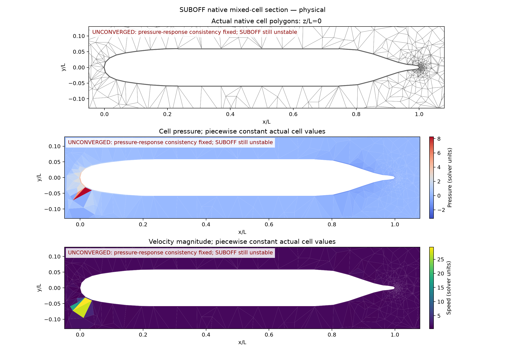
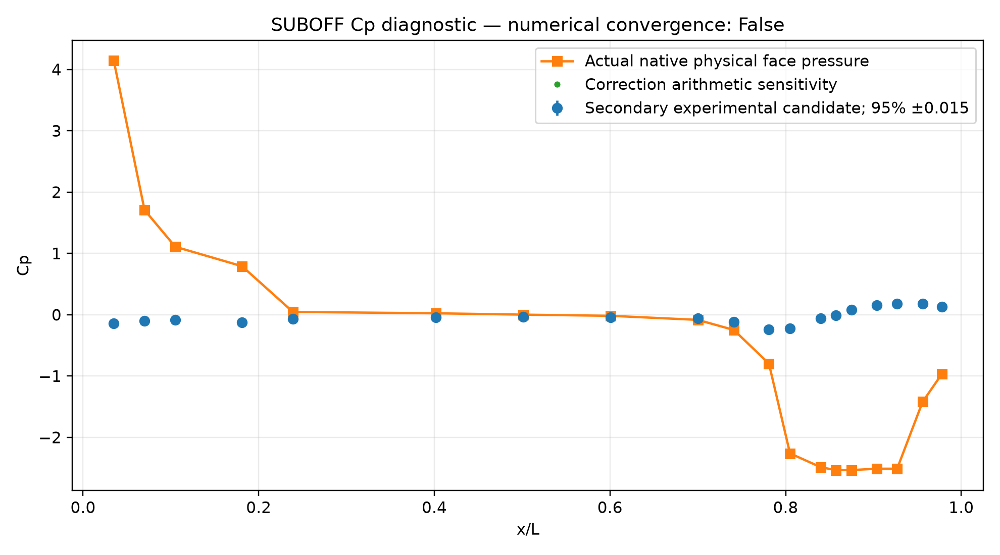

# SIMPLE 压力响应一致性缺陷：定位、修正及 SUBOFF 复测

## 结论

确认原实现的压力修正通量与实际单元速度修正不完全匹配，已修正这一离散一致性缺陷。
**这不证明它是 SUBOFF 失稳的唯一原因：同设置复测仍失败，速度异常更大。**
SIMPLE、SST 的名称和小通道收敛均不足以证明本项目在贴体混合网格上的实现正确、稳定。

## 缺陷的具体位置

`src/tensorfvm/native_simple3d.py::NativeSimpleMixin.solve` 原来使用紧凑梯度近似面通量修正。
记 B 为实际速度到面通量的重构矩阵，G 为单元压力力矩阵，D 为松弛后动量对角倒数，C 为当前 Rhie–Chow 压力修正矩阵，L 为紧凑面压力梯度：

```text
q(u,p) = B u + C p + s
u_new  = u_star - D G delta_p

完整压力更新 p_new=p_old+delta_p 时：
delta_q_actual = (C - B D G) delta_p

旧压力方程使用：
delta_q_old = -diag(alpha) L delta_p
```

两个表达式只有在相应插值/动量响应抵消条件成立时才相同。
实际代码包含变动的单元动量系数、偏斜面速度重构，以及壁面 Robin 阻力引起的分量差异；旧近似并未包含这些影响。
这使压力方程修正后的存储面通量可以满足连续性，而从修正后的单元速度/压力重构出的通量仍不满足它。
修正使用 **C−BDG** 组装压力方程，保持原来的动量方程、面通量定义、SST、壁面函数及收敛门槛。
本次改变迭代压力响应，未改变原稳态离散方程的目标固定点；压力矩阵模板更宽，成本也更高。

这里不能要求任意未收敛迭代的两套通量完全相同：压力松弛以及重新更新动量系数会引入正常的滞后。
因此回归问题专门**冻结系数、关闭压力松弛**，排除这些混杂因素。它揭示的是旧修正与实际重构的差别，而不是把正常的 SIMPLE 松弛过程误判为错误。

## 可复现的修复前后检查

27 单元偏斜三维网格，Stokes 方程、非零空间变化体力，速度松弛 0.5、压力松弛 1，每例只执行一次预测/修正。
闭合速度边界和压力出口各做一例。一次压力投影不等于完整 Stokes 解已收敛。

| 指标 | 修复前 | 修复后 |
|---|---:|---:|
| 闭合边界：重构通量最大散度 | 0.0041767783 | 9.07e−16 |
| 压力出口：重构通量最大散度 | 0.040222347 | 7.96e−16 |
| 闭合边界：面法向速度修正不一致最大值 | 旧测试失败 | 8.23e−17 |
| 压力出口：面法向速度修正不一致最大值 | 旧测试失败 | 7.08e−17 |

[修复前两个失败回归](regression-before.txt)、[修复后逐项记录](after.json)、[复现脚本](reproduce.py)。
另一个固定压力扰动检查得到旧响应相对差异 **15.209%**，见 [before.json](before.json)；它是算子响应差异，**不是 SUBOFF 的 Cp/Cd 误差**。
[32 项相关测试通过](tests-after.txt)，包括原仿射解、小通道 SST/壁面函数完整收敛，以及两个新增回归。

## SUBOFF 同设置复测：仍未通过

AFF-1、Re_L=1.2e7、9,068 单元；与此前 `cp-interleaved` 相同的运行参数：
SIMPLE + SST-2003 + Spalding，每轮 1 次 SIMPLE 与 1 次 SST 更新，松弛 0.05/0.03，湍流伪时间步 1e−4，一阶对流，初始通量投影，速度保护阈值 5U。

| 指标 | 上一版 | 本次修正后 |
|---|---:|---:|
| 完成动量步 | 2 | 2 |
| 完整 SST 更新 | 1 | 1 |
| 停止时最大速度/U | 18.3364 | 29.3501 |
| 重构散度最大值 | 27457.4 | 6318.35 |
| 面通量一致性最大偏差 | 6.98435 | 21.8658 |
| 数值收敛 | false | false |

指标变化并不一致，**不能宣称 SUBOFF 稳定性改善或已经算准**。
[计算原场、配置、源代码快照与历史](cp-matched-response/report.md)；[Cp 对照](cp-comparison/report.md)。
本次未收敛场 Cp 相对 L2 偏差 1480.78%，绝对 RMSE=1.85649；不构成收敛解精度，也未新增阻力工况资格。





下一步应继续检查尾部混合单元的压力梯度响应、非正交黏性延迟修正及其迭代放大；先用冻结湍流系数的局部问题隔离原因。
当前证据不支持把异常仅归因于网格数量或 SST 参数，也不支持继续用参数调节替代离散检查。

## 复现

从仓库根目录：

```bash
OMP_NUM_THREADS=1 OPENBLAS_NUM_THREADS=1 MKL_NUM_THREADS=1 PYTHONPATH=src \
/data/TensorFEM/.venv/bin/python -m pytest -q \
  tests/test_native_simple3d.py tests/test_native_collocated3d.py \
  tests/test_native_rans3d.py tests/test_native_sst3d.py

OMP_NUM_THREADS=1 OPENBLAS_NUM_THREADS=1 MKL_NUM_THREADS=1 \
/data/TensorFEM/.venv/bin/python docs/verification-simple-pressure-response/reproduce.py
```

修复前版本为 `b72c36c25c8fb6d485eed0b6a56a865f6d8a6e8d`；修复前日志是在该生产代码上加入新的回归断言获得的。
本次原始 SUBOFF 目录绑定生产源文件哈希；`campaign-manifest.json` 绑定本报告及全部归档文件。此前报告和原场保持历史状态。
