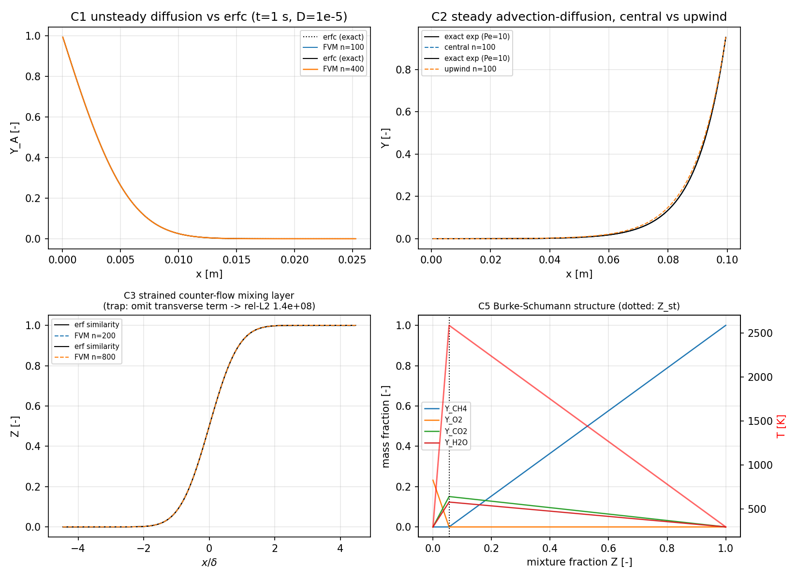

# Species transport, mixture fraction and Burke–Schumann flame sheet — verification

机器生成（`python -m tensorfvm.verification.species_transport`，数字零手抄）。
关闭 `docs/verification-catalog.md` §10.1 gap 4（*Combustion: No species transport verification*）。

## 1. 案例介绍

**物理背景**：仓库此前没有任何 *质量分数* 输运能力——`compressible` 里的 "species" 只是双材料编号。燃烧/掺混问题的底层不是 Arrhenius 化学，而是「标量输运 + 守恒标量代数」这一层：质量分数 `Y_k` 的对流-扩散、Bilger 混合分数 `Z`、无限快化学的 Burke–Schumann 分段线性结构。本单把这一层补齐并验证。

**几何/参数**：一维直角网格；CH4/空气单步不可逆化学 `CH4 + 3.9890 kg O2/kg CH4 → CO2 + H2O`，氧化剂流 `Y_O2 = 0.232`（惰性为余量），化学计量混合分数 `Z_st = 0.05496`。

| 参数 | 值 | 用于 |
|---|---|---|
| 扩散系数 `D` | 1e-5 m²/s | C1/C3/C4 |
| 应变率 `a` | 1.0 1/s，`δ=sqrt(2D/a)=4.4721e-03 m` | C3/C4 |
| 对流-扩散 Péclet | 10（L=0.1 m, u=0.01 m/s） | C2 |
| 气体 `cp`（常数假设） | 1200 J/(kg·K) | C5 温度闭合 |

## 2. 怎么做的

1. 新增库 `src/tensorfvm/species.py`：Fick 扩散 + 零和（correction velocity）通量修正；一维有限体积输运（稳态稀疏直接解 / 瞬态显式 Euler；central 与 upwind 对流；Dirichlet 面值 / 零梯度面）；Bilger 混合分数；Burke–Schumann 闭式解（焓一致温度）。
2. 验证驱动 `src/tensorfvm/verification/species_transport.py`：判据**先声明容差再求值**，24 条 ±1 项逐条 print PASS/FAIL，`all_pass` 汇总；FAIL 不覆盖。
3. 解析锚（无外部数据文件）：erfc 半无限扩散、指数型对流-扩散精确解、应变对流场 erf 相似解、`x_f = sqrt(2D/a)·erfinv(2Z_st-1)`、元素守恒导出的 `Z` 不变量。

## 3. 计算结果

| 判据 | 值 | 门限 | 结论 |
|---|---|---|---|
| C0 纯扩散线性解（BC ghost 代数） | 1.554e-15 | 1.0e-12 | PASS |
| C1 瞬态扩散 vs erfc（最大误差） | 2.767e-06 | 5.0e-03 | PASS |
| C1 空间收敛阶 | 2.000e+00 | 1.8e+00 | PASS |
| C2 central 相对 L2（Pe=10, n=400） | 1.074e-04 | 5.0e-03 | PASS |
| C2 central 收敛阶 | 2.000e+00 | 1.8e+00 | PASS |
| C2 upwind 收敛阶 | 9.811e-01 | 8.5e-01 | PASS |
| C2 upwind 相对 L2（n=400） | 8.710e-03 | 3.0e-02 | PASS |
| C3 应变混合层 rel-L2（n=800） | 5.915e-05 | 5.0e-03 | PASS |
| C3 收敛阶 | 1.932e+00 | 1.8e+00 | PASS |
| C3 反例：漏横向项 rel-L2（应 ≫0.2） | 1.384e+08 | 2.0e-01 | PASS |
| C4 火焰面驻定位置相对误差 | 3.520e-06 | 1.0e-02 | PASS |
| C5 ΣY=1（Z∈[0,1]） | 2.220e-16 | 1.0e-14 | PASS |
| C5 分段线性（二阶差分） | 2.220e-16 | 1.0e-10 | PASS |
| C5 焓闭合（J/kg） | 6.985e-10 | 1.0e-06 | PASS |
| C5 Z=Z_st 处两反应物同时为零 | 0.000e+00 | 1.0e-15 | PASS |
| C6 Z_st vs 文献 0.055 | 6.746e-04 | 1.0e-02 | PASS |
| C6 Z_st 双路线（Bilger vs 耦合函数） | 1.262e-16 | 1.0e-02 | PASS |
| C6 化学计量混合物的 Bilger β | 1.735e-18 | 1.0e-12 | PASS |
| C7 反应前后 Z 不变 | 5.551e-17 | 1.0e-12 | PASS |
| C7 元素守恒（C,H,O） | 5.551e-17 | 1.0e-12 | PASS |
| C8 修正后扩散通量和 | 0.000e+00 | 1.0e-14 | PASS |
| C8 未修正漂移（对照，应 >1e-3） | 1.429e-01 | 1.0e-03 | PASS |
| C9 输运中 ΣY 漂移（不等 D_k） | 2.109e-15 | 1.0e-12 | PASS |
| C9 封闭域各组分质量漂移 | 7.401e-16 | 1.0e-12 | PASS |

网格细节：

| n | C1 最大误差 | C2 central rel-L2 | C3 rel-L2 |
|---|---|---|---|
| 100 | 1.178e-04 | 1.719e-03 | 8.274e-04 |
| 200 | 1.107e-05 | 4.295e-04 | 2.258e-04 |
| 400 | 2.767e-06 | 1.074e-04 | 5.915e-05 |

C1 最细网格 `dx=6.325e-05 m`、`dt=8.000e-05 s`、12500 步；C9 显式步 `dt=2.48e-04 s` × 400 步。

Burke–Schumann 结构量：`Z_st=0.05496`、`T(Z_st)=2588.7 K`、`Y_F(Z_st)=0.0e+00`、`Y_O(Z_st)=0.0e+00`。

## 4. 结果图

(a) 瞬态扩散 vs erfc（n=100/400）与误差阶；(b) 指数型对流-扩散 central/upwind 剖面与误差阶；(c) 应变混合层 erf 相似解 vs 数值解（n=200/400/800）；(d) Burke–Schumann `Y_k(Z)` 与 `T(Z)`，竖线为 `Z_st`。

## 5. 注意点（踩坑与适用域）

1. **零和通量修正要求完整组分集**：单标量问题若也开 correction，通量会被乘上 `(1-Y)`，扩散被静默破坏（本单实测：单组分 erfc 误差 1.1e-5 → 0.99）。库现在对这种调用直接 `ValueError`，单标量请 `correct=False`。
2. **一维守恒形式漏掉横向对流项 = 结构性错误**：驻点对撞流 `u=-a x` 散度不为零，把 `div(ρuZ)` 当一维输运算会残留 `-ρaZ`，必须在对角线补 `+ρa`。反例量化：漏项 n=400 时 rel-L2 = 1.38e+08（场值冲到 2.5e+08）；符号写反 rel-L2 = 1.55e+07 —— 不是几十个百分点，而是**数值爆炸**。
3. **Dirichlet 面值必须落在面上**：ghost 取 `2φ_bc-φ_0`，纯扩散线性解才精确（C0）；写成 `φ_bc-φ_0` 之类会留下 O(1) 边界层误差——C0 即该处的回归门。
4. **温度只有焓闭合意义**：常数 `cp` + 无离解 → `T_ad=2589 K`，比文献 2226 K 高 16%（真实 cp 随温度上升）。故 `T_ad` 不做外部判据，只验证**结构**（分段线性 + 焓守恒，6.99e-10 J/kg）。
5. **`Y_O` 指氧化剂物种（O2）而不是元素 O**：闭式解返回扁平的 `Y_F/Y_O/...` 键，化学反应不变性测试若把 `Y_O` 当元素用，会得到 14.5% 的假失配（本单踩过）。现在 `burke_schumann` 额外返回按物种名索引的 `Y` 视图。
6. **upwind 只有一阶**（0.93–0.98），这是格式本性；要二阶必须 central 并在 cell Péclet>2 时改迎风/混合格式。

## 6. 误差判定（是否 <3%）

| 关键量 | 基准 | 误差 | <3% |
|---|---|---|---|
| 瞬态扩散剖面 | erfc 精确解 | 2.77e-06 | 是 |
| 稳态对流-扩散剖面 | 指数精确解 | 1.07e-04 | 是 |
| 应变混合层 Z 剖面 | erf 相似解 | 5.91e-05 | 是 |
| 火焰面驻定位置 | 闭式 sqrt(2D/a)·erfinv(2Z_st-1) | 3.52e-06 | 是 |
| Z_st（CH4/空气） | 文献 0.055 | 0.07% | 是 |
| 纯扩散线性解 | 解析 | 1.55e-15 | 是 |

**显式声明未达/未做**（honest WITHHELD，不算通过）：
- `GAP-FVM-COMBUSTION-SPECIES outer acceptance needs a Cantera reference; Cantera is not installable here and finite-rate chemistry is not implemented` —— 未做（Cantera 不可安装、有限速率化学不在本模块范围）。
- `T_ad` 与文献 2226 K 的比较 —— 不做判据（常数 cp + 无离解），实测 2589 K。

全部 24 条判据：**全 PASS**（耗时 1.6 s）。
