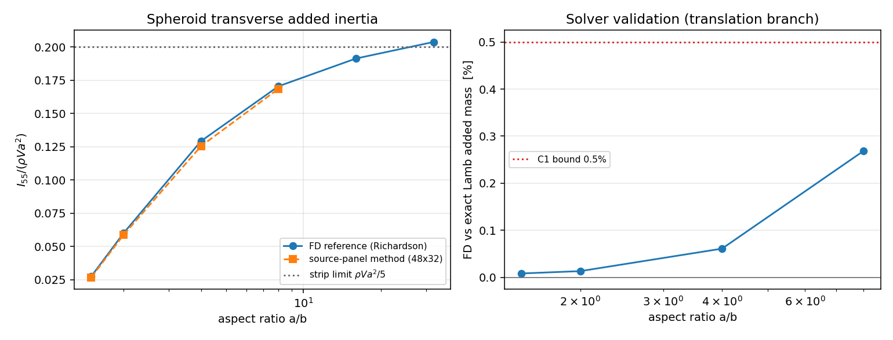

# Spheroid transverse added inertia: independent reference (D6 closed)

**Script**: `python -m tensorfvm.verification.spheroid_rotational_anchor`  
**Module**: `src/tensorfvm/spheroid_potential_reference.py`  
**Debt item**: `docs/VERIFICATION_DEBT_LEDGER.md` D6 (analytic anchor for the spheroid roll/pitch added inertia)

## 1. Case

Prolate spheroid, semi-axes `a` (symmetry axis `x`) and `b` (transverse), in an unbounded ideal fluid at rest, `rho = 1`. Unit angular velocity about a transverse axis (`z`). The rotational added inertia `I_55 = I_66` is the quantity `tensorfvm.maneuvering.dynamics` needs for `J_z`, and it had **no** independent reference: only self-consistency (symmetry, reciprocity, reciprocity of the panel matrix).

## 2. Method

Two independent discretisations of the same Neumann problem `laplace(phi) = 0`, `dphi/dn = (Omega x r) . n`, `phi -> 0` at infinity:

* **panel** (existing): constant-strength surface sources, `panel_added_mass.rotational_added_inertia`;
* **FD** (new): prolate spheroidal coordinates, `phi = f(mu,zeta) cos(psi)`, 2-D finite differences; `zeta` grid built on the boundary-layer scale `ab/c^2` and mapping infinity to `tau = 1`.

Both forcings of interest have `cos(psi)` dependence, so the *same* FD solver handles transverse translation and transverse rotation. The translational branch has an exact closed form (Lamb), which is what makes the rotational number trustworthy: criterion C1 measures the solver against that exact value at every aspect ratio before it is used as a reference.

## 3. Results

| a/b | FD `I55/(rho V a^2)` (Richardson) | panel 48x32 | panel vs FD | strip limit |
|---|---|---|---|---|
| 1.50 | 0.02748 | 0.02671 | -2.80% | 0.2000 |
| 2.00 | 0.05985 | 0.05856 | -2.16% | 0.2000 |
| 4.00 | 0.12918 | 0.12538 | -2.94% | 0.2000 |
| 8.00 | 0.17047 | 0.16858 | -1.11% | 0.2000 |

FD ladder per aspect ratio (`I55/(rho V a^2)`, grids 129x161 / 193x241 / 257x321):

| a/b | ladder | two-finest spread |
|---|---|---|
| 1.50 | 0.02749, 0.02749, 0.02748 | 9.40e-05 |
| 2.00 | 0.05989, 0.05987, 0.05987 | 1.24e-04 |
| 4.00 | 0.12949, 0.12933, 0.12927 | 4.65e-04 |
| 8.00 | 0.17216, 0.17128, 0.17096 | 1.92e-03 |

**Panel resolution ladder (a/b = 2)** -- the panel bias is a discretisation bias that shrinks with the mesh:

| panel mesh | panels | `I55/(rho V a^2)` | vs FD reference |
|---|---|---|---|
| 32x24 | 768 | 0.05705 | -4.69% |
| 48x32 | 1536 | 0.05801 | -3.08% |
| 64x44 | 2816 | 0.05856 | -2.16% |

**Solver validation (C1)** -- FD transverse added mass vs the exact Lamb coefficient:

| a/b | FD `m_t/(rho V)` | exact `k_transverse` | rel err |
|---|---|---|---|
| 1.50 | 0.622136 | 0.622084 | +0.008% |
| 2.00 | 0.704303 | 0.704210 | +0.013% |
| 4.00 | 0.860285 | 0.859761 | +0.061% |
| 8.00 | 0.947267 | 0.944728 | +0.269% |

**Near-sphere law (C5)** -- `I55 / (rho b (a^2-b^2)^2)`:

| a/b | I55 | scaled |
|---|---|---|
| 1.01 | 1.137428e-04 | 0.28153 |
| 1.05 | 2.905381e-03 | 0.27654 |
| 1.10 | 1.203974e-02 | 0.27301 |
| 1.25 | 8.335600e-02 | 0.26345 |

## 4. Criteria

| id | statement | value | pass |
|---|---|---|---|
| C1 | FD transverse added mass vs exact Lamb k_transverse: max rel err < 0.5% | `{'worst_rel_err': np.float64(0.002687488783934544)}` | PASS |
| C2 | FD rotation grid ladder: two-finest spread < 0.3% | `{'worst_spread': 0.0019153102702341204}` | PASS |
| C3 | panel (finest mesh) vs FD reference at a/b=2: |rel| < 3% | `{'mesh': '64x44', 'panel_scaled': 0.058559789775218696, 'reference_scaled': 0.059854672492952316, 'rel_err': -0.021633778346813126}` | PASS |
| C4 | panel axisymmetry |I55-I66|/I55 < 1e-10 | `{'max': 1.2684124723638745e-15}` | PASS |
| C5 | near-sphere law I55 ~ (a^2-b^2)^2: local exponent between a/b=1.01 and 1.05 within 2% of 2 | `{'local_exponents': [1.989008909218243, 1.9820962426914117, 1.963808358884549]}` | PASS |
| C6 | monotone rise to the strip value and within 5% of it at a/b=32 | `{'monotone': True, 'ratios': [1.5, 2.0, 4.0, 8.0, 16.0, 32.0], 'scaled': [0.027483729601214247, 0.05986569073427156, 0.12926701344446204, 0.1709561516164312, np.float64(0.19135004902458785), np.float64(0.2037747894866555)], 'strip_rel_at_32': np.float64(0.018873947433277527)}` | PASS |

**Overall**: PASS

## 5. Notes / limits

* The FD error is dominated by the `zeta` direction: a uniform grid in `log(zeta)` under-resolved the `ab/c^2` boundary layer and was wrong by 300%+ for `a/b = 8`; the layer-scaled map fixed it (see module docstring).
* The panel method is *systematically below* the reference at every aspect ratio, and it approaches it from below as the mesh refines (a/b = 2: -4.7% at 768 panels -> -3.1% at 1536) -- i.e. the remaining panel error is ~1-3% and is a discretisation bias, not noise.
* The strip value `rho V a^2/5` is only an `a/b -> inf` asymptote (logarithmic corrections); it is a sanity limit, not a 3% anchor.
* Wall effects, free surface, viscosity and hull-hull interaction are outside this anchor (unbounded ideal fluid only).
