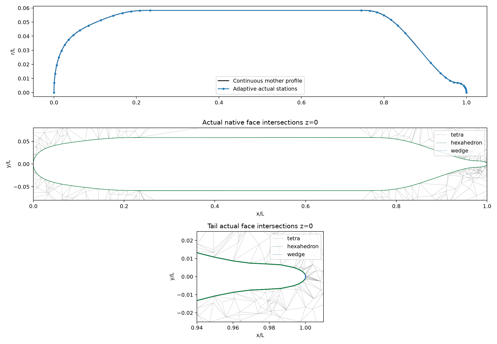

# Adaptive SUBOFF conforming hybrid mesh

## Method and purpose

Optional adaptive meridian sampling splits each of four original polynomial segments at the maximum Euclidean curve-to-chord distance. It checks 8,193 cosine-spaced reference points per segment and preserves exact junctions and closed tips. Target chord distance 0.0002 L, minimum axial separation 1e-05 L, at most 512 stations. Spacing or station-limit conflicts fail explicitly. Original default cosine sampling is unchanged. This controls meridian curvature; azimuthal chord error remains independently controlled by 48 uniform periodic stations. Dense sampled tolerances are not a rigorous continuous Hausdorff certificate.

## Actual geometry and native topology

Actual axial stations: 36; minimum axial separation 0.000419859 L; dense reference maximum meridian chord error 0.000197307 L.

3 layers, first height 0.0001 L, growth 1.25; 4752 hexahedra, 288 cap wedges, 9943 Gmsh exterior tetrahedra. All 3264 interface triangles are shared native internal faces, preserving conformity. Minimum volume 1.22251e-11 L³; minimum S·d 5.95154e-12; relative closure 3.85372e-16; maximum nonorthogonality 89.9665°. Maximum affine audit error 1.74556e-11.



## Actual facet interior error

This audit evaluates **actual triangular FV wall faces**, not just original nodes: three vertices, three edge midpoints, centroid, and three interior quarter points per triangle. Axisymmetry reduces closest distance to the continuous hull to a 2D minimization in axial coordinate and radius. Maximum sampled interior distance **0.00026843 L**, versus maximum sampled vertex distance **4.16522e-09 L**. P95 of all sampled distances 0.000208628 L. Analytic midbody angular sagitta 0.000124844 L. The difference between exact nodes and finite interior chord error is explicitly exposed. These are sampled diagnostics, not a continuous worst-case guarantee. Geometric closeness does not establish flow accuracy.

## Reproduction

```bash
OMP_NUM_THREADS=1 OPENBLAS_NUM_THREADS=1 MKL_NUM_THREADS=1 PYTHONPATH=src /data/TensorFEM/.venv/bin/python scripts/prepare_suboff_adaptive_mesh.py --output NEW_EMPTY_DIRECTORY --chord-tolerance 0.0002 --minimum-spacing 1e-05 --azimuthal 48 --layers 3 --first-height 0.0001 --growth 1.25 --far-size 0.35
```

Source snapshot, native geometry NPZ, Gmsh file, config, summary, PNG/PDF and SHA256 manifest preserve this actual execution. The thin layers are a development mesh, not a full resolved boundary layer. Normal offsets still use the existing finite-difference mother normals; high aspect ratio, nonorthogonality, exterior size jump, domain independence and wall resolution remain separate gates. No turbulence, y+, force/Cp convergence or flow error <3% is claimed. Native triangulation approximates warped quads by planar facets.
