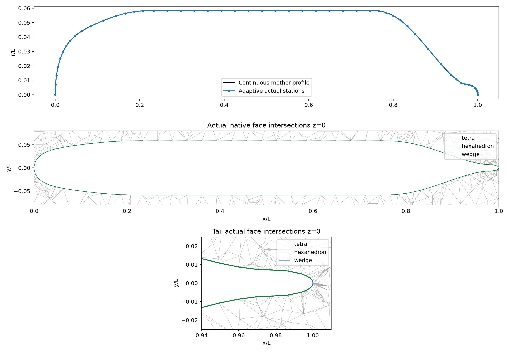
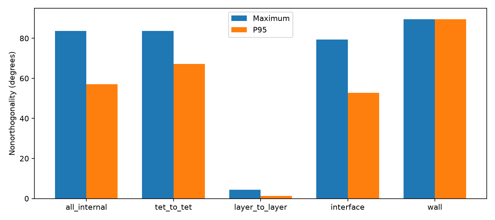

# SUBOFF adaptive conforming hybrid mesh development

## Scope

This development adds optional curvature/chord-distance adaptive meridian stations to `suboff_hybrid_mesh.py`. The existing default cosine grid, normal-offset method, hexahedral/wedge layer cells, Gmsh exterior, and conforming native interface remain intact. It is mesh preparation for subsequent numerical benchmarks; **no flow error below 3% is claimed**.

Each of the four source polynomial segments is sampled on 8,193 dense cosine reference points. Recursive splitting retains the point farthest from the current chord, preserves exact segment junctions and both closed tips, and explicitly rejects minimum-spacing or station-limit conflicts. An additional maximum axial spacing prevents the straight parallel midbody from collapsing to one long grid interval. This is a sampled Euclidean meridian chord criterion, not a global continuous surface certificate. Uniform azimuthal resolution is independent of meridian tolerance.

## Actual generated cases

| Quantity | Initial curvature-only development | Spacing-limited development |
|---|---:|---:|
| Meridian chord target / L | 0.0002 | 0.0002 |
| Axial stations | 36 | 52 |
| Angular stations | 48 | 48 |
| Normal layers | 3 | 3 |
| First layer / L | 0.0001 | 0.0001 |
| Hexahedra | 4,752 | 7,056 |
| Cap wedges | 288 | 288 |
| Gmsh tetrahedra | 9,943 | 15,092 |
| Total cells | 14,983 | 22,436 |
| Verified shared interface triangles | 3,264 | 4,800 |
| Maximum actual facet interior distance / L | 0.000268430 | 0.000254955 |
| Maximum sampled node distance / L | 4.165e-9 | 4.165e-9 |
| Maximum overall nonorthogonality | 89.966° | 89.567° |

The first case is retained as development evidence: curvature alone leaves a long midbody span. The second has maximum permitted spacing 0.05 L, actual maximum 0.031998 L, and minimum 0.000419859 L. Both use first height 0.0001 L, growth 1.25 and total layer thickness 0.00038125 L. These remain thin development bands, not boundary layers resolved for a chosen experimental Reynolds number.

The [spacing-limited report](spacing-limited/report.md) contains its source snapshot, Gmsh file, native geometry NPZ, config, summary and mesh PDF. The [initial report](development/report.md) preserves the earlier algorithm execution. Its launch source intentionally differs from the final spacing-limited implementation; the snapshots record each producer rather than rewriting old evidence.



## Facet interior geometry audit

The wall audit evaluates actual triangular FV integration faces: vertices, edge midpoints, centroid and three interior quarter points, ten points per facet. Axisymmetry reduces surface distance to a nearest meridian minimization in x and radius. A dense-reference nearest bracket and bounded scalar minimization estimate that distance. It exposes facet sag even when all source nodes lie on the mother geometry.

For the spacing-limited case, maximum sampled facet interior distance is **2.54955e-4 L**, about **0.437% of the maximum hull radius**. The angular midbody sagitta alone is **1.24844e-4 L**. Node discrepancy is approximately **4.17e-9 L**. Therefore a node-only check understates the actual planar facet geometry error by several orders of magnitude. Finite samples do not certify a continuous worst-case Hausdorff bound. A small geometry error is not evidence of equally small pressure, force or velocity error.

## Grouped quality and limitations

The spacing-limited mesh has minimum cell volume **1.22251e-11 L³**, minimum S·d **5.95154e-12**, maximum relative closure **3.85e-16**, and affine operator audit maximum error **1.84e-11**. These qualify closed, positive native geometry and affine responses only.

| Native face group | Maximum nonorthogonality | P95 |
|---|---:|---:|
| Layer to layer | 4.311° | 1.274° |
| Structured/exterior interface | 79.464° | 52.827° |
| Tetrahedron to tetrahedron | 83.731° | 67.242° |
| All internal faces | 83.731° | 57.003° |
| Wall facets | 89.567° | 89.478° |



The largest angle is a boundary wall facet near x/L=0.9031. Splitting a high aspect ratio quad into triangles shifts each triangle center tangentially relative to the full hexahedral cell center, producing a large cell-center/triangle-center angle. This boundary metric has a different origin from internal layer skew. The distinction does not exempt boundary traction/gradient operators from verification. Exterior tetrahedra and the interface also require quality improvement before a viscous production calculation. Native triangulation remains a planar-facet approximation to warped quadrilaterals. Normal-offset controls and the fixed far-field domain remain separate risks.

## Reproduction and tests

```bash
OMP_NUM_THREADS=1 OPENBLAS_NUM_THREADS=1 MKL_NUM_THREADS=1 PYTHONPATH=src /data/TensorFEM/.venv/bin/python scripts/prepare_suboff_adaptive_mesh.py --output NEW_EMPTY_DIRECTORY --chord-tolerance .0002 --minimum-spacing 1e-5 --maximum-spacing .05 --azimuthal 48 --layers 3 --first-height .0001 --growth 1.25 --far-size .35
OMP_NUM_THREADS=1 OPENBLAS_NUM_THREADS=1 MKL_NUM_THREADS=1 PYTHONPATH=src /data/TensorFEM/.venv/bin/python scripts/audit_suboff_adaptive_quality.py --geometry NEW_EMPTY_DIRECTORY/native-geometry.npz --output NEW_EMPTY_QUALITY_DIRECTORY
OMP_NUM_THREADS=1 OPENBLAS_NUM_THREADS=1 MKL_NUM_THREADS=1 PYTHONPATH=src /data/TensorFEM/.venv/bin/python -m pytest tests/test_suboff_adaptive_mesh.py tests/test_suboff_hybrid_mesh.py -q
```

**Seven tests passed.** The new tests cover tolerance refinement with exact junctions and spacing bounds, explicit spacing/station-limit rejection, unchanged default stations, and an independent cylindrical-wall triangle sagitta check showing finite interior error despite exact vertices. The grouped quality artifact binds the input NPZ by SHA256 and includes its own audit source. Each generated case has a complete SHA256 manifest.
