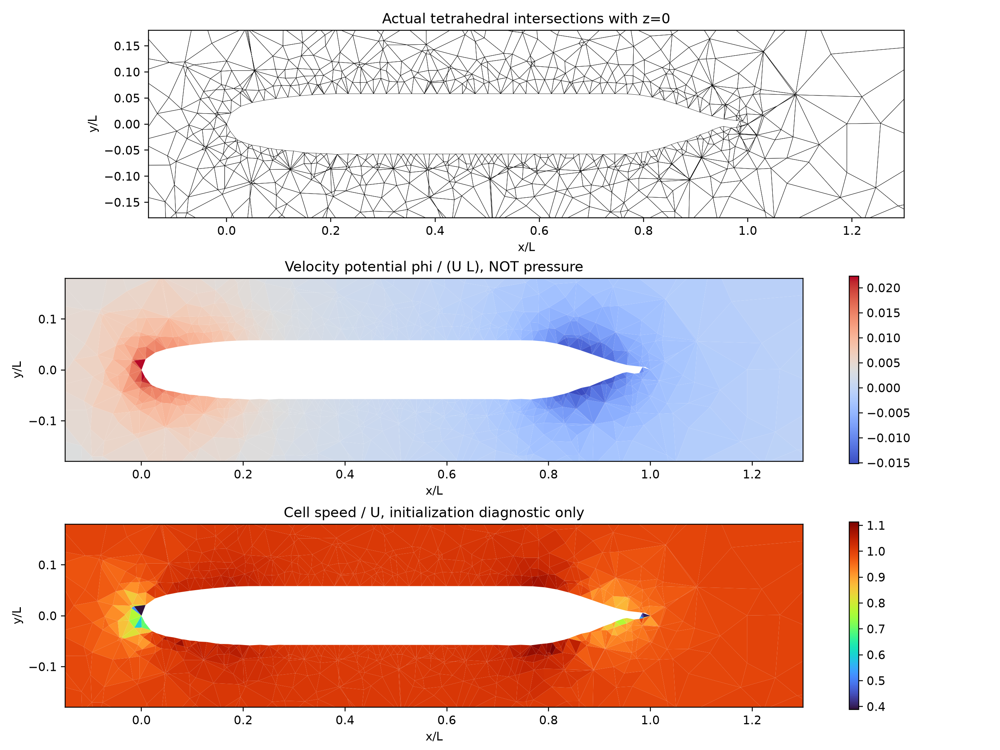

# SUBOFF parallel development: first integrated delivery

**SUBOFF viscous-flow accuracy remains unqualified. This delivery prepares actual body-fitted geometry, general static 3D operators, native-face initialization and restricted pressure-boundary corrections. It does not publish a validated SUBOFF Navier--Stokes result.**

## Parallel implementation

| Workstream | Implemented result | Qualification scope |
| --- | --- | --- |
| Geometry and mesh | TensorLBM bare AFF-1 profile port with original source SHA; Gmsh OCC body-fitted tetrahedra, 6,810 / 13,977 cells | Bare geometry and closed positive mesh only; no appendages or prism boundary layer |
| General 3D interface | NativeMesh3D: Gmsh, unique shared faces, owner/neighbor, actual volumes/centers/area vectors and physical patches; NativeOperators3D: conservative integration and affine reconstruction | Linear convex tetra/hex/wedge/pyramid with planar faces; rejects unsupported topology |
| Pressure compatibility | Same nonzero pressure Neumann data in LS, face flux and conservative traction; optional dt-independent initialization in the cylinder kernel | Restricted opt-in correction; complete coupling and spatial pressure convergence still fail |
| Integrated SUBOFF projection | Full nonorthogonal mixed-boundary scalar operator and CPU sparse LU on both actual SUBOFF meshes | Native-face initialization diagnostic; scalar is velocity potential, not physical pressure |

## Actual SUBOFF meshes and computed initialization

[Geometry preparation and dimensions](../verification-suboff-mesh/report.md); [native topology and affine operator audit](../verification-suboff-native-contract/report.md).


[Coarse initialization report](../verification-suboff-projection/coarse/report.md) and [medium report](../verification-suboff-projection/medium/report.md) archive the input mesh, raw fields, source snapshots, mixed-boundary data, independent affine manufacture and actual LU costs.



No viscosity, Reynolds number or physical time evolution is used in this SUBOFF initialization. At the wall the potential normal derivative removes native normal penetration; inlet/farfield prescribed normal flux is retained, and outlet potential is zero. Each plot explicitly distinguishes velocity potential from physical pressure. Native-face mass conservation does not make the independently corrected cell velocity incompressible.

| Mesh | Cells | Native divergence U/L | Max cell/face normal difference / U | Interpolated cell divergence U/L | Projection contract |
| --- | ---: | ---: | ---: | ---: | --- |
| coarse | 6,810 | 1.737e-12 | 0.16333 | 80.847 | True |
| medium | 13,977 | 1.869e-12 | 0.13472 | 80.101 | True |

Affine scalar tests on the actual SUBOFF mesh give gradient errors about 1.3e-13, with prescribed analytic Neumann/Dirichlet data. These are independent operator responses, not physical benchmark accuracy. Both SUBOFF numerical-flow and physical-accuracy qualifications remain false.

## Pressure--velocity compatibility correction

[Full six-run report](../verification-transient-pressure-compatibility/report.md) includes old startup, projected startup on three body-fitted cylinder grids, complete time-step halving, unsmoothed pressure/velocity fields and failed common-module gates.

The 24,576-cell cylinder maximum normal cell/face difference decreases from 23.90% to 1.428%; 55,296 cells give 1.018%. However, interpolated-cell divergence remains 3.876/3.626 U/D. Medium-to-fine wall Cp differs 14.76%, exceeding 3%. All six common acceptance results remain false. The complete dt/half-dt wall Cp difference is 0.01568% and initial projected fields are bitwise identical. A conservative initialization improves the defect; it does not prove a matching pressure--velocity operator or long-time physical correctness.

The correction is deliberately opt-in via `TransientSettings(initial_projection=True)`; default existing initial conditions remain unchanged. A checkpoint regression verifies projected initialization evidence and subsequent field/history/statistical continuation bitwise. The velocity potential is distinct from actual transient pressure.

## Integration verification

**62 tests passed**, with one existing PyTorch index_reduce beta warning. They cover native geometry, mixed-boundary affine pressure and projection, shared-face conservation, legacy three-element paths, failed stability gates and both initialization/restart paths. [validation.json](validation.json) binds test sources; [pytest-output.txt](pytest-output.txt) preserves the actual completed output. A passed regression suite does not supersede failed physical or cell/face gates.

## Reproduction

```bash
export PYTHONPATH=src OMP_NUM_THREADS=1 OPENBLAS_NUM_THREADS=1 MKL_NUM_THREADS=1
python scripts/prepare_suboff_mesh.py --output results/suboff-mesh
python scripts/verify_native_mesh3d.py results/suboff-mesh/suboff.msh --output results/suboff-mesh-audit
python scripts/initialize_suboff_native.py --mesh results/suboff-mesh/suboff.msh --output results/suboff-initialization
python scripts/verify_transient_pressure_compatibility.py --output results/pressure-compatibility
python scripts/run_body_fitted_cylinder3900.py --output results/cylinder-hodge --nx 64 --ny 32 --nz 12 --stretching 7 --dt 1e-5 --steps 50 --initial-projection
```

Use a fresh output directory. Benchmark/mesh extras supply NumPy, SciPy, Matplotlib and Gmsh. Tested interpreter is `/data/TensorFEM/.venv/bin/python`. CPU reference factorization is measured; GPU acceleration is untested in these paths.

## Next development gate

1. General native 3D conservative viscous momentum and its pressure response; independent manufactured stress, local momentum, boundary-flux and cell/face checks.
2. Low-Re bare-SUBOFF diagnostic with actual pressure, viscous force, histories and demonstrated convergence; distinguish this from experimental-Reynolds comparisons.
3. Boundary-layer and wake refinement, domain sensitivity, verified turbulence/wall treatment and primary reference ingestion before a 3% physical accuracy claim.
4. AFF-8 appendages with conforming junction geometry/mesh, followed by the same verification sequence.

This delivery does not infer drag/Cp from the startup potential or claim that geometry-only tests validate turbulent SUBOFF flow. The unresolved compatibility errors remain visible and determine the next work.
