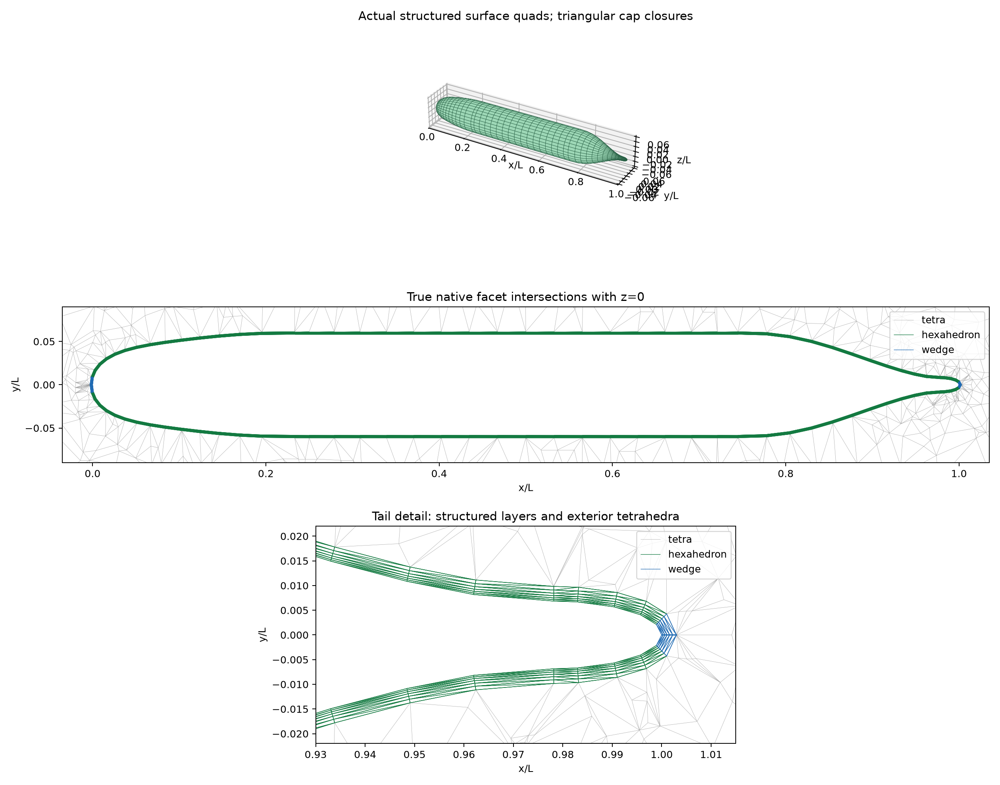

# SUBOFF structured near-wall / unstructured exterior mesh

## Geometry and use

Bare AFF-1 mother profile from TensorLBM (source SHA256 `435bd062a90d6881784734fa614f033e880b310111200436e8b13950fbccae02`). The original experiment offset table remains independently unverified. Length 4.35610010 m. Surface coordinates use cosine-spaced axial stations with the nearest interior samples replaced by the three exact polynomial junctions (avoiding nearly coincident points), uniform periodic azimuth, and finite-difference meridian normals. Both tips close on the axis using wedges, rather than repeated degenerate hexahedra. Normal layer distances are measured from the same original surface, without accumulating marching-normal drift.

Actual mesh: **8832 near-wall hexes**, **384 cap wedges**, **15068 exterior tetrahedra**. 6 layers, first height 0.0003 L = 0.00130683 m, growth 1.2, total thickness 0.00297898 L. These are geometry-development parameters, not a Reynolds/y+ design.

Gmsh 4.15.2 meshes the exterior of the imposed layer skin inside a [-1,3] × [-1,1] × [-1,1] L box. This is genuine unstructured tetrahedral generation. Every outer structured quad is divided on its smallest-vertex-ID diagonal. The exact triangles are imposed on Gmsh and shared in the finite-volume importer: **3008 verified internal triangles**. No overset interpolation or pyramid transition is used. The native volume mesh retains hex/wedge cell types; only FV integration faces are triangulated.

```python
from tensorfvm.native_mesh3d import NativeMesh3D
mesh = NativeMesh3D.from_gmsh('suboff-hybrid.msh', triangulate_faces=True)
```

The opt-in mode treats warped quads as two planar facets, not as bilinear curved faces. File node tags are sorted before triangulation to preserve diagonal choices across round-trips. The default planar-face importer remains strict.

## Mesh evidence



Green: hex facets; blue: cap-wedge facets; gray: exterior tetrahedral facets. The lower panels intersect actual native facets with z=0; they do not project off-plane edges. Displayed diagonals reflect the actual FV face representation. No pressure or velocity solution is shown.

## Verification

- Minimum volume: 1.50383e-10 L³.
- Maximum relative cell closure: 2.75967e-16.
- Minimum S·d: 7.03184e-11.
- Maximum nonorthogonality: 88.6983 degrees.
- Maximum of affine reconstruction / gradient / divergence audit errors: 5.13434e-12.
- Arbitrary internal interface flux global cancellation: 1.06581e-14.
- Fluid + faceted body volume vs box-volume error: 0 L³.
- Sampled wall-node radial error (including explicitly closed tip): 3.81639e-17 L.
- Geometry gates: **True**; numerical/physical flow qualified: **False**.

Full per-metric values are in `summary.json`; `.msh` and `native-geometry.npz` retain native geometry. Source snapshots and SHA256 manifest bind this execution. The PNG/PDF are mesh figures, not a flow report.

## Limits and next gates

This is a thin-layer mesh feasibility result. Surface facet chord error, normal-offset discretization, high aspect ratio, layer/exterior size jump and tail quality need refinement studies before viscous use. Maximum nonorthogonality alone does not certify suitability for turbulence. Fixed outer-domain dimensions are not a domain-independence study. No attachments, y+, wall model, viscous momentum solution, GPU qualification, force/Cp convergence or <3% claim. Layer thickness >0.02 L is rejected pending offset collision controls; candidate meshes fail immediately on invalid geometric projections.

TensorLBM `dg_curv.py` motivated layer height/growth and local-normal geometry, but its DG geometric factors and exterior coupling are not copied into this FVM geometry. SUBOFF DG-band tests do not certify this mesh.

## Reproduction

```bash
OMP_NUM_THREADS=1 OPENBLAS_NUM_THREADS=1 MKL_NUM_THREADS=1 PYTHONPATH=src /data/TensorFEM/.venv/bin/python scripts/prepare_suboff_hybrid_mesh.py --output NEW_EMPTY_DIRECTORY --axial 48 --azimuthal 32 --layers 6 --first-height 0.0003 --growth 1.2 --far-size 0.3
```
