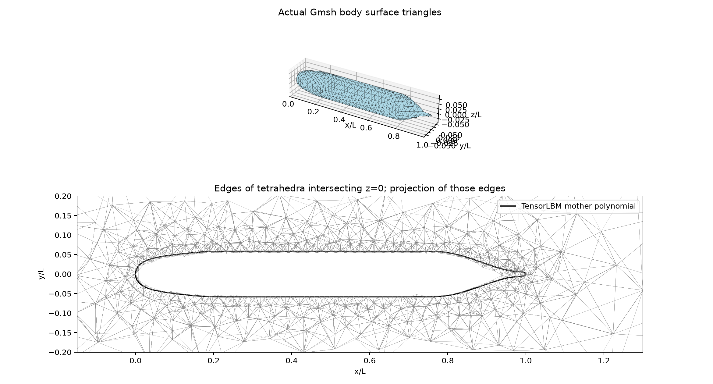

# SUBOFF AFF-1 geometry and mesh preparation

The mother hull is ported from TensorLBM's `suboff_cad.py` (SHA256 `435bd062a90d6881784734fa614f033e880b310111200436e8b13950fbccae02`), preserving its four polynomial segments and original feet dimensions. The source attributes these to Groves, Huang and Chang (1989), DTRC/SHD-1298-01; this stage does not independently certify the original offset tables. Hull length 4.35610010 m, diameter 0.11661807 L. Axis x, bow x=0, stern x=1.

The OCC segmented spline meridian is revolved, then subtracted from a [-1,3]×[-1,1]×[-1,1] L box. Gmsh 4.15.2 generated 13977 actual tetrahedra and 3313 nodes, with wall/inlet/outlet/farfield physical patches. Maximum mesh-node radial discrepancy from the mother polynomial: 2.13676e-08 L. This is an interpolation diagnostic, not a global Hausdorff certification. The outer boundary is deliberately a geometry development domain, not a domain independence result.



## Reproduction

```bash
OMP_NUM_THREADS=1 OPENBLAS_NUM_THREADS=1 MKL_NUM_THREADS=1 PYTHONPATH=src /data/TensorFEM/.venv/bin/python scripts/prepare_suboff_mesh.py --output NEW_DIRECTORY --wall-size 0.025 --far-size 0.3
```

## Acceptance scope

Body-fitted tetrahedral geometry preparation only. No boundary layer prism cells, no flow solution, no y+ estimate, no drag/Cp validation, no mesh convergence, and no <3% claim. AFF-8 appendages are not included. Turbulent experimental-Reynolds computation must first add wall resolution and verified 3D pressure/velocity coupling. `suboff.msh` carries native topology and physical patch IDs for the generic 3D importer.
