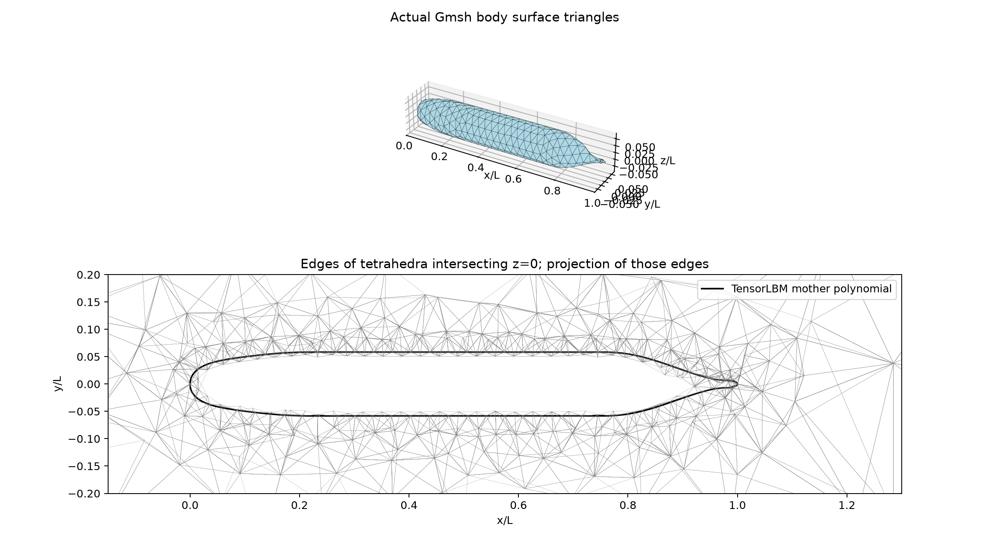

# SUBOFF body-fitted geometry and mesh preparation

## Geometry and software

The bare AFF-1 mother-hull meridian is reused from the adjacent TensorLBM `src/tensorlbm/suboff_cad.py`, preserving all four radius-profile polynomial segments bit for bit over 10,001 comparison stations and segment breakpoints. The complete original module is archived as [tensorlbm-suboff-cad-source.py](tensorlbm-suboff-cad-source.py), SHA256 `435bd062a90d6881784734fa614f033e880b310111200436e8b13950fbccae02`. TensorFVM does not import Torch or TensorLBM to generate this hull. Source attribution is Groves, Huang and Chang (1989), DTRC/SHD-1298-01, as stated by TensorLBM; the original offset report has not been independently ingested in this stage.

Dimensions use the source's feet constants, L=14.291667 ft=4.3561001016 m and R=0.8333333 ft. Thus D/L=0.1166180684. TensorLBM's rounded default L/D=8.57 gives a radius 0.05835% larger; this preparation deliberately uses the original dimensional constants. The axial stations and normalized polynomial are unchanged. Coordinates are x/L in [0,1], bow upstream; y and z transverse.

Gmsh 4.15.2 interpolates four segmented splines with 65 cosine-clustered stations per segment, revolves the closed meridian, subtracts the solid from the outer box, and generates native tetrahedra. Actual wall surface nodes lie on the revolved CAD. This is a conforming body-fitted unstructured mesh. It carries wall/inlet/outlet/farfield physical patches, plus a fluid volume. Domain [-1,3]×[-1,1]×[-1,1] L is a development choice, not an established domain independent setup.

## Actual generated meshes

| Quantity | Coarse | Medium |
|---|---:|---:|
| Nodes | 1,852 | 3,313 |
| Tetrahedral cells | 6,810 | 13,977 |
| Wall triangles | 662 | 1,246 |
| Wall mesh size / L | 0.035 | 0.025 |
| Minimum cell volume / L³ | 5.668e-8 | 4.644e-8 |
| Maximum relative cell face closure | 1.459e-16 | 1.386e-16 |
| Maximum nonorthogonality | 62.55° | 57.46° |
| Minimum face S·d | 4.251e-8 | 3.483e-8 |
| Maximum wall-node radial error / L | 1.125e-8 | 2.137e-8 |

All reported values are from actual Gmsh files and the shared NativeMesh3D importer. Wall-node radial error is a CAD interpolation diagnostic, not a Hausdorff certificate for the linear mesh surface. Positive S·d and closed cells qualify these geometry checks only.




The lower panels project edges of tetrahedra intersecting z=0; they are labeled as projected edges, rather than a false planar triangulation. The upper panels show actual wall triangles.

## Reproduction and artifacts

```bash
OMP_NUM_THREADS=1 OPENBLAS_NUM_THREADS=1 MKL_NUM_THREADS=1 PYTHONPATH=src /data/TensorFEM/.venv/bin/python scripts/prepare_suboff_mesh.py --output NEW_COARSE
OMP_NUM_THREADS=1 OPENBLAS_NUM_THREADS=1 MKL_NUM_THREADS=1 PYTHONPATH=src /data/TensorFEM/.venv/bin/python scripts/prepare_suboff_mesh.py --output NEW_MEDIUM --wall-size .025 --far-size .3
```

An existing nonempty output directory is rejected. [Coarse case](source-bound-coarse/report.md) and [medium case](medium/report.md) include the native `.msh`, JSON geometry audit, mesh PNG/SVG, figure PDF, launch source snapshots, and SHA256 manifests. `coarse/` preserves the first successful development artifact; `source-bound-coarse/` is the same-size reproducible case with complete producer binding. Generic mesh and operator validation is separately maintained by the 3D interface development task.

Tests: `tests/test_suboff_geometry.py` — three tests passed: original-source hash and exact polynomial port, dimensions/profile behavior, and real Gmsh tetrahedra with physical patches. The generating pipeline and Python executable are stated in each case.

## Qualification and next steps

**Flow accuracy remains unqualified.** These meshes have no boundary layer prism cells and no claimed y+, Cp/drag error, mesh convergence, or experimental Reynolds capability. The two generated grids are geometry preparation, not two-grid flow convergence. No computed pressure or velocity fields are manufactured. The next stage is the shared 3D mesh/solver diagnostic at low Reynolds number, then pressure/velocity coupling and wall resolution verification before experimental-Reynolds comparisons. AFF-8 appendages require conforming solid union and junction refinement and are not included in the present AFF-1 result.
