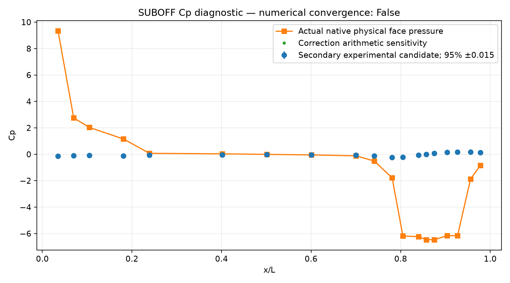
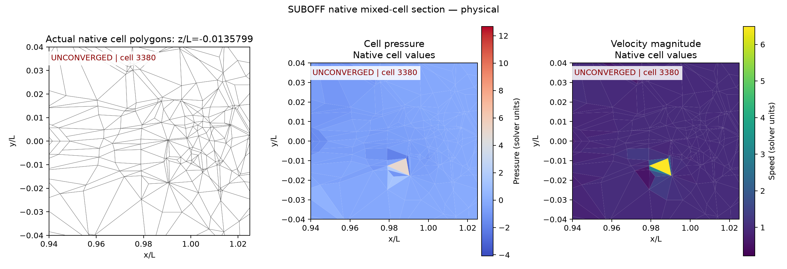

# SUBOFF AFF-1：物理诊断、实验对照与未通过项

**状态：未收敛、未达标。当前没有完成的 SUBOFF SST 耦合解，没有三档网格收敛结论。**

## 主要结果

已经运行两个独立实验工况：Cp 使用 Re_L=1.2e7；阻力使用公开复现工况 Re_L=13218056.809580836。均为裸艇、零攻角、真实无滑移壁面、共形贴体单域 FVM。SST-2003 与原参考参数保持明确记录，未根据实验调节压力常数或力系数。

相同二阶离散设置的两个诊断，在第 2 个动量步因最大速度超过显式保护阈值 5U 而停止，**没有完成第一个 SST 外迭代**。因此下表仅量化保存下来的失败场，不能解释为已收敛物理解的误差。

| 主指标 | 当前失败场对照 | 要求 | 验收 |
|---|---:|---:|---|
| 19 测点 Cp 曲线相对 L2 偏差 | 3,422.59% | <3% | 未通过 |
| Cp 绝对 RMSE | 4.29100 | 补充指标 | — |
| 总 Cd | 13.080758；参考 0.093120813 | 相对偏差 <3% | 未通过 |
| 总 Cd 相对偏差 | 13,947.08% | <3% | 未通过 |
| 总阻力 | 12,277.15 N；参考 87.4 N | 同上 | 未通过 |

[完整物理诊断报告](physical-report/report.md)包含问题、模型与软件设置、真实网格切面、压力/速度场、Cp 对照、逐点 CSV、力分解、残差及 y+。



Cp 比较采用真实壁面三角形压力，按参考测点就近采样，固定自由流压力基准；分母是整条参考曲线的 L2 范数，未对近零测点取不稳定的逐点百分比。总 Cd 使用压力加全部黏性/雷诺应力，并以迎流截面积归一化。原始面力独立重积分与结果一致。

Cp 表为已有的二级转录候选数据，±0.015 是文献报告的绝对不确定度；修正列的微小差异保留并另作敏感性对照。阻力 87.4 N 来自实验；密度、黏度属于已公开的 CFD 复现条件。详见[参考来源审计](../verification-suboff-reference/README.md)。资料核验未阻止本轮直接比较。

## 修复与受控诊断

1. **压力出口回流的动量取值**：原算法在出口回流时仍取内部单元速度，给对流对角线加入负项。从静止场启动时，20 个出口单元因此失败。改为明确给定的回流来流速度；共享面守恒、流入/流出方向有测试覆盖。
2. **启动状态不能冒充计算结果**：原失败场 y+=0 只表示零速度初始化。比较器现在拒绝没有完成动量迭代的场，近壁资格还要求数值收敛；原始错误标志保留并附审计说明。
3. **重复内迭代和重启保留修正面通量**：提供带形状/有限值检查的数值状态恢复接口；不同网格或 Re 的重启会被拒绝。
4. **可选局部伪时间**：动量对角线上加入局部质量项，同时更新隐式 Rhie–Chow 响应，并将相对原稳态响应的差值用旧压力延迟处理。在固定点恢复原稳态通量；当前原方程残差仍是验收依据。独立仿射解析解与非仿射压力离散解验证了固定点一致性。此选项仍是诊断工具，未使本例通过。
5. **质量守恒的初始通量对照**：使用共性 Hodge 投影模块，保持固定边界通量。势函数没有被当作物理压力。投影后初始散度降至 8.70e-11 U/L，但后续仍触发速度保护。

| 诊断 | 动量步数 | 末步最大速度 / U | 完整 SST 步数 | 状态 |
|---|---:|---:|---:|---|
| 原始静止启动 | 0 | 0 | 0 | 非正对角项，禁止实验比较 |
| 修复回流，未加伪时间 | 1 | Cp 73.19；阻力 73.89 | 0 | 中止，保留日志；无最终原场 |
| 只给动量加伪时间 | 2 | Cp 687.89；阻力 702.17 | 0 | 保护停止；[失败场报告](failed-pseudo-report/report.md) |
| 一致伪时间，二阶对流 | 2 | Cp 6.4934；阻力 6.4932 | 0 | 保护停止；主报告对应此组 |
| 一致伪时间，一阶迎风 | 2 | 6.4458 | 0 | 保护停止；[Cp 对照](cp-first-order-comparison/report.md) |
| 一阶迎风，加初始通量投影 | 2 | 6.5130 | 0 | 保护停止；[Cp 对照](cp-projected-comparison/report.md) |

另外两个 MMD_AT_PLUS_A 排序尝试分别在 5 分 34 秒、3 分 43 秒时中止，均未完成第一步。恢复默认 COLAMD 后首个动量步约需 93–101 秒。此处只记录本机运行成本，不是受控性能排名。所有中止和不利结果均保留，未计入合格 benchmark。

## 异常位置与下一步

二阶与一阶对照的最大速度均在外部四面体 **3380**，中心约 `(0.984594, -0.012862, -0.013580)L`；距壁约 0.01272L。二阶压力极值也在艇尾外层四面体。详见[原场极值与面通量独立重放](startup-audit/audit.json)。



这些证据表明，仅关闭高阶对流修正、投影初始通量或改变伪时间还不够；目前也不能将失败归因于 SST 常数或壁面函数，因为尚未进行湍流输运更新。保护阈值是主动中止条件，不是对任何更长迭代轨迹的数学发散证明。

下一开发顺序：

1. 对艇尾混合网格提取更小的真实局部复现，检查动量/压力边界响应、非正交压力通量与局部迭代稳定性；保留所有原方程收敛检查。
2. 完成稳定的真实无滑移动量解，再完成 SST 输运与实际 y+ 检查；保留原实验工况与 Cp/Cd 定义。
3. 在相同壁面几何的近壁层对照上检验敏感性，再增加表面/尾流分辨率，完成三档网格和计算域独立性。
4. 两项主指标均通过后再推进带附体和 overset；本轮未增加物理合格案例数，未开展 FVM–LBM 耦合或 GPU 资格声明。

## 近壁网格

新网格为 **15,419 单元、20 层、首层全高 2e-6 L**；原诊断网格为 **9,068 单元、3 层、首层全高 6e-4 L**。实际壁面三角形逐面相同，外部四面体随层厚变化重新生成。

[网格图与共形/闭合检查](wall-resolved-pilot-mesh/report.md)、[分组质量](wall-resolved-quality/quality.json)、[相同表面与最近壁距对照](wall-layer-comparison/report.md)。新网格尚未运行物理流场。

假定 Cf=0.003，仅用于规划：两工况估计最大 y+ 从约 138/152 降至 0.457/0.503。**这不是根据计算壁面应力得到的 y+ 资格**。新网格层内面最大非正交角 9.26°，结构化/四面体接口 70.72°，三角壁面接近 90°；薄层几何通过不能替代离散与收敛检查。

## 复现与验证

在仓库根目录运行，输出路径必须是空目录：

```bash
export OMP_NUM_THREADS=1 OPENBLAS_NUM_THREADS=1 MKL_NUM_THREADS=1 PYTHONPATH=src
/data/TensorFEM/.venv/bin/python scripts/run_native_suboff_rans.py \
  --mesh docs/verification-suboff-single-domain-mesh/coarse-tail-transition/suboff-hybrid.msh \
  --output NEW_CP_RUN --reynolds 12000000 --inner-iterations 8 --outer-iterations 5 \
  --pseudo-dt 0.01 --momentum-cfl 0.5 --maximum-speed 5
# 阻力工况同设置，Re 改为 13218056.809580836，使用另一个空输出目录。
# 对照一阶迎风：加 --convection-order 1。
# 对照初始投影：在一阶设置上加 --project-initial-flux。
/data/TensorFEM/.venv/bin/python scripts/compare_native_suboff_experiment.py \
  --run NEW_CP_RUN --case cp --output NEW_CP_COMPARISON
```

原始计算源代码在每例 `source-snapshot/`；报告、比较器、网格与审计生产脚本也各自归档。不同阶段源码有所不同，应使用各自快照复放历史失败尝试。当前源码包含后续重启和投影功能，启动默认值也与最早原始失败尝试不同。

50 项针对性测试通过，见 [tests.txt](tests.txt)。它们验证实现、固定点、边界和绘图逻辑，不授予物理准确度。`campaign-manifest.json` 绑定本目录全部文件及本次发布源码/测试快照；`evidence-audit.json` 记录源文件哈希、网格哈希和原场力重放的核验结果。
