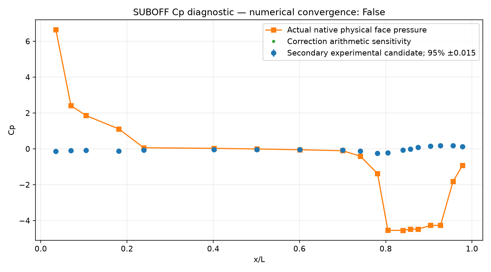

# SUBOFF cp experimental comparison

Case: aff1_cp_wind_tunnel. Nominal metric passed: **False**.
Numerically converged: **False**.
All-case physical validation: **false**; a refinement study remains required.

| Computed/reference metric | Value |
|---|---:|
| p_infinity | 0 |
| nominal_relative_L2_error | 24.745923 |
| correction_sensitivity_relative_L2_error | 24.751257 |
| absolute_RMSE | 3.1024693 |
| experimental_Cp_95_absolute_uncertainty | 0.015 |

See `comparison.json` for actual raw metrics, input hashes, reference qualification
and uncertainty. The reference specification is frozen alongside this report.

